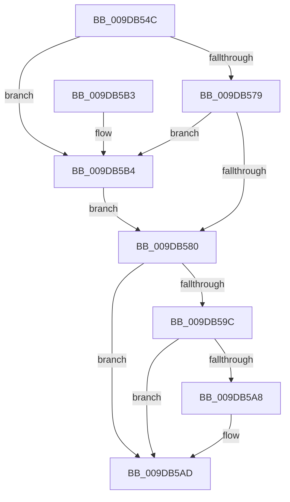

# ObpUnlockObjectType

- RVA: `0x009DB54C`–`0x009DB5BE` (길이 `114` bytes)
- VA: `0x00000001409DB54C`
- 실행 섹션: `PAGE`
- PDB 이름 있음: `예`; PDB Function 태그: `아니요`
- unwind 정보 RVA: `0x00064CA8`
- 디코드: `33`개 명령, `114/114` bytes 표시
- 미해석 바이트: `0` (있으면 어셈블리에 `.byte`로 보존)

> 이 문서는 커널 이미지의 기계어와 PDB 기호를 분석해 생성했습니다. 4번과 5번은 함수 원형과 자료형을 바이너리 사용 방식에서 추정한 C 해석이며 원본 소스 복구 결과는 아닙니다.

## 1. Dependencies

- 직접 호출 지점: **3**; 고유 호출 대상: **3**
- 직접 호출자로 확인된 함수: **6**
- RIP 상대 이미지 참조: **0**

### Outgoing calls
- `0x009DB583` → [KeAbPostRelease](../../text/2E/KeAbPostRelease_function_002E1600.md) (function, `0x002E1600`)
- `0x009DB5A8` → [KiCheckForKernelApcDelivery](../../text/2E/KiCheckForKernelApcDelivery_function_002E2C80.md) (function, `0x002E2C80`)
- `0x009DB5B7` → [ExfReleasePushLock](../../text/26/ExfReleasePushLock_function_002638D0.md) (function, `0x002638D0`)

### Direct callers
- [ObUnRegisterCallbacks](../74/ObUnRegisterCallbacks_function_0074F260.md) at `0x0074F2B6`
- [ObRegisterCallbacks](ObRegisterCallbacks_function_009DAB00.md) at `0x009DACE0`
- [ObpInsertCallbackByAltitude](ObpInsertCallbackByAltitude_function_009DAD34.md) at `0x009DADB9`
- [ObpCreateTypeArray](ObpCreateTypeArray_function_009DB4B4.md) at `0x009DB4E4`
- [ObCreateObjectTypeEx](../AB/ObCreateObjectTypeEx_function_00AB46D0.md) at `0x00AB4C3D`
- [ExpWorkerInitialization](../../init/C5/ExpWorkerInitialization_function_00C539A4.md) at `0x00C53C5F`

### Static image references
- 디코드된 RIP-relative 메모리 참조가 없습니다.

## 2. Other-region calls and transfers

- 다른 실행 섹션으로 향하는 call: **3**
  - `0x009DB583` → [KeAbPostRelease](../../text/2E/KeAbPostRelease_function_002E1600.md) (`PAGE` → `.text`)
  - `0x009DB5A8` → [KiCheckForKernelApcDelivery](../../text/2E/KiCheckForKernelApcDelivery_function_002E2C80.md) (`PAGE` → `.text`)
  - `0x009DB5B7` → [ExfReleasePushLock](../../text/26/ExfReleasePushLock_function_002638D0.md) (`PAGE` → `.text`)
- 별도 외부 분기/꼬리 이동을 확인하지 못했습니다.

## 3. Assembly (complete function range)

```asm
009DB54C  40 53                           push rbx
009DB54E  48 83 EC 20                     sub rsp, 0x20
009DB552  48 8D 99 B8 00 00 00            lea rbx, [rcx + 0xb8]
009DB559  0F 0D 0B                        prefetchw byte ptr [rbx]
009DB55C  48 8B 03                        mov rax, qword ptr [rbx]
009DB55F  45 33 C0                        xor r8d, r8d
009DB562  48 8B C8                        mov rcx, rax
009DB565  48 83 E1 F0                     and rcx, 0xfffffffffffffff0
009DB569  48 83 F9 10                     cmp rcx, 0x10
009DB56D  48 8D 50 F0                     lea rdx, [rax - 0x10]
009DB571  49 0F 46 D0                     cmovbe rdx, r8
009DB575  A8 02                           test al, 2
009DB577  75 3B                           jne 0x1409db5b4
009DB579  F0 48 0F B1 13                  lock cmpxchg qword ptr [rbx], rdx
009DB57E  75 34                           jne 0x1409db5b4
009DB580  48 8B CB                        mov rcx, rbx
009DB583  E8 78 60 90 FF                  call 0x1402e1600
009DB588  65 48 8B 04 25 88 01 00 00      mov rax, qword ptr gs:[0x188]
009DB591  90                              nop
009DB592  66 83 80 E6 01 00 00 01         add word ptr [rax + 0x1e6], 1
009DB59A  75 11                           jne 0x1409db5ad
009DB59C  48 05 98 00 00 00               add rax, 0x98
009DB5A2  90                              nop
009DB5A3  48 39 00                        cmp qword ptr [rax], rax
009DB5A6  74 05                           je 0x1409db5ad
009DB5A8  E8 D3 76 90 FF                  call 0x1402e2c80
009DB5AD  48 83 C4 20                     add rsp, 0x20
009DB5B1  5B                              pop rbx
009DB5B2  C3                              ret
009DB5B3  CC                              int3
009DB5B4  48 8B CB                        mov rcx, rbx
009DB5B7  E8 14 83 88 FF                  call 0x1402638d0
009DB5BC  EB C2                           jmp 0x1409db580
```

## 4. C-style interpretation (structured pseudocode)

```c
__int64 __fastcall ObpUnlockObjectType(__int64 a1, __int64 a2, int a3)
{
    __int64 result;
    __int64 v_rsp;

    v_rsp = (v_rsp) - (32);
    a3 = 0;
    a1 = (*(unsigned __int64 *)(a1 + 184)) & (-16);
    a2 = *(unsigned __int64 *)(a1 + 184) - 16;
    if (a1 <= 16) { a2 = 0; }
    if ((((unsigned __int8)(*(unsigned __int64 *)(a1 + 184))) & (2)) != 0) goto loc_009DB5B4;
    if ((((unsigned __int8)(*(unsigned __int64 *)(a1 + 184))) & (2)) != 0) goto loc_009DB5B4;
loc_009DB580:
    result = KeAbPostRelease(a1 + 184, a2, a3, a4);
    if ((((unsigned __int8)(*(unsigned __int64 *)(a1 + 184))) & (2)) != 0) goto loc_009DB5AD;
    result = (*(unsigned __int64 *)(gs_base + (0 + 392))) + (152);
    if ((*(unsigned __int64 *)(result)) != result) {
        result = KiCheckForKernelApcDelivery(a1 + 184, a2, a3, a4);
    }
    v_rsp = (v_rsp) + (32);
    return result;
loc_009DB5B4:
    result = ExfReleasePushLock(a1 + 184, a2, a3, a4);
    goto loc_009DB580;
}
```

## 5. (Beta) C Style

```c
int64_t ObpUnlockObjectType(void *Arg1, int64_t Arg2, int32_t Arg3)
{
    uint8_t *arg1 = (uint8_t *)Arg1;

    int64_t result;
    int64_t local_rsp;

    local_rsp = (local_rsp) - (32);
    Arg3 = 0;
    Arg1 = (*(uint64_t *)(arg1 + 0xB8)) & (-16);
    Arg2 = *(uint64_t *)(arg1 + 0xB8) - 16;
    if (Arg1 <= 16) { Arg2 = 0; }
    if ((((uint8_t)(*(uint64_t *)(arg1 + 0xB8))) & (2)) != 0) goto loc_009DB5B4;
    if ((((uint8_t)(*(uint64_t *)(arg1 + 0xB8))) & (2)) != 0) goto loc_009DB5B4;
loc_009DB580:
    result = KeAbPostRelease(Arg1 + 184, Arg2, Arg3, a4);
    if ((((uint8_t)(*(uint64_t *)(arg1 + 0xB8))) & (2)) != 0) goto loc_009DB5AD;
    result = (*(uint64_t *)(gs_base + (0 + 0x188))) + (152);
    if ((*(uint64_t *)(result)) != result) {
        result = KiCheckForKernelApcDelivery(Arg1 + 184, Arg2, Arg3, a4);
    }
    local_rsp = (local_rsp) + (32);
    return result;
loc_009DB5B4:
    result = ExfReleasePushLock(Arg1 + 184, Arg2, Arg3, a4);
    goto loc_009DB580;
}
```

### 관측된 메모리 오프셋

구조체 형식이 확인되지 않은 접근은 인자 기준의 오프셋으로만 기록했습니다.

| 기준 인자 | 오프셋 표현 | 폭 (bit) | 접근 |
|---|---:|---:|---|
| `Arg1` | `+ 0x0` | `8` | `R` |
| `Arg1` | `+ 0x0` | `64` | `R` |
| `Arg1` | `+ 0xB8` | `64` | `R` |

## 6. Execution-region graph

[열기: 2D/3D 그래프와 함수 탐색 컨트롤 패널](../../../control-panel.html?section=page&rva=0x009DB54C&view=graph)

- 2D 그래프는 위에서 아래로 흐르고, 3D 그래프는 빈 공간을 드래그해 회전합니다. Shift+드래그는 이동, 휠은 확대·축소, 함수 노드 선택은 대상 보고서 이동입니다.

### Static fallback


