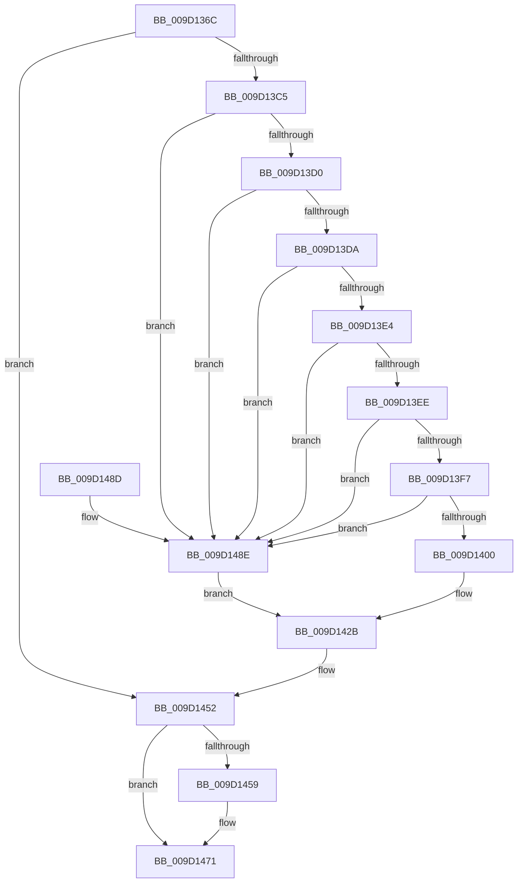

# PiCMGetDeviceStatus

- RVA: `0x009D136C`–`0x009D1495` (길이 `297` bytes)
- VA: `0x00000001409D136C`
- 실행 섹션: `PAGE`
- PDB 이름 있음: `예`; PDB Function 태그: `아니요`
- unwind 정보 RVA: `0x000A13C8`
- 디코드: `76`개 명령, `297/297` bytes 표시
- 미해석 바이트: `0` (있으면 어셈블리에 `.byte`로 보존)

> 이 문서는 커널 이미지의 기계어와 PDB 기호를 분석해 생성했습니다. 4번과 5번은 함수 원형과 자료형을 바이너리 사용 방식에서 추정한 C 해석이며 원본 소스 복구 결과는 아닙니다.

## 1. Dependencies

- 직접 호출 지점: **4**; 고유 호출 대상: **4**
- 직접 호출자로 확인된 함수: **1**
- RIP 상대 이미지 참조: **1**

### Outgoing calls
- `0x009D13B6` → [PiCMCaptureObjectInputData](../8E/PiCMCaptureObjectInputData_function_008E8220.md) (function, `0x008E8220`)
- `0x009D1424` → [CmGetDeviceStatus](CmGetDeviceStatus_function_009D154C.md) (function, `0x009D154C`)
- `0x009D144B` → [PiCMReturnStatusResultData](PiCMReturnStatusResultData_function_009D149C.md) (function, `0x009D149C`)
- `0x009D146C` → [PiControlFreeUserModeCallersBuffer](../../text/44/PiControlFreeUserModeCallersBuffer_function_00448990.md) (function, `0x00448990`)

### Direct callers
- [PiCMHandleIoctl](../8E/PiCMHandleIoctl_function_008EB880.md) at `0x008EBF18`

### Static image references
- `0x009D1408` → RVA `0x00E66398` (`.data`; read)

## 2. Other-region calls and transfers

- 다른 실행 섹션으로 향하는 call: **1**
  - `0x009D146C` → [PiControlFreeUserModeCallersBuffer](../../text/44/PiControlFreeUserModeCallersBuffer_function_00448990.md) (`PAGE` → `.text`)
- 별도 외부 분기/꼬리 이동을 확인하지 못했습니다.

## 3. Assembly (complete function range)

```asm
009D136C  48 8B C4                        mov rax, rsp
009D136F  48 89 70 08                     mov qword ptr [rax + 8], rsi
009D1373  48 89 78 10                     mov qword ptr [rax + 0x10], rdi
009D1377  4C 89 70 18                     mov qword ptr [rax + 0x18], r14
009D137B  4C 89 78 20                     mov qword ptr [rax + 0x20], r15
009D137F  55                              push rbp
009D1380  48 8B EC                        mov rbp, rsp
009D1383  48 83 EC 70                     sub rsp, 0x70
009D1387  4C 8B 7D 38                     mov r15, qword ptr [rbp + 0x38]
009D138B  33 C0                           xor eax, eax
009D138D  21 45 D4                        and dword ptr [rbp - 0x2c], eax
009D1390  0F 57 C0                        xorps xmm0, xmm0
009D1393  21 45 D0                        and dword ptr [rbp - 0x30], eax
009D1396  41 8B F1                        mov esi, r9d
009D1399  21 45 38                        and dword ptr [rbp + 0x38], eax
009D139C  4C 8D 4D D8                     lea r9, [rbp - 0x28]
009D13A0  41 21 07                        and dword ptr [r15], eax
009D13A3  4D 8B F0                        mov r14, r8
009D13A6  44 8B 45 30                     mov r8d, dword ptr [rbp + 0x30]
009D13AA  0F 11 45 D8                     movups xmmword ptr [rbp - 0x28], xmm0
009D13AE  48 89 45 F8                     mov qword ptr [rbp - 8], rax
009D13B2  0F 11 45 E8                     movups xmmword ptr [rbp - 0x18], xmm0
009D13B6  E8 65 6E F1 FF                  call 0x1408e8220
009D13BB  8B F8                           mov edi, eax
009D13BD  85 C0                           test eax, eax
009D13BF  0F 88 8D 00 00 00               js 0x1409d1452
009D13C5  48 83 7D E8 00                  cmp qword ptr [rbp - 0x18], 0
009D13CA  0F 84 BE 00 00 00               je 0x1409d148e
009D13D0  83 7D DC 00                     cmp dword ptr [rbp - 0x24], 0
009D13D4  0F 85 B4 00 00 00               jne 0x1409d148e
009D13DA  83 7D E0 01                     cmp dword ptr [rbp - 0x20], 1
009D13DE  0F 85 AA 00 00 00               jne 0x1409d148e
009D13E4  83 7D F4 00                     cmp dword ptr [rbp - 0xc], 0
009D13E8  0F 85 A0 00 00 00               jne 0x1409d148e
009D13EE  4D 85 F6                        test r14, r14
009D13F1  0F 84 97 00 00 00               je 0x1409d148e
009D13F7  83 FE 14                        cmp esi, 0x14
009D13FA  0F 82 8E 00 00 00               jb 0x1409d148e
009D1400  48 8B 55 E8                     mov rdx, qword ptr [rbp - 0x18]
009D1404  48 8D 45 38                     lea rax, [rbp + 0x38]
009D1408  48 8B 0D 89 4F 49 00            mov rcx, qword ptr [rip + 0x494f89]
009D140F  4C 8D 4D D4                     lea r9, [rbp - 0x2c]
009D1413  48 89 44 24 28                  mov qword ptr [rsp + 0x28], rax
009D1418  45 33 C0                        xor r8d, r8d
009D141B  48 8D 45 D0                     lea rax, [rbp - 0x30]
009D141F  48 89 44 24 20                  mov qword ptr [rsp + 0x20], rax
009D1424  E8 23 01 00 00                  call 0x1409d154c
009D1429  8B C8                           mov ecx, eax
009D142B  8B 45 F8                        mov eax, dword ptr [rbp - 8]
009D142E  44 8B 4D 38                     mov r9d, dword ptr [rbp + 0x38]
009D1432  44 8B 45 D0                     mov r8d, dword ptr [rbp - 0x30]
009D1436  8B 55 D4                        mov edx, dword ptr [rbp - 0x2c]
009D1439  4C 89 7C 24 38                  mov qword ptr [rsp + 0x38], r15
009D143E  89 74 24 30                     mov dword ptr [rsp + 0x30], esi
009D1442  4C 89 74 24 28                  mov qword ptr [rsp + 0x28], r14
009D1447  89 44 24 20                     mov dword ptr [rsp + 0x20], eax
009D144B  E8 4C 00 00 00                  call 0x1409d149c
009D1450  8B F8                           mov edi, eax
009D1452  48 83 7D E8 00                  cmp qword ptr [rbp - 0x18], 0
009D1457  74 18                           je 0x1409d1471
009D1459  65 48 8B 0C 25 88 01 00 00      mov rcx, qword ptr gs:[0x188]
009D1462  48 8B 55 E8                     mov rdx, qword ptr [rbp - 0x18]
009D1466  8A 89 32 02 00 00               mov cl, byte ptr [rcx + 0x232]
009D146C  E8 1F 75 A7 FF                  call 0x140448990
009D1471  4C 8D 5C 24 70                  lea r11, [rsp + 0x70]
009D1476  8B C7                           mov eax, edi
009D1478  49 8B 73 10                     mov rsi, qword ptr [r11 + 0x10]
009D147C  49 8B 7B 18                     mov rdi, qword ptr [r11 + 0x18]
009D1480  4D 8B 73 20                     mov r14, qword ptr [r11 + 0x20]
009D1484  4D 8B 7B 28                     mov r15, qword ptr [r11 + 0x28]
009D1488  49 8B E3                        mov rsp, r11
009D148B  5D                              pop rbp
009D148C  C3                              ret
009D148D  CC                              int3
009D148E  B9 0D 00 00 C0                  mov ecx, 0xc000000d
009D1493  EB 96                           jmp 0x1409d142b
```

## 4. C-style interpretation (structured pseudocode)

```c
__int64 __fastcall PiCMGetDeviceStatus(__int64 a1, __int64 a2, __int64 a3, int a4, unsigned int a5, unsigned int a6)
{
    __int64 result;
    __int64 v_rsp;
    unsigned __int64 v_stack_m10;
    unsigned int v_stack_m14;
    unsigned __int64 v_stack_m20;
    unsigned int v_stack_m28;
    unsigned int v_stack_m2C;
    unsigned __int64 v_stack_m30;
    unsigned int v_stack_m34;
    unsigned int v_stack_m38;
    unsigned __int64 v_stack_m40;
    unsigned int v_stack_m48;
    unsigned __int64 v_stack_m50;
    unsigned __int64 v_stack_m58;
    unsigned __int64 v_stack_m8;

    *(unsigned __int64 *)(v_rsp + 8) = v_rsi;
    *(unsigned __int64 *)(v_rsp + 16) = v_rdi;
    *(unsigned __int64 *)(v_rsp + 24) = v_r14;
    *(unsigned __int64 *)(v_rsp + 32) = v_r15;
    v_rsp = (v_rsp) - (112);
    result = 0;
    v_stack_m30 = v_xmm0;
    v_stack_m10 = 0;
    v_stack_m20 = v_xmm0;
    result = PiCMCaptureObjectInputData(a1, a2, (unsigned int)(a5), v_stack_m30);
    if (sign_flag) goto loc_009D1452;
    if (v_stack_m20 == 0) goto loc_009D148E;
    if (v_stack_m2C != 0) goto loc_009D148E;
    if (v_stack_m28 != 1) goto loc_009D148E;
    if (v_stack_m14 != 0) goto loc_009D148E;
    if (a3 == 0) goto loc_009D148E;
    if (((unsigned int)((unsigned int)(a4))) < 20) goto loc_009D148E;
    v_stack_m50 = a6;
    a3 = 0;
    v_stack_m58 = v_stack_m38;
    result = CmGetDeviceStatus(*(unsigned __int64 *)(v_rip + 4804489), v_stack_m20, a3, v_stack_m34);
loc_009D142B:
    v_stack_m40 = a6;
    v_stack_m48 = (unsigned int)((unsigned int)(a4));
    v_stack_m50 = 0;
    v_stack_m58 = (unsigned int)((unsigned int)(v_stack_m10));
    result = PiCMReturnStatusResultData((unsigned int)((unsigned int)(result)), (unsigned int)(v_stack_m34), (unsigned int)(v_stack_m38), (unsigned int)(a6));
loc_009D1452:
    if (v_stack_m20 != 0) {
        a1 = *(unsigned __int64 *)(gs_base + (0 + 392));
        a2 = v_stack_m20;
        a1 = *(unsigned __int8 *)(a1 + 562);
        result = PiControlFreeUserModeCallersBuffer(a1, a2, (unsigned int)(v_stack_m38), (unsigned int)(a6));
    }
    return (unsigned int)((unsigned int)((unsigned int)((unsigned int)(result))));
loc_009D148E:
    goto loc_009D142B;
}
```

## 5. (Beta) C Style

```c
int64_t PiCMGetDeviceStatus(int64_t Arg1, int64_t Arg2, int64_t Arg3, int32_t Arg4, uint32_t Arg5, void *Arg6)
{
    uint8_t *arg6 = (uint8_t *)Arg6;

    int64_t result;
    int64_t local_rsp;
    uint64_t v_stack_m10;
    uint32_t v_stack_m14;
    uint64_t v_stack_m20;
    uint32_t v_stack_m28;
    uint32_t v_stack_m2C;
    uint64_t v_stack_m30;
    uint32_t v_stack_m34;
    uint32_t v_stack_m38;
    uint64_t v_stack_m40;
    uint32_t v_stack_m48;
    uint64_t v_stack_m50;
    uint64_t v_stack_m58;
    uint64_t v_stack_m8;

    *(uint64_t *)(local_rsp + 0x8) = local_rsi;
    *(uint64_t *)(local_rsp + 0x10) = local_rdi;
    *(uint64_t *)(local_rsp + 0x18) = local_r14;
    *(uint64_t *)(local_rsp + 0x20) = local_r15;
    local_rsp = (local_rsp) - (112);
    result = 0;
    v_stack_m30 = v_xmm0;
    v_stack_m10 = 0;
    v_stack_m20 = v_xmm0;
    result = PiCMCaptureObjectInputData(Arg1, Arg2, (uint32_t)(Arg5), v_stack_m30);
    if (sign_flag) goto loc_009D1452;
    if (v_stack_m20 == 0) goto loc_009D148E;
    if (v_stack_m2C != 0) goto loc_009D148E;
    if (v_stack_m28 != 1) goto loc_009D148E;
    if (v_stack_m14 != 0) goto loc_009D148E;
    if (Arg3 == 0) goto loc_009D148E;
    if (((uint32_t)((uint32_t)(Arg4))) < 20) goto loc_009D148E;
    v_stack_m50 = Arg6;
    Arg3 = 0;
    v_stack_m58 = v_stack_m38;
    result = CmGetDeviceStatus(*(uint64_t *)(v_rip + 0x494F89), v_stack_m20, Arg3, v_stack_m34);
loc_009D142B:
    v_stack_m40 = Arg6;
    v_stack_m48 = (uint32_t)((uint32_t)(Arg4));
    v_stack_m50 = 0;
    v_stack_m58 = (uint32_t)((uint32_t)(v_stack_m10));
    result = PiCMReturnStatusResultData((uint32_t)((uint32_t)(result)), (uint32_t)(v_stack_m34), (uint32_t)(v_stack_m38), (uint32_t)(Arg6));
loc_009D1452:
    if (v_stack_m20 != 0) {
        Arg1 = *(uint64_t *)(gs_base + (0 + 0x188));
        Arg2 = v_stack_m20;
        Arg1 = *(uint8_t *)(Arg1 + 0x232);
        result = PiControlFreeUserModeCallersBuffer(Arg1, Arg2, (uint32_t)(v_stack_m38), (uint32_t)(Arg6));
    }
    return (uint32_t)((uint32_t)((uint32_t)((uint32_t)(result))));
loc_009D148E:
    goto loc_009D142B;
}
```

### 관측된 메모리 오프셋

구조체 형식이 확인되지 않은 접근은 인자 기준의 오프셋으로만 기록했습니다.

| 기준 인자 | 오프셋 표현 | 폭 (bit) | 접근 |
|---|---:|---:|---|
| `Arg6` | `+ 0x0` | `32` | `R/W` |

## 6. Execution-region graph

[열기: 2D/3D 그래프와 함수 탐색 컨트롤 패널](../../../control-panel.html?section=page&rva=0x009D136C&view=graph)

- 2D 그래프는 위에서 아래로 흐르고, 3D 그래프는 빈 공간을 드래그해 회전합니다. Shift+드래그는 이동, 휠은 확대·축소, 함수 노드 선택은 대상 보고서 이동입니다.

### Static fallback


