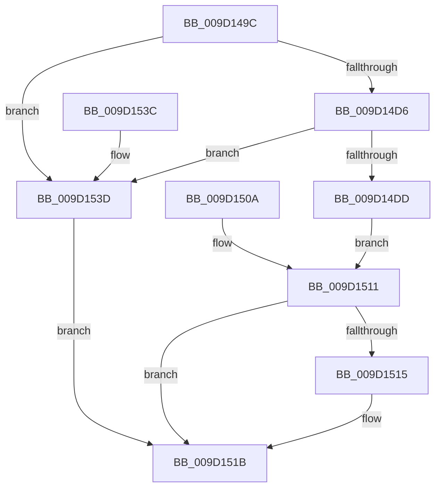

# PiCMReturnStatusResultData

- RVA: `0x009D149C`–`0x009D1544` (길이 `168` bytes)
- VA: `0x00000001409D149C`
- 실행 섹션: `PAGE`
- PDB 이름 있음: `예`; PDB Function 태그: `아니요`
- unwind 정보 RVA: `0x000A13E4`
- 디코드: `49`개 명령, `168/168` bytes 표시
- 미해석 바이트: `0` (있으면 어셈블리에 `.byte`로 보존)

> 이 문서는 커널 이미지의 기계어와 PDB 기호를 분석해 생성했습니다. 4번과 5번은 함수 원형과 자료형을 바이너리 사용 방식에서 추정한 C 해석이며 원본 소스 복구 결과는 아닙니다.

## 1. Dependencies

- 직접 호출 지점: **1**; 고유 호출 대상: **1**
- 직접 호출자로 확인된 함수: **1**
- RIP 상대 이미지 참조: **0**

### Outgoing calls
- `0x009D14ED` → [ProbeForWrite](../8E/ProbeForWrite_function_008E91C0.md) (function, `0x008E91C0`)

### Direct callers
- [PiCMGetDeviceStatus](PiCMGetDeviceStatus_function_009D136C.md) at `0x009D144B`

### Static image references
- 디코드된 RIP-relative 메모리 참조가 없습니다.

## 2. Other-region calls and transfers

- 다른 실행 섹션으로 향하는 call: **0**
- 별도 외부 분기/꼬리 이동을 확인하지 못했습니다.

## 3. Assembly (complete function range)

```asm
009D149C  48 8B C4                        mov rax, rsp
009D149F  48 89 58 08                     mov qword ptr [rax + 8], rbx
009D14A3  48 89 70 10                     mov qword ptr [rax + 0x10], rsi
009D14A7  48 89 78 18                     mov qword ptr [rax + 0x18], rdi
009D14AB  4C 89 60 20                     mov qword ptr [rax + 0x20], r12
009D14AF  41 55                           push r13
009D14B1  41 56                           push r14
009D14B3  41 57                           push r15
009D14B5  48 83 EC 20                     sub rsp, 0x20
009D14B9  45 8B F1                        mov r14d, r9d
009D14BC  45 8B F8                        mov r15d, r8d
009D14BF  44 8B E2                        mov r12d, edx
009D14C2  44 8B E9                        mov r13d, ecx
009D14C5  48 8B 74 24 78                  mov rsi, qword ptr [rsp + 0x78]
009D14CA  83 26 00                        and dword ptr [rsi], 0
009D14CD  33 FF                           xor edi, edi
009D14CF  83 7C 24 70 14                  cmp dword ptr [rsp + 0x70], 0x14
009D14D4  72 67                           jb 0x1409d153d
009D14D6  83 7C 24 60 14                  cmp dword ptr [rsp + 0x60], 0x14
009D14DB  75 60                           jne 0x1409d153d
009D14DD  8B 54 24 70                     mov edx, dword ptr [rsp + 0x70]
009D14E1  44 8D 47 04                     lea r8d, [rdi + 4]
009D14E5  48 8B 5C 24 68                  mov rbx, qword ptr [rsp + 0x68]
009D14EA  48 8B CB                        mov rcx, rbx
009D14ED  E8 CE 7C F1 FF                  call 0x1408e91c0
009D14F2  C7 03 14 00 00 00               mov dword ptr [rbx], 0x14
009D14F8  44 89 6B 04                     mov dword ptr [rbx + 4], r13d
009D14FC  44 89 63 08                     mov dword ptr [rbx + 8], r12d
009D1500  44 89 7B 0C                     mov dword ptr [rbx + 0xc], r15d
009D1504  44 89 73 10                     mov dword ptr [rbx + 0x10], r14d
009D1508  EB 07                           jmp 0x1409d1511
009D150A  8B F8                           mov edi, eax
009D150C  48 8B 74 24 78                  mov rsi, qword ptr [rsp + 0x78]
009D1511  85 FF                           test edi, edi
009D1513  78 06                           js 0x1409d151b
009D1515  C7 06 14 00 00 00               mov dword ptr [rsi], 0x14
009D151B  8B C7                           mov eax, edi
009D151D  48 8B 5C 24 40                  mov rbx, qword ptr [rsp + 0x40]
009D1522  48 8B 74 24 48                  mov rsi, qword ptr [rsp + 0x48]
009D1527  48 8B 7C 24 50                  mov rdi, qword ptr [rsp + 0x50]
009D152C  4C 8B 64 24 58                  mov r12, qword ptr [rsp + 0x58]
009D1531  48 83 C4 20                     add rsp, 0x20
009D1535  41 5F                           pop r15
009D1537  41 5E                           pop r14
009D1539  41 5D                           pop r13
009D153B  C3                              ret
009D153C  CC                              int3
009D153D  BF 0D 00 00 C0                  mov edi, 0xc000000d
009D1542  EB D7                           jmp 0x1409d151b
```

## 4. C-style interpretation (structured pseudocode)

```c
__int64 __fastcall PiCMReturnStatusResultData(int a1, int a2, int a3, int a4, unsigned int a5, __int64 a6, unsigned int a7, __int64 a8)
{
    __int64 result;
    __int64 v_rdi;
    __int64 v_rsp;
    unsigned __int64 v_stack_p10;
    unsigned __int64 v_stack_p18;
    unsigned __int64 v_stack_p20;
    unsigned __int64 v_stack_p40;
    unsigned __int64 v_stack_p8;

    *(unsigned __int64 *)(v_rsp + 8) = v_rbx;
    *(unsigned __int64 *)(v_rsp + 16) = v_rsi;
    *(unsigned __int64 *)(v_rsp + 24) = v_rdi;
    *(unsigned __int64 *)(v_rsp + 32) = v_r12;
    v_rsp = (v_rsp) - (32);
    v_rdi = 0;
    if (a7 < 20) goto loc_009D153D;
    if (a5 != 20) goto loc_009D153D;
    result = ProbeForWrite(a6, (unsigned int)(a7), v_rdi + 4, a4);
    *(unsigned int *)(a6) = 20;
    *(unsigned int *)(a6 + 4) = (unsigned int)((unsigned int)(a1));
    *(unsigned int *)(a6 + 8) = (unsigned int)((unsigned int)(a2));
    *(unsigned int *)(a6 + 12) = (unsigned int)((unsigned int)(a3));
    *(unsigned int *)(a6 + 16) = (unsigned int)((unsigned int)(a4));
    goto loc_009D1511;
loc_009D1511:
    if (!(sign_flag)) {
        *(unsigned int *)(a8) = 20;
    }
    v_rsp = (v_rsp) + (32);
    return 0;
loc_009D153D:
    goto loc_009D151B;
}
```

## 5. (Beta) C Style

```c
int64_t PiCMReturnStatusResultData(int32_t Arg1, int32_t Arg2, int32_t Arg3, int32_t Arg4, uint32_t Arg5, void *Arg6, uint32_t Arg7, void *Arg8)
{
    uint8_t *arg6 = (uint8_t *)Arg6;
    uint8_t *arg8 = (uint8_t *)Arg8;

    int64_t result;
    int64_t local_rdi;
    int64_t local_rsp;
    uint64_t v_stack_p10;
    uint64_t v_stack_p18;
    uint64_t v_stack_p20;
    uint64_t v_stack_p40;
    uint64_t v_stack_p8;

    *(uint64_t *)(local_rsp + 0x8) = local_rbx;
    *(uint64_t *)(local_rsp + 0x10) = local_rsi;
    *(uint64_t *)(local_rsp + 0x18) = local_rdi;
    *(uint64_t *)(local_rsp + 0x20) = local_r12;
    local_rsp = (local_rsp) - (32);
    local_rdi = 0;
    if (Arg7 < 20) goto loc_009D153D;
    if (Arg5 != 20) goto loc_009D153D;
    result = ProbeForWrite(Arg6, (uint32_t)(Arg7), local_rdi + 4, Arg4);
    *(uint32_t *)(arg6) = 20;
    *(uint32_t *)(arg6 + 0x4) = (uint32_t)((uint32_t)(Arg1));
    *(uint32_t *)(arg6 + 0x8) = (uint32_t)((uint32_t)(Arg2));
    *(uint32_t *)(arg6 + 0xC) = (uint32_t)((uint32_t)(Arg3));
    *(uint32_t *)(arg6 + 0x10) = (uint32_t)((uint32_t)(Arg4));
    goto loc_009D1511;
loc_009D1511:
    if (!(sign_flag)) {
        *(uint32_t *)(arg8) = 20;
    }
    local_rsp = (local_rsp) + (32);
    return 0;
loc_009D153D:
    goto loc_009D151B;
}
```

### 관측된 메모리 오프셋

구조체 형식이 확인되지 않은 접근은 인자 기준의 오프셋으로만 기록했습니다.

| 기준 인자 | 오프셋 표현 | 폭 (bit) | 접근 |
|---|---:|---:|---|
| `Arg6` | `+ 0x0` | `32` | `W` |
| `Arg6` | `+ 0x4` | `32` | `W` |
| `Arg6` | `+ 0x8` | `32` | `W` |
| `Arg6` | `+ 0xC` | `32` | `W` |
| `Arg6` | `+ 0x10` | `32` | `W` |
| `Arg8` | `+ 0x0` | `32` | `R/W` |
| `Arg8` | `+ 0x0` | `32` | `W` |

## 6. Execution-region graph

[열기: 2D/3D 그래프와 함수 탐색 컨트롤 패널](../../../control-panel.html?section=page&rva=0x009D149C&view=graph)

- 2D 그래프는 위에서 아래로 흐르고, 3D 그래프는 빈 공간을 드래그해 회전합니다. Shift+드래그는 이동, 휠은 확대·축소, 함수 노드 선택은 대상 보고서 이동입니다.

### Static fallback


