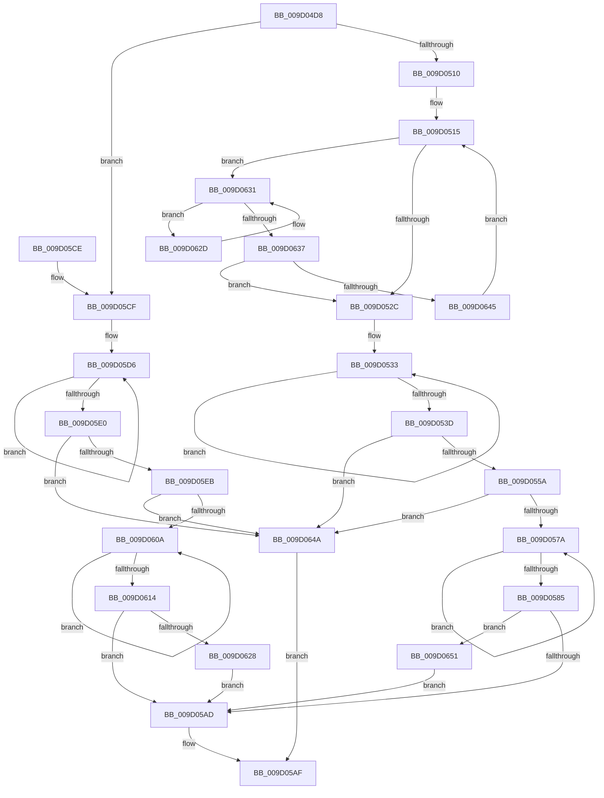

# PnpMultiSzAppend

- RVA: `0x009D04D8`–`0x009D0659` (길이 `385` bytes)
- VA: `0x00000001409D04D8`
- 실행 섹션: `PAGE`
- PDB 이름 있음: `예`; PDB Function 태그: `아니요`
- unwind 정보 RVA: `0x000A12D8`
- 디코드: `107`개 명령, `385/385` bytes 표시
- 미해석 바이트: `0` (있으면 어셈블리에 `.byte`로 보존)

> 이 문서는 커널 이미지의 기계어와 PDB 기호를 분석해 생성했습니다. 4번과 5번은 함수 원형과 자료형을 바이너리 사용 방식에서 추정한 C 해석이며 원본 소스 복구 결과는 아닙니다.

## 1. Dependencies

- 직접 호출 지점: **2**; 고유 호출 대상: **1**
- 직접 호출자로 확인된 함수: **4**
- RIP 상대 이미지 참조: **0**

### Outgoing calls
- `0x009D056D` → [RtlStringCbCopyExW](../../text/45/RtlStringCbCopyExW_function_0045488C.md) (function, `0x0045488C`)
- `0x009D0601` → [RtlStringCbCopyExW](../../text/45/RtlStringCbCopyExW_function_0045488C.md) (function, `0x0045488C`)

### Direct callers
- [CmAppendDeclarativeDefaultFilters](../82/CmAppendDeclarativeDefaultFilters_function_0082F6BC.md) at `0x0082F71E`
- [CmAppendDeclarativeFilterLevel](../82/CmAppendDeclarativeFilterLevel_function_0082F7A4.md) at `0x0082F8DA`
- [CmGetDeviceChildren](CmGetDeviceChildren_function_009D08DC.md) at `0x009D0BDE`
- [CmGetDeviceChildren](CmGetDeviceChildren_function_009D08DC.md) at `0x009D0C50`
- [CmMergeFilterLists](../AF/CmMergeFilterLists_function_00AFA2CC.md) at `0x00AFA3C8`
- [CmMergeFilterLists](../AF/CmMergeFilterLists_function_00AFA2CC.md) at `0x00AFA4AB`
- [CmMergeFilterLists](../AF/CmMergeFilterLists_function_00AFA2CC.md) at `0x00AFA57C`

### Static image references
- 디코드된 RIP-relative 메모리 참조가 없습니다.

## 2. Other-region calls and transfers

- 다른 실행 섹션으로 향하는 call: **2**
  - `0x009D056D` → [RtlStringCbCopyExW](../../text/45/RtlStringCbCopyExW_function_0045488C.md) (`PAGE` → `.text`)
  - `0x009D0601` → [RtlStringCbCopyExW](../../text/45/RtlStringCbCopyExW_function_0045488C.md) (`PAGE` → `.text`)
- 별도 외부 분기/꼬리 이동을 확인하지 못했습니다.

## 3. Assembly (complete function range)

```asm
009D04D8  48 8B C4                        mov rax, rsp
009D04DB  48 89 58 08                     mov qword ptr [rax + 8], rbx
009D04DF  48 89 68 10                     mov qword ptr [rax + 0x10], rbp
009D04E3  48 89 70 18                     mov qword ptr [rax + 0x18], rsi
009D04E7  48 89 78 20                     mov qword ptr [rax + 0x20], rdi
009D04EB  41 54                           push r12
009D04ED  41 56                           push r14
009D04EF  41 57                           push r15
009D04F1  48 83 EC 30                     sub rsp, 0x30
009D04F5  48 8B F1                        mov rsi, rcx
009D04F8  45 33 E4                        xor r12d, r12d
009D04FB  8B 0A                           mov ecx, dword ptr [rdx]
009D04FD  4D 8B F1                        mov r14, r9
009D0500  49 8B E8                        mov rbp, r8
009D0503  4C 8B FA                        mov r15, rdx
009D0506  66 44 39 26                     cmp word ptr [rsi], r12w
009D050A  0F 84 BF 00 00 00               je 0x1409d05cf
009D0510  48 8B FE                        mov rdi, rsi
009D0513  8B D1                           mov edx, ecx
009D0515  48 8B C7                        mov rax, rdi
009D0518  48 2B C6                        sub rax, rsi
009D051B  48 D1 F8                        sar rax, 1
009D051E  8B C0                           mov eax, eax
009D0520  48 03 C0                        add rax, rax
009D0523  48 3B C2                        cmp rax, rdx
009D0526  0F 82 05 01 00 00               jb 0x1409d0631
009D052C  48 83 CB FF                     or rbx, 0xffffffffffffffff
009D0530  48 8B CB                        mov rcx, rbx
009D0533  48 FF C1                        inc rcx
009D0536  66 45 39 24 48                  cmp word ptr [r8 + rcx*2], r12w
009D053B  75 F6                           jne 0x1409d0533
009D053D  48 8B C7                        mov rax, rdi
009D0540  48 2B C6                        sub rax, rsi
009D0543  48 D1 F8                        sar rax, 1
009D0546  48 03 C8                        add rcx, rax
009D0549  48 8D 04 4D 04 00 00 00         lea rax, [rcx*2 + 4]
009D0551  48 3B C2                        cmp rax, rdx
009D0554  0F 87 F0 00 00 00               ja 0x1409d064a
009D055A  C7 44 24 28 00 09 00 00         mov dword ptr [rsp + 0x28], 0x900
009D0562  45 33 C9                        xor r9d, r9d
009D0565  48 8B CF                        mov rcx, rdi
009D0568  4C 89 64 24 20                  mov qword ptr [rsp + 0x20], r12
009D056D  E8 1A 43 A8 FF                  call 0x14045488c
009D0572  85 C0                           test eax, eax
009D0574  0F 88 D0 00 00 00               js 0x1409d064a
009D057A  48 FF C3                        inc rbx
009D057D  66 44 39 64 5D 00               cmp word ptr [rbp + rbx*2], r12w
009D0583  75 F5                           jne 0x1409d057a
009D0585  48 8D 4B 01                     lea rcx, [rbx + 1]
009D0589  48 8D 0C 4F                     lea rcx, [rdi + rcx*2]
009D058D  48 8B C1                        mov rax, rcx
009D0590  66 44 89 21                     mov word ptr [rcx], r12w
009D0594  48 2B C6                        sub rax, rsi
009D0597  48 D1 F8                        sar rax, 1
009D059A  8D 04 45 02 00 00 00            lea eax, [rax*2 + 2]
009D05A1  41 89 07                        mov dword ptr [r15], eax
009D05A4  4D 85 F6                        test r14, r14
009D05A7  0F 85 A4 00 00 00               jne 0x1409d0651
009D05AD  B0 01                           mov al, 1
009D05AF  48 8B 5C 24 50                  mov rbx, qword ptr [rsp + 0x50]
009D05B4  48 8B 6C 24 58                  mov rbp, qword ptr [rsp + 0x58]
009D05B9  48 8B 74 24 60                  mov rsi, qword ptr [rsp + 0x60]
009D05BE  48 8B 7C 24 68                  mov rdi, qword ptr [rsp + 0x68]
009D05C3  48 83 C4 30                     add rsp, 0x30
009D05C7  41 5F                           pop r15
009D05C9  41 5E                           pop r14
009D05CB  41 5C                           pop r12
009D05CD  C3                              ret
009D05CE  CC                              int3
009D05CF  48 83 CB FF                     or rbx, 0xffffffffffffffff
009D05D3  48 8B C3                        mov rax, rbx
009D05D6  48 FF C0                        inc rax
009D05D9  66 45 39 24 40                  cmp word ptr [r8 + rax*2], r12w
009D05DE  75 F6                           jne 0x1409d05d6
009D05E0  8D 3C 45 04 00 00 00            lea edi, [rax*2 + 4]
009D05E7  3B F9                           cmp edi, ecx
009D05E9  77 5F                           ja 0x1409d064a
009D05EB  48 8B D1                        mov rdx, rcx
009D05EE  C7 44 24 28 00 09 00 00         mov dword ptr [rsp + 0x28], 0x900
009D05F6  48 8B CE                        mov rcx, rsi
009D05F9  4C 89 64 24 20                  mov qword ptr [rsp + 0x20], r12
009D05FE  45 33 C9                        xor r9d, r9d
009D0601  E8 86 42 A8 FF                  call 0x14045488c
009D0606  85 C0                           test eax, eax
009D0608  78 40                           js 0x1409d064a
009D060A  48 FF C3                        inc rbx
009D060D  66 44 39 24 5E                  cmp word ptr [rsi + rbx*2], r12w
009D0612  75 F6                           jne 0x1409d060a
009D0614  41 89 3F                        mov dword ptr [r15], edi
009D0617  48 8D 46 02                     lea rax, [rsi + 2]
009D061B  48 8D 04 58                     lea rax, [rax + rbx*2]
009D061F  66 44 89 20                     mov word ptr [rax], r12w
009D0623  4D 85 F6                        test r14, r14
009D0626  74 85                           je 0x1409d05ad
009D0628  49 89 06                        mov qword ptr [r14], rax
009D062B  EB 80                           jmp 0x1409d05ad
009D062D  48 83 C7 02                     add rdi, 2
009D0631  66 44 39 27                     cmp word ptr [rdi], r12w
009D0635  75 F6                           jne 0x1409d062d
009D0637  48 83 C7 02                     add rdi, 2
009D063B  66 44 39 27                     cmp word ptr [rdi], r12w
009D063F  0F 84 E7 FE FF FF               je 0x1409d052c
009D0645  E9 CB FE FF FF                  jmp 0x1409d0515
009D064A  32 C0                           xor al, al
009D064C  E9 5E FF FF FF                  jmp 0x1409d05af
009D0651  49 89 0E                        mov qword ptr [r14], rcx
009D0654  E9 54 FF FF FF                  jmp 0x1409d05ad
```

## 4. C-style interpretation (structured pseudocode)

```c
__int64 __fastcall PnpMultiSzAppend(__int64 a1, __int64 a2, __int64 a3, __int64 a4)
{
    __int64 result;
    __int64 v_r12;
    __int64 v_rbx;
    __int64 v_rdi;
    __int64 v_rsp;
    unsigned int v_stack_m20;
    unsigned __int64 v_stack_m28;
    unsigned __int64 v_stack_p10;
    unsigned __int64 v_stack_p18;
    unsigned __int64 v_stack_p20;
    unsigned int v_stack_p28;
    unsigned __int64 v_stack_p8;

    *(unsigned __int64 *)(v_rsp + 8) = v_rbx;
    *(unsigned __int64 *)(v_rsp + 16) = v_rbp;
    *(unsigned __int64 *)(v_rsp + 24) = v_rsi;
    *(unsigned __int64 *)(v_rsp + 32) = v_rdi;
    v_rsp = (v_rsp) - (48);
    v_r12 = 0;
    if ((*(unsigned __int16 *)(a1)) == 0) goto loc_009D05CF;
loc_009D0515:
    result = (a1) - (a1);
    result = (result) >> (1);
    result = ((unsigned int)((unsigned int)(result))) + ((unsigned int)((unsigned int)(result)));
    if (result < ((unsigned int)((unsigned int)((unsigned int)(*(unsigned int *)(a2)))))) goto loc_009D0631;
loc_009D052C:
    v_rbx = (v_rbx) | (-1);
loc_009D0533:
    a1 = (v_rbx) + 1;
    if ((*(unsigned __int16 *)(a3 + a1 * 2)) != 0) goto loc_009D0533;
    result = (a1) - (a1);
    result = (result) >> (1);
    a1 = (a1) + (result);
    if ((a1 * 2 + 4) > ((unsigned int)((unsigned int)((unsigned int)(*(unsigned int *)(a2)))))) goto loc_009D064A;
    v_stack_m20 = 0x900ULL;
    a4 = 0;
    v_stack_m28 = 0;
    result = RtlStringCbCopyExW(a1, (unsigned int)((unsigned int)((unsigned int)(*(unsigned int *)(a2)))), a3, a4);
    if (sign_flag) goto loc_009D064A;
loc_009D057A:
    v_rbx = (v_rbx) + 1;
    if ((*(unsigned __int16 *)(a3 + v_rbx * 2)) != 0) goto loc_009D057A;
    *(unsigned __int16 *)(a1 + v_rbx + 1 * 2) = 0;
    result = (a1 + v_rbx + 1 * 2) - (a1);
    result = (result) >> (1);
    *(unsigned int *)(a2) = (unsigned int)(result * 2 + 2);
    if (0 != 0) goto loc_009D0651;
loc_009D05AD:
loc_009D05AF:
    v_rsp = (v_rsp) + (48);
    return 1;
loc_009D05CF:
    v_rbx = (v_stack_p8) | (-1);
loc_009D05D6:
    result = (v_rbx) + 1;
    if ((*(unsigned __int16 *)(a3 + result * 2)) != 0) goto loc_009D05D6;
    if (((unsigned int)(result * 2 + 4)) > ((unsigned int)(a1 + v_rbx + 1 * 2))) goto loc_009D064A;
    v_stack_p28 = 0x900ULL;
    v_stack_p20 = 0;
    a4 = 0;
    result = RtlStringCbCopyExW(v_stack_p18, a1 + v_rbx + 1 * 2, a3, a4);
    if (sign_flag) goto loc_009D064A;
loc_009D060A:
    v_rbx = (v_rbx) + 1;
    if ((*(unsigned __int16 *)(v_stack_p18 + v_rbx * 2)) != 0) goto loc_009D060A;
    *(unsigned int *)(a2) = (unsigned int)(result * 2 + 4);
    *(unsigned __int16 *)(v_stack_p18 + 2 + v_rbx * 2) = 0;
    if (0 == 0) goto loc_009D05AD;
    *(unsigned __int64 *)(a4) = v_stack_p18 + 2 + v_rbx * 2;
    goto loc_009D05AD;
loc_009D062D:
    v_rdi = (result * 2 + 4) + (2);
loc_009D0631:
    if ((*(unsigned __int16 *)(v_rdi)) != 0) goto loc_009D062D;
    v_rdi = (v_rdi) + (2);
    if ((*(unsigned __int16 *)(v_rdi)) == 0) goto loc_009D052C;
    goto loc_009D0515;
loc_009D064A:
    result = 0;
    goto loc_009D05AF;
loc_009D0651:
    *(unsigned __int64 *)(a4) = v_stack_p18;
    goto loc_009D05AD;
}
```

## 5. (Beta) C Style

```c
int64_t PnpMultiSzAppend(void *Arg1, void *Arg2, void *Arg3, int64_t Arg4)
{
    uint8_t *arg1 = (uint8_t *)Arg1;
    uint8_t *arg2 = (uint8_t *)Arg2;
    uint8_t *arg3 = (uint8_t *)Arg3;

    int64_t result;
    int64_t local_r12;
    int64_t local_rbx;
    int64_t local_rdi;
    int64_t local_rsp;
    uint32_t v_stack_m20;
    uint64_t v_stack_m28;
    uint64_t v_stack_p10;
    uint64_t v_stack_p18;
    uint64_t v_stack_p20;
    uint32_t v_stack_p28;
    uint64_t v_stack_p8;

    *(uint64_t *)(local_rsp + 0x8) = local_rbx;
    *(uint64_t *)(local_rsp + 0x10) = local_rbp;
    *(uint64_t *)(local_rsp + 0x18) = local_rsi;
    *(uint64_t *)(local_rsp + 0x20) = local_rdi;
    local_rsp = (local_rsp) - (48);
    local_r12 = 0;
    if ((*(uint16_t *)(arg1)) == 0) goto loc_009D05CF;
loc_009D0515:
    result = (Arg1) - (Arg1);
    result = (result) >> (1);
    result = ((uint32_t)((uint32_t)(result))) + ((uint32_t)((uint32_t)(result)));
    if (result < ((uint32_t)((uint32_t)((uint32_t)(*(uint32_t *)(arg2)))))) goto loc_009D0631;
loc_009D052C:
    local_rbx = (local_rbx) | (-1);
loc_009D0533:
    Arg1 = (local_rbx) + 1;
    if ((*(uint16_t *)(arg3 + arg1 * 2)) != 0) goto loc_009D0533;
    result = (Arg1) - (Arg1);
    result = (result) >> (1);
    Arg1 = (Arg1) + (result);
    if ((Arg1 * 2 + 4) > ((uint32_t)((uint32_t)((uint32_t)(*(uint32_t *)(arg2)))))) goto loc_009D064A;
    v_stack_m20 = 0x900ULL;
    Arg4 = 0;
    v_stack_m28 = 0;
    result = RtlStringCbCopyExW(Arg1, (uint32_t)((uint32_t)((uint32_t)(*(uint32_t *)(arg2)))), Arg3, Arg4);
    if (sign_flag) goto loc_009D064A;
loc_009D057A:
    local_rbx = (local_rbx) + 1;
    if ((*(uint16_t *)(arg3 + local_rbx * 2)) != 0) goto loc_009D057A;
    *(uint16_t *)(arg1 + local_rbx + 0x1 * 2) = 0;
    result = (Arg1 + local_rbx + 1 * 2) - (Arg1);
    result = (result) >> (1);
    *(uint32_t *)(arg2) = (uint32_t)(result * 2 + 2);
    if (0 != 0) goto loc_009D0651;
loc_009D05AD:
loc_009D05AF:
    local_rsp = (local_rsp) + (48);
    return 1;
loc_009D05CF:
    local_rbx = (v_stack_p8) | (-1);
loc_009D05D6:
    result = (local_rbx) + 1;
    if ((*(uint16_t *)(arg3 + result * 2)) != 0) goto loc_009D05D6;
    if (((uint32_t)(result * 2 + 4)) > ((uint32_t)(Arg1 + local_rbx + 1 * 2))) goto loc_009D064A;
    v_stack_p28 = 0x900ULL;
    v_stack_p20 = 0;
    Arg4 = 0;
    result = RtlStringCbCopyExW(v_stack_p18, Arg1 + local_rbx + 1 * 2, Arg3, Arg4);
    if (sign_flag) goto loc_009D064A;
loc_009D060A:
    local_rbx = (local_rbx) + 1;
    if ((*(uint16_t *)(v_stack_p18 + local_rbx * 2)) != 0) goto loc_009D060A;
    *(uint32_t *)(arg2) = (uint32_t)(result * 2 + 4);
    *(uint16_t *)(v_stack_p18 + 0x2 + local_rbx * 2) = 0;
    if (0 == 0) goto loc_009D05AD;
    *(uint64_t *)(Arg4) = v_stack_p18 + 2 + local_rbx * 2;
    goto loc_009D05AD;
loc_009D062D:
    local_rdi = (result * 2 + 4) + (2);
loc_009D0631:
    if ((*(uint16_t *)(local_rdi)) != 0) goto loc_009D062D;
    local_rdi = (local_rdi) + (2);
    if ((*(uint16_t *)(local_rdi)) == 0) goto loc_009D052C;
    goto loc_009D0515;
loc_009D064A:
    result = 0;
    goto loc_009D05AF;
loc_009D0651:
    *(uint64_t *)(Arg4) = v_stack_p18;
    goto loc_009D05AD;
}
```

### 관측된 메모리 오프셋

구조체 형식이 확인되지 않은 접근은 인자 기준의 오프셋으로만 기록했습니다.

| 기준 인자 | 오프셋 표현 | 폭 (bit) | 접근 |
|---|---:|---:|---|
| `Arg1` | `+ 0x0` | `16` | `R` |
| `Arg1` | `+ 0x0` | `16` | `W` |
| `Arg1` | `+ 0x0 + rbx*2` | `16` | `R` |
| `Arg1` | `+ 0x0 + rbx*2` | `64` | `R` |
| `Arg1` | `+ 0x0 + rcx*2` | `64` | `R` |
| `Arg1` | `+ 0x2` | `64` | `R` |
| `Arg2` | `+ 0x0` | `32` | `R` |
| `Arg2` | `+ 0x0` | `32` | `W` |
| `Arg3` | `+ 0x0 + rax*2` | `16` | `R` |
| `Arg3` | `+ 0x0 + rbx*2` | `16` | `R` |
| `Arg3` | `+ 0x0 + rcx*2` | `16` | `R` |

## 6. Execution-region graph

[열기: 2D/3D 그래프와 함수 탐색 컨트롤 패널](../../../control-panel.html?section=page&rva=0x009D04D8&view=graph)

- 2D 그래프는 위에서 아래로 흐르고, 3D 그래프는 빈 공간을 드래그해 회전합니다. Shift+드래그는 이동, 휠은 확대·축소, 함수 노드 선택은 대상 보고서 이동입니다.

### Static fallback


