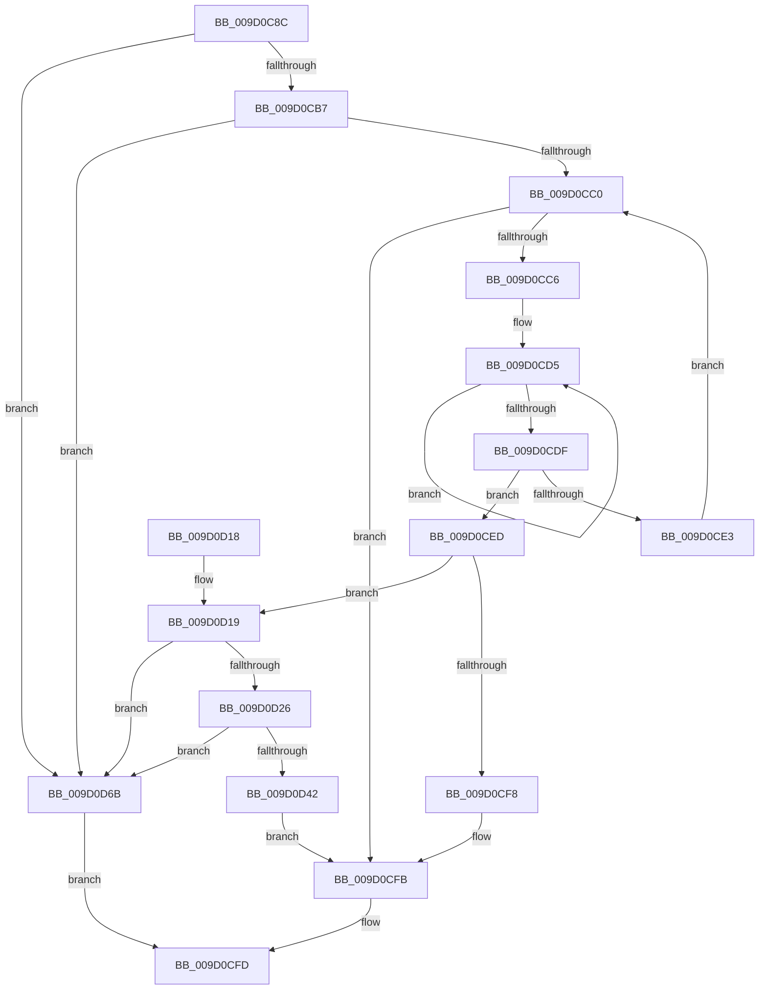

# PnpMultiSzDeleteString

- RVA: `0x009D0C8C`–`0x009D0D6F` (길이 `227` bytes)
- VA: `0x00000001409D0C8C`
- 실행 섹션: `PAGE`
- PDB 이름 있음: `예`; PDB Function 태그: `아니요`
- unwind 정보 RVA: `0x000A1354`
- 디코드: `67`개 명령, `227/227` bytes 표시
- 미해석 바이트: `0` (있으면 어셈블리에 `.byte`로 보존)

> 이 문서는 커널 이미지의 기계어와 PDB 기호를 분석해 생성했습니다. 4번과 5번은 함수 원형과 자료형을 바이너리 사용 방식에서 추정한 C 해석이며 원본 소스 복구 결과는 아닙니다.

## 1. Dependencies

- 직접 호출 지점: **6**; 고유 호출 대상: **5**
- 직접 호출자로 확인된 함수: **1**
- RIP 상대 이미지 참조: **0**

### Outgoing calls
- `0x009D0CCC` → [wcsicmp](../../text/50/wcsicmp_function_00500080.md) (function, `0x00500080`)
- `0x009D0D1D` → [PnpMultiSzGetLen](PnpMultiSzGetLen_function_009D3180.md) (function, `0x009D3180`)
- `0x009D0D35` → [ExAllocatePool2](../../poolcode/B8/ExAllocatePool2_function_00B820F0.md) (function, `0x00B820F0`)
- `0x009D0D4C` → [memcpy](../../text/6C/memcpy_function_006C6840.md) (function, `0x006C6840`)
- `0x009D0D5A` → [memcpy](../../text/6C/memcpy_function_006C6840.md) (function, `0x006C6840`)
- `0x009D0D64` → [ExFreePoolWithTag](../../poolcode/B8/ExFreePoolWithTag_function_00B82870.md) (function, `0x00B82870`)

### Direct callers
- [CmGetDeviceSiblings](CmGetDeviceSiblings_function_009D0734.md) at `0x009D07CC`

### Static image references
- 디코드된 RIP-relative 메모리 참조가 없습니다.

## 2. Other-region calls and transfers

- 다른 실행 섹션으로 향하는 call: **5**
  - `0x009D0CCC` → [wcsicmp](../../text/50/wcsicmp_function_00500080.md) (`PAGE` → `.text`)
  - `0x009D0D35` → [ExAllocatePool2](../../poolcode/B8/ExAllocatePool2_function_00B820F0.md) (`PAGE` → `POOLCODE`)
  - `0x009D0D4C` → [memcpy](../../text/6C/memcpy_function_006C6840.md) (`PAGE` → `.text`)
  - `0x009D0D5A` → [memcpy](../../text/6C/memcpy_function_006C6840.md) (`PAGE` → `.text`)
  - `0x009D0D64` → [ExFreePoolWithTag](../../poolcode/B8/ExFreePoolWithTag_function_00B82870.md) (`PAGE` → `POOLCODE`)
- 별도 외부 분기/꼬리 이동을 확인하지 못했습니다.

## 3. Assembly (complete function range)

```asm
009D0C8C  48 8B C4                        mov rax, rsp
009D0C8F  48 89 58 08                     mov qword ptr [rax + 8], rbx
009D0C93  48 89 68 10                     mov qword ptr [rax + 0x10], rbp
009D0C97  48 89 70 18                     mov qword ptr [rax + 0x18], rsi
009D0C9B  48 89 78 20                     mov qword ptr [rax + 0x20], rdi
009D0C9F  41 56                           push r14
009D0CA1  48 83 EC 20                     sub rsp, 0x20
009D0CA5  45 33 F6                        xor r14d, r14d
009D0CA8  48 8B FA                        mov rdi, rdx
009D0CAB  48 8B D9                        mov rbx, rcx
009D0CAE  48 85 C9                        test rcx, rcx
009D0CB1  0F 84 B4 00 00 00               je 0x1409d0d6b
009D0CB7  48 85 D2                        test rdx, rdx
009D0CBA  0F 84 AB 00 00 00               je 0x1409d0d6b
009D0CC0  66 44 39 33                     cmp word ptr [rbx], r14w
009D0CC4  74 35                           je 0x1409d0cfb
009D0CC6  48 8B D7                        mov rdx, rdi
009D0CC9  48 8B CB                        mov rcx, rbx
009D0CCC  E8 AF F3 B2 FF                  call 0x140500080
009D0CD1  48 83 C9 FF                     or rcx, 0xffffffffffffffff
009D0CD5  48 FF C1                        inc rcx
009D0CD8  66 44 39 34 4B                  cmp word ptr [rbx + rcx*2], r14w
009D0CDD  75 F6                           jne 0x1409d0cd5
009D0CDF  85 C0                           test eax, eax
009D0CE1  74 0A                           je 0x1409d0ced
009D0CE3  48 8D 1C 4B                     lea rbx, [rbx + rcx*2]
009D0CE7  48 83 C3 02                     add rbx, 2
009D0CEB  EB D3                           jmp 0x1409d0cc0
009D0CED  48 8D 3C 4B                     lea rdi, [rbx + rcx*2]
009D0CF1  66 44 39 77 02                  cmp word ptr [rdi + 2], r14w
009D0CF6  75 21                           jne 0x1409d0d19
009D0CF8  44 89 33                        mov dword ptr [rbx], r14d
009D0CFB  B0 01                           mov al, 1
009D0CFD  48 8B 5C 24 30                  mov rbx, qword ptr [rsp + 0x30]
009D0D02  48 8B 6C 24 38                  mov rbp, qword ptr [rsp + 0x38]
009D0D07  48 8B 74 24 40                  mov rsi, qword ptr [rsp + 0x40]
009D0D0C  48 8B 7C 24 48                  mov rdi, qword ptr [rsp + 0x48]
009D0D11  48 83 C4 20                     add rsp, 0x20
009D0D15  41 5E                           pop r14
009D0D17  C3                              ret
009D0D18  CC                              int3
009D0D19  48 8D 4F 02                     lea rcx, [rdi + 2]
009D0D1D  E8 5E 24 00 00                  call 0x1409d3180
009D0D22  03 C0                           add eax, eax
009D0D24  74 45                           je 0x1409d0d6b
009D0D26  41 B8 50 4E 50 52               mov r8d, 0x52504e50
009D0D2C  8B D0                           mov edx, eax
009D0D2E  B9 00 01 00 00                  mov ecx, 0x100
009D0D33  8B E8                           mov ebp, eax
009D0D35  E8 B6 13 1B 00                  call 0x140b820f0
009D0D3A  48 8B F0                        mov rsi, rax
009D0D3D  48 85 C0                        test rax, rax
009D0D40  74 29                           je 0x1409d0d6b
009D0D42  44 8B C5                        mov r8d, ebp
009D0D45  48 8D 57 02                     lea rdx, [rdi + 2]
009D0D49  48 8B C8                        mov rcx, rax
009D0D4C  E8 EF 5A CF FF                  call 0x1406c6840
009D0D51  44 8B C5                        mov r8d, ebp
009D0D54  48 8B D6                        mov rdx, rsi
009D0D57  48 8B CB                        mov rcx, rbx
009D0D5A  E8 E1 5A CF FF                  call 0x1406c6840
009D0D5F  33 D2                           xor edx, edx
009D0D61  48 8B CE                        mov rcx, rsi
009D0D64  E8 07 1B 1B 00                  call 0x140b82870
009D0D69  EB 90                           jmp 0x1409d0cfb
009D0D6B  32 C0                           xor al, al
009D0D6D  EB 8E                           jmp 0x1409d0cfd
```

## 4. C-style interpretation (structured pseudocode)

```c
__int64 __fastcall PnpMultiSzDeleteString(__int64 a1, __int64 a2)
{
    __int64 result;
    __int64 v_r14;
    __int64 v_rbx;
    __int64 v_rsp;
    unsigned __int64 v_stack_p10;
    unsigned __int64 v_stack_p18;
    unsigned __int64 v_stack_p20;
    unsigned __int64 v_stack_p8;

    *(unsigned __int64 *)(v_rsp + 8) = v_rbx;
    *(unsigned __int64 *)(v_rsp + 16) = v_rbp;
    *(unsigned __int64 *)(v_rsp + 24) = v_rsi;
    *(unsigned __int64 *)(v_rsp + 32) = v_rdi;
    v_rsp = (v_rsp) - (32);
    v_r14 = 0;
    if (a1 == 0) goto loc_009D0D6B;
    if (a2 == 0) goto loc_009D0D6B;
loc_009D0CC0:
    if ((*(unsigned __int16 *)(a1)) == 0) goto loc_009D0CFB;
    result = wcsicmp(a1, a2, a3, a4);
    a1 = (a1) | (-1);
loc_009D0CD5:
    a1 = (a1) + 1;
    if ((*(unsigned __int16 *)(a1 + a1 * 2)) != 0) goto loc_009D0CD5;
    if ((unsigned int)(result) == 0) goto loc_009D0CED;
    v_rbx = (a1 + a1 * 2) + (2);
    goto loc_009D0CC0;
loc_009D0CED:
    if ((*(unsigned __int16 *)(v_rbx + a1 * 2 + 2)) != 0) goto loc_009D0D19;
    *(unsigned int *)(v_rbx) = 0;
loc_009D0CFB:
loc_009D0CFD:
    v_rsp = (v_rsp) + (32);
    return 1;
loc_009D0D19:
    result = PnpMultiSzGetLen(v_stack_p20 + 2, a2, a3, a4);
    result = (unsigned int)((result) + ((unsigned int)(result)));
    if (condition_is_equal) goto loc_009D0D6B;
    result = ExAllocatePool2(256, (unsigned int)((unsigned int)(result)), (unsigned int)(0x52504E50ULL), a4);
    if (result == 0) goto loc_009D0D6B;
    result = memcpy(result, v_stack_p20 + 2, (unsigned int)((unsigned int)((unsigned int)((unsigned int)(result)))), a4);
    result = memcpy(v_stack_p8, result, (unsigned int)((unsigned int)((unsigned int)((unsigned int)(result)))), a4);
    a2 = 0;
    result = ExFreePoolWithTag(result, a2, (unsigned int)((unsigned int)((unsigned int)((unsigned int)(result)))), a4);
    goto loc_009D0CFB;
loc_009D0D6B:
    result = 0;
    goto loc_009D0CFD;
}
```

## 5. (Beta) C Style

```c
int64_t PnpMultiSzDeleteString(void *Arg1, int64_t Arg2)
{
    uint8_t *arg1 = (uint8_t *)Arg1;

    int64_t result;
    int64_t local_r14;
    int64_t local_rbx;
    int64_t local_rsp;
    uint64_t v_stack_p10;
    uint64_t v_stack_p18;
    uint64_t v_stack_p20;
    uint64_t v_stack_p8;

    *(uint64_t *)(local_rsp + 0x8) = local_rbx;
    *(uint64_t *)(local_rsp + 0x10) = local_rbp;
    *(uint64_t *)(local_rsp + 0x18) = local_rsi;
    *(uint64_t *)(local_rsp + 0x20) = local_rdi;
    local_rsp = (local_rsp) - (32);
    local_r14 = 0;
    if (Arg1 == NULL) goto loc_009D0D6B;
    if (Arg2 == 0) goto loc_009D0D6B;
loc_009D0CC0:
    if ((*(uint16_t *)(arg1)) == 0) goto loc_009D0CFB;
    result = wcsicmp(Arg1, Arg2, a3, a4);
    Arg1 = (Arg1) | (-1);
loc_009D0CD5:
    Arg1 = (Arg1) + 1;
    if ((*(uint16_t *)(arg1 + arg1 * 2)) != 0) goto loc_009D0CD5;
    if ((uint32_t)(result) == 0) goto loc_009D0CED;
    local_rbx = (Arg1 + Arg1 * 2) + (2);
    goto loc_009D0CC0;
loc_009D0CED:
    if ((*(uint16_t *)(local_rbx + arg1 * 2 + 0x2)) != 0) goto loc_009D0D19;
    *(uint32_t *)(local_rbx) = 0;
loc_009D0CFB:
loc_009D0CFD:
    local_rsp = (local_rsp) + (32);
    return 1;
loc_009D0D19:
    result = PnpMultiSzGetLen(v_stack_p20 + 2, Arg2, a3, a4);
    result = (uint32_t)((result) + ((uint32_t)(result)));
    if (condition_is_equal) goto loc_009D0D6B;
    result = ExAllocatePool2(256, (uint32_t)((uint32_t)(result)), (uint32_t)(0x52504E50ULL), a4);
    if (result == 0) goto loc_009D0D6B;
    result = memcpy(result, v_stack_p20 + 2, (uint32_t)((uint32_t)((uint32_t)((uint32_t)(result)))), a4);
    result = memcpy(v_stack_p8, result, (uint32_t)((uint32_t)((uint32_t)((uint32_t)(result)))), a4);
    Arg2 = 0;
    result = ExFreePoolWithTag(result, Arg2, (uint32_t)((uint32_t)((uint32_t)((uint32_t)(result)))), a4);
    goto loc_009D0CFB;
loc_009D0D6B:
    result = 0;
    goto loc_009D0CFD;
}
```

### 관측된 메모리 오프셋

구조체 형식이 확인되지 않은 접근은 인자 기준의 오프셋으로만 기록했습니다.

| 기준 인자 | 오프셋 표현 | 폭 (bit) | 접근 |
|---|---:|---:|---|
| `Arg1` | `+ 0x0` | `16` | `R` |
| `Arg1` | `+ 0x0` | `32` | `W` |
| `Arg1` | `+ 0x0 + rcx*2` | `16` | `R` |
| `Arg1` | `+ 0x0 + rcx*2` | `64` | `R` |
| `Arg1` | `+ 0x2` | `16` | `R` |
| `Arg1` | `+ 0x2` | `64` | `R` |

## 6. Execution-region graph

[열기: 2D/3D 그래프와 함수 탐색 컨트롤 패널](../../../control-panel.html?section=page&rva=0x009D0C8C&view=graph)

- 2D 그래프는 위에서 아래로 흐르고, 3D 그래프는 빈 공간을 드래그해 회전합니다. Shift+드래그는 이동, 휠은 확대·축소, 함수 노드 선택은 대상 보고서 이동입니다.

### Static fallback


