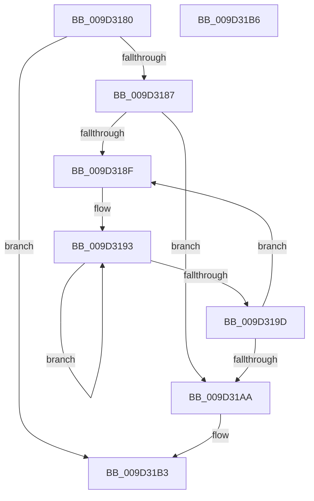

# PnpMultiSzGetLen

- RVA: `0x009D3180`–`0x009D31B7` (길이 `55` bytes)
- VA: `0x00000001409D3180`
- 실행 섹션: `PAGE`
- PDB 이름 있음: `예`; PDB Function 태그: `아니요`
- unwind 정보 RVA: `0x000DB714`
- 디코드: `20`개 명령, `55/55` bytes 표시
- 미해석 바이트: `0` (있으면 어셈블리에 `.byte`로 보존)

> 이 문서는 커널 이미지의 기계어와 PDB 기호를 분석해 생성했습니다. 4번과 5번은 함수 원형과 자료형을 바이너리 사용 방식에서 추정한 C 해석이며 원본 소스 복구 결과는 아닙니다.

## 1. Dependencies

- 직접 호출 지점: **0**; 고유 호출 대상: **0**
- 직접 호출자로 확인된 함수: **4**
- RIP 상대 이미지 참조: **0**

### Outgoing calls
- 직접 디코드된 call 명령이 없습니다.

### Direct callers
- [CmGetDeviceSiblings](CmGetDeviceSiblings_function_009D0734.md) at `0x009D085E`
- [PnpMultiSzDeleteString](PnpMultiSzDeleteString_function_009D0C8C.md) at `0x009D0D1D`
- [_CmGetDeviceMappedPropertyFromComposite](_CmGetDeviceMappedPropertyFromComposite_function_009D1684.md) at `0x009D2634`
- [sub_009D2B5A](Unknown_function_009D2B5A.md) at `0x009D2C98`

### Static image references
- 디코드된 RIP-relative 메모리 참조가 없습니다.

## 2. Other-region calls and transfers

- 다른 실행 섹션으로 향하는 call: **0**
- 별도 외부 분기/꼬리 이동을 확인하지 못했습니다.

## 3. Assembly (complete function range)

```asm
009D3180  33 D2                           xor edx, edx
009D3182  48 85 C9                        test rcx, rcx
009D3185  74 2C                           je 0x1409d31b3
009D3187  48 8B C1                        mov rax, rcx
009D318A  66 39 11                        cmp word ptr [rcx], dx
009D318D  74 1B                           je 0x1409d31aa
009D318F  49 83 C8 FF                     or r8, 0xffffffffffffffff
009D3193  49 FF C0                        inc r8
009D3196  66 42 39 14 40                  cmp word ptr [rax + r8*2], dx
009D319B  75 F6                           jne 0x1409d3193
009D319D  4A 8D 04 40                     lea rax, [rax + r8*2]
009D31A1  48 83 C0 02                     add rax, 2
009D31A5  66 39 10                        cmp word ptr [rax], dx
009D31A8  75 E5                           jne 0x1409d318f
009D31AA  48 2B C1                        sub rax, rcx
009D31AD  48 D1 F8                        sar rax, 1
009D31B0  8D 50 01                        lea edx, [rax + 1]
009D31B3  8B C2                           mov eax, edx
009D31B5  C3                              ret
009D31B6  CC                              int3
```

## 4. C-style interpretation (structured pseudocode)

```c
__int64 __fastcall PnpMultiSzGetLen(__int64 a1, int a2, __int64 a3)
{
    __int64 result;

    a2 = 0;
    if (a1 == 0) goto loc_009D31B3;
    if ((*(unsigned __int16 *)(a1)) == 0) goto loc_009D31AA;
loc_009D318F:
    a3 = (a3) | (-1);
loc_009D3193:
    a3 = (a3) + 1;
    if ((*(unsigned __int16 *)(a1 + a3 * 2)) != 0) goto loc_009D3193;
    result = (a1 + a3 * 2) + (2);
    if ((*(unsigned __int16 *)(result)) != 0) goto loc_009D318F;
loc_009D31AA:
    result = (result) - (a1);
    result = (result) >> (1);
loc_009D31B3:
    return (unsigned int)((unsigned int)(result + 1));
}
```

## 5. (Beta) C Style

```c
int64_t PnpMultiSzGetLen(int64_t Arg1, int32_t Arg2, int64_t Arg3)
{
    int64_t result;

    Arg2 = 0;
    if (Arg1 == 0) goto loc_009D31B3;
    if ((*(uint16_t *)(Arg1)) == 0) goto loc_009D31AA;
loc_009D318F:
    Arg3 = (Arg3) | (-1);
loc_009D3193:
    Arg3 = (Arg3) + 1;
    if ((*(uint16_t *)(Arg1 + Arg3 * 2)) != 0) goto loc_009D3193;
    result = (Arg1 + Arg3 * 2) + (2);
    if ((*(uint16_t *)(result)) != 0) goto loc_009D318F;
loc_009D31AA:
    result = (result) - (Arg1);
    result = (result) >> (1);
loc_009D31B3:
    return (uint32_t)((uint32_t)(result + 1));
}
```

## 6. Execution-region graph

[열기: 2D/3D 그래프와 함수 탐색 컨트롤 패널](../../../control-panel.html?section=page&rva=0x009D3180&view=graph)

- 2D 그래프는 위에서 아래로 흐르고, 3D 그래프는 빈 공간을 드래그해 회전합니다. Shift+드래그는 이동, 휠은 확대·축소, 함수 노드 선택은 대상 보고서 이동입니다.

### Static fallback


