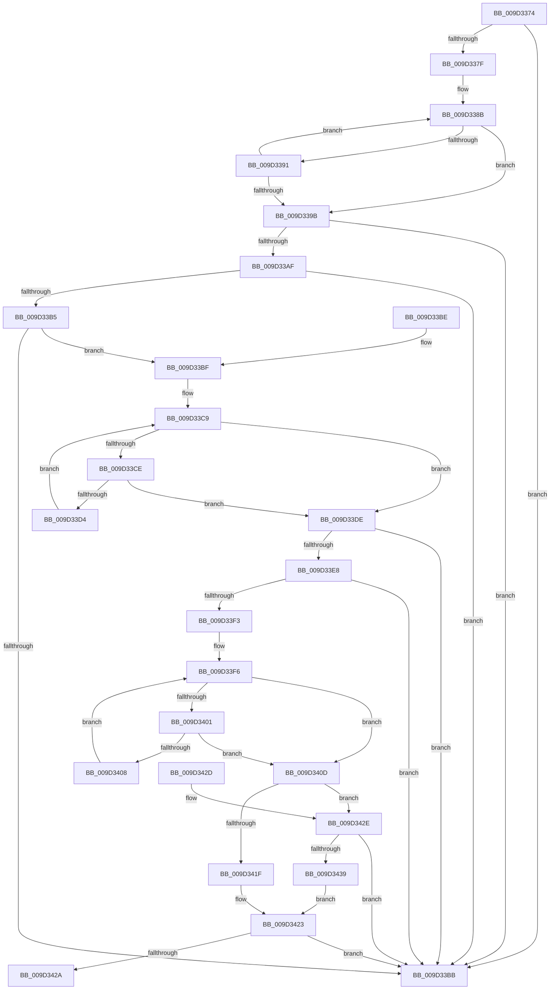

# PnpParseIndirectInfString

- RVA: `0x009D3374`–`0x009D343D` (길이 `201` bytes)
- VA: `0x00000001409D3374`
- 실행 섹션: `PAGE`
- PDB 이름 있음: `예`; PDB Function 태그: `아니요`
- unwind 정보 RVA: `0x000DB714`
- 디코드: `65`개 명령, `201/201` bytes 표시
- 미해석 바이트: `0` (있으면 어셈블리에 `.byte`로 보존)

> 이 문서는 커널 이미지의 기계어와 PDB 기호를 분석해 생성했습니다. 4번과 5번은 함수 원형과 자료형을 바이너리 사용 방식에서 추정한 C 해석이며 원본 소스 복구 결과는 아닙니다.

## 1. Dependencies

- 직접 호출 지점: **0**; 고유 호출 대상: **0**
- 직접 호출자로 확인된 함수: **3**
- RIP 상대 이미지 참조: **0**

### Outgoing calls
- 직접 디코드된 call 명령이 없습니다.

### Direct callers
- [PnpRegQueryValueIndirect](../8E/PnpRegQueryValueIndirect_function_008EE210.md) at `0x008EE3C4`
- [sub_009D2CEA](Unknown_function_009D2CEA.md) at `0x009D2E26`
- [_CmGetInstallerClassMappedPropertyFromRegProp](_CmGetInstallerClassMappedPropertyFromRegProp_function_009D3E34.md) at `0x009D3F96`

### Static image references
- 디코드된 RIP-relative 메모리 참조가 없습니다.

## 2. Other-region calls and transfers

- 다른 실행 섹션으로 향하는 call: **0**
- 별도 외부 분기/꼬리 이동을 확인하지 못했습니다.

## 3. Assembly (complete function range)

```asm
009D3374  45 33 D2                        xor r10d, r10d
009D3377  48 8B D1                        mov rdx, rcx
009D337A  48 85 C9                        test rcx, rcx
009D337D  74 3C                           je 0x1409d33bb
009D337F  41 B9 FF 7F 00 00               mov r9d, 0x7fff
009D3385  48 8B C1                        mov rax, rcx
009D3388  45 8B C1                        mov r8d, r9d
009D338B  66 44 39 10                     cmp word ptr [rax], r10w
009D338F  74 0A                           je 0x1409d339b
009D3391  48 83 C0 02                     add rax, 2
009D3395  49 83 E8 01                     sub r8, 1
009D3399  75 F0                           jne 0x1409d338b
009D339B  4D 2B C8                        sub r9, r8
009D339E  49 8B C0                        mov rax, r8
009D33A1  48 F7 D8                        neg rax
009D33A4  48 1B C9                        sbb rcx, rcx
009D33A7  49 23 C9                        and rcx, r9
009D33AA  4D 85 C0                        test r8, r8
009D33AD  74 0C                           je 0x1409d33bb
009D33AF  48 83 F9 05                     cmp rcx, 5
009D33B3  72 06                           jb 0x1409d33bb
009D33B5  66 83 3A 40                     cmp word ptr [rdx], 0x40
009D33B9  74 04                           je 0x1409d33bf
009D33BB  32 C0                           xor al, al
009D33BD  C3                              ret
009D33BE  CC                              int3
009D33BF  0F B7 42 02                     movzx eax, word ptr [rdx + 2]
009D33C3  41 B8 01 00 00 00               mov r8d, 1
009D33C9  66 85 C0                        test ax, ax
009D33CC  74 10                           je 0x1409d33de
009D33CE  66 83 F8 2C                     cmp ax, 0x2c
009D33D2  74 0A                           je 0x1409d33de
009D33D4  41 FF C0                        inc r8d
009D33D7  42 0F B7 04 42                  movzx eax, word ptr [rdx + r8*2]
009D33DC  EB EB                           jmp 0x1409d33c9
009D33DE  41 8B C0                        mov eax, r8d
009D33E1  66 83 3C 42 2C                  cmp word ptr [rdx + rax*2], 0x2c
009D33E6  75 D3                           jne 0x1409d33bb
009D33E8  41 FF C0                        inc r8d
009D33EB  66 42 83 3C 42 25               cmp word ptr [rdx + r8*2], 0x25
009D33F1  75 C8                           jne 0x1409d33bb
009D33F3  41 FF C0                        inc r8d
009D33F6  46 0F B7 0C 42                  movzx r9d, word ptr [rdx + r8*2]
009D33FB  66 45 85 C9                     test r9w, r9w
009D33FF  74 0C                           je 0x1409d340d
009D3401  66 41 83 F9 3B                  cmp r9w, 0x3b
009D3406  74 05                           je 0x1409d340d
009D3408  41 FF C0                        inc r8d
009D340B  EB E9                           jmp 0x1409d33f6
009D340D  66 42 83 3C 42 3B               cmp word ptr [rdx + r8*2], 0x3b
009D3413  45 8B CA                        mov r9d, r10d
009D3416  45 0F 44 C8                     cmove r9d, r8d
009D341A  45 85 C9                        test r9d, r9d
009D341D  74 0F                           je 0x1409d342e
009D341F  41 8D 49 FF                     lea ecx, [r9 - 1]
009D3423  66 83 3C 4A 25                  cmp word ptr [rdx + rcx*2], 0x25
009D3428  75 91                           jne 0x1409d33bb
009D342A  B0 01                           mov al, 1
009D342C  C3                              ret
009D342D  CC                              int3
009D342E  41 B8 FF FF FF FF               mov r8d, 0xffffffff
009D3434  49 3B C8                        cmp rcx, r8
009D3437  77 82                           ja 0x1409d33bb
009D3439  FF C9                           dec ecx
009D343B  EB E6                           jmp 0x1409d3423
```

## 4. C-style interpretation (structured pseudocode)

```c
__int64 __fastcall PnpParseIndirectInfString(__int64 a1)
{
    __int64 result;
    __int64 v_r10;

    v_r10 = 0;
    if (a1 == 0) goto loc_009D33BB;
loc_009D338B:
    if ((*(unsigned __int16 *)(a1)) == 0) goto loc_009D339B;
    result = (a1) + (2);
    a3 = ((unsigned int)((unsigned int)((unsigned int)(0x7FFFULL)))) - (1);
    if (condition_is_not_equal) goto loc_009D338B;
loc_009D339B:
    a4 = ((unsigned int)(0x7FFFULL)) - (a3);
    result = -(a3);
    a1 = (a1) & (a4);
    if (a3 == 0) goto loc_009D33BB;
    if (a1 < 5) goto loc_009D33BB;
    if ((*(unsigned __int16 *)(a1)) == 64) goto loc_009D33BF;
loc_009D33BB:
    result = 0;
    return result;
loc_009D33BF:
loc_009D33C9:
    if ((unsigned __int16)(*(unsigned __int16 *)(a1 + 2)) == 0) goto loc_009D33DE;
    if (((unsigned __int16)(*(unsigned __int16 *)(a1 + 2))) == 44) goto loc_009D33DE;
    a3 = (unsigned int)((1) + 1);
    goto loc_009D33C9;
loc_009D33DE:
    if ((*(unsigned __int16 *)(a1 + (unsigned int)((unsigned int)(a3)) * 2)) != 44) goto loc_009D33BB;
    a3 = (unsigned int)((a3) + 1);
    if ((*(unsigned __int16 *)(a1 + a3 * 2)) != 37) goto loc_009D33BB;
    a3 = (unsigned int)((a3) + 1);
loc_009D33F6:
    if ((unsigned __int16)(*(unsigned __int16 *)(a1 + a3 * 2)) == 0) goto loc_009D340D;
    if (((unsigned __int16)(*(unsigned __int16 *)(a1 + a3 * 2))) == 59) goto loc_009D340D;
    a3 = (unsigned int)((a3) + 1);
    goto loc_009D33F6;
loc_009D340D:
    a4 = 0;
    if ((*(unsigned __int16 *)(a1 + a3 * 2)) == 59) { a4 = (unsigned int)(a3); }
    if ((unsigned int)(a4) == 0) goto loc_009D342E;
loc_009D3423:
    if ((*(unsigned __int16 *)(a1 + a4 - 1 * 2)) != 37) goto loc_009D33BB;
    return 1;
loc_009D342E:
    if ((a4 - 1) > ((unsigned int)(0xFFFFFFFFULL))) goto loc_009D33BB;
    a1 = (unsigned int)((a4 - 1) - 1);
    goto loc_009D3423;
}
```

## 5. (Beta) C Style

```c
int64_t PnpParseIndirectInfString(void *Arg1)
{
    uint8_t *arg1 = (uint8_t *)Arg1;

    int64_t result;
    int64_t local_r10;

    local_r10 = 0;
    if (Arg1 == NULL) goto loc_009D33BB;
loc_009D338B:
    if ((*(uint16_t *)(arg1)) == 0) goto loc_009D339B;
    result = (Arg1) + (2);
    a3 = ((uint32_t)((uint32_t)((uint32_t)(0x7FFFULL)))) - (1);
    if (condition_is_not_equal) goto loc_009D338B;
loc_009D339B:
    a4 = ((uint32_t)(0x7FFFULL)) - (a3);
    result = -(a3);
    Arg1 = (Arg1) & (a4);
    if (a3 == 0) goto loc_009D33BB;
    if (Arg1 < 5) goto loc_009D33BB;
    if ((*(uint16_t *)(arg1)) == 64) goto loc_009D33BF;
loc_009D33BB:
    result = 0;
    return result;
loc_009D33BF:
loc_009D33C9:
    if ((uint16_t)(*(uint16_t *)(arg1 + 0x2)) == 0) goto loc_009D33DE;
    if (((uint16_t)(*(uint16_t *)(arg1 + 0x2))) == 44) goto loc_009D33DE;
    a3 = (uint32_t)((1) + 1);
    goto loc_009D33C9;
loc_009D33DE:
    if ((*(uint16_t *)(arg1 + (uint32_t)((uint32_t)(a3)) * 2)) != 44) goto loc_009D33BB;
    a3 = (uint32_t)((a3) + 1);
    if ((*(uint16_t *)(arg1 + a3 * 2)) != 37) goto loc_009D33BB;
    a3 = (uint32_t)((a3) + 1);
loc_009D33F6:
    if ((uint16_t)(*(uint16_t *)(arg1 + a3 * 2)) == 0) goto loc_009D340D;
    if (((uint16_t)(*(uint16_t *)(arg1 + a3 * 2))) == 59) goto loc_009D340D;
    a3 = (uint32_t)((a3) + 1);
    goto loc_009D33F6;
loc_009D340D:
    a4 = 0;
    if ((*(uint16_t *)(arg1 + a3 * 2)) == 59) { a4 = (uint32_t)(a3); }
    if ((uint32_t)(a4) == 0) goto loc_009D342E;
loc_009D3423:
    if ((*(uint16_t *)(arg1 + a4 - 0x1 * 2)) != 37) goto loc_009D33BB;
    return 1;
loc_009D342E:
    if ((a4 - 1) > ((uint32_t)(0xFFFFFFFFULL))) goto loc_009D33BB;
    Arg1 = (uint32_t)((a4 - 1) - 1);
    goto loc_009D3423;
}
```

### 관측된 메모리 오프셋

구조체 형식이 확인되지 않은 접근은 인자 기준의 오프셋으로만 기록했습니다.

| 기준 인자 | 오프셋 표현 | 폭 (bit) | 접근 |
|---|---:|---:|---|
| `Arg1` | `+ 0x0` | `16` | `R` |
| `Arg1` | `+ 0x0 + r8*2` | `16` | `R` |
| `Arg1` | `+ 0x0 + rax*2` | `16` | `R` |
| `Arg1` | `+ 0x0 + rcx*2` | `16` | `R` |
| `Arg1` | `+ 0x2` | `16` | `R` |

## 6. Execution-region graph

[열기: 2D/3D 그래프와 함수 탐색 컨트롤 패널](../../../control-panel.html?section=page&rva=0x009D3374&view=graph)

- 2D 그래프는 위에서 아래로 흐르고, 3D 그래프는 빈 공간을 드래그해 회전합니다. Shift+드래그는 이동, 휠은 확대·축소, 함수 노드 선택은 대상 보고서 이동입니다.

### Static fallback


