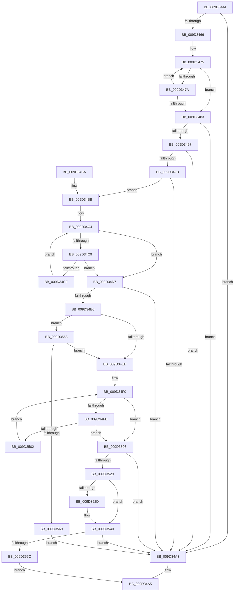

# PnpParseIndirectResourceString

- RVA: `0x009D3444`–`0x009D356E` (길이 `298` bytes)
- VA: `0x00000001409D3444`
- 실행 섹션: `PAGE`
- PDB 이름 있음: `예`; PDB Function 태그: `아니요`
- unwind 정보 RVA: `0x000A1550`
- 디코드: `90`개 명령, `298/298` bytes 표시
- 미해석 바이트: `0` (있으면 어셈블리에 `.byte`로 보존)

> 이 문서는 커널 이미지의 기계어와 PDB 기호를 분석해 생성했습니다. 4번과 5번은 함수 원형과 자료형을 바이너리 사용 방식에서 추정한 C 해석이며 원본 소스 복구 결과는 아닙니다.

## 1. Dependencies

- 직접 호출 지점: **2**; 고유 호출 대상: **2**
- 직접 호출자로 확인된 함수: **3**
- RIP 상대 이미지 참조: **0**

### Outgoing calls
- `0x009D351C` → [RtlInitUnicodeStringEx](../../text/46/RtlInitUnicodeStringEx_function_00463960.md) (function, `0x00463960`)
- `0x009D354F` → [RtlUnicodeStringToInteger](../99/RtlUnicodeStringToInteger_function_00993480.md) (function, `0x00993480`)

### Direct callers
- [PnpRegQueryValueIndirect](../8E/PnpRegQueryValueIndirect_function_008EE210.md) at `0x008EE3D0`
- [sub_009D2CEA](Unknown_function_009D2CEA.md) at `0x009D2E32`
- [_CmGetInstallerClassMappedPropertyFromRegProp](_CmGetInstallerClassMappedPropertyFromRegProp_function_009D3E34.md) at `0x009D3FA2`

### Static image references
- 디코드된 RIP-relative 메모리 참조가 없습니다.

## 2. Other-region calls and transfers

- 다른 실행 섹션으로 향하는 call: **1**
  - `0x009D351C` → [RtlInitUnicodeStringEx](../../text/46/RtlInitUnicodeStringEx_function_00463960.md) (`PAGE` → `.text`)
- 별도 외부 분기/꼬리 이동을 확인하지 못했습니다.

## 3. Assembly (complete function range)

```asm
009D3444  48 8B C4                        mov rax, rsp
009D3447  48 89 58 08                     mov qword ptr [rax + 8], rbx
009D344B  48 89 68 10                     mov qword ptr [rax + 0x10], rbp
009D344F  48 89 70 18                     mov qword ptr [rax + 0x18], rsi
009D3453  57                              push rdi
009D3454  48 83 EC 30                     sub rsp, 0x30
009D3458  33 F6                           xor esi, esi
009D345A  0F 57 C0                        xorps xmm0, xmm0
009D345D  0F 11 40 E8                     movups xmmword ptr [rax - 0x18], xmm0
009D3461  48 85 C9                        test rcx, rcx
009D3464  74 3D                           je 0x1409d34a3
009D3466  41 B8 FF 7F 00 00               mov r8d, 0x7fff
009D346C  8D 6E 02                        lea ebp, [rsi + 2]
009D346F  41 8B D0                        mov edx, r8d
009D3472  48 8B C1                        mov rax, rcx
009D3475  66 39 30                        cmp word ptr [rax], si
009D3478  74 09                           je 0x1409d3483
009D347A  48 03 C5                        add rax, rbp
009D347D  48 83 EA 01                     sub rdx, 1
009D3481  75 F2                           jne 0x1409d3475
009D3483  4C 2B C2                        sub r8, rdx
009D3486  48 8B C2                        mov rax, rdx
009D3489  48 F7 D8                        neg rax
009D348C  4D 1B C9                        sbb r9, r9
009D348F  4D 23 C8                        and r9, r8
009D3492  48 85 D2                        test rdx, rdx
009D3495  74 0C                           je 0x1409d34a3
009D3497  49 83 F9 05                     cmp r9, 5
009D349B  72 06                           jb 0x1409d34a3
009D349D  66 83 39 40                     cmp word ptr [rcx], 0x40
009D34A1  74 18                           je 0x1409d34bb
009D34A3  32 C0                           xor al, al
009D34A5  48 8B 5C 24 40                  mov rbx, qword ptr [rsp + 0x40]
009D34AA  48 8B 6C 24 48                  mov rbp, qword ptr [rsp + 0x48]
009D34AF  48 8B 74 24 50                  mov rsi, qword ptr [rsp + 0x50]
009D34B4  48 83 C4 30                     add rsp, 0x30
009D34B8  5F                              pop rdi
009D34B9  C3                              ret
009D34BA  CC                              int3
009D34BB  0F B7 41 02                     movzx eax, word ptr [rcx + 2]
009D34BF  BA 01 00 00 00                  mov edx, 1
009D34C4  66 85 C0                        test ax, ax
009D34C7  74 0E                           je 0x1409d34d7
009D34C9  66 83 F8 2C                     cmp ax, 0x2c
009D34CD  74 08                           je 0x1409d34d7
009D34CF  FF C2                           inc edx
009D34D1  0F B7 04 51                     movzx eax, word ptr [rcx + rdx*2]
009D34D5  EB ED                           jmp 0x1409d34c4
009D34D7  8B C2                           mov eax, edx
009D34D9  66 83 3C 41 2C                  cmp word ptr [rcx + rax*2], 0x2c
009D34DE  75 C3                           jne 0x1409d34a3
009D34E0  8D 7A 01                        lea edi, [rdx + 1]
009D34E3  0F B7 04 79                     movzx eax, word ptr [rcx + rdi*2]
009D34E7  66 83 F8 2D                     cmp ax, 0x2d
009D34EB  75 76                           jne 0x1409d3563
009D34ED  8D 57 01                        lea edx, [rdi + 1]
009D34F0  44 0F B7 04 51                  movzx r8d, word ptr [rcx + rdx*2]
009D34F5  66 45 85 C0                     test r8w, r8w
009D34F9  74 0B                           je 0x1409d3506
009D34FB  66 41 83 F8 3B                  cmp r8w, 0x3b
009D3500  74 04                           je 0x1409d3506
009D3502  FF C2                           inc edx
009D3504  EB EA                           jmp 0x1409d34f0
009D3506  66 83 3C 51 3B                  cmp word ptr [rcx + rdx*2], 0x3b
009D350B  8B DE                           mov ebx, esi
009D350D  0F 44 DA                        cmove ebx, edx
009D3510  48 03 CD                        add rcx, rbp
009D3513  48 8D 14 79                     lea rdx, [rcx + rdi*2]
009D3517  48 8D 4C 24 20                  lea rcx, [rsp + 0x20]
009D351C  E8 3F 04 A9 FF                  call 0x140463960
009D3521  85 C0                           test eax, eax
009D3523  0F 88 7A FF FF FF               js 0x1409d34a3
009D3529  85 DB                           test ebx, ebx
009D352B  74 13                           je 0x1409d3540
009D352D  66 2B DF                        sub bx, di
009D3530  66 03 DB                        add bx, bx
009D3533  66 2B DD                        sub bx, bp
009D3536  66 89 5C 24 20                  mov word ptr [rsp + 0x20], bx
009D353B  66 89 5C 24 22                  mov word ptr [rsp + 0x22], bx
009D3540  4C 8D 44 24 58                  lea r8, [rsp + 0x58]
009D3545  BA 0A 00 00 00                  mov edx, 0xa
009D354A  48 8D 4C 24 20                  lea rcx, [rsp + 0x20]
009D354F  E8 2C FF FB FF                  call 0x140993480
009D3554  85 C0                           test eax, eax
009D3556  0F 88 47 FF FF FF               js 0x1409d34a3
009D355C  B0 01                           mov al, 1
009D355E  E9 42 FF FF FF                  jmp 0x1409d34a5
009D3563  66 83 F8 23                     cmp ax, 0x23
009D3567  74 84                           je 0x1409d34ed
009D3569  E9 35 FF FF FF                  jmp 0x1409d34a3
```

## 4. C-style interpretation (structured pseudocode)

```c
__int64 __fastcall PnpParseIndirectResourceString(__int64 a1, __int64 a2, __int64 a3, __int64 a4)
{
    __int64 result;
    __int64 v_rbx;
    __int64 v_rsi;
    __int64 v_rsp;
    unsigned __int64 v_stack_p10;
    unsigned __int64 v_stack_p18;
    unsigned __int64 v_stack_p20;
    unsigned __int16 v_stack_p22;
    unsigned __int64 v_stack_p58;
    unsigned __int64 v_stack_p8;

    *(unsigned __int64 *)(v_rsp + 8) = v_rbx;
    *(unsigned __int64 *)(v_rsp + 16) = v_rbp;
    *(unsigned __int64 *)(v_rsp + 24) = v_rsi;
    v_rsp = (v_rsp) - (48);
    v_rsi = 0;
    *(unsigned __int64 *)(v_rsp - 24) = v_xmm0;
    if (a1 == 0) goto loc_009D34A3;
loc_009D3475:
    if ((*(unsigned __int16 *)(a1)) == 0) goto loc_009D3483;
    result = (a1) + (v_rsi + 2);
    a2 = ((unsigned int)((unsigned int)((unsigned int)(0x7FFFULL)))) - (1);
    if (condition_is_not_equal) goto loc_009D3475;
loc_009D3483:
    a3 = ((unsigned int)(0x7FFFULL)) - (a2);
    result = -(a2);
    a4 = (a4) & (a3);
    if (a2 == 0) goto loc_009D34A3;
    if (a4 < 5) goto loc_009D34A3;
    if ((*(unsigned __int16 *)(a1)) == 64) goto loc_009D34BB;
loc_009D34A3:
    result = 0;
loc_009D34A5:
    v_rsp = (v_rsp) + (48);
    return result;
loc_009D34BB:
loc_009D34C4:
    if ((unsigned __int16)(*(unsigned __int16 *)(a1 + 2)) == 0) goto loc_009D34D7;
    if (((unsigned __int16)(*(unsigned __int16 *)(a1 + 2))) == 44) goto loc_009D34D7;
    a2 = (unsigned int)((1) + 1);
    goto loc_009D34C4;
loc_009D34D7:
    if ((*(unsigned __int16 *)(a1 + (unsigned int)((unsigned int)(a2)) * 2)) != 44) goto loc_009D34A3;
    if (((unsigned __int16)(*(unsigned __int16 *)(a1 + a2 + 1 * 2))) != 45) goto loc_009D3563;
loc_009D34ED:
loc_009D34F0:
    if ((unsigned __int16)(*(unsigned __int16 *)(a1 + a2 + 1 + 1 * 2)) == 0) goto loc_009D3506;
    if (((unsigned __int16)(*(unsigned __int16 *)(a1 + a2 + 1 + 1 * 2))) == 59) goto loc_009D3506;
    a2 = (unsigned int)((a2 + 1 + 1) + 1);
    goto loc_009D34F0;
loc_009D3506:
    v_rbx = (unsigned int)((unsigned int)(v_stack_p18));
    if ((*(unsigned __int16 *)(a1 + a2 * 2)) == 59) { v_rbx = (unsigned int)(a2); }
    a1 = (a1) + (v_stack_p10);
    result = RtlInitUnicodeStringEx(v_stack_p20, a1 + a2 + 1 * 2, *(unsigned __int16 *)(a1 + a2 + 1 + 1 * 2), a4);
    if (sign_flag) goto loc_009D34A3;
    if ((unsigned int)(v_rbx) != 0) {
        v_rbx = (unsigned __int16)((v_rbx) - ((unsigned __int16)(a2 + 1)));
        v_rbx = (unsigned __int16)((v_rbx) + ((unsigned __int16)(v_rbx)));
        v_rbx = (unsigned __int16)((v_rbx) - ((unsigned __int16)(v_stack_p10)));
        v_stack_p20 = (unsigned __int16)(v_rbx);
        v_stack_p22 = (unsigned __int16)(v_rbx);
    }
    result = RtlUnicodeStringToInteger(v_stack_p20, 10, v_stack_p58, a4);
    if (sign_flag) goto loc_009D34A3;
    goto loc_009D34A5;
loc_009D3563:
    if (1 == 35) goto loc_009D34ED;
    goto loc_009D34A3;
}
```

## 5. (Beta) C Style

```c
int64_t PnpParseIndirectResourceString(int64_t Arg1, int64_t Arg2, int64_t Arg3, int64_t Arg4)
{
    int64_t result;
    int64_t local_rbx;
    int64_t local_rsi;
    int64_t local_rsp;
    uint64_t v_stack_p10;
    uint64_t v_stack_p18;
    uint64_t v_stack_p20;
    uint16_t v_stack_p22;
    uint64_t v_stack_p58;
    uint64_t v_stack_p8;

    *(uint64_t *)(local_rsp + 0x8) = local_rbx;
    *(uint64_t *)(local_rsp + 0x10) = local_rbp;
    *(uint64_t *)(local_rsp + 0x18) = local_rsi;
    local_rsp = (local_rsp) - (48);
    local_rsi = 0;
    *(uint64_t *)(local_rsp - 0x18) = v_xmm0;
    if (Arg1 == 0) goto loc_009D34A3;
loc_009D3475:
    if ((*(uint16_t *)(Arg1)) == 0) goto loc_009D3483;
    result = (Arg1) + (local_rsi + 2);
    Arg2 = ((uint32_t)((uint32_t)((uint32_t)(0x7FFFULL)))) - (1);
    if (condition_is_not_equal) goto loc_009D3475;
loc_009D3483:
    Arg3 = ((uint32_t)(0x7FFFULL)) - (Arg2);
    result = -(Arg2);
    Arg4 = (Arg4) & (Arg3);
    if (Arg2 == 0) goto loc_009D34A3;
    if (Arg4 < 5) goto loc_009D34A3;
    if ((*(uint16_t *)(Arg1)) == 64) goto loc_009D34BB;
loc_009D34A3:
    result = 0;
loc_009D34A5:
    local_rsp = (local_rsp) + (48);
    return result;
loc_009D34BB:
loc_009D34C4:
    if ((uint16_t)(*(uint16_t *)(Arg1 + 0x2)) == 0) goto loc_009D34D7;
    if (((uint16_t)(*(uint16_t *)(Arg1 + 0x2))) == 44) goto loc_009D34D7;
    Arg2 = (uint32_t)((1) + 1);
    goto loc_009D34C4;
loc_009D34D7:
    if ((*(uint16_t *)(Arg1 + (uint32_t)((uint32_t)(Arg2)) * 2)) != 44) goto loc_009D34A3;
    if (((uint16_t)(*(uint16_t *)(Arg1 + Arg2 + 0x1 * 2))) != 45) goto loc_009D3563;
loc_009D34ED:
loc_009D34F0:
    if ((uint16_t)(*(uint16_t *)(Arg1 + Arg2 + 0x1 + 0x1 * 2)) == 0) goto loc_009D3506;
    if (((uint16_t)(*(uint16_t *)(Arg1 + Arg2 + 0x1 + 0x1 * 2))) == 59) goto loc_009D3506;
    Arg2 = (uint32_t)((Arg2 + 1 + 1) + 1);
    goto loc_009D34F0;
loc_009D3506:
    local_rbx = (uint32_t)((uint32_t)(v_stack_p18));
    if ((*(uint16_t *)(Arg1 + Arg2 * 2)) == 59) { local_rbx = (uint32_t)(Arg2); }
    Arg1 = (Arg1) + (v_stack_p10);
    result = RtlInitUnicodeStringEx(v_stack_p20, Arg1 + Arg2 + 1 * 2, *(uint16_t *)(Arg1 + Arg2 + 0x1 + 0x1 * 2), Arg4);
    if (sign_flag) goto loc_009D34A3;
    if ((uint32_t)(local_rbx) != 0) {
        local_rbx = (uint16_t)((local_rbx) - ((uint16_t)(Arg2 + 1)));
        local_rbx = (uint16_t)((local_rbx) + ((uint16_t)(local_rbx)));
        local_rbx = (uint16_t)((local_rbx) - ((uint16_t)(v_stack_p10)));
        v_stack_p20 = (uint16_t)(local_rbx);
        v_stack_p22 = (uint16_t)(local_rbx);
    }
    result = RtlUnicodeStringToInteger(v_stack_p20, 10, v_stack_p58, Arg4);
    if (sign_flag) goto loc_009D34A3;
    goto loc_009D34A5;
loc_009D3563:
    if (1 == 35) goto loc_009D34ED;
    goto loc_009D34A3;
}
```

## 6. Execution-region graph

[열기: 2D/3D 그래프와 함수 탐색 컨트롤 패널](../../../control-panel.html?section=page&rva=0x009D3444&view=graph)

- 2D 그래프는 위에서 아래로 흐르고, 3D 그래프는 빈 공간을 드래그해 회전합니다. Shift+드래그는 이동, 휠은 확대·축소, 함수 노드 선택은 대상 보고서 이동입니다.

### Static fallback


