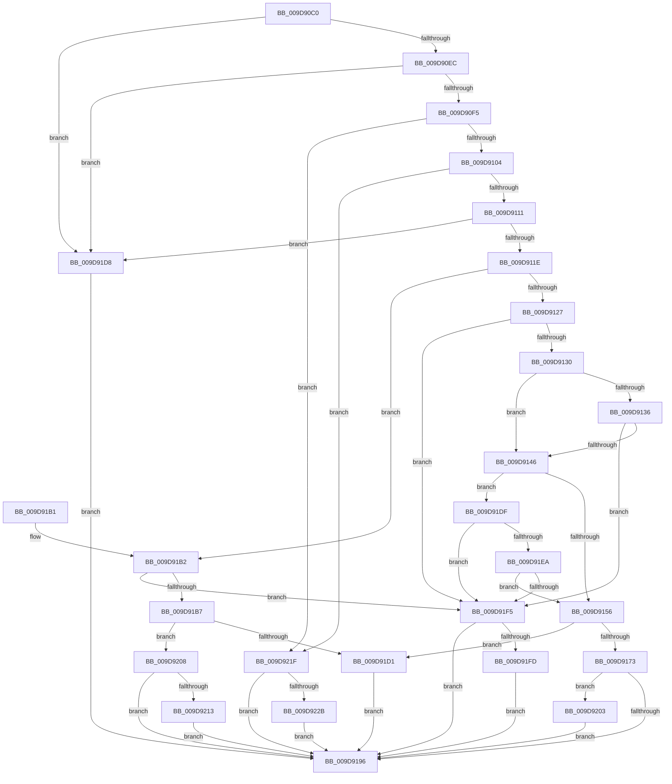

# PnpUnicodeStringToWstr

- RVA: `0x009D90C0`–`0x009D9233` (길이 `371` bytes)
- VA: `0x00000001409D90C0`
- 실행 섹션: `PAGE`
- PDB 이름 있음: `예`; PDB Function 태그: `아니요`
- unwind 정보 RVA: `0x0006F298`
- 디코드: `101`개 명령, `371/371` bytes 표시
- 미해석 바이트: `0` (있으면 어셈블리에 `.byte`로 보존)

> 이 문서는 커널 이미지의 기계어와 PDB 기호를 분석해 생성했습니다. 4번과 5번은 함수 원형과 자료형을 바이너리 사용 방식에서 추정한 C 해석이며 원본 소스 복구 결과는 아닙니다.

## 1. Dependencies

- 직접 호출 지점: **3**; 고유 호출 대상: **2**
- 직접 호출자로 확인된 함수: **8**
- RIP 상대 이미지 참조: **0**

### Outgoing calls
- `0x009D9166` → [ExAllocatePool2](../../poolcode/B8/ExAllocatePool2_function_00B820F0.md) (function, `0x00B820F0`)
- `0x009D917E` → [memcpy](../../text/6C/memcpy_function_006C6840.md) (function, `0x006C6840`)
- `0x009D91C7` → [ExAllocatePool2](../../poolcode/B8/ExAllocatePool2_function_00B820F0.md) (function, `0x00B820F0`)

### Direct callers
- [IoReportDetectedDevice](../72/IoReportDetectedDevice_function_00725CD0.md) at `0x007262B0`
- [PipApplyFunctionToServiceInstances](../72/PipApplyFunctionToServiceInstances_function_0072BF40.md) at `0x0072C0A6`
- [PiInitializeDevice](../73/PiInitializeDevice_function_0073EC5C.md) at `0x0073ECFD`
- [IoOpenDeviceInterfaceRegistryKey](../AC/IoOpenDeviceInterfaceRegistryKey_function_00AC5C60.md) at `0x00AC5CB0`
- [IopDeviceObjectFromSymbolicName](../AD/IopDeviceObjectFromSymbolicName_function_00AD63EC.md) at `0x00AD6432`
- [sub_00B33DD8](../B3/Unknown_function_00B33DD8.md) at `0x00B33EF8`
- [IopInitializeBootDrivers](../../init/C2/IopInitializeBootDrivers_function_00C2E6F4.md) at `0x00C2F1E9`
- [PipInitComputerIds](../../init/C7/PipInitComputerIds_function_00C74734.md) at `0x00C74D59`

### Static image references
- 디코드된 RIP-relative 메모리 참조가 없습니다.

## 2. Other-region calls and transfers

- 다른 실행 섹션으로 향하는 call: **3**
  - `0x009D9166` → [ExAllocatePool2](../../poolcode/B8/ExAllocatePool2_function_00B820F0.md) (`PAGE` → `POOLCODE`)
  - `0x009D917E` → [memcpy](../../text/6C/memcpy_function_006C6840.md) (`PAGE` → `.text`)
  - `0x009D91C7` → [ExAllocatePool2](../../poolcode/B8/ExAllocatePool2_function_00B820F0.md) (`PAGE` → `POOLCODE`)
- 별도 외부 분기/꼬리 이동을 확인하지 못했습니다.

## 3. Assembly (complete function range)

```asm
009D90C0  48 89 5C 24 08                  mov qword ptr [rsp + 8], rbx
009D90C5  48 89 6C 24 10                  mov qword ptr [rsp + 0x10], rbp
009D90CA  48 89 74 24 18                  mov qword ptr [rsp + 0x18], rsi
009D90CF  57                              push rdi
009D90D0  41 56                           push r14
009D90D2  41 57                           push r15
009D90D4  48 83 EC 20                     sub rsp, 0x20
009D90D8  33 FF                           xor edi, edi
009D90DA  49 8B D8                        mov rbx, r8
009D90DD  48 8B EA                        mov rbp, rdx
009D90E0  4C 8B F1                        mov r14, rcx
009D90E3  48 85 C9                        test rcx, rcx
009D90E6  0F 84 EC 00 00 00               je 0x1409d91d8
009D90EC  48 85 DB                        test rbx, rbx
009D90EF  0F 84 E3 00 00 00               je 0x1409d91d8
009D90F5  45 0F B7 40 02                  movzx r8d, word ptr [r8 + 2]
009D90FA  41 83 F8 02                     cmp r8d, 2
009D90FE  0F 82 1B 01 00 00               jb 0x1409d921f
009D9104  48 8B 53 08                     mov rdx, qword ptr [rbx + 8]
009D9108  48 85 D2                        test rdx, rdx
009D910B  0F 84 0E 01 00 00               je 0x1409d921f
009D9111  0F B7 0B                        movzx ecx, word ptr [rbx]
009D9114  66 41 3B C8                     cmp cx, r8w
009D9118  0F 87 BA 00 00 00               ja 0x1409d91d8
009D911E  66 85 C9                        test cx, cx
009D9121  0F 84 8B 00 00 00               je 0x1409d91b2
009D9127  66 39 3A                        cmp word ptr [rdx], di
009D912A  0F 84 C5 00 00 00               je 0x1409d91f5
009D9130  66 41 3B C8                     cmp cx, r8w
009D9134  75 10                           jne 0x1409d9146
009D9136  8B C1                           mov eax, ecx
009D9138  48 D1 E8                        shr rax, 1
009D913B  66 39 7C 42 FE                  cmp word ptr [rdx + rax*2 - 2], di
009D9140  0F 84 AF 00 00 00               je 0x1409d91f5
009D9146  49 8D 40 FE                     lea rax, [r8 - 2]
009D914A  4C 8B C9                        mov r9, rcx
009D914D  48 3B C8                        cmp rcx, rax
009D9150  0F 86 89 00 00 00               jbe 0x1409d91df
009D9156  8D 71 02                        lea esi, [rcx + 2]
009D9159  41 B8 50 70 73 75               mov r8d, 0x75737050
009D915F  8B D6                           mov edx, esi
009D9161  B9 00 01 00 00                  mov ecx, 0x100
009D9166  E8 85 8F 1A 00                  call 0x140b820f0
009D916B  4C 8B F8                        mov r15, rax
009D916E  48 85 C0                        test rax, rax
009D9171  74 5E                           je 0x1409d91d1
009D9173  44 0F B7 03                     movzx r8d, word ptr [rbx]
009D9177  48 8B C8                        mov rcx, rax
009D917A  48 8B 53 08                     mov rdx, qword ptr [rbx + 8]
009D917E  E8 BD D6 CE FF                  call 0x1406c6840
009D9183  0F B7 03                        movzx eax, word ptr [rbx]
009D9186  48 D1 E8                        shr rax, 1
009D9189  4D 89 3E                        mov qword ptr [r14], r15
009D918C  66 41 89 3C 47                  mov word ptr [r15 + rax*2], di
009D9191  48 85 ED                        test rbp, rbp
009D9194  75 6D                           jne 0x1409d9203
009D9196  48 8B 5C 24 40                  mov rbx, qword ptr [rsp + 0x40]
009D919B  8B C7                           mov eax, edi
009D919D  48 8B 6C 24 48                  mov rbp, qword ptr [rsp + 0x48]
009D91A2  48 8B 74 24 50                  mov rsi, qword ptr [rsp + 0x50]
009D91A7  48 83 C4 20                     add rsp, 0x20
009D91AB  41 5F                           pop r15
009D91AD  41 5E                           pop r14
009D91AF  5F                              pop rdi
009D91B0  C3                              ret
009D91B1  CC                              int3
009D91B2  66 39 3A                        cmp word ptr [rdx], di
009D91B5  74 3E                           je 0x1409d91f5
009D91B7  BA 02 00 00 00                  mov edx, 2
009D91BC  B9 00 01 00 00                  mov ecx, 0x100
009D91C1  41 B8 50 70 73 75               mov r8d, 0x75737050
009D91C7  E8 24 8F 1A 00                  call 0x140b820f0
009D91CC  48 85 C0                        test rax, rax
009D91CF  75 37                           jne 0x1409d9208
009D91D1  BF 9A 00 00 C0                  mov edi, 0xc000009a
009D91D6  EB BE                           jmp 0x1409d9196
009D91D8  BF 0D 00 00 C0                  mov edi, 0xc000000d
009D91DD  EB B7                           jmp 0x1409d9196
009D91DF  49 D1 E9                        shr r9, 1
009D91E2  66 42 39 7C 4A FE               cmp word ptr [rdx + r9*2 - 2], di
009D91E8  74 0B                           je 0x1409d91f5
009D91EA  66 42 39 3C 4A                  cmp word ptr [rdx + r9*2], di
009D91EF  0F 85 61 FF FF FF               jne 0x1409d9156
009D91F5  49 89 16                        mov qword ptr [r14], rdx
009D91F8  48 85 ED                        test rbp, rbp
009D91FB  74 99                           je 0x1409d9196
009D91FD  44 89 45 00                     mov dword ptr [rbp], r8d
009D9201  EB 93                           jmp 0x1409d9196
009D9203  89 75 00                        mov dword ptr [rbp], esi
009D9206  EB 8E                           jmp 0x1409d9196
009D9208  66 89 38                        mov word ptr [rax], di
009D920B  49 89 06                        mov qword ptr [r14], rax
009D920E  48 85 ED                        test rbp, rbp
009D9211  74 83                           je 0x1409d9196
009D9213  C7 45 00 02 00 00 00            mov dword ptr [rbp], 2
009D921A  E9 77 FF FF FF                  jmp 0x1409d9196
009D921F  48 89 39                        mov qword ptr [rcx], rdi
009D9222  48 85 ED                        test rbp, rbp
009D9225  0F 84 6B FF FF FF               je 0x1409d9196
009D922B  89 7D 00                        mov dword ptr [rbp], edi
009D922E  E9 63 FF FF FF                  jmp 0x1409d9196
```

## 4. C-style interpretation (structured pseudocode)

```c
__int64 __fastcall PnpUnicodeStringToWstr(__int64 a1, __int64 a2, __int64 a3)
{
    __int64 result;
    __int64 v_rdi;
    __int64 v_rsp;
    unsigned __int64 v_stack_p10;
    unsigned __int64 v_stack_p18;
    unsigned __int64 v_stack_p8;

    v_stack_p8 = v_rbx;
    v_stack_p10 = v_rbp;
    v_stack_p18 = v_rsi;
    v_rsp = (v_rsp) - (32);
    v_rdi = 0;
    if (a1 == 0) goto loc_009D91D8;
    if (a3 == 0) goto loc_009D91D8;
    if (((unsigned int)(*(unsigned __int16 *)(a3 + 2))) < 2) goto loc_009D921F;
    if (*(unsigned __int64 *)(a3 + 8) == 0) goto loc_009D921F;
    if (((unsigned __int16)(*(unsigned __int16 *)(a3))) > ((unsigned __int16)(*(unsigned __int16 *)(a3 + 2)))) goto loc_009D91D8;
    if ((unsigned __int16)(*(unsigned __int16 *)(a3)) == 0) goto loc_009D91B2;
    if ((*(unsigned __int16 *)(*(unsigned __int64 *)(a3 + 8))) == 0) goto loc_009D91F5;
    if (((unsigned __int16)(*(unsigned __int16 *)(a3))) != ((unsigned __int16)(*(unsigned __int16 *)(a3 + 2)))) goto loc_009D9146;
    result = ((unsigned int)((unsigned int)(*(unsigned __int16 *)(a3)))) >> (1);
    if ((*(unsigned __int16 *)(*(unsigned __int64 *)(a3 + 8) + result * 2 - 2)) == 0) goto loc_009D91F5;
loc_009D9146:
    if ((*(unsigned __int16 *)(a3)) <= (*(unsigned __int16 *)(a3 + 2) - 2)) goto loc_009D91DF;
loc_009D9156:
    result = ExAllocatePool2(256, (unsigned int)((unsigned int)(*(unsigned __int16 *)(a3) + 2)), (unsigned int)(0x75737050ULL), *(unsigned __int16 *)(a3));
    if (result == 0) goto loc_009D91D1;
    result = memcpy(result, *(unsigned __int64 *)(a3 + 8), *(unsigned __int16 *)(a3), *(unsigned __int16 *)(a3));
    result = (*(unsigned __int16 *)(a3)) >> (1);
    *(unsigned __int64 *)(a1) = result;
    *(unsigned __int16 *)(result + result * 2) = 0;
    if (a2 != 0) goto loc_009D9203;
loc_009D9196:
    v_rsp = (v_rsp) + (32);
    return 0;
loc_009D91B2:
    if ((*(unsigned __int16 *)(*(unsigned __int64 *)(a3 + 8))) == 0) goto loc_009D91F5;
    result = ExAllocatePool2(256, 2, (unsigned int)(0x75737050ULL), *(unsigned __int16 *)(a3));
    if (result != 0) goto loc_009D9208;
loc_009D91D1:
    goto loc_009D9196;
loc_009D91D8:
    goto loc_009D9196;
loc_009D91DF:
    a4 = (*(unsigned __int16 *)(a3)) >> (1);
    if ((*(unsigned __int16 *)(2 + a4 * 2 - 2)) == ((unsigned __int16)((unsigned int)(0xC000000DULL)))) goto loc_009D91F5;
    if ((*(unsigned __int16 *)(2 + a4 * 2)) != ((unsigned __int16)((unsigned int)(0xC000000DULL)))) goto loc_009D9156;
loc_009D91F5:
    *(unsigned __int64 *)(a1) = 2;
    if (v_stack_p10 == 0) goto loc_009D9196;
    *(unsigned int *)(v_stack_p10) = (unsigned int)((unsigned int)(0x75737050ULL));
    goto loc_009D9196;
loc_009D9203:
    *(unsigned int *)(v_stack_p10) = (unsigned int)(v_stack_p18);
    goto loc_009D9196;
loc_009D9208:
    *(unsigned __int16 *)(result) = (unsigned __int16)((unsigned int)(0xC000000DULL));
    *(unsigned __int64 *)(a1) = result;
    if (v_stack_p10 == 0) goto loc_009D9196;
    *(unsigned int *)(v_stack_p10) = 2;
    goto loc_009D9196;
loc_009D921F:
    *(unsigned __int64 *)(256) = (unsigned int)(0xC000000DULL);
    if (v_stack_p10 == 0) goto loc_009D9196;
    *(unsigned int *)(v_stack_p10) = (unsigned int)((unsigned int)(0xC000000DULL));
    goto loc_009D9196;
}
```

## 5. (Beta) C Style

```c
int64_t PnpUnicodeStringToWstr(void *Arg1, int64_t Arg2, void *Arg3)
{
    uint8_t *arg1 = (uint8_t *)Arg1;
    uint8_t *arg3 = (uint8_t *)Arg3;

    int64_t result;
    int64_t local_rdi;
    int64_t local_rsp;
    uint64_t v_stack_p10;
    uint64_t v_stack_p18;
    uint64_t v_stack_p8;

    v_stack_p8 = local_rbx;
    v_stack_p10 = local_rbp;
    v_stack_p18 = local_rsi;
    local_rsp = (local_rsp) - (32);
    local_rdi = 0;
    if (Arg1 == NULL) goto loc_009D91D8;
    if (Arg3 == NULL) goto loc_009D91D8;
    if (((uint32_t)(*(uint16_t *)(arg3 + 0x2))) < 2) goto loc_009D921F;
    if (*(uint64_t *)(arg3 + 0x8) == 0) goto loc_009D921F;
    if (((uint16_t)(*(uint16_t *)(arg3))) > ((uint16_t)(*(uint16_t *)(arg3 + 0x2)))) goto loc_009D91D8;
    if ((uint16_t)(*(uint16_t *)(arg3)) == 0) goto loc_009D91B2;
    if ((*(uint16_t *)(*(uint64_t *)(arg3 + 0x8))) == 0) goto loc_009D91F5;
    if (((uint16_t)(*(uint16_t *)(arg3))) != ((uint16_t)(*(uint16_t *)(arg3 + 0x2)))) goto loc_009D9146;
    result = ((uint32_t)((uint32_t)(*(uint16_t *)(arg3)))) >> (1);
    if ((*(uint16_t *)(*(uint64_t *)(arg3 + 0x8) + result * 2 - 0x2)) == 0) goto loc_009D91F5;
loc_009D9146:
    if ((*(uint16_t *)(arg3)) <= (*(uint16_t *)(arg3 + 0x2) - 2)) goto loc_009D91DF;
loc_009D9156:
    result = ExAllocatePool2(256, (uint32_t)((uint32_t)(*(uint16_t *)(arg3) + 2)), (uint32_t)(0x75737050ULL), *(uint16_t *)(arg3));
    if (result == 0) goto loc_009D91D1;
    result = memcpy(result, *(uint64_t *)(arg3 + 0x8), *(uint16_t *)(arg3), *(uint16_t *)(arg3));
    result = (*(uint16_t *)(arg3)) >> (1);
    *(uint64_t *)(arg1) = result;
    *(uint16_t *)(result + result * 2) = 0;
    if (Arg2 != 0) goto loc_009D9203;
loc_009D9196:
    local_rsp = (local_rsp) + (32);
    return 0;
loc_009D91B2:
    if ((*(uint16_t *)(*(uint64_t *)(arg3 + 0x8))) == 0) goto loc_009D91F5;
    result = ExAllocatePool2(256, 2, (uint32_t)(0x75737050ULL), *(uint16_t *)(arg3));
    if (result != 0) goto loc_009D9208;
loc_009D91D1:
    goto loc_009D9196;
loc_009D91D8:
    goto loc_009D9196;
loc_009D91DF:
    a4 = (*(uint16_t *)(arg3)) >> (1);
    if ((*(uint16_t *)(2 + a4 * 2 - 0x2)) == ((uint16_t)((uint32_t)(0xC000000DULL)))) goto loc_009D91F5;
    if ((*(uint16_t *)(2 + a4 * 2)) != ((uint16_t)((uint32_t)(0xC000000DULL)))) goto loc_009D9156;
loc_009D91F5:
    *(uint64_t *)(arg1) = 2;
    if (v_stack_p10 == 0) goto loc_009D9196;
    *(uint32_t *)(v_stack_p10) = (uint32_t)((uint32_t)(0x75737050ULL));
    goto loc_009D9196;
loc_009D9203:
    *(uint32_t *)(v_stack_p10) = (uint32_t)(v_stack_p18);
    goto loc_009D9196;
loc_009D9208:
    *(uint16_t *)(result) = (uint16_t)((uint32_t)(0xC000000DULL));
    *(uint64_t *)(arg1) = result;
    if (v_stack_p10 == 0) goto loc_009D9196;
    *(uint32_t *)(v_stack_p10) = 2;
    goto loc_009D9196;
loc_009D921F:
    *(uint64_t *)(256) = (uint32_t)(0xC000000DULL);
    if (v_stack_p10 == 0) goto loc_009D9196;
    *(uint32_t *)(v_stack_p10) = (uint32_t)((uint32_t)(0xC000000DULL));
    goto loc_009D9196;
}
```

### 관측된 메모리 오프셋

구조체 형식이 확인되지 않은 접근은 인자 기준의 오프셋으로만 기록했습니다.

| 기준 인자 | 오프셋 표현 | 폭 (bit) | 접근 |
|---|---:|---:|---|
| `Arg1` | `+ 0x0` | `64` | `W` |
| `Arg3` | `+ 0x2` | `16` | `R` |

## 6. Execution-region graph

[열기: 2D/3D 그래프와 함수 탐색 컨트롤 패널](../../../control-panel.html?section=page&rva=0x009D90C0&view=graph)

- 2D 그래프는 위에서 아래로 흐르고, 3D 그래프는 빈 공간을 드래그해 회전합니다. Shift+드래그는 이동, 휠은 확대·축소, 함수 노드 선택은 대상 보고서 이동입니다.

### Static fallback


