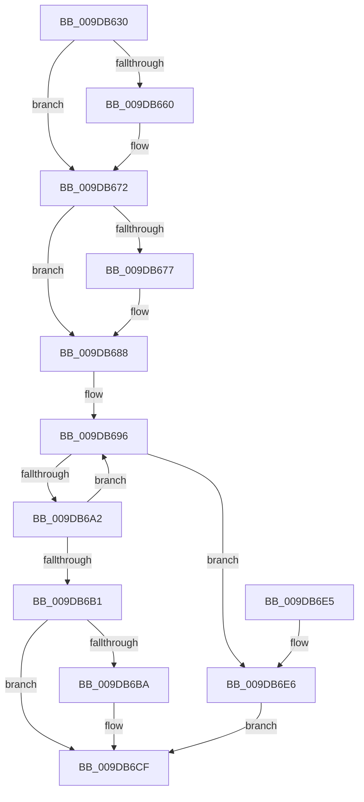

# PsQueryProcessAttributes

- RVA: `0x009DB630`–`0x009DB6F5` (길이 `197` bytes)
- VA: `0x00000001409DB630`
- 실행 섹션: `PAGE`
- PDB 이름 있음: `예`; PDB Function 태그: `아니요`
- unwind 정보 RVA: `0x000A3458`
- 디코드: `50`개 명령, `197/197` bytes 표시
- 미해석 바이트: `0` (있으면 어셈블리에 `.byte`로 보존)

> 이 문서는 커널 이미지의 기계어와 PDB 기호를 분석해 생성했습니다. 4번과 5번은 함수 원형과 자료형을 바이너리 사용 방식에서 추정한 C 해석이며 원본 소스 복구 결과는 아닙니다.

## 1. Dependencies

- 직접 호출 지점: **5**; 고유 호출 대상: **4**
- 직접 호출자로 확인된 함수: **4**
- RIP 상대 이미지 참조: **3**

### Outgoing calls
- `0x009DB653` → [PsReferencePrimaryTokenWithTag](../../text/20/PsReferencePrimaryTokenWithTag_function_0020FF80.md) (function, `0x0020FF80`)
- `0x009DB66A` → [SeSecurityAttributePresent](../../text/21/SeSecurityAttributePresent_function_00213660.md) (function, `0x00213660`)
- `0x009DB681` → [SeSecurityAttributePresent](../../text/21/SeSecurityAttributePresent_function_00213660.md) (function, `0x00213660`)
- `0x009DB6CA` → [ObpPushStackInfo](../../text/21/ObpPushStackInfo_function_002109E4.md) (function, `0x002109E4`)
- `0x009DB6EE` → [ObfDereferenceObjectWithTag](../../text/2F/ObfDereferenceObjectWithTag_function_002F78E0.md) (function, `0x002F78E0`)

### Direct callers
- [PopPowerRequestCreateCommon](../../text/23/PopPowerRequestCreateCommon_function_00230150.md) at `0x002302D0`
- [NtQueryInformationProcess](../9A/NtQueryInformationProcess_function_009AA250.md) at `0x009ABC47`
- [PspAllocateProcess](../A1/PspAllocateProcess_function_00A13B3C.md) at `0x00A15DA6`
- [PspAssignProcessToJob](../A2/PspAssignProcessToJob_function_00A23370.md) at `0x00A2378F`

### Static image references
- `0x009DB660` → RVA `0x00B4BEA8` (`PspSysAppIdClaim`; read)
- `0x009DB677` → RVA `0x00B4BE98` (`PspPackagedAppClaim`; read)
- `0x009DB6B1` → RVA `0x00FC5010` (`ALMOSTRO`; read)

## 2. Other-region calls and transfers

- 다른 실행 섹션으로 향하는 call: **5**
  - `0x009DB653` → [PsReferencePrimaryTokenWithTag](../../text/20/PsReferencePrimaryTokenWithTag_function_0020FF80.md) (`PAGE` → `.text`)
  - `0x009DB66A` → [SeSecurityAttributePresent](../../text/21/SeSecurityAttributePresent_function_00213660.md) (`PAGE` → `.text`)
  - `0x009DB681` → [SeSecurityAttributePresent](../../text/21/SeSecurityAttributePresent_function_00213660.md) (`PAGE` → `.text`)
  - `0x009DB6CA` → [ObpPushStackInfo](../../text/21/ObpPushStackInfo_function_002109E4.md) (`PAGE` → `.text`)
  - `0x009DB6EE` → [ObfDereferenceObjectWithTag](../../text/2F/ObfDereferenceObjectWithTag_function_002F78E0.md) (`PAGE` → `.text`)
- 별도 외부 분기/꼬리 이동을 확인하지 못했습니다.

## 3. Assembly (complete function range)

```asm
009DB630  48 89 5C 24 08                  mov qword ptr [rsp + 8], rbx
009DB635  48 89 74 24 10                  mov qword ptr [rsp + 0x10], rsi
009DB63A  48 89 7C 24 18                  mov qword ptr [rsp + 0x18], rdi
009DB63F  41 56                           push r14
009DB641  48 83 EC 20                     sub rsp, 0x20
009DB645  4C 8B F2                        mov r14, rdx
009DB648  49 8B F0                        mov rsi, r8
009DB64B  BA 44 66 6C 74                  mov edx, 0x746c6644
009DB650  48 8B D9                        mov rbx, rcx
009DB653  E8 28 49 83 FF                  call 0x14020ff80
009DB658  48 8B F8                        mov rdi, rax
009DB65B  4D 85 F6                        test r14, r14
009DB65E  74 12                           je 0x1409db672
009DB660  48 8D 15 41 08 17 00            lea rdx, [rip + 0x170841]
009DB667  48 8B C8                        mov rcx, rax
009DB66A  E8 F1 7F 83 FF                  call 0x140213660
009DB66F  41 88 06                        mov byte ptr [r14], al
009DB672  48 85 F6                        test rsi, rsi
009DB675  74 11                           je 0x1409db688
009DB677  48 8D 15 1A 08 17 00            lea rdx, [rip + 0x17081a]
009DB67E  48 8B CF                        mov rcx, rdi
009DB681  E8 DA 7F 83 FF                  call 0x140213660
009DB686  88 06                           mov byte ptr [rsi], al
009DB688  0F 0D 8B 48 02 00 00            prefetchw byte ptr [rbx + 0x248]
009DB68F  48 8B 83 48 02 00 00            mov rax, qword ptr [rbx + 0x248]
009DB696  48 8B C8                        mov rcx, rax
009DB699  48 33 CF                        xor rcx, rdi
009DB69C  48 83 F9 0F                     cmp rcx, 0xf
009DB6A0  73 44                           jae 0x1409db6e6
009DB6A2  48 8D 48 01                     lea rcx, [rax + 1]
009DB6A6  F0 48 0F B1 8B 48 02 00 00      lock cmpxchg qword ptr [rbx + 0x248], rcx
009DB6AF  75 E5                           jne 0x1409db696
009DB6B1  83 3D 58 99 5E 00 00            cmp dword ptr [rip + 0x5e9958], 0
009DB6B8  74 15                           je 0x1409db6cf
009DB6BA  33 D2                           xor edx, edx
009DB6BC  48 8D 4F D0                     lea rcx, [rdi - 0x30]
009DB6C0  41 B9 44 66 6C 74               mov r9d, 0x746c6644
009DB6C6  44 8D 42 01                     lea r8d, [rdx + 1]
009DB6CA  E8 15 53 83 FF                  call 0x1402109e4
009DB6CF  48 8B 5C 24 30                  mov rbx, qword ptr [rsp + 0x30]
009DB6D4  48 8B 74 24 38                  mov rsi, qword ptr [rsp + 0x38]
009DB6D9  48 8B 7C 24 40                  mov rdi, qword ptr [rsp + 0x40]
009DB6DE  48 83 C4 20                     add rsp, 0x20
009DB6E2  41 5E                           pop r14
009DB6E4  C3                              ret
009DB6E5  CC                              int3
009DB6E6  BA 44 66 6C 74                  mov edx, 0x746c6644
009DB6EB  48 8B CF                        mov rcx, rdi
009DB6EE  E8 ED C1 91 FF                  call 0x1402f78e0
009DB6F3  EB DA                           jmp 0x1409db6cf
```

## 4. C-style interpretation (structured pseudocode)

```c
__int64 __fastcall PsQueryProcessAttributes(__int64 a1, __int64 a2, __int64 a3)
{
    __int64 result;
    __int64 v_rsp;
    unsigned __int64 v_stack_p10;
    unsigned __int64 v_stack_p18;
    unsigned __int64 v_stack_p8;

    v_stack_p8 = v_rbx;
    v_stack_p10 = v_rsi;
    v_stack_p18 = v_rdi;
    v_rsp = (v_rsp) - (32);
    result = PsReferencePrimaryTokenWithTag(a1, (unsigned int)(0x746C6644ULL), a3, a4);
    if (a2 != 0) {
        a2 = v_rip + 1509441;
        a1 = result;
        result = SeSecurityAttributePresent(a1, a2, a3, a4);
        *(unsigned __int8 *)(a2) = (unsigned __int8)(result);
    }
    if (a3 != 0) {
        a2 = v_rip + 1509402;
        a1 = result;
        result = SeSecurityAttributePresent(a1, a2, a3, a4);
        *(unsigned __int8 *)(a3) = (unsigned __int8)(result);
    }
loc_009DB696:
    a1 = (*(unsigned __int64 *)(a1 + 584)) ^ (result);
    if (a1 >= 15) goto loc_009DB6E6;
    if (a1 != 15) goto loc_009DB696;
    result = *(unsigned __int64 *)(a1 + 584);
    if ((*(unsigned int *)(v_rip + 6199640)) != 0) {
        a2 = 0;
        a1 = result - 48;
        a4 = 0x746C6644ULL;
        a3 = a2 + 1;
        result = ObpPushStackInfo(a1, a2, a3, a4);
    }
    v_rsp = (v_rsp) + (32);
    return result;
loc_009DB6E6:
    result = ObfDereferenceObjectWithTag(v_stack_p18, (unsigned int)(0x746C6644ULL), a3, a4);
    goto loc_009DB6CF;
}
```

## 5. (Beta) C Style

```c
int64_t PsQueryProcessAttributes(void *Arg1, int64_t Arg2, int64_t Arg3)
{
    uint8_t *arg1 = (uint8_t *)Arg1;

    int64_t result;
    int64_t local_rsp;
    uint64_t v_stack_p10;
    uint64_t v_stack_p18;
    uint64_t v_stack_p8;

    v_stack_p8 = local_rbx;
    v_stack_p10 = local_rsi;
    v_stack_p18 = local_rdi;
    local_rsp = (local_rsp) - (32);
    result = PsReferencePrimaryTokenWithTag(Arg1, (uint32_t)(0x746C6644ULL), Arg3, a4);
    if (Arg2 != 0) {
        Arg2 = v_rip + 1509441;
        Arg1 = result;
        result = SeSecurityAttributePresent(Arg1, Arg2, Arg3, a4);
        *(uint8_t *)(Arg2) = (uint8_t)(result);
    }
    if (Arg3 != 0) {
        Arg2 = v_rip + 1509402;
        Arg1 = result;
        result = SeSecurityAttributePresent(Arg1, Arg2, Arg3, a4);
        *(uint8_t *)(Arg3) = (uint8_t)(result);
    }
loc_009DB696:
    Arg1 = (*(uint64_t *)(arg1 + 0x248)) ^ (result);
    if (Arg1 >= 15) goto loc_009DB6E6;
    if (Arg1 != 15) goto loc_009DB696;
    result = *(uint64_t *)(arg1 + 0x248);
    if ((*(uint32_t *)(v_rip + 0x5E9958)) != 0) {
        Arg2 = 0;
        Arg1 = result - 48;
        a4 = 0x746C6644ULL;
        Arg3 = Arg2 + 1;
        result = ObpPushStackInfo(Arg1, Arg2, Arg3, a4);
    }
    local_rsp = (local_rsp) + (32);
    return result;
loc_009DB6E6:
    result = ObfDereferenceObjectWithTag(v_stack_p18, (uint32_t)(0x746C6644ULL), Arg3, a4);
    goto loc_009DB6CF;
}
```

### 관측된 메모리 오프셋

구조체 형식이 확인되지 않은 접근은 인자 기준의 오프셋으로만 기록했습니다.

| 기준 인자 | 오프셋 표현 | 폭 (bit) | 접근 |
|---|---:|---:|---|
| `Arg1` | `+ 0x248` | `8` | `R` |
| `Arg1` | `+ 0x248` | `64` | `R` |

## 6. Execution-region graph

[열기: 2D/3D 그래프와 함수 탐색 컨트롤 패널](../../../control-panel.html?section=page&rva=0x009DB630&view=graph)

- 2D 그래프는 위에서 아래로 흐르고, 3D 그래프는 빈 공간을 드래그해 회전합니다. Shift+드래그는 이동, 휠은 확대·축소, 함수 노드 선택은 대상 보고서 이동입니다.

### Static fallback


