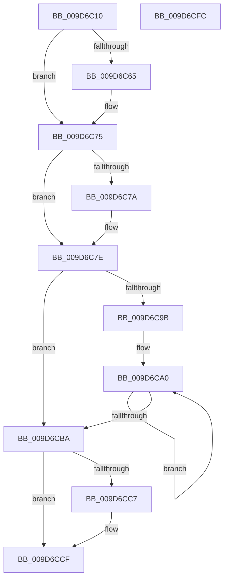

# PsQueryRuntimeProcess

- RVA: `0x009D6C10`–`0x009D6CFD` (길이 `237` bytes)
- VA: `0x00000001409D6C10`
- 실행 섹션: `PAGE`
- PDB 이름 있음: `예`; PDB Function 태그: `아니요`
- unwind 정보 RVA: `0x00083688`
- 디코드: `67`개 명령, `237/237` bytes 표시
- 미해석 바이트: `0` (있으면 어셈블리에 `.byte`로 보존)

> 이 문서는 커널 이미지의 기계어와 PDB 기호를 분석해 생성했습니다. 4번과 5번은 함수 원형과 자료형을 바이너리 사용 방식에서 추정한 C 해석이며 원본 소스 복구 결과는 아닙니다.

## 1. Dependencies

- 직접 호출 지점: **5**; 고유 호출 대상: **5**
- 직접 호출자로 확인된 함수: **3**
- RIP 상대 이미지 참조: **0**

### Outgoing calls
- `0x009D6C4D` → [KeAbPreAcquire](../../text/21/KeAbPreAcquire_function_00210230.md) (function, `0x00210230`)
- `0x009D6C70` → [ExfAcquirePushLockSharedEx](../../text/21/ExfAcquirePushLockSharedEx_function_0021044C.md) (function, `0x0021044C`)
- `0x009D6CCA` → [ExfReleasePushLockShared](../../text/26/ExfReleasePushLockShared_function_00263440.md) (function, `0x00263440`)
- `0x009D6CD2` → [KeAbPostRelease](../../text/2E/KeAbPostRelease_function_002E1600.md) (function, `0x002E1600`)
- `0x009D6CDA` → [KeLeaveCriticalRegionThread](../../text/25/KeLeaveCriticalRegionThread_function_0025EFF0.md) (function, `0x0025EFF0`)

### Direct callers
- [PspSetJobTimeLimitCallback](../78/PspSetJobTimeLimitCallback_function_00785900.md) at `0x0078591E`
- [NtQueryInformationProcess](../9A/NtQueryInformationProcess_function_009AA250.md) at `0x009AAFE5`
- [ExpQuerySystemPerformanceInformation](ExpQuerySystemPerformanceInformation_function_009D648C.md) at `0x009D67F6`

### Static image references
- 디코드된 RIP-relative 메모리 참조가 없습니다.

## 2. Other-region calls and transfers

- 다른 실행 섹션으로 향하는 call: **5**
  - `0x009D6C4D` → [KeAbPreAcquire](../../text/21/KeAbPreAcquire_function_00210230.md) (`PAGE` → `.text`)
  - `0x009D6C70` → [ExfAcquirePushLockSharedEx](../../text/21/ExfAcquirePushLockSharedEx_function_0021044C.md) (`PAGE` → `.text`)
  - `0x009D6CCA` → [ExfReleasePushLockShared](../../text/26/ExfReleasePushLockShared_function_00263440.md) (`PAGE` → `.text`)
  - `0x009D6CD2` → [KeAbPostRelease](../../text/2E/KeAbPostRelease_function_002E1600.md) (`PAGE` → `.text`)
  - `0x009D6CDA` → [KeLeaveCriticalRegionThread](../../text/25/KeLeaveCriticalRegionThread_function_0025EFF0.md) (`PAGE` → `.text`)
- 별도 외부 분기/꼬리 이동을 확인하지 못했습니다.

## 3. Assembly (complete function range)

```asm
009D6C10  48 89 5C 24 10                  mov qword ptr [rsp + 0x10], rbx
009D6C15  48 89 6C 24 18                  mov qword ptr [rsp + 0x18], rbp
009D6C1A  56                              push rsi
009D6C1B  57                              push rdi
009D6C1C  41 54                           push r12
009D6C1E  41 56                           push r14
009D6C20  41 57                           push r15
009D6C22  48 83 EC 20                     sub rsp, 0x20
009D6C26  65 4C 8B 34 25 88 01 00 00      mov r14, qword ptr gs:[0x188]
009D6C2F  48 8D A9 E0 05 00 00            lea rbp, [rcx + 0x5e0]
009D6C36  4C 8B FA                        mov r15, rdx
009D6C39  48 8B F1                        mov rsi, rcx
009D6C3C  45 33 C0                        xor r8d, r8d
009D6C3F  33 D2                           xor edx, edx
009D6C41  48 8B CD                        mov rcx, rbp
009D6C44  66 41 FF 8E E4 01 00 00         dec word ptr [r14 + 0x1e4]
009D6C4C  90                              nop
009D6C4D  E8 DE 95 83 FF                  call 0x140210230
009D6C52  48 8B D8                        mov rbx, rax
009D6C55  41 BC 11 00 00 00               mov r12d, 0x11
009D6C5B  33 C0                           xor eax, eax
009D6C5D  F0 4C 0F B1 65 00               lock cmpxchg qword ptr [rbp], r12
009D6C63  74 10                           je 0x1409d6c75
009D6C65  4C 8B CD                        mov r9, rbp
009D6C68  4C 8B C3                        mov r8, rbx
009D6C6B  33 D2                           xor edx, edx
009D6C6D  48 8B CD                        mov rcx, rbp
009D6C70  E8 D7 97 83 FF                  call 0x14021044c
009D6C75  48 85 DB                        test rbx, rbx
009D6C78  74 04                           je 0x1409d6c7e
009D6C7A  C6 43 0A 01                     mov byte ptr [rbx + 0xa], 1
009D6C7E  48 8B 9E 38 01 00 00            mov rbx, qword ptr [rsi + 0x138]
009D6C85  4C 8D 86 70 03 00 00            lea r8, [rsi + 0x370]
009D6C8C  49 8B 08                        mov rcx, qword ptr [r8]
009D6C8F  48 8B BE 40 01 00 00            mov rdi, qword ptr [rsi + 0x140]
009D6C96  49 3B C8                        cmp rcx, r8
009D6C99  74 1F                           je 0x1409d6cba
009D6C9B  0F 1F 44 00 00                  nop dword ptr [rax + rax]
009D6CA0  8B 91 14 FD FF FF               mov edx, dword ptr [rcx - 0x2ec]
009D6CA6  48 03 DA                        add rbx, rdx
009D6CA9  8B 91 64 FD FF FF               mov edx, dword ptr [rcx - 0x29c]
009D6CAF  48 8B 09                        mov rcx, qword ptr [rcx]
009D6CB2  48 03 FA                        add rdi, rdx
009D6CB5  49 3B C8                        cmp rcx, r8
009D6CB8  75 E6                           jne 0x1409d6ca0
009D6CBA  33 C9                           xor ecx, ecx
009D6CBC  49 8B C4                        mov rax, r12
009D6CBF  F0 48 0F B1 4D 00               lock cmpxchg qword ptr [rbp], rcx
009D6CC5  74 08                           je 0x1409d6ccf
009D6CC7  48 8B CD                        mov rcx, rbp
009D6CCA  E8 71 C7 88 FF                  call 0x140263440
009D6CCF  48 8B CD                        mov rcx, rbp
009D6CD2  E8 29 A9 90 FF                  call 0x1402e1600
009D6CD7  49 8B CE                        mov rcx, r14
009D6CDA  E8 11 83 88 FF                  call 0x14025eff0
009D6CDF  48 8B 6C 24 60                  mov rbp, qword ptr [rsp + 0x60]
009D6CE4  48 8B C3                        mov rax, rbx
009D6CE7  48 8B 5C 24 58                  mov rbx, qword ptr [rsp + 0x58]
009D6CEC  49 89 3F                        mov qword ptr [r15], rdi
009D6CEF  48 83 C4 20                     add rsp, 0x20
009D6CF3  41 5F                           pop r15
009D6CF5  41 5E                           pop r14
009D6CF7  41 5C                           pop r12
009D6CF9  5F                              pop rdi
009D6CFA  5E                              pop rsi
009D6CFB  C3                              ret
009D6CFC  CC                              int3
```

## 4. C-style interpretation (structured pseudocode)

```c
__int64 __fastcall PsQueryRuntimeProcess(__int64 a1, __int64 a2, int a3)
{
    __int64 result;
    __int64 v_rbx;
    __int64 v_rdi;
    __int64 v_rsp;
    unsigned __int64 v_stack_p10;
    unsigned __int64 v_stack_p18;

    v_stack_p10 = v_rbx;
    v_stack_p18 = v_rbp;
    v_rsp = (v_rsp) - (32);
    a3 = 0;
    a2 = 0;
    result = KeAbPreAcquire(a1 + 1504, a2, a3, a4);
    result = 0;
    if (!(condition_is_equal)) {
        a4 = a1 + 1504;
        a3 = 0;
        a2 = 0;
        a1 = a1 + 1504;
        result = ExfAcquirePushLockSharedEx(a1, a2, a3, a4);
    }
    if (result != 0) {
        *(unsigned __int8 *)(result + 10) = 1;
    }
    if ((*(unsigned __int64 *)(a1 + 880)) == (a1 + 880)) goto loc_009D6CBA;
loc_009D6CA0:
    v_rbx = (*(unsigned __int64 *)(a1 + 312)) + ((unsigned int)(*(unsigned int *)(*(unsigned __int64 *)(a1 + 880) - 748)));
    v_rdi = (*(unsigned __int64 *)(a1 + 320)) + ((unsigned int)(*(unsigned int *)(*(unsigned __int64 *)(a1 + 880) - 668)));
    if ((*(unsigned __int64 *)(*(unsigned __int64 *)(a1 + 880))) != (a1 + 880)) goto loc_009D6CA0;
loc_009D6CBA:
    a1 = 0;
    result = 17;
    if (!(condition_is_equal)) {
        a1 = a1 + 1504;
        result = ExfReleasePushLockShared(a1, (unsigned int)(*(unsigned int *)(*(unsigned __int64 *)(a1 + 880) - 668)), a1 + 880, a4);
    }
    result = KeAbPostRelease(a1 + 1504, (unsigned int)(*(unsigned int *)(*(unsigned __int64 *)(a1 + 880) - 668)), a1 + 880, a4);
    result = KeLeaveCriticalRegionThread(*(unsigned __int64 *)(gs_base + (0 + 392)), (unsigned int)(*(unsigned int *)(*(unsigned __int64 *)(a1 + 880) - 668)), a1 + 880, a4);
    *(unsigned __int64 *)(a2) = v_rdi;
    v_rsp = (v_rsp) + (32);
    return v_rbx;
}
```

## 5. (Beta) C Style

```c
int64_t PsQueryRuntimeProcess(void *Arg1, void *Arg2, int32_t Arg3)
{
    uint8_t *arg1 = (uint8_t *)Arg1;
    uint8_t *arg2 = (uint8_t *)Arg2;

    int64_t result;
    int64_t local_rbx;
    int64_t local_rdi;
    int64_t local_rsp;
    uint64_t v_stack_p10;
    uint64_t v_stack_p18;

    v_stack_p10 = local_rbx;
    v_stack_p18 = local_rbp;
    local_rsp = (local_rsp) - (32);
    Arg3 = 0;
    Arg2 = 0;
    result = KeAbPreAcquire(Arg1 + 1504, Arg2, Arg3, a4);
    result = 0;
    if (!(condition_is_equal)) {
        a4 = Arg1 + 1504;
        Arg3 = 0;
        Arg2 = 0;
        Arg1 = Arg1 + 1504;
        result = ExfAcquirePushLockSharedEx(Arg1, Arg2, Arg3, a4);
    }
    if (result != 0) {
        *(uint8_t *)(result + 0xA) = 1;
    }
    if ((*(uint64_t *)(arg1 + 0x370)) == (Arg1 + 880)) goto loc_009D6CBA;
loc_009D6CA0:
    local_rbx = (*(uint64_t *)(arg1 + 0x138)) + ((uint32_t)(*(uint32_t *)(*(uint64_t *)(arg1 + 0x370) - 0x2EC)));
    local_rdi = (*(uint64_t *)(arg1 + 0x140)) + ((uint32_t)(*(uint32_t *)(*(uint64_t *)(arg1 + 0x370) - 0x29C)));
    if ((*(uint64_t *)(*(uint64_t *)(arg1 + 0x370))) != (Arg1 + 880)) goto loc_009D6CA0;
loc_009D6CBA:
    Arg1 = 0;
    result = 17;
    if (!(condition_is_equal)) {
        Arg1 = Arg1 + 1504;
        result = ExfReleasePushLockShared(Arg1, (uint32_t)(*(uint32_t *)(*(uint64_t *)(arg1 + 0x370) - 0x29C)), Arg1 + 880, a4);
    }
    result = KeAbPostRelease(Arg1 + 1504, (uint32_t)(*(uint32_t *)(*(uint64_t *)(arg1 + 0x370) - 0x29C)), Arg1 + 880, a4);
    result = KeLeaveCriticalRegionThread(*(uint64_t *)(gs_base + (0 + 0x188)), (uint32_t)(*(uint32_t *)(*(uint64_t *)(arg1 + 0x370) - 0x29C)), Arg1 + 880, a4);
    *(uint64_t *)(arg2) = local_rdi;
    local_rsp = (local_rsp) + (32);
    return local_rbx;
}
```

### 관측된 메모리 오프셋

구조체 형식이 확인되지 않은 접근은 인자 기준의 오프셋으로만 기록했습니다.

| 기준 인자 | 오프셋 표현 | 폭 (bit) | 접근 |
|---|---:|---:|---|
| `Arg1` | `+ 0x0` | `64` | `R` |
| `Arg1` | `+ 0x138` | `64` | `R` |
| `Arg1` | `+ 0x140` | `64` | `R` |
| `Arg1` | `+ 0x370` | `64` | `R` |
| `Arg1` | `+ 0x5E0` | `64` | `R` |
| `Arg2` | `+ 0x0` | `64` | `W` |

## 6. Execution-region graph

[열기: 2D/3D 그래프와 함수 탐색 컨트롤 패널](../../../control-panel.html?section=page&rva=0x009D6C10&view=graph)

- 2D 그래프는 위에서 아래로 흐르고, 3D 그래프는 빈 공간을 드래그해 회전합니다. Shift+드래그는 이동, 휠은 확대·축소, 함수 노드 선택은 대상 보고서 이동입니다.

### Static fallback


