# PspAllocateAndQueryProcessNotificationChannel

- RVA: `0x009D0140`–`0x009D0467` (길이 `807` bytes)
- VA: `0x00000001409D0140`
- 실행 섹션: `PAGE`
- PDB 이름 있음: `예`; PDB Function 태그: `아니요`
- unwind 정보 RVA: `0x000A11D0`
- 디코드: `210`개 명령, `807/807` bytes 표시
- 미해석 바이트: `0` (있으면 어셈블리에 `.byte`로 보존)

> 이 문서는 커널 이미지의 기계어와 PDB 기호를 분석해 생성했습니다. 4번과 5번은 함수 원형과 자료형을 바이너리 사용 방식에서 추정한 C 해석이며 원본 소스 복구 결과는 아닙니다.

## 1. Dependencies

- 직접 호출 지점: **8**; 고유 호출 대상: **8**
- 직접 호출자로 확인된 함수: **1**
- RIP 상대 이미지 참조: **2**

### Outgoing calls
- `0x009D01B2` → [memset](../../text/6C/memset_function_006C6C40.md) (function, `0x006C6C40`)
- `0x009D01E1` → [RtlpAddKnownAce](../92/RtlpAddKnownAce_function_00929A20.md) (function, `0x00929A20`)
- `0x009D0234` → [ZwCreateWnfStateName](../../text/6A/ZwCreateWnfStateName_function_006AEB50.md) (function, `0x006AEB50`)
- `0x009D0247` → [PspLockProcessExclusive](../../text/46/PspLockProcessExclusive_function_00460164.md) (function, `0x00460164`)
- `0x009D0271` → [PspUnlockProcessExclusive](../../text/46/PspUnlockProcessExclusive_function_004601C0.md) (function, `0x004601C0`)
- `0x009D0330` → [_security_check_cookie](../../text/6A/_security_check_cookie_function_006AC640.md) (function, `0x006AC640`)
- `0x009D044E` → [ZwUpdateWnfStateData](../../text/6B/ZwUpdateWnfStateData_function_006B0D10.md) (function, `0x006B0D10`)
- `0x009D045D` → [ZwDeleteWnfStateName](../../text/6A/ZwDeleteWnfStateName_function_006AECF0.md) (function, `0x006AECF0`)

### Direct callers
- [NtQueryInformationProcess](../9A/NtQueryInformationProcess_function_009AA250.md) at `0x009AAF5D`

### Static image references
- `0x009D0157` → RVA `0x00E0A740` (`.data`; read)
- `0x009D01B7` → RVA `0x00E67D48` (`.data`; read)

## 2. Other-region calls and transfers

- 다른 실행 섹션으로 향하는 call: **7**
  - `0x009D01B2` → [memset](../../text/6C/memset_function_006C6C40.md) (`PAGE` → `.text`)
  - `0x009D0234` → [ZwCreateWnfStateName](../../text/6A/ZwCreateWnfStateName_function_006AEB50.md) (`PAGE` → `.text`)
  - `0x009D0247` → [PspLockProcessExclusive](../../text/46/PspLockProcessExclusive_function_00460164.md) (`PAGE` → `.text`)
  - `0x009D0271` → [PspUnlockProcessExclusive](../../text/46/PspUnlockProcessExclusive_function_004601C0.md) (`PAGE` → `.text`)
  - `0x009D0330` → [_security_check_cookie](../../text/6A/_security_check_cookie_function_006AC640.md) (`PAGE` → `.text`)
  - `0x009D044E` → [ZwUpdateWnfStateData](../../text/6B/ZwUpdateWnfStateData_function_006B0D10.md) (`PAGE` → `.text`)
  - `0x009D045D` → [ZwDeleteWnfStateName](../../text/6A/ZwDeleteWnfStateName_function_006AECF0.md) (`PAGE` → `.text`)
- 별도 외부 분기/꼬리 이동을 확인하지 못했습니다.

## 3. Assembly (complete function range)

```asm
009D0140  48 89 5C 24 20                  mov qword ptr [rsp + 0x20], rbx
009D0145  55                              push rbp
009D0146  56                              push rsi
009D0147  57                              push rdi
009D0148  41 54                           push r12
009D014A  41 55                           push r13
009D014C  41 56                           push r14
009D014E  41 57                           push r15
009D0150  48 81 EC E0 00 00 00            sub rsp, 0xe0
009D0157  48 8B 05 E2 A5 43 00            mov rax, qword ptr [rip + 0x43a5e2]
009D015E  48 33 C4                        xor rax, rsp
009D0161  48 89 84 24 D0 00 00 00         mov qword ptr [rsp + 0xd0], rax
009D0169  33 C0                           xor eax, eax
009D016B  48 8D B2 20 07 00 00            lea rsi, [rdx + 0x720]
009D0172  45 33 ED                        xor r13d, r13d
009D0175  48 89 44 24 60                  mov qword ptr [rsp + 0x60], rax
009D017A  0F 57 C0                        xorps xmm0, xmm0
009D017D  4C 89 6C 24 68                  mov qword ptr [rsp + 0x68], r13
009D0182  45 32 FF                        xor r15b, r15b
009D0185  45 32 E4                        xor r12b, r12b
009D0188  40 32 FF                        xor dil, dil
009D018B  49 8B D8                        mov rbx, r8
009D018E  48 8B EA                        mov rbp, rdx
009D0191  4C 8B F1                        mov r14, rcx
009D0194  0F 11 44 24 40                  movups xmmword ptr [rsp + 0x40], xmm0
009D0199  0F 11 44 24 50                  movups xmmword ptr [rsp + 0x50], xmm0
009D019E  48 39 06                        cmp qword ptr [rsi], rax
009D01A1  0F 85 CF 00 00 00               jne 0x1409d0276
009D01A7  33 D2                           xor edx, edx
009D01A9  44 8D 40 50                     lea r8d, [rax + 0x50]
009D01AD  48 8D 4C 24 78                  lea rcx, [rsp + 0x78]
009D01B2  E8 89 6A CF FF                  call 0x1406c6c40
009D01B7  48 8B 05 8A 7B 49 00            mov rax, qword ptr [rip + 0x497b8a]
009D01BE  45 8D 4D 01                     lea r9d, [r13 + 1]
009D01C2  40 88 7C 24 28                  mov byte ptr [rsp + 0x28], dil
009D01C7  41 8D 55 02                     lea edx, [r13 + 2]
009D01CB  45 33 C0                        xor r8d, r8d
009D01CE  48 89 44 24 20                  mov qword ptr [rsp + 0x20], rax
009D01D3  48 8D 4C 24 70                  lea rcx, [rsp + 0x70]
009D01D8  48 C7 44 24 70 02 00 58 00      mov qword ptr [rsp + 0x70], 0x580002
009D01E1  E8 3A 98 F5 FF                  call 0x140929a20
009D01E6  0F B7 44 24 42                  movzx eax, word ptr [rsp + 0x42]
009D01EB  C6 44 24 40 01                  mov byte ptr [rsp + 0x40], 1
009D01F0  66 85 C0                        test ax, ax
009D01F3  78 1B                           js 0x1409d0210
009D01F5  48 8D 4C 24 70                  lea rcx, [rsp + 0x70]
009D01FA  48 89 4C 24 60                  mov qword ptr [rsp + 0x60], rcx
009D01FF  B9 F7 FF 00 00                  mov ecx, 0xfff7
009D0204  66 23 C1                        and ax, cx
009D0207  66 83 C8 04                     or ax, 4
009D020B  66 89 44 24 42                  mov word ptr [rsp + 0x42], ax
009D0210  45 33 C9                        xor r9d, r9d
009D0213  48 8D 44 24 40                  lea rax, [rsp + 0x40]
009D0218  48 89 44 24 30                  mov qword ptr [rsp + 0x30], rax
009D021D  48 8D 4C 24 68                  lea rcx, [rsp + 0x68]
009D0222  44 89 6C 24 28                  mov dword ptr [rsp + 0x28], r13d
009D0227  4C 89 6C 24 20                  mov qword ptr [rsp + 0x20], r13
009D022C  41 8D 51 03                     lea edx, [r9 + 3]
009D0230  45 8D 41 04                     lea r8d, [r9 + 4]
009D0234  E8 17 E9 CD FF                  call 0x1406aeb50
009D0239  85 C0                           test eax, eax
009D023B  0F 88 E4 00 00 00               js 0x1409d0325
009D0241  49 8B D6                        mov rdx, r14
009D0244  48 8B CD                        mov rcx, rbp
009D0247  E8 18 FF A8 FF                  call 0x140460164
009D024C  4C 39 2E                        cmp qword ptr [rsi], r13
009D024F  0F 85 D7 01 00 00               jne 0x1409d042c
009D0255  48 8B 44 24 68                  mov rax, qword ptr [rsp + 0x68]
009D025A  40 B7 01                        mov dil, 1
009D025D  48 89 06                        mov qword ptr [rsi], rax
009D0260  48 8B 43 24                     mov rax, qword ptr [rbx + 0x24]
009D0264  48 89 85 44 07 00 00            mov qword ptr [rbp + 0x744], rax
009D026B  49 8B D6                        mov rdx, r14
009D026E  48 8B CD                        mov rcx, rbp
009D0271  E8 4A FF A8 FF                  call 0x1404601c0
009D0276  0F 10 06                        movups xmm0, xmmword ptr [rsi]
009D0279  0F 11 03                        movups xmmword ptr [rbx], xmm0
009D027C  0F 10 4E 10                     movups xmm1, xmmword ptr [rsi + 0x10]
009D0280  0F 11 4B 10                     movups xmmword ptr [rbx + 0x10], xmm1
009D0284  0F 10 46 20                     movups xmm0, xmmword ptr [rsi + 0x20]
009D0288  0F 11 43 20                     movups xmmword ptr [rbx + 0x20], xmm0
009D028C  8B 4B 08                        mov ecx, dword ptr [rbx + 8]
009D028F  0F BA F1 1F                     btr ecx, 0x1f
009D0293  89 4B 08                        mov dword ptr [rbx + 8], ecx
009D0296  40 84 FF                        test dil, dil
009D0299  0F 85 B2 00 00 00               jne 0x1409d0351
009D029F  8B 4B 0C                        mov ecx, dword ptr [rbx + 0xc]
009D02A2  0F BA F1 1F                     btr ecx, 0x1f
009D02A6  89 4B 0C                        mov dword ptr [rbx + 0xc], ecx
009D02A9  40 84 FF                        test dil, dil
009D02AC  0F 85 BF 00 00 00               jne 0x1409d0371
009D02B2  8B 4B 10                        mov ecx, dword ptr [rbx + 0x10]
009D02B5  0F BA F1 1F                     btr ecx, 0x1f
009D02B9  89 4B 10                        mov dword ptr [rbx + 0x10], ecx
009D02BC  40 84 FF                        test dil, dil
009D02BF  0F 85 CC 00 00 00               jne 0x1409d0391
009D02C5  8B 4B 14                        mov ecx, dword ptr [rbx + 0x14]
009D02C8  0F BA F1 1F                     btr ecx, 0x1f
009D02CC  89 4B 14                        mov dword ptr [rbx + 0x14], ecx
009D02CF  40 84 FF                        test dil, dil
009D02D2  0F 85 D9 00 00 00               jne 0x1409d03b1
009D02D8  8B 4B 18                        mov ecx, dword ptr [rbx + 0x18]
009D02DB  0F BA F1 1F                     btr ecx, 0x1f
009D02DF  89 4B 18                        mov dword ptr [rbx + 0x18], ecx
009D02E2  40 84 FF                        test dil, dil
009D02E5  0F 85 E6 00 00 00               jne 0x1409d03d1
009D02EB  8B 4B 1C                        mov ecx, dword ptr [rbx + 0x1c]
009D02EE  0F BA F1 1F                     btr ecx, 0x1f
009D02F2  89 4B 1C                        mov dword ptr [rbx + 0x1c], ecx
009D02F5  40 84 FF                        test dil, dil
009D02F8  0F 85 F3 00 00 00               jne 0x1409d03f1
009D02FE  8B 4B 20                        mov ecx, dword ptr [rbx + 0x20]
009D0301  0F BA F1 1F                     btr ecx, 0x1f
009D0305  89 4B 20                        mov dword ptr [rbx + 0x20], ecx
009D0308  40 84 FF                        test dil, dil
009D030B  0F 85 00 01 00 00               jne 0x1409d0411
009D0311  45 84 E4                        test r12b, r12b
009D0314  0F 85 1A 01 00 00               jne 0x1409d0434
009D031A  45 84 FF                        test r15b, r15b
009D031D  0F 85 35 01 00 00               jne 0x1409d0458
009D0323  33 C0                           xor eax, eax
009D0325  48 8B 8C 24 D0 00 00 00         mov rcx, qword ptr [rsp + 0xd0]
009D032D  48 33 CC                        xor rcx, rsp
009D0330  E8 0B C3 CD FF                  call 0x1406ac640
009D0335  48 8B 9C 24 38 01 00 00         mov rbx, qword ptr [rsp + 0x138]
009D033D  48 81 C4 E0 00 00 00            add rsp, 0xe0
009D0344  41 5F                           pop r15
009D0346  41 5E                           pop r14
009D0348  41 5D                           pop r13
009D034A  41 5C                           pop r12
009D034C  5F                              pop rdi
009D034D  5E                              pop rsi
009D034E  5D                              pop rbp
009D034F  C3                              ret
009D0350  CC                              int3
009D0351  8B 43 24                        mov eax, dword ptr [rbx + 0x24]
009D0354  A8 01                           test al, 1
009D0356  0F 84 43 FF FF FF               je 0x1409d029f
009D035C  85 C9                           test ecx, ecx
009D035E  0F 84 3B FF FF FF               je 0x1409d029f
009D0364  8B 4B 0C                        mov ecx, dword ptr [rbx + 0xc]
009D0367  41 B4 01                        mov r12b, 1
009D036A  0F BA F1 1F                     btr ecx, 0x1f
009D036E  89 4B 0C                        mov dword ptr [rbx + 0xc], ecx
009D0371  8B 43 24                        mov eax, dword ptr [rbx + 0x24]
009D0374  A8 02                           test al, 2
009D0376  0F 84 36 FF FF FF               je 0x1409d02b2
009D037C  85 C9                           test ecx, ecx
009D037E  0F 84 2E FF FF FF               je 0x1409d02b2
009D0384  8B 4B 10                        mov ecx, dword ptr [rbx + 0x10]
009D0387  41 B4 01                        mov r12b, 1
009D038A  0F BA F1 1F                     btr ecx, 0x1f
009D038E  89 4B 10                        mov dword ptr [rbx + 0x10], ecx
009D0391  8B 43 24                        mov eax, dword ptr [rbx + 0x24]
009D0394  A8 04                           test al, 4
009D0396  0F 84 29 FF FF FF               je 0x1409d02c5
009D039C  85 C9                           test ecx, ecx
009D039E  0F 84 21 FF FF FF               je 0x1409d02c5
009D03A4  8B 4B 14                        mov ecx, dword ptr [rbx + 0x14]
009D03A7  41 B4 01                        mov r12b, 1
009D03AA  0F BA F1 1F                     btr ecx, 0x1f
009D03AE  89 4B 14                        mov dword ptr [rbx + 0x14], ecx
009D03B1  8B 43 24                        mov eax, dword ptr [rbx + 0x24]
009D03B4  A8 08                           test al, 8
009D03B6  0F 84 1C FF FF FF               je 0x1409d02d8
009D03BC  85 C9                           test ecx, ecx
009D03BE  0F 84 14 FF FF FF               je 0x1409d02d8
009D03C4  8B 4B 18                        mov ecx, dword ptr [rbx + 0x18]
009D03C7  41 B4 01                        mov r12b, 1
009D03CA  0F BA F1 1F                     btr ecx, 0x1f
009D03CE  89 4B 18                        mov dword ptr [rbx + 0x18], ecx
009D03D1  8B 43 24                        mov eax, dword ptr [rbx + 0x24]
009D03D4  A8 10                           test al, 0x10
009D03D6  0F 84 0F FF FF FF               je 0x1409d02eb
009D03DC  85 C9                           test ecx, ecx
009D03DE  0F 84 07 FF FF FF               je 0x1409d02eb
009D03E4  8B 4B 1C                        mov ecx, dword ptr [rbx + 0x1c]
009D03E7  41 B4 01                        mov r12b, 1
009D03EA  0F BA F1 1F                     btr ecx, 0x1f
009D03EE  89 4B 1C                        mov dword ptr [rbx + 0x1c], ecx
009D03F1  8B 43 24                        mov eax, dword ptr [rbx + 0x24]
009D03F4  A8 20                           test al, 0x20
009D03F6  0F 84 02 FF FF FF               je 0x1409d02fe
009D03FC  85 C9                           test ecx, ecx
009D03FE  0F 84 FA FE FF FF               je 0x1409d02fe
009D0404  8B 4B 20                        mov ecx, dword ptr [rbx + 0x20]
009D0407  41 B4 01                        mov r12b, 1
009D040A  0F BA F1 1F                     btr ecx, 0x1f
009D040E  89 4B 20                        mov dword ptr [rbx + 0x20], ecx
009D0411  8B 43 24                        mov eax, dword ptr [rbx + 0x24]
009D0414  A8 40                           test al, 0x40
009D0416  0F 84 F5 FE FF FF               je 0x1409d0311
009D041C  85 C9                           test ecx, ecx
009D041E  0F 84 ED FE FF FF               je 0x1409d0311
009D0424  41 B4 01                        mov r12b, 1
009D0427  E9 E5 FE FF FF                  jmp 0x1409d0311
009D042C  41 B7 01                        mov r15b, 1
009D042F  E9 37 FE FF FF                  jmp 0x1409d026b
009D0434  44 89 6C 24 30                  mov dword ptr [rsp + 0x30], r13d
009D0439  45 33 C9                        xor r9d, r9d
009D043C  44 89 6C 24 28                  mov dword ptr [rsp + 0x28], r13d
009D0441  45 33 C0                        xor r8d, r8d
009D0444  33 D2                           xor edx, edx
009D0446  4C 89 6C 24 20                  mov qword ptr [rsp + 0x20], r13
009D044B  48 8B CE                        mov rcx, rsi
009D044E  E8 BD 08 CE FF                  call 0x1406b0d10
009D0453  E9 C2 FE FF FF                  jmp 0x1409d031a
009D0458  48 8D 4C 24 68                  lea rcx, [rsp + 0x68]
009D045D  E8 8E E8 CD FF                  call 0x1406aecf0
009D0462  E9 BC FE FF FF                  jmp 0x1409d0323
```

## 4. C-style interpretation (structured pseudocode)

```c
__int64 __fastcall PspAllocateAndQueryProcessNotificationChannel(__int64 a1, __int64 a2, __int64 a3)
{
    __int64 result;
    __int64 v_r12;
    __int64 v_r13;
    __int64 v_r15;
    __int64 v_rdi;
    __int64 v_rsp;
    unsigned __int64 v_stack_m48;
    unsigned __int64 v_stack_mA0;
    unsigned __int64 v_stack_mA8;
    unsigned __int64 v_stack_mB0;
    unsigned __int64 v_stack_mB8;
    unsigned __int64 v_stack_mC8;
    unsigned __int16 v_stack_mD6;
    unsigned __int64 v_stack_mD8;
    unsigned __int64 v_stack_mE8;
    unsigned __int8 v_stack_mF0;
    unsigned __int64 v_stack_mF8;
    unsigned __int64 v_stack_p20;
    unsigned int v_stack_p28;
    unsigned int v_stack_p30;
    unsigned __int64 v_stack_p68;

    v_stack_p20 = v_rbx;
    v_rsp = (v_rsp) - (224);
    result = (*(unsigned __int64 *)(v_rip + 4433378)) ^ (v_rsp);
    v_stack_m48 = result;
    result = 0;
    v_r13 = 0;
    v_stack_mB8 = 0;
    v_stack_mB0 = 0;
    v_r15 = 0;
    v_r12 = 0;
    v_rdi = 0;
    v_stack_mD8 = v_xmm0;
    v_stack_mC8 = v_xmm0;
    if ((*(unsigned __int64 *)(a2 + 1824)) != 0) goto loc_009D0276;
    a2 = 0;
    result = memset(v_stack_mA0, a2, result + 80, a4);
    v_stack_mF0 = 0;
    a3 = 0;
    v_stack_mF8 = *(unsigned __int64 *)(v_rip + 4815754);
    v_stack_mA8 = 0x580002ULL;
    result = RtlpAddKnownAce(v_stack_mA8, v_r13 + 2, a3, v_r13 + 1);
    v_stack_mD8 = 1;
    result = v_stack_mD6;
    if (!(sign_flag)) {
        a1 = v_stack_mA8;
        v_stack_mB8 = a1;
        a1 = 0xFFF7ULL;
        result = (unsigned __int16)((v_stack_mD6) & ((unsigned __int16)(a1)));
        result = (unsigned __int16)((result) | (4));
        v_stack_mD6 = (unsigned __int16)(result);
    }
    a4 = 0;
    v_stack_mE8 = v_stack_mD8;
    v_stack_mF0 = 0;
    v_stack_mF8 = 0;
    result = ZwCreateWnfStateName(v_stack_mB0, a4 + 3, a4 + 4, a4);
    if (sign_flag) goto loc_009D0325;
    result = PspLockProcessExclusive(0, a1, a4 + 4, a4);
    if ((*(unsigned __int64 *)(a2 + 1824)) != 0) goto loc_009D042C;
    *(unsigned __int64 *)(a2 + 1824) = v_stack_mB0;
    *(unsigned __int64 *)(a2 + 1860) = *(unsigned __int64 *)(a3 + 36);
loc_009D026B:
    result = PspUnlockProcessExclusive(0, a1, a4 + 4, a4);
loc_009D0276:
    *(unsigned __int64 *)(a3) = v_xmm0;
    *(unsigned __int64 *)(a3 + 16) = v_xmm1;
    *(unsigned __int64 *)(a3 + 32) = v_xmm0;
    *(unsigned int *)(a3 + 8) = (unsigned int)((unsigned int)(*(unsigned int *)(a3 + 8)));
    if (1 != 0) goto loc_009D0351;
loc_009D029F:
    *(unsigned int *)(a3 + 12) = (unsigned int)((unsigned int)(*(unsigned int *)(a3 + 12)));
    if (1 != 0) goto loc_009D0371;
loc_009D02B2:
    *(unsigned int *)(a3 + 16) = (unsigned int)((unsigned int)(*(unsigned int *)(a3 + 16)));
    if (1 != 0) goto loc_009D0391;
loc_009D02C5:
    *(unsigned int *)(a3 + 20) = (unsigned int)((unsigned int)(*(unsigned int *)(a3 + 20)));
    if (1 != 0) goto loc_009D03B1;
loc_009D02D8:
    *(unsigned int *)(a3 + 24) = (unsigned int)((unsigned int)(*(unsigned int *)(a3 + 24)));
    if (1 != 0) goto loc_009D03D1;
loc_009D02EB:
    *(unsigned int *)(a3 + 28) = (unsigned int)((unsigned int)(*(unsigned int *)(a3 + 28)));
    if (1 != 0) goto loc_009D03F1;
loc_009D02FE:
    *(unsigned int *)(a3 + 32) = (unsigned int)((unsigned int)(*(unsigned int *)(a3 + 32)));
    if (1 != 0) goto loc_009D0411;
loc_009D0311:
    if (0 != 0) goto loc_009D0434;
loc_009D031A:
    if (0 != 0) goto loc_009D0458;
loc_009D0323:
    result = 0;
loc_009D0325:
    a1 = (v_stack_m48) ^ (v_rsp);
    result = _security_check_cookie(a1, a1, a4 + 4, a4);
    v_rsp = (v_rsp) + (224);
    return result;
loc_009D0351:
    if ((((unsigned __int8)((unsigned int)(*(unsigned int *)(v_stack_p20 + 36)))) & (1)) == 0) goto loc_009D029F;
    if ((unsigned int)(a1) == 0) goto loc_009D029F;
    *(unsigned int *)(v_stack_p20 + 12) = (unsigned int)((unsigned int)(*(unsigned int *)(v_stack_p20 + 12)));
loc_009D0371:
    if ((((unsigned __int8)((unsigned int)(*(unsigned int *)(v_stack_p20 + 36)))) & (2)) == 0) goto loc_009D02B2;
    if ((unsigned int)((unsigned int)(*(unsigned int *)(v_stack_p20 + 12))) == 0) goto loc_009D02B2;
    *(unsigned int *)(v_stack_p20 + 16) = (unsigned int)((unsigned int)(*(unsigned int *)(v_stack_p20 + 16)));
loc_009D0391:
    if ((((unsigned __int8)((unsigned int)(*(unsigned int *)(v_stack_p20 + 36)))) & (4)) == 0) goto loc_009D02C5;
    if ((unsigned int)((unsigned int)(*(unsigned int *)(v_stack_p20 + 16))) == 0) goto loc_009D02C5;
    *(unsigned int *)(v_stack_p20 + 20) = (unsigned int)((unsigned int)(*(unsigned int *)(v_stack_p20 + 20)));
loc_009D03B1:
    if ((((unsigned __int8)((unsigned int)(*(unsigned int *)(v_stack_p20 + 36)))) & (8)) == 0) goto loc_009D02D8;
    if ((unsigned int)((unsigned int)(*(unsigned int *)(v_stack_p20 + 20))) == 0) goto loc_009D02D8;
    *(unsigned int *)(v_stack_p20 + 24) = (unsigned int)((unsigned int)(*(unsigned int *)(v_stack_p20 + 24)));
loc_009D03D1:
    if ((((unsigned __int8)((unsigned int)(*(unsigned int *)(v_stack_p20 + 36)))) & (16)) == 0) goto loc_009D02EB;
    if ((unsigned int)((unsigned int)(*(unsigned int *)(v_stack_p20 + 24))) == 0) goto loc_009D02EB;
    *(unsigned int *)(v_stack_p20 + 28) = (unsigned int)((unsigned int)(*(unsigned int *)(v_stack_p20 + 28)));
loc_009D03F1:
    if ((((unsigned __int8)((unsigned int)(*(unsigned int *)(v_stack_p20 + 36)))) & (32)) == 0) goto loc_009D02FE;
    if ((unsigned int)((unsigned int)(*(unsigned int *)(v_stack_p20 + 28))) == 0) goto loc_009D02FE;
    *(unsigned int *)(v_stack_p20 + 32) = (unsigned int)((unsigned int)(*(unsigned int *)(v_stack_p20 + 32)));
loc_009D0411:
    if ((((unsigned __int8)((unsigned int)(*(unsigned int *)(v_stack_p20 + 36)))) & (64)) == 0) goto loc_009D0311;
    if ((unsigned int)((unsigned int)(*(unsigned int *)(v_stack_p20 + 32))) == 0) goto loc_009D0311;
    goto loc_009D0311;
loc_009D042C:
    goto loc_009D026B;
loc_009D0434:
    v_stack_p30 = 0;
    a4 = 0;
    v_stack_p28 = 0;
    a3 = 0;
    a2 = 0;
    v_stack_p20 = 0;
    result = ZwUpdateWnfStateData(a2 + 1824, a2, a3, a4);
    goto loc_009D031A;
loc_009D0458:
    result = ZwDeleteWnfStateName(v_stack_p68, a2, a3, a4);
    goto loc_009D0323;
}
```

## 5. (Beta) C Style

```c
int64_t PspAllocateAndQueryProcessNotificationChannel(int64_t Arg1, void *Arg2, void *Arg3)
{
    uint8_t *arg2 = (uint8_t *)Arg2;
    uint8_t *arg3 = (uint8_t *)Arg3;

    int64_t result;
    int64_t local_r12;
    int64_t local_r13;
    int64_t local_r15;
    int64_t local_rdi;
    int64_t local_rsp;
    uint64_t v_stack_m48;
    uint64_t v_stack_mA0;
    uint64_t v_stack_mA8;
    uint64_t v_stack_mB0;
    uint64_t v_stack_mB8;
    uint64_t v_stack_mC8;
    uint16_t v_stack_mD6;
    uint64_t v_stack_mD8;
    uint64_t v_stack_mE8;
    uint8_t v_stack_mF0;
    uint64_t v_stack_mF8;
    uint64_t v_stack_p20;
    uint32_t v_stack_p28;
    uint32_t v_stack_p30;
    uint64_t v_stack_p68;

    v_stack_p20 = local_rbx;
    local_rsp = (local_rsp) - (224);
    result = (*(uint64_t *)(v_rip + 0x43A5E2)) ^ (local_rsp);
    v_stack_m48 = result;
    result = 0;
    local_r13 = 0;
    v_stack_mB8 = 0;
    v_stack_mB0 = 0;
    local_r15 = 0;
    local_r12 = 0;
    local_rdi = 0;
    v_stack_mD8 = v_xmm0;
    v_stack_mC8 = v_xmm0;
    if ((*(uint64_t *)(arg2 + 0x720)) != 0) goto loc_009D0276;
    Arg2 = 0;
    result = memset(v_stack_mA0, Arg2, result + 80, a4);
    v_stack_mF0 = 0;
    Arg3 = 0;
    v_stack_mF8 = *(uint64_t *)(v_rip + 0x497B8A);
    v_stack_mA8 = 0x580002ULL;
    result = RtlpAddKnownAce(v_stack_mA8, local_r13 + 2, Arg3, local_r13 + 1);
    v_stack_mD8 = 1;
    result = v_stack_mD6;
    if (!(sign_flag)) {
        Arg1 = v_stack_mA8;
        v_stack_mB8 = Arg1;
        Arg1 = 0xFFF7ULL;
        result = (uint16_t)((v_stack_mD6) & ((uint16_t)(Arg1)));
        result = (uint16_t)((result) | (4));
        v_stack_mD6 = (uint16_t)(result);
    }
    a4 = 0;
    v_stack_mE8 = v_stack_mD8;
    v_stack_mF0 = 0;
    v_stack_mF8 = 0;
    result = ZwCreateWnfStateName(v_stack_mB0, a4 + 3, a4 + 4, a4);
    if (sign_flag) goto loc_009D0325;
    result = PspLockProcessExclusive(0, Arg1, a4 + 4, a4);
    if ((*(uint64_t *)(arg2 + 0x720)) != 0) goto loc_009D042C;
    *(uint64_t *)(arg2 + 0x720) = v_stack_mB0;
    *(uint64_t *)(arg2 + 0x744) = *(uint64_t *)(arg3 + 0x24);
loc_009D026B:
    result = PspUnlockProcessExclusive(0, Arg1, a4 + 4, a4);
loc_009D0276:
    *(uint64_t *)(arg3) = v_xmm0;
    *(uint64_t *)(arg3 + 0x10) = v_xmm1;
    *(uint64_t *)(arg3 + 0x20) = v_xmm0;
    *(uint32_t *)(arg3 + 0x8) = (uint32_t)((uint32_t)(*(uint32_t *)(arg3 + 0x8)));
    if (1 != 0) goto loc_009D0351;
loc_009D029F:
    *(uint32_t *)(arg3 + 0xC) = (uint32_t)((uint32_t)(*(uint32_t *)(arg3 + 0xC)));
    if (1 != 0) goto loc_009D0371;
loc_009D02B2:
    *(uint32_t *)(arg3 + 0x10) = (uint32_t)((uint32_t)(*(uint32_t *)(arg3 + 0x10)));
    if (1 != 0) goto loc_009D0391;
loc_009D02C5:
    *(uint32_t *)(arg3 + 0x14) = (uint32_t)((uint32_t)(*(uint32_t *)(arg3 + 0x14)));
    if (1 != 0) goto loc_009D03B1;
loc_009D02D8:
    *(uint32_t *)(arg3 + 0x18) = (uint32_t)((uint32_t)(*(uint32_t *)(arg3 + 0x18)));
    if (1 != 0) goto loc_009D03D1;
loc_009D02EB:
    *(uint32_t *)(arg3 + 0x1C) = (uint32_t)((uint32_t)(*(uint32_t *)(arg3 + 0x1C)));
    if (1 != 0) goto loc_009D03F1;
loc_009D02FE:
    *(uint32_t *)(arg3 + 0x20) = (uint32_t)((uint32_t)(*(uint32_t *)(arg3 + 0x20)));
    if (1 != 0) goto loc_009D0411;
loc_009D0311:
    if (0 != 0) goto loc_009D0434;
loc_009D031A:
    if (0 != 0) goto loc_009D0458;
loc_009D0323:
    result = 0;
loc_009D0325:
    Arg1 = (v_stack_m48) ^ (local_rsp);
    result = _security_check_cookie(Arg1, Arg1, a4 + 4, a4);
    local_rsp = (local_rsp) + (224);
    return result;
loc_009D0351:
    if ((((uint8_t)((uint32_t)(*(uint32_t *)(v_stack_p20 + 0x24)))) & (1)) == 0) goto loc_009D029F;
    if ((uint32_t)(Arg1) == 0) goto loc_009D029F;
    *(uint32_t *)(v_stack_p20 + 0xC) = (uint32_t)((uint32_t)(*(uint32_t *)(v_stack_p20 + 0xC)));
loc_009D0371:
    if ((((uint8_t)((uint32_t)(*(uint32_t *)(v_stack_p20 + 0x24)))) & (2)) == 0) goto loc_009D02B2;
    if ((uint32_t)((uint32_t)(*(uint32_t *)(v_stack_p20 + 0xC))) == 0) goto loc_009D02B2;
    *(uint32_t *)(v_stack_p20 + 0x10) = (uint32_t)((uint32_t)(*(uint32_t *)(v_stack_p20 + 0x10)));
loc_009D0391:
    if ((((uint8_t)((uint32_t)(*(uint32_t *)(v_stack_p20 + 0x24)))) & (4)) == 0) goto loc_009D02C5;
    if ((uint32_t)((uint32_t)(*(uint32_t *)(v_stack_p20 + 0x10))) == 0) goto loc_009D02C5;
    *(uint32_t *)(v_stack_p20 + 0x14) = (uint32_t)((uint32_t)(*(uint32_t *)(v_stack_p20 + 0x14)));
loc_009D03B1:
    if ((((uint8_t)((uint32_t)(*(uint32_t *)(v_stack_p20 + 0x24)))) & (8)) == 0) goto loc_009D02D8;
    if ((uint32_t)((uint32_t)(*(uint32_t *)(v_stack_p20 + 0x14))) == 0) goto loc_009D02D8;
    *(uint32_t *)(v_stack_p20 + 0x18) = (uint32_t)((uint32_t)(*(uint32_t *)(v_stack_p20 + 0x18)));
loc_009D03D1:
    if ((((uint8_t)((uint32_t)(*(uint32_t *)(v_stack_p20 + 0x24)))) & (16)) == 0) goto loc_009D02EB;
    if ((uint32_t)((uint32_t)(*(uint32_t *)(v_stack_p20 + 0x18))) == 0) goto loc_009D02EB;
    *(uint32_t *)(v_stack_p20 + 0x1C) = (uint32_t)((uint32_t)(*(uint32_t *)(v_stack_p20 + 0x1C)));
loc_009D03F1:
    if ((((uint8_t)((uint32_t)(*(uint32_t *)(v_stack_p20 + 0x24)))) & (32)) == 0) goto loc_009D02FE;
    if ((uint32_t)((uint32_t)(*(uint32_t *)(v_stack_p20 + 0x1C))) == 0) goto loc_009D02FE;
    *(uint32_t *)(v_stack_p20 + 0x20) = (uint32_t)((uint32_t)(*(uint32_t *)(v_stack_p20 + 0x20)));
loc_009D0411:
    if ((((uint8_t)((uint32_t)(*(uint32_t *)(v_stack_p20 + 0x24)))) & (64)) == 0) goto loc_009D0311;
    if ((uint32_t)((uint32_t)(*(uint32_t *)(v_stack_p20 + 0x20))) == 0) goto loc_009D0311;
    goto loc_009D0311;
loc_009D042C:
    goto loc_009D026B;
loc_009D0434:
    v_stack_p30 = 0;
    a4 = 0;
    v_stack_p28 = 0;
    Arg3 = 0;
    Arg2 = 0;
    v_stack_p20 = 0;
    result = ZwUpdateWnfStateData(Arg2 + 1824, Arg2, Arg3, a4);
    goto loc_009D031A;
loc_009D0458:
    result = ZwDeleteWnfStateName(v_stack_p68, Arg2, Arg3, a4);
    goto loc_009D0323;
}
```

### 관측된 메모리 오프셋

구조체 형식이 확인되지 않은 접근은 인자 기준의 오프셋으로만 기록했습니다.

| 기준 인자 | 오프셋 표현 | 폭 (bit) | 접근 |
|---|---:|---:|---|
| `Arg2` | `+ 0x0` | `64` | `R` |
| `Arg2` | `+ 0x0` | `64` | `W` |
| `Arg2` | `+ 0x0` | `128` | `R` |
| `Arg2` | `+ 0x10` | `128` | `R` |
| `Arg2` | `+ 0x20` | `128` | `R` |
| `Arg2` | `+ 0x720` | `64` | `R` |
| `Arg2` | `+ 0x744` | `64` | `W` |
| `Arg3` | `+ 0x0` | `128` | `R` |
| `Arg3` | `+ 0x8` | `32` | `R` |
| `Arg3` | `+ 0x8` | `32` | `W` |
| `Arg3` | `+ 0xC` | `32` | `R` |
| `Arg3` | `+ 0xC` | `32` | `W` |
| `Arg3` | `+ 0x10` | `32` | `R` |
| `Arg3` | `+ 0x10` | `32` | `W` |
| `Arg3` | `+ 0x10` | `128` | `R` |
| `Arg3` | `+ 0x14` | `32` | `R` |
| `Arg3` | `+ 0x14` | `32` | `W` |
| `Arg3` | `+ 0x18` | `32` | `R` |
| `Arg3` | `+ 0x18` | `32` | `W` |
| `Arg3` | `+ 0x1C` | `32` | `R` |
| `Arg3` | `+ 0x1C` | `32` | `W` |
| `Arg3` | `+ 0x20` | `32` | `R` |
| `Arg3` | `+ 0x20` | `32` | `W` |
| `Arg3` | `+ 0x20` | `128` | `R` |
| `Arg3` | `+ 0x24` | `32` | `R` |
| `Arg3` | `+ 0x24` | `64` | `R` |

## 6. Execution-region graph

[열기: 2D/3D 그래프와 함수 탐색 컨트롤 패널](../../../control-panel.html?section=page&rva=0x009D0140&view=graph)

- 2D 그래프는 위에서 아래로 흐르고, 3D 그래프는 빈 공간을 드래그해 회전합니다. Shift+드래그는 이동, 휠은 확대·축소, 함수 노드 선택은 대상 보고서 이동입니다.

### Static fallback

```mermaid
flowchart TD
  bb_009D0140[BB_009D0140]
  bb_009D01A7[BB_009D01A7]
  bb_009D01F5[BB_009D01F5]
  bb_009D0210[BB_009D0210]
  bb_009D0241[BB_009D0241]
  bb_009D0255[BB_009D0255]
  bb_009D026B[BB_009D026B]
  bb_009D0276[BB_009D0276]
  bb_009D029F[BB_009D029F]
  bb_009D02B2[BB_009D02B2]
  bb_009D02C5[BB_009D02C5]
  bb_009D02D8[BB_009D02D8]
  bb_009D02EB[BB_009D02EB]
  bb_009D02FE[BB_009D02FE]
  bb_009D0311[BB_009D0311]
  bb_009D031A[BB_009D031A]
  bb_009D0323[BB_009D0323]
  bb_009D0325[BB_009D0325]
  bb_009D0350[BB_009D0350]
  bb_009D0351[BB_009D0351]
  bb_009D035C[BB_009D035C]
  bb_009D0364[BB_009D0364]
  bb_009D0371[BB_009D0371]
  bb_009D037C[BB_009D037C]
  bb_009D0384[BB_009D0384]
  bb_009D0391[BB_009D0391]
  bb_009D039C[BB_009D039C]
  bb_009D03A4[BB_009D03A4]
  bb_009D03B1[BB_009D03B1]
  bb_009D03BC[BB_009D03BC]
  bb_009D03C4[BB_009D03C4]
  bb_009D03D1[BB_009D03D1]
  bb_009D03DC[BB_009D03DC]
  bb_009D03E4[BB_009D03E4]
  bb_009D03F1[BB_009D03F1]
  bb_009D03FC[BB_009D03FC]
  bb_009D0404[BB_009D0404]
  bb_009D0411[BB_009D0411]
  bb_009D041C[BB_009D041C]
  bb_009D0424[BB_009D0424]
  bb_009D042C[BB_009D042C]
  bb_009D0434[BB_009D0434]
  bb_009D0458[BB_009D0458]
  bb_009D0140 -->|branch| bb_009D0276
  bb_009D0140 -->|fallthrough| bb_009D01A7
  bb_009D01A7 -->|branch| bb_009D0210
  bb_009D01A7 -->|fallthrough| bb_009D01F5
  bb_009D01F5 -->|flow| bb_009D0210
  bb_009D0210 -->|branch| bb_009D0325
  bb_009D0210 -->|fallthrough| bb_009D0241
  bb_009D0241 -->|branch| bb_009D042C
  bb_009D0241 -->|fallthrough| bb_009D0255
  bb_009D0255 -->|flow| bb_009D026B
  bb_009D026B -->|flow| bb_009D0276
  bb_009D0276 -->|branch| bb_009D0351
  bb_009D0276 -->|fallthrough| bb_009D029F
  bb_009D029F -->|branch| bb_009D0371
  bb_009D029F -->|fallthrough| bb_009D02B2
  bb_009D02B2 -->|branch| bb_009D0391
  bb_009D02B2 -->|fallthrough| bb_009D02C5
  bb_009D02C5 -->|branch| bb_009D03B1
  bb_009D02C5 -->|fallthrough| bb_009D02D8
  bb_009D02D8 -->|branch| bb_009D03D1
  bb_009D02D8 -->|fallthrough| bb_009D02EB
  bb_009D02EB -->|branch| bb_009D03F1
  bb_009D02EB -->|fallthrough| bb_009D02FE
  bb_009D02FE -->|branch| bb_009D0411
  bb_009D02FE -->|fallthrough| bb_009D0311
  bb_009D0311 -->|branch| bb_009D0434
  bb_009D0311 -->|fallthrough| bb_009D031A
  bb_009D031A -->|branch| bb_009D0458
  bb_009D031A -->|fallthrough| bb_009D0323
  bb_009D0323 -->|flow| bb_009D0325
  bb_009D0350 -->|flow| bb_009D0351
  bb_009D0351 -->|branch| bb_009D029F
  bb_009D0351 -->|fallthrough| bb_009D035C
  bb_009D035C -->|branch| bb_009D029F
  bb_009D035C -->|fallthrough| bb_009D0364
  bb_009D0364 -->|flow| bb_009D0371
  bb_009D0371 -->|branch| bb_009D02B2
  bb_009D0371 -->|fallthrough| bb_009D037C
  bb_009D037C -->|branch| bb_009D02B2
  bb_009D037C -->|fallthrough| bb_009D0384
  bb_009D0384 -->|flow| bb_009D0391
  bb_009D0391 -->|branch| bb_009D02C5
  bb_009D0391 -->|fallthrough| bb_009D039C
  bb_009D039C -->|branch| bb_009D02C5
  bb_009D039C -->|fallthrough| bb_009D03A4
  bb_009D03A4 -->|flow| bb_009D03B1
  bb_009D03B1 -->|branch| bb_009D02D8
  bb_009D03B1 -->|fallthrough| bb_009D03BC
  bb_009D03BC -->|branch| bb_009D02D8
  bb_009D03BC -->|fallthrough| bb_009D03C4
  bb_009D03C4 -->|flow| bb_009D03D1
  bb_009D03D1 -->|branch| bb_009D02EB
  bb_009D03D1 -->|fallthrough| bb_009D03DC
  bb_009D03DC -->|branch| bb_009D02EB
  bb_009D03DC -->|fallthrough| bb_009D03E4
  bb_009D03E4 -->|flow| bb_009D03F1
  bb_009D03F1 -->|branch| bb_009D02FE
  bb_009D03F1 -->|fallthrough| bb_009D03FC
  bb_009D03FC -->|branch| bb_009D02FE
  bb_009D03FC -->|fallthrough| bb_009D0404
  bb_009D0404 -->|flow| bb_009D0411
  bb_009D0411 -->|branch| bb_009D0311
  bb_009D0411 -->|fallthrough| bb_009D041C
  bb_009D041C -->|branch| bb_009D0311
  bb_009D041C -->|fallthrough| bb_009D0424
  bb_009D0424 -->|branch| bb_009D0311
  bb_009D042C -->|branch| bb_009D026B
  bb_009D0434 -->|branch| bb_009D031A
  bb_009D0458 -->|branch| bb_009D0323
```


