# PspChargeJobWakeCounter

- RVA: `0x009D5D20`–`0x009D60C3` (길이 `931` bytes)
- VA: `0x00000001409D5D20`
- 실행 섹션: `PAGE`
- PDB 이름 있음: `예`; PDB Function 태그: `예`
- unwind 정보 RVA: `0x000A2118`
- 디코드: `219`개 명령, `931/931` bytes 표시
- 미해석 바이트: `0` (있으면 어셈블리에 `.byte`로 보존)

> 이 문서는 커널 이미지의 기계어와 PDB 기호를 분석해 생성했습니다. 4번과 5번은 함수 원형과 자료형을 바이너리 사용 방식에서 추정한 C 해석이며 원본 소스 복구 결과는 아닙니다.

## 1. Dependencies

- 직접 호출 지점: **13**; 고유 호출 대상: **8**
- 직접 호출자로 확인된 함수: **2**
- RIP 상대 이미지 참조: **2**

### Outgoing calls
- `0x009D5DB0` → [ExAcquireResourceSharedLite](../../text/21/ExAcquireResourceSharedLite_function_00211BC0.md) (function, `0x00211BC0`)
- `0x009D5DEA` → [ExAcquireResourceSharedLite](../../text/21/ExAcquireResourceSharedLite_function_00211BC0.md) (function, `0x00211BC0`)
- `0x009D5E1C` → [ExReleaseResourceLite](../../text/25/ExReleaseResourceLite_function_0025FA10.md) (function, `0x0025FA10`)
- `0x009D5E70` → [ExReleaseResourceLite](../../text/25/ExReleaseResourceLite_function_0025FA10.md) (function, `0x0025FA10`)
- `0x009D5EFD` → [ExReleaseResourceLite](../../text/25/ExReleaseResourceLite_function_0025FA10.md) (function, `0x0025FA10`)
- `0x009D5F1F` → [KiCheckForKernelApcDelivery](../../text/2E/KiCheckForKernelApcDelivery_function_002E2C80.md) (function, `0x002E2C80`)
- `0x009D5F89` → [ObfReferenceObjectWithTag](../../text/21/ObfReferenceObjectWithTag_function_00210710.md) (function, `0x00210710`)
- `0x009D5FA9` → [PspRequestDeferredJobNotification](../../text/49/PspRequestDeferredJobNotification_function_004938F8.md) (function, `0x004938F8`)
- `0x009D5FBE` → [ObfDereferenceObjectWithTag](../../text/2F/ObfDereferenceObjectWithTag_function_002F78E0.md) (function, `0x002F78E0`)
- `0x009D6028` → [EtwTraceWakeCounter](../88/EtwTraceWakeCounter_function_0088B73C.md) (function, `0x0088B73C`)
- `0x009D603B` → [ExReleaseResourceLite](../../text/25/ExReleaseResourceLite_function_0025FA10.md) (function, `0x0025FA10`)
- `0x009D6057` → [ExAcquireResourceSharedLite](../../text/21/ExAcquireResourceSharedLite_function_00211BC0.md) (function, `0x00211BC0`)
- `0x009D60B9` → [EtwTraceWakeEvent](../70/EtwTraceWakeEvent_function_007042C8.md) (function, `0x007042C8`)

### Direct callers
- [PspChargeProcessWakeCounter](../88/PspChargeProcessWakeCounter_function_0088D2A0.md) at `0x0088D6E3`
- [PspAssignProcessToJob](../A2/PspAssignProcessToJob_function_00A23370.md) at `0x00A236BB`
- [PspAssignProcessToJob](../A2/PspAssignProcessToJob_function_00A23370.md) at `0x00A236FF`

### Static image references
- `0x009D5ECA` → RVA `0x00FC6B10` (`ALMOSTRO`; read)
- `0x009D6072` → RVA `0x00F475F8` (`.data`; read)

## 2. Other-region calls and transfers

- 다른 실행 섹션으로 향하는 call: **11**
  - `0x009D5DB0` → [ExAcquireResourceSharedLite](../../text/21/ExAcquireResourceSharedLite_function_00211BC0.md) (`PAGE` → `.text`)
  - `0x009D5DEA` → [ExAcquireResourceSharedLite](../../text/21/ExAcquireResourceSharedLite_function_00211BC0.md) (`PAGE` → `.text`)
  - `0x009D5E1C` → [ExReleaseResourceLite](../../text/25/ExReleaseResourceLite_function_0025FA10.md) (`PAGE` → `.text`)
  - `0x009D5E70` → [ExReleaseResourceLite](../../text/25/ExReleaseResourceLite_function_0025FA10.md) (`PAGE` → `.text`)
  - `0x009D5EFD` → [ExReleaseResourceLite](../../text/25/ExReleaseResourceLite_function_0025FA10.md) (`PAGE` → `.text`)
  - `0x009D5F1F` → [KiCheckForKernelApcDelivery](../../text/2E/KiCheckForKernelApcDelivery_function_002E2C80.md) (`PAGE` → `.text`)
  - `0x009D5F89` → [ObfReferenceObjectWithTag](../../text/21/ObfReferenceObjectWithTag_function_00210710.md) (`PAGE` → `.text`)
  - `0x009D5FA9` → [PspRequestDeferredJobNotification](../../text/49/PspRequestDeferredJobNotification_function_004938F8.md) (`PAGE` → `.text`)
  - `0x009D5FBE` → [ObfDereferenceObjectWithTag](../../text/2F/ObfDereferenceObjectWithTag_function_002F78E0.md) (`PAGE` → `.text`)
  - `0x009D603B` → [ExReleaseResourceLite](../../text/25/ExReleaseResourceLite_function_0025FA10.md) (`PAGE` → `.text`)
  - `0x009D6057` → [ExAcquireResourceSharedLite](../../text/21/ExAcquireResourceSharedLite_function_00211BC0.md) (`PAGE` → `.text`)
- call이 아닌 외부 분기/꼬리 이동: **1**
  - `0x009D5FE2` → [sub_00B2F9D2](../B2/Unknown_function_00B2F9D2.md) (`tail-transfer`)

## 3. Assembly (complete function range)

```asm
009D5D20  4C 89 4C 24 20                  mov qword ptr [rsp + 0x20], r9
009D5D25  44 89 44 24 18                  mov dword ptr [rsp + 0x18], r8d
009D5D2A  48 89 54 24 10                  mov qword ptr [rsp + 0x10], rdx
009D5D2F  48 89 4C 24 08                  mov qword ptr [rsp + 8], rcx
009D5D34  53                              push rbx
009D5D35  55                              push rbp
009D5D36  56                              push rsi
009D5D37  57                              push rdi
009D5D38  41 54                           push r12
009D5D3A  41 55                           push r13
009D5D3C  41 56                           push r14
009D5D3E  41 57                           push r15
009D5D40  48 83 EC 68                     sub rsp, 0x68
009D5D44  44 8B A4 24 D0 00 00 00         mov r12d, dword ptr [rsp + 0xd0]
009D5D4C  33 C0                           xor eax, eax
009D5D4E  65 48 8B 3C 25 88 01 00 00      mov rdi, qword ptr gs:[0x188]
009D5D57  48 8B D9                        mov rbx, rcx
009D5D5A  48 89 44 24 48                  mov qword ptr [rsp + 0x48], rax
009D5D5F  48 8B F1                        mov rsi, rcx
009D5D62  B8 01 00 00 00                  mov eax, 1
009D5D67  48 89 7C 24 50                  mov qword ptr [rsp + 0x50], rdi
009D5D6C  45 8B FC                        mov r15d, r12d
009D5D6F  41 8B C8                        mov ecx, r8d
009D5D72  D3 E0                           shl eax, cl
009D5D74  41 83 E7 04                     and r15d, 4
009D5D78  41 8B EC                        mov ebp, r12d
009D5D7B  44 89 7C 24 40                  mov dword ptr [rsp + 0x40], r15d
009D5D80  89 44 24 44                     mov dword ptr [rsp + 0x44], eax
009D5D84  45 8B F0                        mov r14d, r8d
009D5D87  83 E5 01                        and ebp, 1
009D5D8A  74 48                           je 0x1409d5dd4
009D5D8C  48 85 FF                        test rdi, rdi
009D5D8F  74 08                           je 0x1409d5d99
009D5D91  66 FF 8F E6 01 00 00            dec word ptr [rdi + 0x1e6]
009D5D98  90                              nop
009D5D99  48 8B 83 20 05 00 00            mov rax, qword ptr [rbx + 0x520]
009D5DA0  B2 01                           mov dl, 1
009D5DA2  48 89 44 24 48                  mov qword ptr [rsp + 0x48], rax
009D5DA7  48 8B 4C 24 48                  mov rcx, qword ptr [rsp + 0x48]
009D5DAC  48 83 C1 38                     add rcx, 0x38
009D5DB0  E8 0B BE 83 FF                  call 0x140211bc0
009D5DB5  48 8B 8B 20 05 00 00            mov rcx, qword ptr [rbx + 0x520]
009D5DBC  48 8B 44 24 48                  mov rax, qword ptr [rsp + 0x48]
009D5DC1  48 3B C1                        cmp rax, rcx
009D5DC4  0F 85 68 02 00 00               jne 0x1409d6032
009D5DCA  4C 8B 6C 24 48                  mov r13, qword ptr [rsp + 0x48]
009D5DCF  4C 89 6C 24 48                  mov qword ptr [rsp + 0x48], r13
009D5DD4  8B 7C 24 44                     mov edi, dword ptr [rsp + 0x44]
009D5DD8  4C 8B AC 24 C8 00 00 00         mov r13, qword ptr [rsp + 0xc8]
009D5DE0  85 ED                           test ebp, ebp
009D5DE2  74 0B                           je 0x1409d5def
009D5DE4  48 8D 4E 38                     lea rcx, [rsi + 0x38]
009D5DE8  B2 01                           mov dl, 1
009D5DEA  E8 D1 BD 83 FF                  call 0x140211bc0
009D5DEF  45 85 FF                        test r15d, r15d
009D5DF2  74 32                           je 0x1409d5e26
009D5DF4  4D 8B F5                        mov r14, r13
009D5DF7  F0 4C 0F C1 B6 98 04 00 00      lock xadd qword ptr [rsi + 0x498], r14
009D5E00  4D 03 F5                        add r14, r13
009D5E03  83 BE 28 04 00 00 00            cmp dword ptr [rsi + 0x428], 0
009D5E0A  0F 85 B8 01 00 00               jne 0x1409d5fc8
009D5E10  85 ED                           test ebp, ebp
009D5E12  0F 84 B2 00 00 00               je 0x1409d5eca
009D5E18  48 8D 4E 38                     lea rcx, [rsi + 0x38]
009D5E1C  E8 EF 9B 88 FF                  call 0x14025fa10
009D5E21  E9 A4 00 00 00                  jmp 0x1409d5eca
009D5E26  49 63 C6                        movsxd rax, r14d
009D5E29  4D 8B FD                        mov r15, r13
009D5E2C  F0 4C 0F C1 BC C6 60 04 00 00   lock xadd qword ptr [rsi + rax*8 + 0x460], r15
009D5E36  8B 86 10 06 00 00               mov eax, dword ptr [rsi + 0x610]
009D5E3C  4D 03 FD                        add r15, r13
009D5E3F  48 8B 9E A0 04 00 00            mov rbx, qword ptr [rsi + 0x4a0]
009D5E46  0F BA E0 0B                     bt eax, 0xb
009D5E4A  48 89 9C 24 C8 00 00 00         mov qword ptr [rsp + 0xc8], rbx
009D5E52  0F 92 C1                        setb cl
009D5E55  44 0F B6 E1                     movzx r12d, cl
009D5E59  0F BA E0 0B                     bt eax, 0xb
009D5E5D  73 09                           jae 0x1409d5e68
009D5E5F  4D 85 FF                        test r15, r15
009D5E62  0F 84 E7 00 00 00               je 0x1409d5f4f
009D5E68  85 ED                           test ebp, ebp
009D5E6A  74 09                           je 0x1409d5e75
009D5E6C  48 8D 4E 38                     lea rcx, [rsi + 0x38]
009D5E70  E8 9B 9B 88 FF                  call 0x14025fa10
009D5E75  4D 8B F7                        mov r14, r15
009D5E78  45 84 E4                        test r12b, r12b
009D5E7B  74 38                           je 0x1409d5eb5
009D5E7D  4D 85 ED                        test r13, r13
009D5E80  B8 06 00 00 00                  mov eax, 6
009D5E85  B9 00 00 00 00                  mov ecx, 0
009D5E8A  0F 4E C1                        cmovle eax, ecx
009D5E8D  44 8B E0                        mov r12d, eax
009D5E90  41 83 CC 01                     or r12d, 1
009D5E94  85 ED                           test ebp, ebp
009D5E96  44 0F 44 E0                     cmove r12d, eax
009D5E9A  41 8B C4                        mov eax, r12d
009D5E9D  83 E0 02                        and eax, 2
009D5EA0  85 BC 24 CC 00 00 00            test dword ptr [rsp + 0xcc], edi
009D5EA7  0F 85 C0 00 00 00               jne 0x1409d5f6d
009D5EAD  85 FB                           test ebx, edi
009D5EAF  0F 85 32 01 00 00               jne 0x1409d5fe7
009D5EB5  48 8B 9C 24 B0 00 00 00         mov rbx, qword ptr [rsp + 0xb0]
009D5EBD  44 8B 7C 24 40                  mov r15d, dword ptr [rsp + 0x40]
009D5EC2  44 8B A4 24 D0 00 00 00         mov r12d, dword ptr [rsp + 0xd0]
009D5ECA  F7 05 3C 0C 5F 00 00 20 00 00   test dword ptr [rip + 0x5f0c3c], 0x2000
009D5ED4  0F 85 17 01 00 00               jne 0x1409d5ff1
009D5EDA  48 8B B6 18 05 00 00            mov rsi, qword ptr [rsi + 0x518]
009D5EE1  48 3B B4 24 B8 00 00 00         cmp rsi, qword ptr [rsp + 0xb8]
009D5EE9  75 4B                           jne 0x1409d5f36
009D5EEB  48 8B 7C 24 50                  mov rdi, qword ptr [rsp + 0x50]
009D5EF0  4C 8B 6C 24 48                  mov r13, qword ptr [rsp + 0x48]
009D5EF5  85 ED                           test ebp, ebp
009D5EF7  74 2B                           je 0x1409d5f24
009D5EF9  49 8D 4D 38                     lea rcx, [r13 + 0x38]
009D5EFD  E8 0E 9B 88 FF                  call 0x14025fa10
009D5F02  48 85 FF                        test rdi, rdi
009D5F05  74 1D                           je 0x1409d5f24
009D5F07  90                              nop
009D5F08  66 83 87 E6 01 00 00 01         add word ptr [rdi + 0x1e6], 1
009D5F10  75 12                           jne 0x1409d5f24
009D5F12  48 81 C7 98 00 00 00            add rdi, 0x98
009D5F19  90                              nop
009D5F1A  48 39 3F                        cmp qword ptr [rdi], rdi
009D5F1D  74 05                           je 0x1409d5f24
009D5F1F  E8 5C CD 90 FF                  call 0x1402e2c80
009D5F24  48 83 C4 68                     add rsp, 0x68
009D5F28  41 5F                           pop r15
009D5F2A  41 5E                           pop r14
009D5F2C  41 5D                           pop r13
009D5F2E  41 5C                           pop r12
009D5F30  5F                              pop rdi
009D5F31  5E                              pop rsi
009D5F32  5D                              pop rbp
009D5F33  5B                              pop rbx
009D5F34  C3                              ret
009D5F35  CC                              int3
009D5F36  F7 86 10 06 00 00 00 10 00 00   test dword ptr [rsi + 0x610], 0x1000
009D5F40  44 8B B4 24 C0 00 00 00         mov r14d, dword ptr [rsp + 0xc0]
009D5F48  74 A1                           je 0x1409d5eeb
009D5F4A  E9 91 FE FF FF                  jmp 0x1409d5de0
009D5F4F  48 8B C3                        mov rax, rbx
009D5F52  48 C1 E8 20                     shr rax, 0x20
009D5F56  85 C7                           test edi, eax
009D5F58  0F 85 0A FF FF FF               jne 0x1409d5e68
009D5F5E  45 32 E4                        xor r12b, r12b
009D5F61  F0 09 BE A8 04 00 00            lock or dword ptr [rsi + 0x4a8], edi
009D5F68  E9 FB FE FF FF                  jmp 0x1409d5e68
009D5F6D  4D 85 FF                        test r15, r15
009D5F70  74 0F                           je 0x1409d5f81
009D5F72  E9 36 FF FF FF                  jmp 0x1409d5ead
009D5F77  49 83 FF 01                     cmp r15, 1
009D5F7B  0F 85 05 01 00 00               jne 0x1409d6086
009D5F81  BA 50 73 4E 6F                  mov edx, 0x6f4e7350
009D5F86  48 8B CE                        mov rcx, rsi
009D5F89  E8 82 A7 83 FF                  call 0x140210710
009D5F8E  F7 05 78 0B 5F 00 00 04 00 00   test dword ptr [rip + 0x5f0b78], 0x400
009D5F98  0F 85 FD 00 00 00               jne 0x1409d609b
009D5F9E  BA 00 20 00 00                  mov edx, 0x2000
009D5FA3  48 8B CE                        mov rcx, rsi
009D5FA6  4D 8B F7                        mov r14, r15
009D5FA9  E8 4A D9 AB FF                  call 0x1404938f8
009D5FAE  84 C0                           test al, al
009D5FB0  0F 85 FF FE FF FF               jne 0x1409d5eb5
009D5FB6  BA 50 73 4E 6F                  mov edx, 0x6f4e7350
009D5FBB  48 8B CE                        mov rcx, rsi
009D5FBE  E8 1D 19 92 FF                  call 0x1402f78e0
009D5FC3  E9 ED FE FF FF                  jmp 0x1409d5eb5
009D5FC8  41 F6 C4 02                     test r12b, 2
009D5FCC  0F 85 A0 00 00 00               jne 0x1409d6072
009D5FD2  F7 05 34 0B 5F 00 00 02 00 00   test dword ptr [rip + 0x5f0b34], 0x200
009D5FDC  0F 84 2E FE FF FF               je 0x1409d5e10
009D5FE2  E9 EB 99 15 00                  jmp 0x140b2f9d2
009D5FE7  85 C0                           test eax, eax
009D5FE9  0F 84 C6 FE FF FF               je 0x1409d5eb5
009D5FEF  EB 86                           jmp 0x1409d5f77
009D5FF1  44 8B 84 24 C0 00 00 00         mov r8d, dword ptr [rsp + 0xc0]
009D5FF9  33 C0                           xor eax, eax
009D5FFB  8B D0                           mov edx, eax
009D5FFD  45 85 FF                        test r15d, r15d
009D6000  48 8B 84 24 E0 00 00 00         mov rax, qword ptr [rsp + 0xe0]
009D6008  4D 8B CD                        mov r9, r13
009D600B  48 89 44 24 30                  mov qword ptr [rsp + 0x30], rax
009D6010  0F 95 C2                        setne dl
009D6013  48 8B 84 24 D8 00 00 00         mov rax, qword ptr [rsp + 0xd8]
009D601B  48 8B CE                        mov rcx, rsi
009D601E  48 89 44 24 28                  mov qword ptr [rsp + 0x28], rax
009D6023  4C 89 74 24 20                  mov qword ptr [rsp + 0x20], r14
009D6028  E8 0F 57 EB FF                  call 0x14088b73c
009D602D  E9 A8 FE FF FF                  jmp 0x1409d5eda
009D6032  48 8B 4C 24 48                  mov rcx, qword ptr [rsp + 0x48]
009D6037  48 83 C1 38                     add rcx, 0x38
009D603B  E8 D0 99 88 FF                  call 0x14025fa10
009D6040  48 8B 83 20 05 00 00            mov rax, qword ptr [rbx + 0x520]
009D6047  B2 01                           mov dl, 1
009D6049  48 89 44 24 48                  mov qword ptr [rsp + 0x48], rax
009D604E  48 8B 4C 24 48                  mov rcx, qword ptr [rsp + 0x48]
009D6053  48 83 C1 38                     add rcx, 0x38
009D6057  E8 64 BB 83 FF                  call 0x140211bc0
009D605C  48 8B 8B 20 05 00 00            mov rcx, qword ptr [rbx + 0x520]
009D6063  48 8B 44 24 48                  mov rax, qword ptr [rsp + 0x48]
009D6068  48 3B C1                        cmp rax, rcx
009D606B  75 C5                           jne 0x1409d6032
009D606D  E9 58 FD FF FF                  jmp 0x1409d5dca
009D6072  80 3D 7F 15 57 00 00            cmp byte ptr [rip + 0x57157f], 0
009D6079  0F 84 53 FF FF FF               je 0x1409d5fd2
009D607F  CD 2C                           int 0x2c
009D6081  E9 4C FF FF FF                  jmp 0x1409d5fd2
009D6086  0F 86 29 FE FF FF               jbe 0x1409d5eb5
009D608C  41 F6 C4 01                     test r12b, 1
009D6090  0F 84 1F FE FF FF               je 0x1409d5eb5
009D6096  E9 E6 FE FF FF                  jmp 0x1409d5f81
009D609B  41 F6 C4 04                     test r12b, 4
009D609F  0F 84 F9 FE FF FF               je 0x1409d5f9e
009D60A5  49 83 FF 01                     cmp r15, 1
009D60A9  0F 85 EF FE FF FF               jne 0x1409d5f9e
009D60AF  8B 94 24 C0 00 00 00            mov edx, dword ptr [rsp + 0xc0]
009D60B6  48 8B CE                        mov rcx, rsi
009D60B9  E8 0A E2 D2 FF                  call 0x1407042c8
009D60BE  E9 DB FE FF FF                  jmp 0x1409d5f9e
```

## 4. C-style interpretation (structured pseudocode)

```c
__int64 __fastcall PspChargeJobWakeCounter(__int64 a1, __int64 a2, int a3, __int64 a4, unsigned int a5, __int64 a6, __int64 a7)
{
    __int64 result;
    __int64 v_r12;
    __int64 v_r14;
    __int64 v_r15;
    __int64 v_rbp;
    __int64 v_rdi;
    __int64 v_rsp;
    unsigned __int64 v_stack_m58;
    unsigned __int64 v_stack_m60;
    unsigned int v_stack_m64;
    unsigned int v_stack_m68;
    unsigned __int64 v_stack_p10;
    unsigned int v_stack_p18;
    unsigned __int64 v_stack_p20;
    unsigned int v_stack_p24;
    unsigned __int64 v_stack_p28;
    unsigned __int64 v_stack_p30;
    unsigned __int64 v_stack_p48;
    unsigned __int64 v_stack_p8;
    unsigned int v_stack_pC0;

    v_stack_p20 = a4;
    v_stack_p18 = a3;
    v_stack_p10 = a2;
    v_stack_p8 = a1;
    v_rsp = (v_rsp) - (104);
    result = 0;
    v_stack_m60 = 0;
    v_stack_m58 = *(unsigned __int64 *)(gs_base + (0 + 392));
    result = (unsigned int)((1) << ((unsigned __int8)((unsigned int)(a3))));
    v_r15 = (unsigned int)(((unsigned int)((unsigned int)((unsigned int)(a5)))) & (4));
    v_stack_m68 = (unsigned int)(v_r15);
    v_stack_m64 = (unsigned int)(result);
    v_rbp = (unsigned int)(((unsigned int)((unsigned int)((unsigned int)(a5)))) & (1));
    if (condition_is_equal) goto loc_009D5DD4;
    if (*(unsigned __int64 *)(gs_base + (0 + 392)) != 0) {
    }
    v_stack_m60 = *(unsigned __int64 *)(a1 + 1312);
    a1 = (v_stack_m60) + (56);
    result = ExAcquireResourceSharedLite(a1, 1, a3, a4);
    if (v_stack_m60 != (*(unsigned __int64 *)(a1 + 1312))) goto loc_009D6032;
loc_009D5DCA:
    v_stack_m60 = v_stack_m60;
loc_009D5DD4:
loc_009D5DE0:
    result = v_stack_m60;
    if ((unsigned int)(v_rbp) != 0) {
        a1 = a1 + 56;
        a2 = 1;
        result = ExAcquireResourceSharedLite(a1, a2, a3, a4);
    }
    if ((unsigned int)(v_r15) == 0) goto loc_009D5E26;
    v_r14 = (v_stack_p20) + (v_stack_p20);
    if ((*(unsigned int *)(a1 + 1064)) != 0) goto loc_009D5FC8;
loc_009D5E10:
    if ((unsigned int)(v_rbp) == 0) goto loc_009D5ECA;
    result = ExReleaseResourceLite(a1 + 56, a2, a3, a4);
    goto loc_009D5ECA;
loc_009D5E26:
    v_r15 = (v_stack_p20) + (v_stack_p20);
    v_stack_p20 = *(unsigned __int64 *)(a1 + 1184);
    a1 = (condition_is_below) ? 1 : 0;
    if (condition_is_above_or_equal) goto loc_009D5E68;
    if (v_r15 == 0) goto loc_009D5F4F;
loc_009D5E68:
    result = (unsigned int)(*(unsigned int *)(a1 + 1552));
    if ((unsigned int)(v_rbp) != 0) {
        a1 = a1 + 56;
        result = ExReleaseResourceLite(a1, a2, a3, a4);
    }
    if ((unsigned __int8)((unsigned __int8)(a1)) == 0) goto loc_009D5EB5;
    result = 6;
    if (condition_is_less_or_equal) { result = 0; }
    v_r12 = (unsigned int)(((unsigned int)((unsigned int)(result))) | (1));
    if ((unsigned int)(v_rbp) == 0) { v_r12 = (unsigned int)(result); }
    result = (unsigned int)(((unsigned int)((unsigned int)(v_r12))) & (2));
    if (((v_stack_p24) & ((unsigned int)((unsigned int)(v_stack_m64)))) != 0) goto loc_009D5F6D;
loc_009D5EAD:
    if ((((unsigned int)(*(unsigned __int64 *)(a1 + 1184))) & ((unsigned int)((unsigned int)(v_stack_m64)))) != 0) goto loc_009D5FE7;
loc_009D5EB5:
loc_009D5ECA:
    if (((*(unsigned int *)(v_rip + 6229052)) & (0x2000ULL)) != 0) goto loc_009D5FF1;
loc_009D5EDA:
    if ((*(unsigned __int64 *)(a1 + 1304)) != v_stack_p10) goto loc_009D5F36;
loc_009D5EEB:
    if ((unsigned int)(v_rbp) == 0) goto loc_009D5F24;
    result = ExReleaseResourceLite(v_stack_m60 + 56, a2, a3, a4);
    if (v_stack_m58 == 0) goto loc_009D5F24;
    if (v_stack_m58 != 0) goto loc_009D5F24;
    v_rdi = (v_stack_m58) + (152);
    if ((*(unsigned __int64 *)(v_rdi)) != v_rdi) {
        result = KiCheckForKernelApcDelivery(v_stack_m60 + 56, a2, a3, a4);
    }
    v_rsp = (v_rsp) + (104);
    return result;
loc_009D5F36:
    if (((*(unsigned int *)(*(unsigned __int64 *)(a1 + 1304) + 1552)) & (0x1000ULL)) == 0) goto loc_009D5EEB;
    goto loc_009D5DE0;
loc_009D5F4F:
    result = (v_stack_p8) >> (32);
    if ((((unsigned int)(v_rdi)) & ((unsigned int)(result))) != 0) goto loc_009D5E68;
    v_r12 = 0;
    goto loc_009D5E68;
loc_009D5F6D:
    if ((unsigned int)(v_stack_m68) == 0) goto loc_009D5F81;
    goto loc_009D5EAD;
loc_009D5F77:
    if (((unsigned int)(v_stack_m68)) != 1) goto loc_009D6086;
loc_009D5F81:
    result = ObfReferenceObjectWithTag(*(unsigned __int64 *)(a1 + 1304), (unsigned int)(0x6F4E7350ULL), a3, a4);
    if (((*(unsigned int *)(v_rip + 6228856)) & (0x400ULL)) != 0) goto loc_009D609B;
loc_009D5F9E:
    result = PspRequestDeferredJobNotification(*(unsigned __int64 *)(a1 + 1304), (unsigned int)(0x2000ULL), a3, a4);
    if ((unsigned __int8)(result) != 0) goto loc_009D5EB5;
    result = ObfDereferenceObjectWithTag(*(unsigned __int64 *)(a1 + 1304), (unsigned int)(0x6F4E7350ULL), a3, a4);
    goto loc_009D5EB5;
loc_009D5FC8:
    if (((0) & (2)) != 0) goto loc_009D6072;
loc_009D5FD2:
    if (((*(unsigned int *)(v_rip + 6228788)) & (512)) == 0) goto loc_009D5E10;
loc_009D5FE7:
    if ((unsigned int)(result) == 0) goto loc_009D5EB5;
    goto loc_009D5F77;
loc_009D5FF1:
    result = 0;
    v_stack_p30 = a7;
    a2 = ((unsigned int)((unsigned int)(v_stack_m68)) != 0) ? 1 : 0;
    v_stack_p28 = a6;
    v_stack_p20 = (unsigned int)(v_stack_m68);
    result = EtwTraceWakeCounter(*(unsigned __int64 *)(a1 + 1304), a2, (unsigned int)(v_stack_pC0), v_stack_m60);
    goto loc_009D5EDA;
loc_009D6032:
    a1 = (v_stack_p48) + (56);
    result = ExReleaseResourceLite(a1, a2, (unsigned int)(v_stack_pC0), v_stack_m60);
    v_stack_p48 = *(unsigned __int64 *)(v_stack_p8 + 1312);
    a1 = (v_stack_p48) + (56);
    result = ExAcquireResourceSharedLite(a1, 1, (unsigned int)(v_stack_pC0), v_stack_m60);
    if (v_stack_p48 != (*(unsigned __int64 *)(v_stack_p8 + 1312))) goto loc_009D6032;
    goto loc_009D5DCA;
loc_009D6072:
    if ((*(unsigned __int8 *)(v_rip + 5707135)) == 0) goto loc_009D5FD2;
    goto loc_009D5FD2;
loc_009D6086:
    if ((*(unsigned __int8 *)(v_rip + 5707135)) <= 0) goto loc_009D5EB5;
    if (((0) & (1)) == 0) goto loc_009D5EB5;
    goto loc_009D5F81;
loc_009D609B:
    if (((0) & (4)) == 0) goto loc_009D5F9E;
    if (((unsigned int)(v_stack_m68)) != 1) goto loc_009D5F9E;
    result = EtwTraceWakeEvent(*(unsigned __int64 *)(a1 + 1304), (unsigned int)(v_stack_pC0), (unsigned int)(v_stack_pC0), v_stack_m60);
    goto loc_009D5F9E;
}
```

## 5. (Beta) C Style

```c
int64_t PspChargeJobWakeCounter(void *Arg1, int64_t Arg2, int32_t Arg3, int64_t Arg4, uint32_t Arg5, int64_t Arg6, int64_t Arg7)
{
    uint8_t *arg1 = (uint8_t *)Arg1;

    int64_t result;
    int64_t local_r12;
    int64_t local_r14;
    int64_t local_r15;
    int64_t local_rbp;
    int64_t local_rdi;
    int64_t local_rsp;
    uint64_t v_stack_m58;
    uint64_t v_stack_m60;
    uint32_t v_stack_m64;
    uint32_t v_stack_m68;
    uint64_t v_stack_p10;
    uint32_t v_stack_p18;
    uint64_t v_stack_p20;
    uint32_t v_stack_p24;
    uint64_t v_stack_p28;
    uint64_t v_stack_p30;
    uint64_t v_stack_p48;
    uint64_t v_stack_p8;
    uint32_t v_stack_pC0;

    v_stack_p20 = Arg4;
    v_stack_p18 = Arg3;
    v_stack_p10 = Arg2;
    v_stack_p8 = Arg1;
    local_rsp = (local_rsp) - (104);
    result = 0;
    v_stack_m60 = 0;
    v_stack_m58 = *(uint64_t *)(gs_base + (0 + 0x188));
    result = (uint32_t)((1) << ((uint8_t)((uint32_t)(Arg3))));
    local_r15 = (uint32_t)(((uint32_t)((uint32_t)((uint32_t)(Arg5)))) & (4));
    v_stack_m68 = (uint32_t)(local_r15);
    v_stack_m64 = (uint32_t)(result);
    local_rbp = (uint32_t)(((uint32_t)((uint32_t)((uint32_t)(Arg5)))) & (1));
    if (condition_is_equal) goto loc_009D5DD4;
    if (*(uint64_t *)(gs_base + (0 + 0x188)) != 0) {
    }
    v_stack_m60 = *(uint64_t *)(arg1 + 0x520);
    Arg1 = (v_stack_m60) + (56);
    result = ExAcquireResourceSharedLite(Arg1, 1, Arg3, Arg4);
    if (v_stack_m60 != (*(uint64_t *)(arg1 + 0x520))) goto loc_009D6032;
loc_009D5DCA:
    v_stack_m60 = v_stack_m60;
loc_009D5DD4:
loc_009D5DE0:
    result = v_stack_m60;
    if ((uint32_t)(local_rbp) != 0) {
        Arg1 = Arg1 + 56;
        Arg2 = 1;
        result = ExAcquireResourceSharedLite(Arg1, Arg2, Arg3, Arg4);
    }
    if ((uint32_t)(local_r15) == 0) goto loc_009D5E26;
    local_r14 = (v_stack_p20) + (v_stack_p20);
    if ((*(uint32_t *)(arg1 + 0x428)) != 0) goto loc_009D5FC8;
loc_009D5E10:
    if ((uint32_t)(local_rbp) == 0) goto loc_009D5ECA;
    result = ExReleaseResourceLite(Arg1 + 56, Arg2, Arg3, Arg4);
    goto loc_009D5ECA;
loc_009D5E26:
    local_r15 = (v_stack_p20) + (v_stack_p20);
    v_stack_p20 = *(uint64_t *)(arg1 + 0x4A0);
    Arg1 = (condition_is_below) ? 1 : 0;
    if (condition_is_above_or_equal) goto loc_009D5E68;
    if (local_r15 == 0) goto loc_009D5F4F;
loc_009D5E68:
    result = (uint32_t)(*(uint32_t *)(arg1 + 0x610));
    if ((uint32_t)(local_rbp) != 0) {
        Arg1 = Arg1 + 56;
        result = ExReleaseResourceLite(Arg1, Arg2, Arg3, Arg4);
    }
    if ((uint8_t)((uint8_t)(Arg1)) == 0) goto loc_009D5EB5;
    result = 6;
    if (condition_is_less_or_equal) { result = 0; }
    local_r12 = (uint32_t)(((uint32_t)((uint32_t)(result))) | (1));
    if ((uint32_t)(local_rbp) == 0) { local_r12 = (uint32_t)(result); }
    result = (uint32_t)(((uint32_t)((uint32_t)(local_r12))) & (2));
    if (((v_stack_p24) & ((uint32_t)((uint32_t)(v_stack_m64)))) != 0) goto loc_009D5F6D;
loc_009D5EAD:
    if ((((uint32_t)(*(uint64_t *)(arg1 + 0x4A0))) & ((uint32_t)((uint32_t)(v_stack_m64)))) != 0) goto loc_009D5FE7;
loc_009D5EB5:
loc_009D5ECA:
    if (((*(uint32_t *)(v_rip + 0x5F0C3C)) & (0x2000ULL)) != 0) goto loc_009D5FF1;
loc_009D5EDA:
    if ((*(uint64_t *)(arg1 + 0x518)) != v_stack_p10) goto loc_009D5F36;
loc_009D5EEB:
    if ((uint32_t)(local_rbp) == 0) goto loc_009D5F24;
    result = ExReleaseResourceLite(v_stack_m60 + 56, Arg2, Arg3, Arg4);
    if (v_stack_m58 == 0) goto loc_009D5F24;
    if (v_stack_m58 != 0) goto loc_009D5F24;
    local_rdi = (v_stack_m58) + (152);
    if ((*(uint64_t *)(local_rdi)) != local_rdi) {
        result = KiCheckForKernelApcDelivery(v_stack_m60 + 56, Arg2, Arg3, Arg4);
    }
    local_rsp = (local_rsp) + (104);
    return result;
loc_009D5F36:
    if (((*(uint32_t *)(*(uint64_t *)(arg1 + 0x518) + 0x610)) & (0x1000ULL)) == 0) goto loc_009D5EEB;
    goto loc_009D5DE0;
loc_009D5F4F:
    result = (v_stack_p8) >> (32);
    if ((((uint32_t)(local_rdi)) & ((uint32_t)(result))) != 0) goto loc_009D5E68;
    local_r12 = 0;
    goto loc_009D5E68;
loc_009D5F6D:
    if ((uint32_t)(v_stack_m68) == 0) goto loc_009D5F81;
    goto loc_009D5EAD;
loc_009D5F77:
    if (((uint32_t)(v_stack_m68)) != 1) goto loc_009D6086;
loc_009D5F81:
    result = ObfReferenceObjectWithTag(*(uint64_t *)(arg1 + 0x518), (uint32_t)(0x6F4E7350ULL), Arg3, Arg4);
    if (((*(uint32_t *)(v_rip + 0x5F0B78)) & (0x400ULL)) != 0) goto loc_009D609B;
loc_009D5F9E:
    result = PspRequestDeferredJobNotification(*(uint64_t *)(arg1 + 0x518), (uint32_t)(0x2000ULL), Arg3, Arg4);
    if ((uint8_t)(result) != 0) goto loc_009D5EB5;
    result = ObfDereferenceObjectWithTag(*(uint64_t *)(arg1 + 0x518), (uint32_t)(0x6F4E7350ULL), Arg3, Arg4);
    goto loc_009D5EB5;
loc_009D5FC8:
    if (((0) & (2)) != 0) goto loc_009D6072;
loc_009D5FD2:
    if (((*(uint32_t *)(v_rip + 0x5F0B34)) & (512)) == 0) goto loc_009D5E10;
loc_009D5FE7:
    if ((uint32_t)(result) == 0) goto loc_009D5EB5;
    goto loc_009D5F77;
loc_009D5FF1:
    result = 0;
    v_stack_p30 = Arg7;
    Arg2 = ((uint32_t)((uint32_t)(v_stack_m68)) != 0) ? 1 : 0;
    v_stack_p28 = Arg6;
    v_stack_p20 = (uint32_t)(v_stack_m68);
    result = EtwTraceWakeCounter(*(uint64_t *)(arg1 + 0x518), Arg2, (uint32_t)(v_stack_pC0), v_stack_m60);
    goto loc_009D5EDA;
loc_009D6032:
    Arg1 = (v_stack_p48) + (56);
    result = ExReleaseResourceLite(Arg1, Arg2, (uint32_t)(v_stack_pC0), v_stack_m60);
    v_stack_p48 = *(uint64_t *)(v_stack_p8 + 0x520);
    Arg1 = (v_stack_p48) + (56);
    result = ExAcquireResourceSharedLite(Arg1, 1, (uint32_t)(v_stack_pC0), v_stack_m60);
    if (v_stack_p48 != (*(uint64_t *)(v_stack_p8 + 0x520))) goto loc_009D6032;
    goto loc_009D5DCA;
loc_009D6072:
    if ((*(uint8_t *)(v_rip + 0x57157F)) == 0) goto loc_009D5FD2;
    goto loc_009D5FD2;
loc_009D6086:
    if ((*(uint8_t *)(v_rip + 0x57157F)) <= 0) goto loc_009D5EB5;
    if (((0) & (1)) == 0) goto loc_009D5EB5;
    goto loc_009D5F81;
loc_009D609B:
    if (((0) & (4)) == 0) goto loc_009D5F9E;
    if (((uint32_t)(v_stack_m68)) != 1) goto loc_009D5F9E;
    result = EtwTraceWakeEvent(*(uint64_t *)(arg1 + 0x518), (uint32_t)(v_stack_pC0), (uint32_t)(v_stack_pC0), v_stack_m60);
    goto loc_009D5F9E;
}
```

### 관측된 메모리 오프셋

구조체 형식이 확인되지 않은 접근은 인자 기준의 오프셋으로만 기록했습니다.

| 기준 인자 | 오프셋 표현 | 폭 (bit) | 접근 |
|---|---:|---:|---|
| `Arg1` | `+ 0x520` | `64` | `R` |

## 6. Execution-region graph

[열기: 2D/3D 그래프와 함수 탐색 컨트롤 패널](../../../control-panel.html?section=page&rva=0x009D5D20&view=graph)

- 2D 그래프는 위에서 아래로 흐르고, 3D 그래프는 빈 공간을 드래그해 회전합니다. Shift+드래그는 이동, 휠은 확대·축소, 함수 노드 선택은 대상 보고서 이동입니다.

### Static fallback

```mermaid
flowchart TD
  bb_009D5D20[BB_009D5D20]
  bb_009D5D8C[BB_009D5D8C]
  bb_009D5D91[BB_009D5D91]
  bb_009D5D99[BB_009D5D99]
  bb_009D5DCA[BB_009D5DCA]
  bb_009D5DD4[BB_009D5DD4]
  bb_009D5DE0[BB_009D5DE0]
  bb_009D5DE4[BB_009D5DE4]
  bb_009D5DEF[BB_009D5DEF]
  bb_009D5DF4[BB_009D5DF4]
  bb_009D5E10[BB_009D5E10]
  bb_009D5E18[BB_009D5E18]
  bb_009D5E26[BB_009D5E26]
  bb_009D5E5F[BB_009D5E5F]
  bb_009D5E68[BB_009D5E68]
  bb_009D5E6C[BB_009D5E6C]
  bb_009D5E75[BB_009D5E75]
  bb_009D5E7D[BB_009D5E7D]
  bb_009D5EAD[BB_009D5EAD]
  bb_009D5EB5[BB_009D5EB5]
  bb_009D5ECA[BB_009D5ECA]
  bb_009D5EDA[BB_009D5EDA]
  bb_009D5EEB[BB_009D5EEB]
  bb_009D5EF9[BB_009D5EF9]
  bb_009D5F07[BB_009D5F07]
  bb_009D5F12[BB_009D5F12]
  bb_009D5F1F[BB_009D5F1F]
  bb_009D5F24[BB_009D5F24]
  bb_009D5F35[BB_009D5F35]
  bb_009D5F36[BB_009D5F36]
  bb_009D5F4A[BB_009D5F4A]
  bb_009D5F4F[BB_009D5F4F]
  bb_009D5F5E[BB_009D5F5E]
  bb_009D5F6D[BB_009D5F6D]
  bb_009D5F72[BB_009D5F72]
  bb_009D5F77[BB_009D5F77]
  bb_009D5F81[BB_009D5F81]
  bb_009D5F9E[BB_009D5F9E]
  bb_009D5FB6[BB_009D5FB6]
  bb_009D5FC8[BB_009D5FC8]
  bb_009D5FD2[BB_009D5FD2]
  bb_009D5FE2[BB_009D5FE2]
  bb_009D5FE7[BB_009D5FE7]
  bb_009D5FEF[BB_009D5FEF]
  bb_009D5FF1[BB_009D5FF1]
  bb_009D6032[BB_009D6032]
  bb_009D606D[BB_009D606D]
  bb_009D6072[BB_009D6072]
  bb_009D607F[BB_009D607F]
  bb_009D6086[BB_009D6086]
  bb_009D608C[BB_009D608C]
  bb_009D6096[BB_009D6096]
  bb_009D609B[BB_009D609B]
  bb_009D60A5[BB_009D60A5]
  bb_009D60AF[BB_009D60AF]
  bb_009D5D20 -->|branch| bb_009D5DD4
  bb_009D5D20 -->|fallthrough| bb_009D5D8C
  bb_009D5D8C -->|branch| bb_009D5D99
  bb_009D5D8C -->|fallthrough| bb_009D5D91
  bb_009D5D91 -->|flow| bb_009D5D99
  bb_009D5D99 -->|branch| bb_009D6032
  bb_009D5D99 -->|fallthrough| bb_009D5DCA
  bb_009D5DCA -->|flow| bb_009D5DD4
  bb_009D5DD4 -->|flow| bb_009D5DE0
  bb_009D5DE0 -->|branch| bb_009D5DEF
  bb_009D5DE0 -->|fallthrough| bb_009D5DE4
  bb_009D5DE4 -->|flow| bb_009D5DEF
  bb_009D5DEF -->|branch| bb_009D5E26
  bb_009D5DEF -->|fallthrough| bb_009D5DF4
  bb_009D5DF4 -->|branch| bb_009D5FC8
  bb_009D5DF4 -->|fallthrough| bb_009D5E10
  bb_009D5E10 -->|branch| bb_009D5ECA
  bb_009D5E10 -->|fallthrough| bb_009D5E18
  bb_009D5E18 -->|branch| bb_009D5ECA
  bb_009D5E26 -->|branch| bb_009D5E68
  bb_009D5E26 -->|fallthrough| bb_009D5E5F
  bb_009D5E5F -->|branch| bb_009D5F4F
  bb_009D5E5F -->|fallthrough| bb_009D5E68
  bb_009D5E68 -->|branch| bb_009D5E75
  bb_009D5E68 -->|fallthrough| bb_009D5E6C
  bb_009D5E6C -->|flow| bb_009D5E75
  bb_009D5E75 -->|branch| bb_009D5EB5
  bb_009D5E75 -->|fallthrough| bb_009D5E7D
  bb_009D5E7D -->|branch| bb_009D5F6D
  bb_009D5E7D -->|fallthrough| bb_009D5EAD
  bb_009D5EAD -->|branch| bb_009D5FE7
  bb_009D5EAD -->|fallthrough| bb_009D5EB5
  bb_009D5EB5 -->|flow| bb_009D5ECA
  bb_009D5ECA -->|branch| bb_009D5FF1
  bb_009D5ECA -->|fallthrough| bb_009D5EDA
  bb_009D5EDA -->|branch| bb_009D5F36
  bb_009D5EDA -->|fallthrough| bb_009D5EEB
  bb_009D5EEB -->|branch| bb_009D5F24
  bb_009D5EEB -->|fallthrough| bb_009D5EF9
  bb_009D5EF9 -->|branch| bb_009D5F24
  bb_009D5EF9 -->|fallthrough| bb_009D5F07
  bb_009D5F07 -->|branch| bb_009D5F24
  bb_009D5F07 -->|fallthrough| bb_009D5F12
  bb_009D5F12 -->|branch| bb_009D5F24
  bb_009D5F12 -->|fallthrough| bb_009D5F1F
  bb_009D5F1F -->|flow| bb_009D5F24
  bb_009D5F35 -->|flow| bb_009D5F36
  bb_009D5F36 -->|branch| bb_009D5EEB
  bb_009D5F36 -->|fallthrough| bb_009D5F4A
  bb_009D5F4A -->|branch| bb_009D5DE0
  bb_009D5F4F -->|branch| bb_009D5E68
  bb_009D5F4F -->|fallthrough| bb_009D5F5E
  bb_009D5F5E -->|branch| bb_009D5E68
  bb_009D5F6D -->|branch| bb_009D5F81
  bb_009D5F6D -->|fallthrough| bb_009D5F72
  bb_009D5F72 -->|branch| bb_009D5EAD
  bb_009D5F77 -->|branch| bb_009D6086
  bb_009D5F77 -->|fallthrough| bb_009D5F81
  bb_009D5F81 -->|branch| bb_009D609B
  bb_009D5F81 -->|fallthrough| bb_009D5F9E
  bb_009D5F9E -->|branch| bb_009D5EB5
  bb_009D5F9E -->|fallthrough| bb_009D5FB6
  bb_009D5FB6 -->|branch| bb_009D5EB5
  bb_009D5FC8 -->|branch| bb_009D6072
  bb_009D5FC8 -->|fallthrough| bb_009D5FD2
  bb_009D5FD2 -->|branch| bb_009D5E10
  bb_009D5FD2 -->|fallthrough| bb_009D5FE2
  bb_009D5FE7 -->|branch| bb_009D5EB5
  bb_009D5FE7 -->|fallthrough| bb_009D5FEF
  bb_009D5FEF -->|branch| bb_009D5F77
  bb_009D5FF1 -->|branch| bb_009D5EDA
  bb_009D6032 -->|branch| bb_009D6032
  bb_009D6032 -->|fallthrough| bb_009D606D
  bb_009D606D -->|branch| bb_009D5DCA
  bb_009D6072 -->|branch| bb_009D5FD2
  bb_009D6072 -->|fallthrough| bb_009D607F
  bb_009D607F -->|branch| bb_009D5FD2
  bb_009D6086 -->|branch| bb_009D5EB5
  bb_009D6086 -->|fallthrough| bb_009D608C
  bb_009D608C -->|branch| bb_009D5EB5
  bb_009D608C -->|fallthrough| bb_009D6096
  bb_009D6096 -->|branch| bb_009D5F81
  bb_009D609B -->|branch| bb_009D5F9E
  bb_009D609B -->|fallthrough| bb_009D60A5
  bb_009D60A5 -->|branch| bb_009D5F9E
  bb_009D60A5 -->|fallthrough| bb_009D60AF
  bb_009D60AF -->|branch| bb_009D5F9E
```


