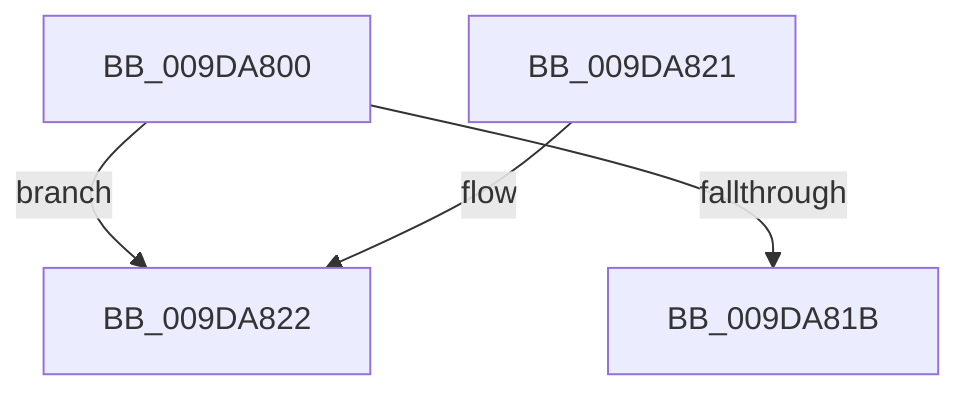

# PspDereferenceQuotaBlock

- RVA: `0x009DA800`–`0x009DA829` (길이 `41` bytes)
- VA: `0x00000001409DA800`
- 실행 섹션: `PAGE`
- PDB 이름 있음: `예`; PDB Function 태그: `아니요`
- unwind 정보 RVA: `0x000A32E0`
- 디코드: `12`개 명령, `41/41` bytes 표시
- 미해석 바이트: `0` (있으면 어셈블리에 `.byte`로 보존)

> 이 문서는 커널 이미지의 기계어와 PDB 기호를 분석해 생성했습니다. 4번과 5번은 함수 원형과 자료형을 바이너리 사용 방식에서 추정한 C 해석이며 원본 소스 복구 결과는 아닙니다.

## 1. Dependencies

- 직접 호출 지점: **0**; 고유 호출 대상: **0**
- 직접 호출자로 확인된 함수: **1**
- RIP 상대 이미지 참조: **1**

### Outgoing calls
- 직접 디코드된 call 명령이 없습니다.

### Direct callers
- [PspDereferenceQuota](../90/PspDereferenceQuota_function_009075A4.md) at `0x009075AF`

### Static image references
- `0x009DA822` → RVA `0x00FC7350` (`ALMOSTRO`; read)

## 2. Other-region calls and transfers

- 다른 실행 섹션으로 향하는 call: **0**
- 별도 외부 분기/꼬리 이동을 확인하지 못했습니다.

## 3. Assembly (complete function range)

```asm
009DA800  40 53                           push rbx
009DA802  48 83 EC 20                     sub rsp, 0x20
009DA806  48 8B D9                        mov rbx, rcx
009DA809  B8 FF FF FF FF                  mov eax, 0xffffffff
009DA80E  F0 0F C1 81 00 02 00 00         lock xadd dword ptr [rcx + 0x200], eax
009DA816  83 F8 01                        cmp eax, 1
009DA819  74 07                           je 0x1409da822
009DA81B  48 83 C4 20                     add rsp, 0x20
009DA81F  5B                              pop rbx
009DA820  C3                              ret
009DA821  CC                              int3
009DA822  0F B6 05 27 CB 5E 00            movzx eax, byte ptr [rip + 0x5ecb27]
```

## 4. C-style interpretation (structured pseudocode)

```c
__int64 __fastcall PspDereferenceQuotaBlock(__int64 a1)
{
    __int64 v_rsp;

    v_rsp = (v_rsp) - (32);
    if (((unsigned int)((unsigned int)(0xFFFFFFFFULL))) == 1) goto loc_009DA822;
    v_rsp = (v_rsp) + (32);
    return (unsigned int)(0xFFFFFFFFULL);
loc_009DA822:
    return *(unsigned __int8 *)(v_rip + 6212391);
}
```

## 5. (Beta) C Style

```c
int64_t PspDereferenceQuotaBlock(void *Arg1)
{
    uint8_t *arg1 = (uint8_t *)Arg1;

    int64_t local_rsp;

    local_rsp = (local_rsp) - (32);
    if (((uint32_t)((uint32_t)(0xFFFFFFFFULL))) == 1) goto loc_009DA822;
    local_rsp = (local_rsp) + (32);
    return (uint32_t)(0xFFFFFFFFULL);
loc_009DA822:
    return *(uint8_t *)(v_rip + 0x5ECB27);
}
```

### 관측된 메모리 오프셋

구조체 형식이 확인되지 않은 접근은 인자 기준의 오프셋으로만 기록했습니다.

| 기준 인자 | 오프셋 표현 | 폭 (bit) | 접근 |
|---|---:|---:|---|
| `Arg1` | `+ 0x200` | `32` | `R/W` |

## 6. Execution-region graph

[열기: 2D/3D 그래프와 함수 탐색 컨트롤 패널](../../../control-panel.html?section=page&rva=0x009DA800&view=graph)

- 2D 그래프는 위에서 아래로 흐르고, 3D 그래프는 빈 공간을 드래그해 회전합니다. Shift+드래그는 이동, 휠은 확대·축소, 함수 노드 선택은 대상 보고서 이동입니다.

### Static fallback


