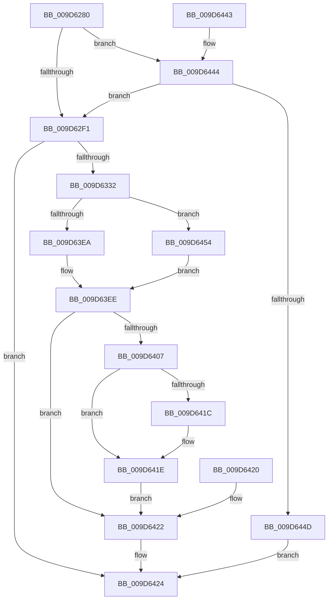

# PspQueryQuotaLimits

- RVA: `0x009D6280`–`0x009D645A` (길이 `474` bytes)
- VA: `0x00000001409D6280`
- 실행 섹션: `PAGE`
- PDB 이름 있음: `예`; PDB Function 태그: `아니요`
- unwind 정보 RVA: `0x000A24BC`
- 디코드: `109`개 명령, `474/474` bytes 표시
- 미해석 바이트: `0` (있으면 어셈블리에 `.byte`로 보존)

> 이 문서는 커널 이미지의 기계어와 PDB 기호를 분석해 생성했습니다. 4번과 5번은 함수 원형과 자료형을 바이너리 사용 방식에서 추정한 C 해석이며 원본 소스 복구 결과는 아닙니다.

## 1. Dependencies

- 직접 호출 지점: **8**; 고유 호출 대상: **8**
- 직접 호출자로 확인된 함수: **1**
- RIP 상대 이미지 참조: **2**

### Outgoing calls
- `0x009D62BD` → [memset](../../text/6C/memset_function_006C6C40.md) (function, `0x006C6C40`)
- `0x009D6325` → [ObpReferenceObjectByHandleWithTag](../86/ObpReferenceObjectByHandleWithTag_function_00869650.md) (function, `0x00869650`)
- `0x009D6389` → [KiStackAttachProcess](../../text/21/KiStackAttachProcess_function_00216820.md) (function, `0x00216820`)
- `0x009D63BC` → [MmQueryWorkingSetInformation](../../text/41/MmQueryWorkingSetInformation_function_0041CB20.md) (function, `0x0041CB20`)
- `0x009D63CD` → [KiUnstackDetachProcess](../../text/21/KiUnstackDetachProcess_function_00217D30.md) (function, `0x00217D30`)
- `0x009D63FE` → [ObfDereferenceObjectWithTag](../../text/2F/ObfDereferenceObjectWithTag_function_002F78E0.md) (function, `0x002F78E0`)
- `0x009D6412` → [memcpy](../../text/6C/memcpy_function_006C6840.md) (function, `0x006C6840`)
- `0x009D642F` → [_security_check_cookie](../../text/6A/_security_check_cookie_function_006AC640.md) (function, `0x006AC640`)

### Direct callers
- [NtQueryInformationProcess](../9A/NtQueryInformationProcess_function_009AA250.md) at `0x009AB067`

### Static image references
- `0x009D628F` → RVA `0x00E0A740` (`.data`; read)
- `0x009D62F1` → RVA `0x00FC6A98` (`ALMOSTRO`; read)

## 2. Other-region calls and transfers

- 다른 실행 섹션으로 향하는 call: **7**
  - `0x009D62BD` → [memset](../../text/6C/memset_function_006C6C40.md) (`PAGE` → `.text`)
  - `0x009D6389` → [KiStackAttachProcess](../../text/21/KiStackAttachProcess_function_00216820.md) (`PAGE` → `.text`)
  - `0x009D63BC` → [MmQueryWorkingSetInformation](../../text/41/MmQueryWorkingSetInformation_function_0041CB20.md) (`PAGE` → `.text`)
  - `0x009D63CD` → [KiUnstackDetachProcess](../../text/21/KiUnstackDetachProcess_function_00217D30.md) (`PAGE` → `.text`)
  - `0x009D63FE` → [ObfDereferenceObjectWithTag](../../text/2F/ObfDereferenceObjectWithTag_function_002F78E0.md) (`PAGE` → `.text`)
  - `0x009D6412` → [memcpy](../../text/6C/memcpy_function_006C6840.md) (`PAGE` → `.text`)
  - `0x009D642F` → [_security_check_cookie](../../text/6A/_security_check_cookie_function_006AC640.md) (`PAGE` → `.text`)
- 별도 외부 분기/꼬리 이동을 확인하지 못했습니다.

## 3. Assembly (complete function range)

```asm
009D6280  40 53                           push rbx
009D6282  56                              push rsi
009D6283  57                              push rdi
009D6284  41 56                           push r14
009D6286  41 57                           push r15
009D6288  48 81 EC 00 01 00 00            sub rsp, 0x100
009D628F  48 8B 05 AA 44 43 00            mov rax, qword ptr [rip + 0x4344aa]
009D6296  48 33 C4                        xor rax, rsp
009D6299  48 89 84 24 F0 00 00 00         mov qword ptr [rsp + 0xf0], rax
009D62A1  41 8B D9                        mov ebx, r9d
009D62A4  4D 8B F0                        mov r14, r8
009D62A7  48 8B F1                        mov rsi, rcx
009D62AA  48 8B BC 24 50 01 00 00         mov rdi, qword ptr [rsp + 0x150]
009D62B2  33 D2                           xor edx, edx
009D62B4  44 8D 42 58                     lea r8d, [rdx + 0x58]
009D62B8  48 8D 4C 24 50                  lea rcx, [rsp + 0x50]
009D62BD  E8 7E 09 CF FF                  call 0x1406c6c40
009D62C2  33 C0                           xor eax, eax
009D62C4  48 89 44 24 48                  mov qword ptr [rsp + 0x48], rax
009D62C9  89 44 24 40                     mov dword ptr [rsp + 0x40], eax
009D62CD  0F 57 C0                        xorps xmm0, xmm0
009D62D0  0F 11 84 24 C0 00 00 00         movups xmmword ptr [rsp + 0xc0], xmm0
009D62D8  0F 11 84 24 D0 00 00 00         movups xmmword ptr [rsp + 0xd0], xmm0
009D62E0  0F 11 84 24 E0 00 00 00         movups xmmword ptr [rsp + 0xe0], xmm0
009D62E8  83 FB 30                        cmp ebx, 0x30
009D62EB  0F 85 53 01 00 00               jne 0x1409d6444
009D62F1  4C 8B 05 A0 07 5F 00            mov r8, qword ptr [rip + 0x5f07a0]
009D62F8  48 89 44 24 38                  mov qword ptr [rsp + 0x38], rax
009D62FD  48 89 44 24 30                  mov qword ptr [rsp + 0x30], rax
009D6302  48 8D 44 24 48                  lea rax, [rsp + 0x48]
009D6307  48 89 44 24 28                  mov qword ptr [rsp + 0x28], rax
009D630C  C7 44 24 20 50 73 51 79         mov dword ptr [rsp + 0x20], 0x79517350
009D6314  44 0F B6 8C 24 58 01 00 00      movzx r9d, byte ptr [rsp + 0x158]
009D631D  BA 00 10 00 00                  mov edx, 0x1000
009D6322  48 8B CE                        mov rcx, rsi
009D6325  E8 26 33 E9 FF                  call 0x140869650
009D632A  85 C0                           test eax, eax
009D632C  0F 88 F2 00 00 00               js 0x1409d6424
009D6332  48 8B 44 24 48                  mov rax, qword ptr [rsp + 0x48]
009D6337  48 8B 88 F8 02 00 00            mov rcx, qword ptr [rax + 0x2f8]
009D633E  48 8B 81 C0 00 00 00            mov rax, qword ptr [rcx + 0xc0]
009D6345  48 89 44 24 50                  mov qword ptr [rsp + 0x50], rax
009D634A  48 8B 41 40                     mov rax, qword ptr [rcx + 0x40]
009D634E  48 89 44 24 58                  mov qword ptr [rsp + 0x58], rax
009D6353  48 8B 81 40 01 00 00            mov rax, qword ptr [rcx + 0x140]
009D635A  48 89 44 24 70                  mov qword ptr [rsp + 0x70], rax
009D635F  48 8B 81 C0 01 00 00            mov rax, qword ptr [rcx + 0x1c0]
009D6366  48 89 84 24 80 00 00 00         mov qword ptr [rsp + 0x80], rax
009D636E  48 C7 44 24 78 FF FF FF FF      mov qword ptr [rsp + 0x78], 0xffffffffffffffff
009D6377  4C 8D 84 24 C0 00 00 00         lea r8, [rsp + 0xc0]
009D637F  33 D2                           xor edx, edx
009D6381  4C 8B 7C 24 48                  mov r15, qword ptr [rsp + 0x48]
009D6386  49 8B CF                        mov rcx, r15
009D6389  E8 92 04 84 FF                  call 0x140216820
009D638E  48 8D 44 24 40                  lea rax, [rsp + 0x40]
009D6393  48 89 44 24 28                  mov qword ptr [rsp + 0x28], rax
009D6398  48 8D 44 24 68                  lea rax, [rsp + 0x68]
009D639D  48 89 44 24 20                  mov qword ptr [rsp + 0x20], rax
009D63A2  4C 8D 4C 24 60                  lea r9, [rsp + 0x60]
009D63A7  4C 8D 44 24 48                  lea r8, [rsp + 0x48]
009D63AC  48 8D 94 24 B0 00 00 00         lea rdx, [rsp + 0xb0]
009D63B4  48 8D 8C 24 B8 00 00 00         lea rcx, [rsp + 0xb8]
009D63BC  E8 5F 67 A4 FF                  call 0x14041cb20
009D63C1  8B F0                           mov esi, eax
009D63C3  33 D2                           xor edx, edx
009D63C5  48 8D 8C 24 C0 00 00 00         lea rcx, [rsp + 0xc0]
009D63CD  E8 5E 19 84 FF                  call 0x140217d30
009D63D2  8B 54 24 40                     mov edx, dword ptr [rsp + 0x40]
009D63D6  0F B6 CA                        movzx ecx, dl
009D63D9  80 E1 04                        and cl, 4
009D63DC  F6 D9                           neg cl
009D63DE  45 1B C0                        sbb r8d, r8d
009D63E1  41 83 C0 02                     add r8d, 2
009D63E5  F6 C2 01                        test dl, 1
009D63E8  75 6A                           jne 0x1409d6454
009D63EA  41 83 C8 08                     or r8d, 8
009D63EE  44 89 84 24 A0 00 00 00         mov dword ptr [rsp + 0xa0], r8d
009D63F6  BA 50 73 51 79                  mov edx, 0x79517350
009D63FB  49 8B CF                        mov rcx, r15
009D63FE  E8 DD 14 92 FF                  call 0x1402f78e0
009D6403  85 F6                           test esi, esi
009D6405  78 1B                           js 0x1409d6422
009D6407  4C 8B C3                        mov r8, rbx
009D640A  48 8D 54 24 50                  lea rdx, [rsp + 0x50]
009D640F  49 8B CE                        mov rcx, r14
009D6412  E8 29 04 CF FF                  call 0x1406c6840
009D6417  48 85 FF                        test rdi, rdi
009D641A  74 02                           je 0x1409d641e
009D641C  89 1F                           mov dword ptr [rdi], ebx
009D641E  EB 02                           jmp 0x1409d6422
009D6420  8B F0                           mov esi, eax
009D6422  8B C6                           mov eax, esi
009D6424  48 8B 8C 24 F0 00 00 00         mov rcx, qword ptr [rsp + 0xf0]
009D642C  48 33 CC                        xor rcx, rsp
009D642F  E8 0C 62 CD FF                  call 0x1406ac640
009D6434  48 81 C4 00 01 00 00            add rsp, 0x100
009D643B  41 5F                           pop r15
009D643D  41 5E                           pop r14
009D643F  5F                              pop rdi
009D6440  5E                              pop rsi
009D6441  5B                              pop rbx
009D6442  C3                              ret
009D6443  CC                              int3
009D6444  83 FB 58                        cmp ebx, 0x58
009D6447  0F 84 A4 FE FF FF               je 0x1409d62f1
009D644D  B8 04 00 00 C0                  mov eax, 0xc0000004
009D6452  EB D0                           jmp 0x1409d6424
009D6454  41 83 C8 04                     or r8d, 4
009D6458  EB 94                           jmp 0x1409d63ee
```

## 4. C-style interpretation (structured pseudocode)

```c
__int64 __fastcall PspQueryQuotaLimits(__int64 a1, int a2, __int64 a3, int a4, __int64 a5, unsigned __int8 a6)
{
    __int64 result;
    __int64 v_rsp;
    unsigned __int64 v_stack_m100;
    unsigned int v_stack_m108;
    unsigned __int64 v_stack_m38;
    unsigned __int64 v_stack_m48;
    unsigned __int64 v_stack_m58;
    unsigned __int64 v_stack_m68;
    unsigned __int64 v_stack_m70;
    unsigned __int64 v_stack_m78;
    unsigned int v_stack_m88;
    unsigned __int64 v_stack_mA8;
    unsigned __int64 v_stack_mB0;
    unsigned __int64 v_stack_mB8;
    unsigned __int64 v_stack_mC0;
    unsigned __int64 v_stack_mC8;
    unsigned __int64 v_stack_mD0;
    unsigned __int64 v_stack_mD8;
    unsigned __int64 v_stack_mE0;
    unsigned int v_stack_mE8;
    unsigned __int64 v_stack_mF0;
    unsigned __int64 v_stack_mF8;

    v_rsp = (v_rsp) - (256);
    result = (*(unsigned __int64 *)(v_rip + 4408490)) ^ (v_rsp);
    v_stack_m38 = result;
    a2 = 0;
    result = memset(v_stack_mD8, a2, a2 + 88, a4);
    result = 0;
    v_stack_mE0 = 0;
    v_stack_mE8 = 0;
    v_stack_m68 = v_xmm0;
    v_stack_m58 = v_xmm0;
    v_stack_m48 = v_xmm0;
    if (((unsigned int)((unsigned int)(a4))) != 48) goto loc_009D6444;
loc_009D62F1:
    v_stack_mF0 = 0;
    v_stack_mF8 = 0;
    v_stack_m100 = v_stack_mE0;
    v_stack_m108 = 0x79517350ULL;
    result = ObpReferenceObjectByHandleWithTag(a1, (unsigned int)(0x1000ULL), *(unsigned __int64 *)(v_rip + 6227872), a6);
    if (sign_flag) goto loc_009D6424;
    v_stack_mD8 = *(unsigned __int64 *)(*(unsigned __int64 *)(v_stack_mE0 + 760) + 192);
    v_stack_mD0 = *(unsigned __int64 *)(*(unsigned __int64 *)(v_stack_mE0 + 760) + 64);
    v_stack_mB8 = *(unsigned __int64 *)(*(unsigned __int64 *)(v_stack_mE0 + 760) + 320);
    v_stack_mA8 = *(unsigned __int64 *)(*(unsigned __int64 *)(v_stack_mE0 + 760) + 448);
    v_stack_mB0 = -1;
    a2 = 0;
    result = KiStackAttachProcess(v_stack_mE0, a2, v_stack_m68, a6);
    v_stack_m100 = v_stack_mE8;
    v_stack_m108 = v_stack_mC0;
    result = MmQueryWorkingSetInformation(v_stack_m70, v_stack_m78, v_stack_mE0, v_stack_mC8);
    a2 = 0;
    result = KiUnstackDetachProcess(v_stack_m68, a2, v_stack_mE0, v_stack_mC8);
    a1 = (unsigned __int8)(((unsigned __int8)((unsigned int)(v_stack_mE8))) & (4));
    a1 = (unsigned __int8)(-(a1));
    a3 = (unsigned int)((v_stack_mE0) + (2));
    if ((((unsigned __int8)((unsigned int)(v_stack_mE8))) & (1)) != 0) goto loc_009D6454;
    a3 = (unsigned int)((a3) | (8));
loc_009D63EE:
    v_stack_m88 = (unsigned int)(a3);
    result = ObfDereferenceObjectWithTag(v_stack_mE0, (unsigned int)(0x79517350ULL), a3, v_stack_mC8);
    if (sign_flag) goto loc_009D6422;
    result = memcpy(a3, v_stack_mD8, (unsigned int)(a4), v_stack_mC8);
    if (a5 != 0) {
        *(unsigned int *)(a5) = (unsigned int)((unsigned int)(a4));
    }
    goto loc_009D6422;
loc_009D6422:
loc_009D6424:
    a1 = (v_stack_m38) ^ (v_rsp);
    result = _security_check_cookie(a1, v_stack_mD8, (unsigned int)(a4), v_stack_mC8);
    v_rsp = (v_rsp) + (256);
    return result;
loc_009D6444:
    if (((unsigned int)((unsigned int)(a4))) == 88) goto loc_009D62F1;
    goto loc_009D6424;
loc_009D6454:
    a3 = (unsigned int)(((unsigned int)(a4)) | (4));
    goto loc_009D63EE;
}
```

## 5. (Beta) C Style

```c
int64_t PspQueryQuotaLimits(int64_t Arg1, int32_t Arg2, int64_t Arg3, int32_t Arg4, int64_t Arg5, uint8_t Arg6)
{
    int64_t result;
    int64_t local_rsp;
    uint64_t v_stack_m100;
    uint32_t v_stack_m108;
    uint64_t v_stack_m38;
    uint64_t v_stack_m48;
    uint64_t v_stack_m58;
    uint64_t v_stack_m68;
    uint64_t v_stack_m70;
    uint64_t v_stack_m78;
    uint32_t v_stack_m88;
    uint64_t v_stack_mA8;
    uint64_t v_stack_mB0;
    uint64_t v_stack_mB8;
    uint64_t v_stack_mC0;
    uint64_t v_stack_mC8;
    uint64_t v_stack_mD0;
    uint64_t v_stack_mD8;
    uint64_t v_stack_mE0;
    uint32_t v_stack_mE8;
    uint64_t v_stack_mF0;
    uint64_t v_stack_mF8;

    local_rsp = (local_rsp) - (256);
    result = (*(uint64_t *)(v_rip + 0x4344AA)) ^ (local_rsp);
    v_stack_m38 = result;
    Arg2 = 0;
    result = memset(v_stack_mD8, Arg2, Arg2 + 88, Arg4);
    result = 0;
    v_stack_mE0 = 0;
    v_stack_mE8 = 0;
    v_stack_m68 = v_xmm0;
    v_stack_m58 = v_xmm0;
    v_stack_m48 = v_xmm0;
    if (((uint32_t)((uint32_t)(Arg4))) != 48) goto loc_009D6444;
loc_009D62F1:
    v_stack_mF0 = 0;
    v_stack_mF8 = 0;
    v_stack_m100 = v_stack_mE0;
    v_stack_m108 = 0x79517350ULL;
    result = ObpReferenceObjectByHandleWithTag(Arg1, (uint32_t)(0x1000ULL), *(uint64_t *)(v_rip + 0x5F07A0), Arg6);
    if (sign_flag) goto loc_009D6424;
    v_stack_mD8 = *(uint64_t *)(*(uint64_t *)(v_stack_mE0 + 0x2F8) + 0xC0);
    v_stack_mD0 = *(uint64_t *)(*(uint64_t *)(v_stack_mE0 + 0x2F8) + 0x40);
    v_stack_mB8 = *(uint64_t *)(*(uint64_t *)(v_stack_mE0 + 0x2F8) + 0x140);
    v_stack_mA8 = *(uint64_t *)(*(uint64_t *)(v_stack_mE0 + 0x2F8) + 0x1C0);
    v_stack_mB0 = -1;
    Arg2 = 0;
    result = KiStackAttachProcess(v_stack_mE0, Arg2, v_stack_m68, Arg6);
    v_stack_m100 = v_stack_mE8;
    v_stack_m108 = v_stack_mC0;
    result = MmQueryWorkingSetInformation(v_stack_m70, v_stack_m78, v_stack_mE0, v_stack_mC8);
    Arg2 = 0;
    result = KiUnstackDetachProcess(v_stack_m68, Arg2, v_stack_mE0, v_stack_mC8);
    Arg1 = (uint8_t)(((uint8_t)((uint32_t)(v_stack_mE8))) & (4));
    Arg1 = (uint8_t)(-(Arg1));
    Arg3 = (uint32_t)((v_stack_mE0) + (2));
    if ((((uint8_t)((uint32_t)(v_stack_mE8))) & (1)) != 0) goto loc_009D6454;
    Arg3 = (uint32_t)((Arg3) | (8));
loc_009D63EE:
    v_stack_m88 = (uint32_t)(Arg3);
    result = ObfDereferenceObjectWithTag(v_stack_mE0, (uint32_t)(0x79517350ULL), Arg3, v_stack_mC8);
    if (sign_flag) goto loc_009D6422;
    result = memcpy(Arg3, v_stack_mD8, (uint32_t)(Arg4), v_stack_mC8);
    if (Arg5 != 0) {
        *(uint32_t *)(Arg5) = (uint32_t)((uint32_t)(Arg4));
    }
    goto loc_009D6422;
loc_009D6422:
loc_009D6424:
    Arg1 = (v_stack_m38) ^ (local_rsp);
    result = _security_check_cookie(Arg1, v_stack_mD8, (uint32_t)(Arg4), v_stack_mC8);
    local_rsp = (local_rsp) + (256);
    return result;
loc_009D6444:
    if (((uint32_t)((uint32_t)(Arg4))) == 88) goto loc_009D62F1;
    goto loc_009D6424;
loc_009D6454:
    Arg3 = (uint32_t)(((uint32_t)(Arg4)) | (4));
    goto loc_009D63EE;
}
```

## 6. Execution-region graph

[열기: 2D/3D 그래프와 함수 탐색 컨트롤 패널](../../../control-panel.html?section=page&rva=0x009D6280&view=graph)

- 2D 그래프는 위에서 아래로 흐르고, 3D 그래프는 빈 공간을 드래그해 회전합니다. Shift+드래그는 이동, 휠은 확대·축소, 함수 노드 선택은 대상 보고서 이동입니다.

### Static fallback


