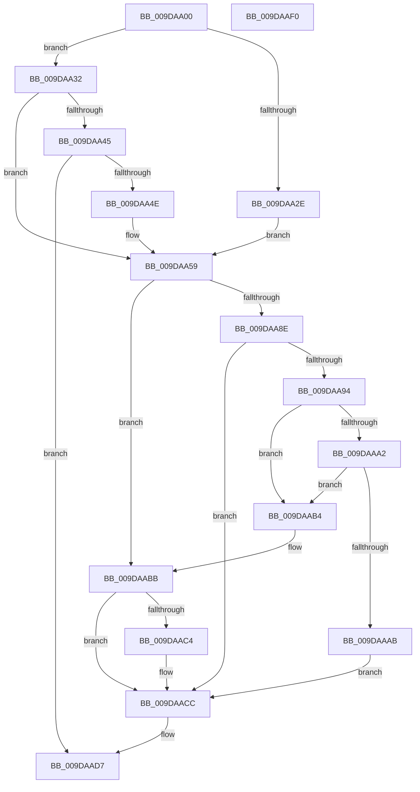

# PspRemoveQuotaBlock

- RVA: `0x009DAA00`–`0x009DAAF1` (길이 `241` bytes)
- VA: `0x00000001409DAA00`
- 실행 섹션: `PAGE`
- PDB 이름 있음: `예`; PDB Function 태그: `아니요`
- unwind 정보 RVA: `0x00060300`
- 디코드: `68`개 명령, `241/241` bytes 표시
- 미해석 바이트: `0` (있으면 어셈블리에 `.byte`로 보존)

> 이 문서는 커널 이미지의 기계어와 PDB 기호를 분석해 생성했습니다. 4번과 5번은 함수 원형과 자료형을 바이너리 사용 방식에서 추정한 C 해석이며 원본 소스 복구 결과는 아닙니다.

## 1. Dependencies

- 직접 호출 지점: **7**; 고유 호출 대상: **6**
- 직접 호출자로 확인된 함수: **3**
- RIP 상대 이미지 참조: **3**

### Outgoing calls
- `0x009DAA34` → [PspGetQuotaSid](../../text/5E/PspGetQuotaSid_function_005E2B9C.md) (function, `0x005E2B9C`)
- `0x009DAA3C` → [Feature_2056154424__private_IsEnabledDeviceUsageNoInline](../../text/5E/Feature_2056154424__private_IsEnabledDeviceUsageNoInline_function_005E276C.md) (function, `0x005E276C`)
- `0x009DAA51` → [RtlLengthSid](../../text/45/RtlLengthSid_function_0045D270.md) (function, `0x0045D270`)
- `0x009DAA68` → [PspHashKeyValue](../A5/PspHashKeyValue_function_00A5EC40.md) (function, `0x00A5EC40`)
- `0x009DAA85` → [PspLockQuotaListExclusive](../../text/4D/PspLockQuotaListExclusive_function_004D81A8.md) (function, `0x004D81A8`)
- `0x009DAA94` → [Feature_2056154424__private_IsEnabledDeviceUsageNoInline](../../text/5E/Feature_2056154424__private_IsEnabledDeviceUsageNoInline_function_005E276C.md) (function, `0x005E276C`)
- `0x009DAAD2` → [PspUnlockQuotaListExclusive](../../text/4D/PspUnlockQuotaListExclusive_function_004D9988.md) (function, `0x004D9988`)

### Direct callers
- [sub_00864EE6](../86/Unknown_function_00864EE6.md) at `0x00865123`
- [sub_00864EE6](../86/Unknown_function_00864EE6.md) at `0x008652F6`
- [PsReturnSharedPoolQuota](../8B/PsReturnSharedPoolQuota_function_008BCC30.md) at `0x008BCD86`
- [sub_009DA829](Unknown_function_009DA829.md) at `0x009DA921`

### Static image references
- `0x009DAA70` → RVA `0x00FD9C48` (`PAGEDATA`; read)
- `0x009DAABB` → RVA `0x00FD9DB8` (`PAGEDATA`; read)
- `0x009DAAC4` → RVA `0x00FD9DB8` (`PAGEDATA`; read/write)

## 2. Other-region calls and transfers

- 다른 실행 섹션으로 향하는 call: **6**
  - `0x009DAA34` → [PspGetQuotaSid](../../text/5E/PspGetQuotaSid_function_005E2B9C.md) (`PAGE` → `.text`)
  - `0x009DAA3C` → [Feature_2056154424__private_IsEnabledDeviceUsageNoInline](../../text/5E/Feature_2056154424__private_IsEnabledDeviceUsageNoInline_function_005E276C.md) (`PAGE` → `.text`)
  - `0x009DAA51` → [RtlLengthSid](../../text/45/RtlLengthSid_function_0045D270.md) (`PAGE` → `.text`)
  - `0x009DAA85` → [PspLockQuotaListExclusive](../../text/4D/PspLockQuotaListExclusive_function_004D81A8.md) (`PAGE` → `.text`)
  - `0x009DAA94` → [Feature_2056154424__private_IsEnabledDeviceUsageNoInline](../../text/5E/Feature_2056154424__private_IsEnabledDeviceUsageNoInline_function_005E276C.md) (`PAGE` → `.text`)
  - `0x009DAAD2` → [PspUnlockQuotaListExclusive](../../text/4D/PspUnlockQuotaListExclusive_function_004D9988.md) (`PAGE` → `.text`)
- 별도 외부 분기/꼬리 이동을 확인하지 못했습니다.

## 3. Assembly (complete function range)

```asm
009DAA00  48 89 5C 24 08                  mov qword ptr [rsp + 8], rbx
009DAA05  48 89 6C 24 10                  mov qword ptr [rsp + 0x10], rbp
009DAA0A  48 89 74 24 18                  mov qword ptr [rsp + 0x18], rsi
009DAA0F  57                              push rdi
009DAA10  41 56                           push r14
009DAA12  41 57                           push r15
009DAA14  48 83 EC 20                     sub rsp, 0x20
009DAA18  45 33 F6                        xor r14d, r14d
009DAA1B  48 8D 99 08 02 00 00            lea rbx, [rcx + 0x208]
009DAA22  48 8B F1                        mov rsi, rcx
009DAA25  41 8D 6E 01                     lea ebp, [r14 + 1]
009DAA29  48 39 2B                        cmp qword ptr [rbx], rbp
009DAA2C  75 04                           jne 0x1409daa32
009DAA2E  33 FF                           xor edi, edi
009DAA30  EB 27                           jmp 0x1409daa59
009DAA32  33 ED                           xor ebp, ebp
009DAA34  E8 63 81 C0 FF                  call 0x1405e2b9c
009DAA39  48 8B F8                        mov rdi, rax
009DAA3C  E8 2B 7D C0 FF                  call 0x1405e276c
009DAA41  85 C0                           test eax, eax
009DAA43  74 14                           je 0x1409daa59
009DAA45  48 85 FF                        test rdi, rdi
009DAA48  0F 84 89 00 00 00               je 0x1409daad7
009DAA4E  48 8B CF                        mov rcx, rdi
009DAA51  E8 1A 28 A8 FF                  call 0x14045d270
009DAA56  44 8B F0                        mov r14d, eax
009DAA59  65 4C 8B 3C 25 88 01 00 00      mov r15, qword ptr gs:[0x188]
009DAA62  49 8B D6                        mov rdx, r14
009DAA65  48 8B CF                        mov rcx, rdi
009DAA68  E8 D3 41 08 00                  call 0x140a5ec40
009DAA6D  44 8B D0                        mov r10d, eax
009DAA70  48 8B 05 D1 F1 5F 00            mov rax, qword ptr [rip + 0x5ff1d1]
009DAA77  4B 8D 0C 52                     lea rcx, [r10 + r10*2]
009DAA7B  48 8D 3C C8                     lea rdi, [rax + rcx*8]
009DAA7F  49 8B CF                        mov rcx, r15
009DAA82  48 8B D7                        mov rdx, rdi
009DAA85  E8 1E D7 AF FF                  call 0x1404d81a8
009DAA8A  85 ED                           test ebp, ebp
009DAA8C  75 2D                           jne 0x1409daabb
009DAA8E  48 83 3B 00                     cmp qword ptr [rbx], 0
009DAA92  74 38                           je 0x1409daacc
009DAA94  E8 D3 7C C0 FF                  call 0x1405e276c
009DAA99  48 8B 0B                        mov rcx, qword ptr [rbx]
009DAA9C  48 39 59 08                     cmp qword ptr [rcx + 8], rbx
009DAAA0  75 12                           jne 0x1409daab4
009DAAA2  48 8B 43 08                     mov rax, qword ptr [rbx + 8]
009DAAA6  48 39 18                        cmp qword ptr [rax], rbx
009DAAA9  75 09                           jne 0x1409daab4
009DAAAB  48 89 08                        mov qword ptr [rax], rcx
009DAAAE  48 89 41 08                     mov qword ptr [rcx + 8], rax
009DAAB2  EB 18                           jmp 0x1409daacc
009DAAB4  B9 03 00 00 00                  mov ecx, 3
009DAAB9  CD 29                           int 0x29
009DAABB  48 3B 35 F6 F2 5F 00            cmp rsi, qword ptr [rip + 0x5ff2f6]
009DAAC2  75 08                           jne 0x1409daacc
009DAAC4  48 83 25 EC F2 5F 00 00         and qword ptr [rip + 0x5ff2ec], 0
009DAACC  48 8B D7                        mov rdx, rdi
009DAACF  49 8B CF                        mov rcx, r15
009DAAD2  E8 B1 EE AF FF                  call 0x1404d9988
009DAAD7  48 8B 5C 24 40                  mov rbx, qword ptr [rsp + 0x40]
009DAADC  48 8B 6C 24 48                  mov rbp, qword ptr [rsp + 0x48]
009DAAE1  48 8B 74 24 50                  mov rsi, qword ptr [rsp + 0x50]
009DAAE6  48 83 C4 20                     add rsp, 0x20
009DAAEA  41 5F                           pop r15
009DAAEC  41 5E                           pop r14
009DAAEE  5F                              pop rdi
009DAAEF  C3                              ret
009DAAF0  CC                              int3
```

## 4. C-style interpretation (structured pseudocode)

```c
__int64 __fastcall PspRemoveQuotaBlock(__int64 a1)
{
    __int64 result;
    __int64 v_r14;
    __int64 v_rbp;
    __int64 v_rdi;
    __int64 v_rsp;
    unsigned __int64 v_stack_p10;
    unsigned __int64 v_stack_p18;
    unsigned __int64 v_stack_p8;

    v_stack_p8 = v_rbx;
    v_stack_p10 = v_rbp;
    v_stack_p18 = v_rsi;
    v_rsp = (v_rsp) - (32);
    v_r14 = 0;
    if ((*(unsigned __int64 *)(a1 + 520)) != (v_r14 + 1)) goto loc_009DAA32;
    v_rdi = 0;
    goto loc_009DAA59;
loc_009DAA32:
    v_rbp = 0;
    result = PspGetQuotaSid(a1, a2, a3, a4);
    result = Feature_2056154424__private_IsEnabledDeviceUsageNoInline(a1, a2, a3, a4);
    if ((unsigned int)(result) == 0) goto loc_009DAA59;
    if (result == 0) goto loc_009DAAD7;
    result = RtlLengthSid(result, a2, a3, a4);
loc_009DAA59:
    result = PspHashKeyValue(result, (unsigned int)((unsigned int)(result)), a3, a4);
    result = PspLockQuotaListExclusive(*(unsigned __int64 *)(gs_base + (0 + 392)), *(unsigned __int64 *)(v_rip + 6287825) + (unsigned int)((unsigned int)(result)) + (unsigned int)((unsigned int)(result)) * 2 * 8, a3, a4);
    if (0 != 0) goto loc_009DAABB;
    if ((*(unsigned __int64 *)(a1 + 520)) == 0) goto loc_009DAACC;
    result = Feature_2056154424__private_IsEnabledDeviceUsageNoInline(*(unsigned __int64 *)(gs_base + (0 + 392)), *(unsigned __int64 *)(v_rip + 6287825) + (unsigned int)((unsigned int)(result)) + (unsigned int)((unsigned int)(result)) * 2 * 8, a3, a4);
    if ((*(unsigned __int64 *)(*(unsigned __int64 *)(a1 + 520) + 8)) != (a1 + 520)) goto loc_009DAAB4;
    if ((*(unsigned __int64 *)(*(unsigned __int64 *)(a1 + 520 + 8))) != (a1 + 520)) goto loc_009DAAB4;
    *(unsigned __int64 *)(*(unsigned __int64 *)(a1 + 520 + 8)) = *(unsigned __int64 *)(a1 + 520);
    *(unsigned __int64 *)(*(unsigned __int64 *)(a1 + 520) + 8) = *(unsigned __int64 *)(a1 + 520 + 8);
    goto loc_009DAACC;
loc_009DAAB4:
loc_009DAABB:
    if (a1 == (*(unsigned __int64 *)(v_rip + 6288118))) {
    }
    result = PspUnlockQuotaListExclusive(*(unsigned __int64 *)(gs_base + (0 + 392)), *(unsigned __int64 *)(v_rip + 6287825) + (unsigned int)((unsigned int)(result)) + (unsigned int)((unsigned int)(result)) * 2 * 8, a3, a4);
loc_009DAAD7:
    v_rsp = (v_rsp) + (32);
    return result;
}
```

## 5. (Beta) C Style

```c
int64_t PspRemoveQuotaBlock(void *Arg1)
{
    uint8_t *arg1 = (uint8_t *)Arg1;

    int64_t result;
    int64_t local_r14;
    int64_t local_rbp;
    int64_t local_rdi;
    int64_t local_rsp;
    uint64_t v_stack_p10;
    uint64_t v_stack_p18;
    uint64_t v_stack_p8;

    v_stack_p8 = local_rbx;
    v_stack_p10 = local_rbp;
    v_stack_p18 = local_rsi;
    local_rsp = (local_rsp) - (32);
    local_r14 = 0;
    if ((*(uint64_t *)(arg1 + 0x208)) != (local_r14 + 1)) goto loc_009DAA32;
    local_rdi = 0;
    goto loc_009DAA59;
loc_009DAA32:
    local_rbp = 0;
    result = PspGetQuotaSid(Arg1, a2, a3, a4);
    result = Feature_2056154424__private_IsEnabledDeviceUsageNoInline(Arg1, a2, a3, a4);
    if ((uint32_t)(result) == 0) goto loc_009DAA59;
    if (result == 0) goto loc_009DAAD7;
    result = RtlLengthSid(result, a2, a3, a4);
loc_009DAA59:
    result = PspHashKeyValue(result, (uint32_t)((uint32_t)(result)), a3, a4);
    result = PspLockQuotaListExclusive(*(uint64_t *)(gs_base + (0 + 0x188)), *(uint64_t *)(v_rip + 0x5FF1D1) + (uint32_t)((uint32_t)(result)) + (uint32_t)((uint32_t)(result)) * 2 * 8, a3, a4);
    if (0 != 0) goto loc_009DAABB;
    if ((*(uint64_t *)(arg1 + 0x208)) == 0) goto loc_009DAACC;
    result = Feature_2056154424__private_IsEnabledDeviceUsageNoInline(*(uint64_t *)(gs_base + (0 + 0x188)), *(uint64_t *)(v_rip + 0x5FF1D1) + (uint32_t)((uint32_t)(result)) + (uint32_t)((uint32_t)(result)) * 2 * 8, a3, a4);
    if ((*(uint64_t *)(*(uint64_t *)(arg1 + 0x208) + 0x8)) != (Arg1 + 520)) goto loc_009DAAB4;
    if ((*(uint64_t *)(*(uint64_t *)(arg1 + 0x208 + 0x8))) != (Arg1 + 520)) goto loc_009DAAB4;
    *(uint64_t *)(*(uint64_t *)(arg1 + 0x208 + 0x8)) = *(uint64_t *)(arg1 + 0x208);
    *(uint64_t *)(*(uint64_t *)(arg1 + 0x208) + 0x8) = *(uint64_t *)(arg1 + 0x208 + 0x8);
    goto loc_009DAACC;
loc_009DAAB4:
loc_009DAABB:
    if (Arg1 == (*(uint64_t *)(v_rip + 0x5FF2F6))) {
    }
    result = PspUnlockQuotaListExclusive(*(uint64_t *)(gs_base + (0 + 0x188)), *(uint64_t *)(v_rip + 0x5FF1D1) + (uint32_t)((uint32_t)(result)) + (uint32_t)((uint32_t)(result)) * 2 * 8, a3, a4);
loc_009DAAD7:
    local_rsp = (local_rsp) + (32);
    return result;
}
```

### 관측된 메모리 오프셋

구조체 형식이 확인되지 않은 접근은 인자 기준의 오프셋으로만 기록했습니다.

| 기준 인자 | 오프셋 표현 | 폭 (bit) | 접근 |
|---|---:|---:|---|
| `Arg1` | `+ 0x0` | `64` | `R` |
| `Arg1` | `+ 0x8` | `64` | `R` |
| `Arg1` | `+ 0x208` | `64` | `R` |

## 6. Execution-region graph

[열기: 2D/3D 그래프와 함수 탐색 컨트롤 패널](../../../control-panel.html?section=page&rva=0x009DAA00&view=graph)

- 2D 그래프는 위에서 아래로 흐르고, 3D 그래프는 빈 공간을 드래그해 회전합니다. Shift+드래그는 이동, 휠은 확대·축소, 함수 노드 선택은 대상 보고서 이동입니다.

### Static fallback


