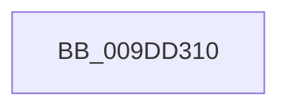

# RegRtlQueryValue

- RVA: `0x009DD310`–`0x009DD363` (길이 `83` bytes)
- VA: `0x00000001409DD310`
- 실행 섹션: `PAGE`
- PDB 이름 있음: `예`; PDB Function 태그: `아니요`
- unwind 정보 RVA: `0x000A38A4`
- 디코드: `21`개 명령, `83/83` bytes 표시
- 미해석 바이트: `0` (있으면 어셈블리에 `.byte`로 보존)

> 이 문서는 커널 이미지의 기계어와 PDB 기호를 분석해 생성했습니다. 4번과 5번은 함수 원형과 자료형을 바이너리 사용 방식에서 추정한 C 해석이며 원본 소스 복구 결과는 아닙니다.

## 1. Dependencies

- 직접 호출 지점: **1**; 고유 호출 대상: **1**
- 직접 호출자로 확인된 함수: **1**
- RIP 상대 이미지 참조: **1**

### Outgoing calls
- `0x009DD356` → [RtlInitUnicodeStringEx](../../text/46/RtlInitUnicodeStringEx_function_00463960.md) (function, `0x00463960`)

### Direct callers
- [SysCtxOpenControlSet](../83/SysCtxOpenControlSet_function_00831B00.md) at `0x00831C07`

### Static image references
- `0x009DD320` → RVA `0x00E0A740` (`.data`; read)

## 2. Other-region calls and transfers

- 다른 실행 섹션으로 향하는 call: **1**
  - `0x009DD356` → [RtlInitUnicodeStringEx](../../text/46/RtlInitUnicodeStringEx_function_00463960.md) (`PAGE` → `.text`)
- call이 아닌 외부 분기/꼬리 이동: **1**
  - `0x009DD35D` → [sub_009DD42F](Unknown_function_009DD42F.md) (`tail-transfer`)

## 3. Assembly (complete function range)

```asm
009DD310  40 56                           push rsi
009DD312  57                              push rdi
009DD313  41 54                           push r12
009DD315  41 56                           push r14
009DD317  41 57                           push r15
009DD319  48 81 EC F0 00 00 00            sub rsp, 0xf0
009DD320  48 8B 05 19 D4 42 00            mov rax, qword ptr [rip + 0x42d419]
009DD327  48 33 C4                        xor rax, rsp
009DD32A  48 89 84 24 D8 00 00 00         mov qword ptr [rsp + 0xd8], rax
009DD332  48 8B B4 24 40 01 00 00         mov rsi, qword ptr [rsp + 0x140]
009DD33A  4C 8B E1                        mov r12, rcx
009DD33D  0F 57 C0                        xorps xmm0, xmm0
009DD340  48 8D 4C 24 38                  lea rcx, [rsp + 0x38]
009DD345  33 FF                           xor edi, edi
009DD347  4D 8B F9                        mov r15, r9
009DD34A  0F 11 44 24 38                  movups xmmword ptr [rsp + 0x38], xmm0
009DD34F  89 7C 24 30                     mov dword ptr [rsp + 0x30], edi
009DD353  4D 8B F0                        mov r14, r8
009DD356  E8 05 66 A8 FF                  call 0x140463960
009DD35B  85 C0                           test eax, eax
009DD35D  0F 88 CC 00 00 00               js 0x1409dd42f
```

## 4. C-style interpretation (structured pseudocode)

```c
__int64 __fastcall RegRtlQueryValue(__int64 a1, __int64 a2, __int64 a3, __int64 a4, __int64 a5)
{
    __int64 result;
    __int64 v_rdi;
    __int64 v_rsp;
    unsigned __int64 v_stack_m40;
    unsigned __int64 v_stack_mE0;
    unsigned int v_stack_mE8;

    v_rsp = (v_rsp) - (240);
    result = (*(unsigned __int64 *)(v_rip + 4379673)) ^ (v_rsp);
    v_stack_m40 = result;
    v_rdi = 0;
    v_stack_mE0 = v_xmm0;
    v_stack_mE8 = 0;
    result = RtlInitUnicodeStringEx(v_stack_mE0, a2, a3, a4);
}
```

## 5. (Beta) C Style

```c
int64_t RegRtlQueryValue(int64_t Arg1, int64_t Arg2, int64_t Arg3, int64_t Arg4, int64_t Arg5)
{
    int64_t result;
    int64_t local_rdi;
    int64_t local_rsp;
    uint64_t v_stack_m40;
    uint64_t v_stack_mE0;
    uint32_t v_stack_mE8;

    local_rsp = (local_rsp) - (240);
    result = (*(uint64_t *)(v_rip + 0x42D419)) ^ (local_rsp);
    v_stack_m40 = result;
    local_rdi = 0;
    v_stack_mE0 = v_xmm0;
    v_stack_mE8 = 0;
    result = RtlInitUnicodeStringEx(v_stack_mE0, Arg2, Arg3, Arg4);
}
```

## 6. Execution-region graph

[열기: 2D/3D 그래프와 함수 탐색 컨트롤 패널](../../../control-panel.html?section=page&rva=0x009DD310&view=graph)

- 2D 그래프는 위에서 아래로 흐르고, 3D 그래프는 빈 공간을 드래그해 회전합니다. Shift+드래그는 이동, 휠은 확대·축소, 함수 노드 선택은 대상 보고서 이동입니다.

### Static fallback


