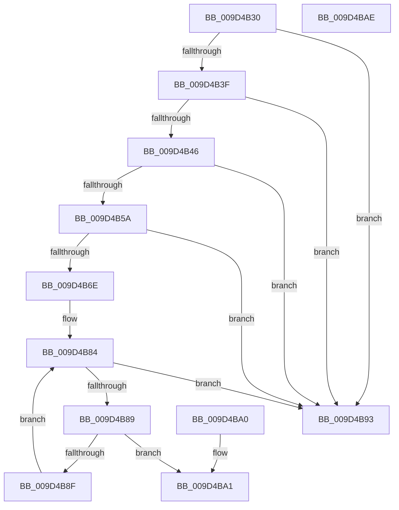

# RtlIsElevatedRid

- RVA: `0x009D4B30`–`0x009D4BAF` (길이 `127` bytes)
- VA: `0x00000001409D4B30`
- 실행 섹션: `PAGE`
- PDB 이름 있음: `예`; PDB Function 태그: `아니요`
- unwind 정보 RVA: `0x000A1A48`
- 디코드: `45`개 명령, `127/127` bytes 표시
- 미해석 바이트: `0` (있으면 어셈블리에 `.byte`로 보존)

> 이 문서는 커널 이미지의 기계어와 PDB 기호를 분석해 생성했습니다. 4번과 5번은 함수 원형과 자료형을 바이너리 사용 방식에서 추정한 C 해석이며 원본 소스 복구 결과는 아닙니다.

## 1. Dependencies

- 직접 호출 지점: **3**; 고유 호출 대상: **2**
- 직접 호출자로 확인된 함수: **2**
- RIP 상대 이미지 참조: **1**

### Outgoing calls
- `0x009D4B4C` → [RtlSubAuthorityCountSid](../../text/46/RtlSubAuthorityCountSid_function_00468F10.md) (function, `0x00468F10`)
- `0x009D4B5F` → [RtlSubAuthoritySid](../../text/45/RtlSubAuthoritySid_function_00456D10.md) (function, `0x00456D10`)
- `0x009D4B74` → [RtlSubAuthoritySid](../../text/45/RtlSubAuthoritySid_function_00456D10.md) (function, `0x00456D10`)

### Direct callers
- [SepGetTokenElevation](../../text/44/SepGetTokenElevation_function_0044F3C8.md) at `0x0044F405`
- [SepRemoveDisabledGroupsAndPrivileges](SepRemoveDisabledGroupsAndPrivileges_function_009D48B4.md) at `0x009D4996`

### Static image references
- `0x009D4B79` → RVA `0x0002C9B0` (`.rdata`; read)

## 2. Other-region calls and transfers

- 다른 실행 섹션으로 향하는 call: **3**
  - `0x009D4B4C` → [RtlSubAuthorityCountSid](../../text/46/RtlSubAuthorityCountSid_function_00468F10.md) (`PAGE` → `.text`)
  - `0x009D4B5F` → [RtlSubAuthoritySid](../../text/45/RtlSubAuthoritySid_function_00456D10.md) (`PAGE` → `.text`)
  - `0x009D4B74` → [RtlSubAuthoritySid](../../text/45/RtlSubAuthoritySid_function_00456D10.md) (`PAGE` → `.text`)
- 별도 외부 분기/꼬리 이동을 확인하지 못했습니다.

## 3. Assembly (complete function range)

```asm
009D4B30  48 89 5C 24 08                  mov qword ptr [rsp + 8], rbx
009D4B35  57                              push rdi
009D4B36  48 83 EC 20                     sub rsp, 0x20
009D4B3A  48 85 C9                        test rcx, rcx
009D4B3D  74 54                           je 0x1409d4b93
009D4B3F  8B 41 08                        mov eax, dword ptr [rcx + 8]
009D4B42  A8 30                           test al, 0x30
009D4B44  75 4D                           jne 0x1409d4b93
009D4B46  48 8B 19                        mov rbx, qword ptr [rcx]
009D4B49  48 8B CB                        mov rcx, rbx
009D4B4C  E8 BF 43 A9 FF                  call 0x140468f10
009D4B51  0F B6 38                        movzx edi, byte ptr [rax]
009D4B54  40 80 FF 01                     cmp dil, 1
009D4B58  72 39                           jb 0x1409d4b93
009D4B5A  33 D2                           xor edx, edx
009D4B5C  48 8B CB                        mov rcx, rbx
009D4B5F  E8 AC 21 A8 FF                  call 0x140456d10
009D4B64  8B 10                           mov edx, dword ptr [rax]
009D4B66  83 C2 B0                        add edx, -0x50
009D4B69  83 FA 1F                        cmp edx, 0x1f
009D4B6C  76 25                           jbe 0x1409d4b93
009D4B6E  8D 57 FF                        lea edx, [rdi - 1]
009D4B71  48 8B CB                        mov rcx, rbx
009D4B74  E8 97 21 A8 FF                  call 0x140456d10
009D4B79  4C 8D 05 30 7E 65 FF            lea r8, [rip - 0x9a81d0]
009D4B80  8B 10                           mov edx, dword ptr [rax]
009D4B82  33 C0                           xor eax, eax
009D4B84  83 F8 13                        cmp eax, 0x13
009D4B87  73 0A                           jae 0x1409d4b93
009D4B89  41 3B 14 80                     cmp edx, dword ptr [r8 + rax*4]
009D4B8D  74 12                           je 0x1409d4ba1
009D4B8F  FF C0                           inc eax
009D4B91  EB F1                           jmp 0x1409d4b84
009D4B93  32 C0                           xor al, al
009D4B95  48 8B 5C 24 30                  mov rbx, qword ptr [rsp + 0x30]
009D4B9A  48 83 C4 20                     add rsp, 0x20
009D4B9E  5F                              pop rdi
009D4B9F  C3                              ret
009D4BA0  CC                              int3
009D4BA1  48 8B 5C 24 30                  mov rbx, qword ptr [rsp + 0x30]
009D4BA6  B0 01                           mov al, 1
009D4BA8  48 83 C4 20                     add rsp, 0x20
009D4BAC  5F                              pop rdi
009D4BAD  C3                              ret
009D4BAE  CC                              int3
```

## 4. C-style interpretation (structured pseudocode)

```c
__int64 __fastcall RtlIsElevatedRid(__int64 a1, int a2)
{
    __int64 result;
    __int64 v_rsp;
    unsigned __int64 v_stack_p30;
    unsigned __int64 v_stack_p8;

    v_stack_p8 = v_rbx;
    v_rsp = (v_rsp) - (32);
    if (a1 == 0) goto loc_009D4B93;
    if ((((unsigned __int8)((unsigned int)(*(unsigned int *)(a1 + 8)))) & (48)) != 0) goto loc_009D4B93;
    result = RtlSubAuthorityCountSid(*(unsigned __int64 *)(a1), a2, a3, a4);
    if (((unsigned __int8)(*(unsigned __int8 *)(result))) < 1) goto loc_009D4B93;
    a2 = 0;
    result = RtlSubAuthoritySid(*(unsigned __int64 *)(a1), a2, a3, a4);
    a2 = (unsigned int)(((unsigned int)(*(unsigned int *)(result))) + (-80));
    if (a2 <= 31) goto loc_009D4B93;
    result = RtlSubAuthoritySid(*(unsigned __int64 *)(a1), *(unsigned __int8 *)(result) - 1, a3, a4);
    result = 0;
loc_009D4B84:
    if (0 >= 19) goto loc_009D4B93;
    if (((unsigned int)((unsigned int)(*(unsigned int *)(result)))) == (*(unsigned int *)(v_rip - 10125776 + result * 4))) goto loc_009D4BA1;
    result = (unsigned int)((result) + 1);
    goto loc_009D4B84;
loc_009D4B93:
    result = 0;
    v_rsp = (v_rsp) + (32);
    return result;
loc_009D4BA1:
    v_rsp = (v_rsp) + (32);
    return 1;
}
```

## 5. (Beta) C Style

```c
int64_t RtlIsElevatedRid(int64_t Arg1, int32_t Arg2)
{
    int64_t result;
    int64_t local_rsp;
    uint64_t v_stack_p30;
    uint64_t v_stack_p8;

    v_stack_p8 = local_rbx;
    local_rsp = (local_rsp) - (32);
    if (Arg1 == 0) goto loc_009D4B93;
    if ((((uint8_t)((uint32_t)(*(uint32_t *)(Arg1 + 0x8)))) & (48)) != 0) goto loc_009D4B93;
    result = RtlSubAuthorityCountSid(*(uint64_t *)(Arg1), Arg2, a3, a4);
    if (((uint8_t)(*(uint8_t *)(result))) < 1) goto loc_009D4B93;
    Arg2 = 0;
    result = RtlSubAuthoritySid(*(uint64_t *)(Arg1), Arg2, a3, a4);
    Arg2 = (uint32_t)(((uint32_t)(*(uint32_t *)(result))) + (-80));
    if (Arg2 <= 31) goto loc_009D4B93;
    result = RtlSubAuthoritySid(*(uint64_t *)(Arg1), *(uint8_t *)(result) - 1, a3, a4);
    result = 0;
loc_009D4B84:
    if (0 >= 19) goto loc_009D4B93;
    if (((uint32_t)((uint32_t)(*(uint32_t *)(result)))) == (*(uint32_t *)(v_rip - 0x9A81D0 + result * 4))) goto loc_009D4BA1;
    result = (uint32_t)((result) + 1);
    goto loc_009D4B84;
loc_009D4B93:
    result = 0;
    local_rsp = (local_rsp) + (32);
    return result;
loc_009D4BA1:
    local_rsp = (local_rsp) + (32);
    return 1;
}
```

## 6. Execution-region graph

[열기: 2D/3D 그래프와 함수 탐색 컨트롤 패널](../../../control-panel.html?section=page&rva=0x009D4B30&view=graph)

- 2D 그래프는 위에서 아래로 흐르고, 3D 그래프는 빈 공간을 드래그해 회전합니다. Shift+드래그는 이동, 휠은 확대·축소, 함수 노드 선택은 대상 보고서 이동입니다.

### Static fallback


