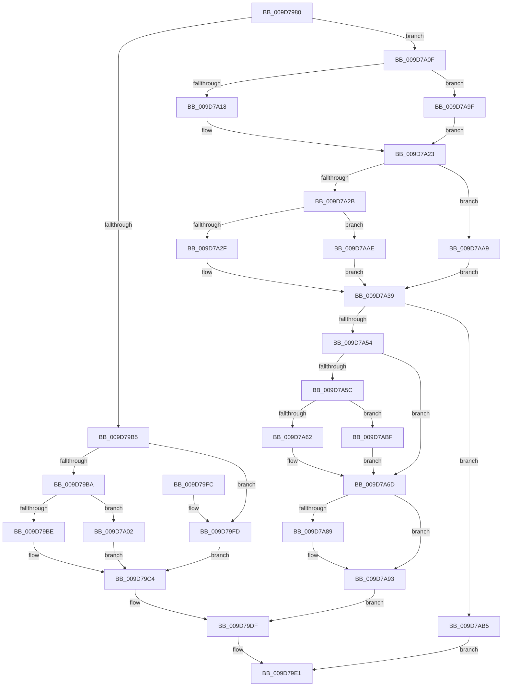

# SeAppendPrivileges

- RVA: `0x009D7980`–`0x009D7AC7` (길이 `327` bytes)
- VA: `0x00000001409D7980`
- 실행 섹션: `PAGE`
- PDB 이름 있음: `예`; PDB Function 태그: `아니요`
- unwind 정보 RVA: `0x000A2AB0`
- 디코드: `92`개 명령, `327/327` bytes 표시
- 미해석 바이트: `0` (있으면 어셈블리에 `.byte`로 보존)

> 이 문서는 커널 이미지의 기계어와 PDB 기호를 분석해 생성했습니다. 4번과 5번은 함수 원형과 자료형을 바이너리 사용 방식에서 추정한 C 해석이며 원본 소스 복구 결과는 아닙니다.

## 1. Dependencies

- 직접 호출 지점: **5**; 고유 호출 대상: **4**
- 직접 호출자로 확인된 함수: **8**
- RIP 상대 이미지 참조: **0**

### Outgoing calls
- `0x009D79D6` → [memcpy](../../text/6C/memcpy_function_006C6840.md) (function, `0x006C6840`)
- `0x009D7A47` → [ExAllocatePool2](../../poolcode/B8/ExAllocatePool2_function_00B820F0.md) (function, `0x00B820F0`)
- `0x009D7A73` → [memcpy](../../text/6C/memcpy_function_006C6840.md) (function, `0x006C6840`)
- `0x009D7A7E` → [SepConcatenatePrivileges](SepConcatenatePrivileges_function_009D7AD0.md) (function, `0x009D7AD0`)
- `0x009D7A8E` → [ExFreePoolWithTag](../../poolcode/B8/ExFreePoolWithTag_function_00B82870.md) (function, `0x00B82870`)

### Direct callers
- [IopCreateSecurityCheck](../../text/3A/IopCreateSecurityCheck_function_003A5DA0.md) at `0x003A5F55`
- [CMFCheckAccess](../7D/CMFCheckAccess_function_007D28B4.md) at `0x007D2A8F`
- [ObpCreateHandle](../86/ObpCreateHandle_function_0086B950.md) at `0x0086D194`
- [ObpGrantAccess](../86/ObpGrantAccess_function_0086F250.md) at `0x0086F889`
- [ObpAdjustCreatorAccessState](../87/ObpAdjustCreatorAccessState_function_00874650.md) at `0x00874839`
- [IopParseDevice](../89/IopParseDevice_function_0089E510.md) at `0x0089EC56`
- [IopParseDevice](../89/IopParseDevice_function_0089E510.md) at `0x008A0404`
- [IopParseDevice](../89/IopParseDevice_function_0089E510.md) at `0x008A07F6`
- [ObCheckCreateObjectAccess](../8C/ObCheckCreateObjectAccess_function_008C6340.md) at `0x008C64A4`
- [ObpCheckTraverseAccess](../8C/ObpCheckTraverseAccess_function_008C6CE4.md) at `0x008C6E10`

### Static image references
- 디코드된 RIP-relative 메모리 참조가 없습니다.

## 2. Other-region calls and transfers

- 다른 실행 섹션으로 향하는 call: **4**
  - `0x009D79D6` → [memcpy](../../text/6C/memcpy_function_006C6840.md) (`PAGE` → `.text`)
  - `0x009D7A47` → [ExAllocatePool2](../../poolcode/B8/ExAllocatePool2_function_00B820F0.md) (`PAGE` → `POOLCODE`)
  - `0x009D7A73` → [memcpy](../../text/6C/memcpy_function_006C6840.md) (`PAGE` → `.text`)
  - `0x009D7A8E` → [ExFreePoolWithTag](../../poolcode/B8/ExFreePoolWithTag_function_00B82870.md) (`PAGE` → `POOLCODE`)
- 별도 외부 분기/꼬리 이동을 확인하지 못했습니다.

## 3. Assembly (complete function range)

```asm
009D7980  48 89 5C 24 08                  mov qword ptr [rsp + 8], rbx
009D7985  48 89 6C 24 10                  mov qword ptr [rsp + 0x10], rbp
009D798A  48 89 74 24 18                  mov qword ptr [rsp + 0x18], rsi
009D798F  48 89 7C 24 20                  mov qword ptr [rsp + 0x20], rdi
009D7994  41 56                           push r14
009D7996  48 83 EC 20                     sub rsp, 0x20
009D799A  48 8B 71 48                     mov rsi, qword ptr [rcx + 0x48]
009D799E  48 8B FA                        mov rdi, rdx
009D79A1  48 8B E9                        mov rbp, rcx
009D79A4  48 8B 1E                        mov rbx, qword ptr [rsi]
009D79A7  44 8B 07                        mov r8d, dword ptr [rdi]
009D79AA  8B 13                           mov edx, dword ptr [rbx]
009D79AC  42 8D 04 02                     lea eax, [rdx + r8]
009D79B0  83 F8 03                        cmp eax, 3
009D79B3  77 5A                           ja 0x1409d7a0f
009D79B5  48 85 DB                        test rbx, rbx
009D79B8  74 43                           je 0x1409d79fd
009D79BA  85 D2                           test edx, edx
009D79BC  75 44                           jne 0x1409d7a02
009D79BE  41 BE 08 00 00 00               mov r14d, 8
009D79C4  47 8D 04 40                     lea r8d, [r8 + r8*2]
009D79C8  41 8B CE                        mov ecx, r14d
009D79CB  41 C1 E0 02                     shl r8d, 2
009D79CF  48 8D 57 08                     lea rdx, [rdi + 8]
009D79D3  48 03 CB                        add rcx, rbx
009D79D6  E8 65 EE CE FF                  call 0x1406c6840
009D79DB  8B 07                           mov eax, dword ptr [rdi]
009D79DD  01 03                           add dword ptr [rbx], eax
009D79DF  33 C0                           xor eax, eax
009D79E1  48 8B 5C 24 30                  mov rbx, qword ptr [rsp + 0x30]
009D79E6  48 8B 6C 24 38                  mov rbp, qword ptr [rsp + 0x38]
009D79EB  48 8B 74 24 40                  mov rsi, qword ptr [rsp + 0x40]
009D79F0  48 8B 7C 24 48                  mov rdi, qword ptr [rsp + 0x48]
009D79F5  48 83 C4 20                     add rsp, 0x20
009D79F9  41 5E                           pop r14
009D79FB  C3                              ret
009D79FC  CC                              int3
009D79FD  45 33 F6                        xor r14d, r14d
009D7A00  EB C2                           jmp 0x1409d79c4
009D7A02  8D 04 52                        lea eax, [rdx + rdx*2]
009D7A05  44 8D 34 85 08 00 00 00         lea r14d, [rax*4 + 8]
009D7A0D  EB B5                           jmp 0x1409d79c4
009D7A0F  45 85 C0                        test r8d, r8d
009D7A12  0F 84 87 00 00 00               je 0x1409d7a9f
009D7A18  43 8D 04 40                     lea eax, [r8 + r8*2]
009D7A1C  8D 0C 85 08 00 00 00            lea ecx, [rax*4 + 8]
009D7A23  45 33 F6                        xor r14d, r14d
009D7A26  48 85 DB                        test rbx, rbx
009D7A29  74 7E                           je 0x1409d7aa9
009D7A2B  85 D2                           test edx, edx
009D7A2D  74 7F                           je 0x1409d7aae
009D7A2F  8D 04 52                        lea eax, [rdx + rdx*2]
009D7A32  8D 04 85 08 00 00 00            lea eax, [rax*4 + 8]
009D7A39  8D 14 01                        lea edx, [rcx + rax]
009D7A3C  41 B8 53 65 50 72               mov r8d, 0x72506553
009D7A42  B9 00 01 00 00                  mov ecx, 0x100
009D7A47  E8 A4 A6 1A 00                  call 0x140b820f0
009D7A4C  48 8B D8                        mov rbx, rax
009D7A4F  48 85 C0                        test rax, rax
009D7A52  74 61                           je 0x1409d7ab5
009D7A54  48 8B 16                        mov rdx, qword ptr [rsi]
009D7A57  48 85 D2                        test rdx, rdx
009D7A5A  74 11                           je 0x1409d7a6d
009D7A5C  8B 02                           mov eax, dword ptr [rdx]
009D7A5E  85 C0                           test eax, eax
009D7A60  74 5D                           je 0x1409d7abf
009D7A62  8D 04 40                        lea eax, [rax + rax*2]
009D7A65  44 8D 34 85 08 00 00 00         lea r14d, [rax*4 + 8]
009D7A6D  45 8B C6                        mov r8d, r14d
009D7A70  48 8B CB                        mov rcx, rbx
009D7A73  E8 C8 ED CE FF                  call 0x1406c6840
009D7A78  4C 8B C7                        mov r8, rdi
009D7A7B  48 8B CB                        mov rcx, rbx
009D7A7E  E8 4D 00 00 00                  call 0x1409d7ad0
009D7A83  80 7D 0B 00                     cmp byte ptr [rbp + 0xb], 0
009D7A87  74 0A                           je 0x1409d7a93
009D7A89  48 8B 0E                        mov rcx, qword ptr [rsi]
009D7A8C  33 D2                           xor edx, edx
009D7A8E  E8 DD AD 1A 00                  call 0x140b82870
009D7A93  48 89 1E                        mov qword ptr [rsi], rbx
009D7A96  C6 45 0B 01                     mov byte ptr [rbp + 0xb], 1
009D7A9A  E9 40 FF FF FF                  jmp 0x1409d79df
009D7A9F  B9 08 00 00 00                  mov ecx, 8
009D7AA4  E9 7A FF FF FF                  jmp 0x1409d7a23
009D7AA9  41 8B C6                        mov eax, r14d
009D7AAC  EB 8B                           jmp 0x1409d7a39
009D7AAE  B8 08 00 00 00                  mov eax, 8
009D7AB3  EB 84                           jmp 0x1409d7a39
009D7AB5  B8 9A 00 00 C0                  mov eax, 0xc000009a
009D7ABA  E9 22 FF FF FF                  jmp 0x1409d79e1
009D7ABF  41 BE 08 00 00 00               mov r14d, 8
009D7AC5  EB A6                           jmp 0x1409d7a6d
```

## 4. C-style interpretation (structured pseudocode)

```c
__int64 __fastcall SeAppendPrivileges(__int64 a1, __int64 a2)
{
    __int64 result;
    __int64 v_r14;
    __int64 v_rsp;
    unsigned __int64 v_stack_p10;
    unsigned __int64 v_stack_p18;
    unsigned __int64 v_stack_p20;
    unsigned __int64 v_stack_p8;

    v_stack_p8 = v_rbx;
    v_stack_p10 = v_rbp;
    v_stack_p18 = v_rsi;
    v_stack_p20 = v_rdi;
    v_rsp = (v_rsp) - (32);
    if (((unsigned int)((unsigned int)(*(unsigned int *)(*(unsigned __int64 *)(*(unsigned __int64 *)(a1 + 72)))) + (unsigned int)(*(unsigned int *)(a2)) * 1)) > 3) goto loc_009D7A0F;
    if (*(unsigned __int64 *)(*(unsigned __int64 *)(a1 + 72)) == 0) goto loc_009D79FD;
    if ((unsigned int)((unsigned int)(*(unsigned int *)(*(unsigned __int64 *)(*(unsigned __int64 *)(a1 + 72))))) != 0) goto loc_009D7A02;
loc_009D79C4:
    a3 = (unsigned int)(((unsigned int)(*(unsigned int *)(a2)) + (unsigned int)(*(unsigned int *)(a2)) * 2) << (2));
    a1 = (8) + (*(unsigned __int64 *)(*(unsigned __int64 *)(a1 + 72)));
    result = memcpy(a1, a2 + 8, a3, a4);
loc_009D79DF:
    result = 0;
loc_009D79E1:
    v_rsp = (v_rsp) + (32);
    return result;
loc_009D79FD:
    v_r14 = 0;
    goto loc_009D79C4;
loc_009D7A02:
    goto loc_009D79C4;
loc_009D7A0F:
    if ((unsigned int)(a3) == 0) goto loc_009D7A9F;
loc_009D7A23:
    v_r14 = 0;
    if (v_stack_p8 == 0) goto loc_009D7AA9;
    if ((unsigned int)(a2 + 8) == 0) goto loc_009D7AAE;
loc_009D7A39:
    result = ExAllocatePool2(256, a3 + a3 * 2 * 4 + 8 + a2 + 8 + a2 + 8 * 2 * 4 + 8 * 1, (unsigned int)(0x72506553ULL), a4);
    if (result == 0) goto loc_009D7AB5;
    if (*(unsigned __int64 *)(v_stack_p18) == 0) goto loc_009D7A6D;
    if ((unsigned int)((unsigned int)(*(unsigned int *)(*(unsigned __int64 *)(v_stack_p18)))) == 0) goto loc_009D7ABF;
loc_009D7A6D:
    result = memcpy(result, *(unsigned __int64 *)(v_stack_p18), (unsigned int)((unsigned int)((unsigned int)(*(unsigned int *)(*(unsigned __int64 *)(v_stack_p18))) + (unsigned int)(*(unsigned int *)(*(unsigned __int64 *)(v_stack_p18))) * 2 * 4 + 8)), a4);
    result = SepConcatenatePrivileges(result, *(unsigned __int64 *)(v_stack_p18), v_stack_p20, a4);
    if ((*(unsigned __int8 *)(v_stack_p10 + 11)) != 0) {
        a1 = *(unsigned __int64 *)(v_stack_p18);
        a2 = 0;
        result = ExFreePoolWithTag(a1, a2, v_stack_p20, a4);
    }
    *(unsigned __int64 *)(v_stack_p18) = result;
    *(unsigned __int8 *)(v_stack_p10 + 11) = 1;
    goto loc_009D79DF;
loc_009D7A9F:
    goto loc_009D7A23;
loc_009D7AA9:
    goto loc_009D7A39;
loc_009D7AAE:
    goto loc_009D7A39;
loc_009D7AB5:
    goto loc_009D79E1;
loc_009D7ABF:
    goto loc_009D7A6D;
}
```

## 5. (Beta) C Style

```c
int64_t SeAppendPrivileges(void *Arg1, void *Arg2)
{
    uint8_t *arg1 = (uint8_t *)Arg1;
    uint8_t *arg2 = (uint8_t *)Arg2;

    int64_t result;
    int64_t local_r14;
    int64_t local_rsp;
    uint64_t v_stack_p10;
    uint64_t v_stack_p18;
    uint64_t v_stack_p20;
    uint64_t v_stack_p8;

    v_stack_p8 = local_rbx;
    v_stack_p10 = local_rbp;
    v_stack_p18 = local_rsi;
    v_stack_p20 = local_rdi;
    local_rsp = (local_rsp) - (32);
    if (((uint32_t)((uint32_t)(*(uint32_t *)(*(uint64_t *)(*(uint64_t *)(arg1 + 0x48)))) + (uint32_t)(*(uint32_t *)(arg2)) * 1)) > 3) goto loc_009D7A0F;
    if (*(uint64_t *)(*(uint64_t *)(arg1 + 0x48)) == 0) goto loc_009D79FD;
    if ((uint32_t)((uint32_t)(*(uint32_t *)(*(uint64_t *)(*(uint64_t *)(arg1 + 0x48))))) != 0) goto loc_009D7A02;
loc_009D79C4:
    a3 = (uint32_t)(((uint32_t)(*(uint32_t *)(arg2)) + (uint32_t)(*(uint32_t *)(arg2)) * 2) << (2));
    Arg1 = (8) + (*(uint64_t *)(*(uint64_t *)(arg1 + 0x48)));
    result = memcpy(Arg1, Arg2 + 8, a3, a4);
loc_009D79DF:
    result = 0;
loc_009D79E1:
    local_rsp = (local_rsp) + (32);
    return result;
loc_009D79FD:
    local_r14 = 0;
    goto loc_009D79C4;
loc_009D7A02:
    goto loc_009D79C4;
loc_009D7A0F:
    if ((uint32_t)(a3) == 0) goto loc_009D7A9F;
loc_009D7A23:
    local_r14 = 0;
    if (v_stack_p8 == 0) goto loc_009D7AA9;
    if ((uint32_t)(Arg2 + 8) == 0) goto loc_009D7AAE;
loc_009D7A39:
    result = ExAllocatePool2(256, a3 + a3 * 2 * 4 + 8 + Arg2 + 8 + Arg2 + 8 * 2 * 4 + 8 * 1, (uint32_t)(0x72506553ULL), a4);
    if (result == 0) goto loc_009D7AB5;
    if (*(uint64_t *)(v_stack_p18) == 0) goto loc_009D7A6D;
    if ((uint32_t)((uint32_t)(*(uint32_t *)(*(uint64_t *)(v_stack_p18)))) == 0) goto loc_009D7ABF;
loc_009D7A6D:
    result = memcpy(result, *(uint64_t *)(v_stack_p18), (uint32_t)((uint32_t)((uint32_t)(*(uint32_t *)(*(uint64_t *)(v_stack_p18))) + (uint32_t)(*(uint32_t *)(*(uint64_t *)(v_stack_p18))) * 2 * 4 + 8)), a4);
    result = SepConcatenatePrivileges(result, *(uint64_t *)(v_stack_p18), v_stack_p20, a4);
    if ((*(uint8_t *)(v_stack_p10 + 0xB)) != 0) {
        Arg1 = *(uint64_t *)(v_stack_p18);
        Arg2 = 0;
        result = ExFreePoolWithTag(Arg1, Arg2, v_stack_p20, a4);
    }
    *(uint64_t *)(v_stack_p18) = result;
    *(uint8_t *)(v_stack_p10 + 0xB) = 1;
    goto loc_009D79DF;
loc_009D7A9F:
    goto loc_009D7A23;
loc_009D7AA9:
    goto loc_009D7A39;
loc_009D7AAE:
    goto loc_009D7A39;
loc_009D7AB5:
    goto loc_009D79E1;
loc_009D7ABF:
    goto loc_009D7A6D;
}
```

### 관측된 메모리 오프셋

구조체 형식이 확인되지 않은 접근은 인자 기준의 오프셋으로만 기록했습니다.

| 기준 인자 | 오프셋 표현 | 폭 (bit) | 접근 |
|---|---:|---:|---|
| `Arg1` | `+ 0xB` | `8` | `R` |
| `Arg1` | `+ 0xB` | `8` | `W` |
| `Arg1` | `+ 0x48` | `64` | `R` |
| `Arg2` | `+ 0x0` | `32` | `R` |
| `Arg2` | `+ 0x8` | `64` | `R` |

## 6. Execution-region graph

[열기: 2D/3D 그래프와 함수 탐색 컨트롤 패널](../../../control-panel.html?section=page&rva=0x009D7980&view=graph)

- 2D 그래프는 위에서 아래로 흐르고, 3D 그래프는 빈 공간을 드래그해 회전합니다. Shift+드래그는 이동, 휠은 확대·축소, 함수 노드 선택은 대상 보고서 이동입니다.

### Static fallback


