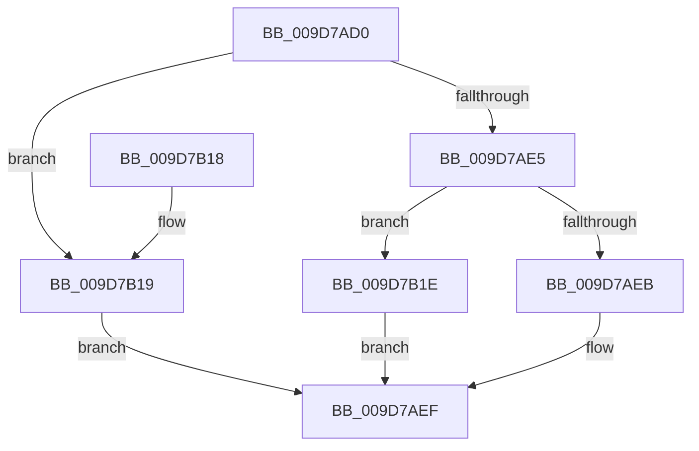

# SepConcatenatePrivileges

- RVA: `0x009D7AD0`–`0x009D7B2B` (길이 `91` bytes)
- VA: `0x00000001409D7AD0`
- 실행 섹션: `PAGE`
- PDB 이름 있음: `예`; PDB Function 태그: `아니요`
- unwind 정보 RVA: `0x00093470`
- 디코드: `30`개 명령, `91/91` bytes 표시
- 미해석 바이트: `0` (있으면 어셈블리에 `.byte`로 보존)

> 이 문서는 커널 이미지의 기계어와 PDB 기호를 분석해 생성했습니다. 4번과 5번은 함수 원형과 자료형을 바이너리 사용 방식에서 추정한 C 해석이며 원본 소스 복구 결과는 아닙니다.

## 1. Dependencies

- 직접 호출 지점: **1**; 고유 호출 대상: **1**
- 직접 호출자로 확인된 함수: **8**
- RIP 상대 이미지 참조: **0**

### Outgoing calls
- `0x009D7B04` → [memcpy](../../text/6C/memcpy_function_006C6840.md) (function, `0x006C6840`)

### Direct callers
- [ObpCreateHandle](../86/ObpCreateHandle_function_0086B950.md) at `0x0086D94E`
- [ObpGrantAccess](../86/ObpGrantAccess_function_0086F250.md) at `0x0086F99C`
- [sub_0086FDC3](../86/Unknown_function_0086FDC3.md) at `0x0086FF15`
- [CmpCheckOpenAccessOnKeyBody](../87/CmpCheckOpenAccessOnKeyBody_function_00870000.md) at `0x008709BF`
- [ObCheckObjectAccess](../87/ObCheckObjectAccess_function_00872260.md) at `0x008727B7`
- [sub_008A0B76](../8A/Unknown_function_008A0B76.md) at `0x008A0BF1`
- [sub_008A0C3F](../8A/Unknown_function_008A0C3F.md) at `0x008A0CAE`
- [SeAppendPrivileges](SeAppendPrivileges_function_009D7980.md) at `0x009D7A7E`

### Static image references
- 디코드된 RIP-relative 메모리 참조가 없습니다.

## 2. Other-region calls and transfers

- 다른 실행 섹션으로 향하는 call: **1**
  - `0x009D7B04` → [memcpy](../../text/6C/memcpy_function_006C6840.md) (`PAGE` → `.text`)
- 별도 외부 분기/꼬리 이동을 확인하지 못했습니다.

## 3. Assembly (complete function range)

```asm
009D7AD0  48 89 5C 24 08                  mov qword ptr [rsp + 8], rbx
009D7AD5  57                              push rdi
009D7AD6  48 83 EC 20                     sub rsp, 0x20
009D7ADA  49 8B F8                        mov rdi, r8
009D7ADD  48 8B D9                        mov rbx, rcx
009D7AE0  48 85 C9                        test rcx, rcx
009D7AE3  74 34                           je 0x1409d7b19
009D7AE5  8B 01                           mov eax, dword ptr [rcx]
009D7AE7  85 C0                           test eax, eax
009D7AE9  75 33                           jne 0x1409d7b1e
009D7AEB  44 8D 48 08                     lea r9d, [rax + 8]
009D7AEF  41 8B 00                        mov eax, dword ptr [r8]
009D7AF2  48 8D 57 08                     lea rdx, [rdi + 8]
009D7AF6  41 8B C9                        mov ecx, r9d
009D7AF9  48 03 CB                        add rcx, rbx
009D7AFC  44 8D 04 40                     lea r8d, [rax + rax*2]
009D7B00  41 C1 E0 02                     shl r8d, 2
009D7B04  E8 37 ED CE FF                  call 0x1406c6840
009D7B09  8B 07                           mov eax, dword ptr [rdi]
009D7B0B  01 03                           add dword ptr [rbx], eax
009D7B0D  48 8B 5C 24 30                  mov rbx, qword ptr [rsp + 0x30]
009D7B12  48 83 C4 20                     add rsp, 0x20
009D7B16  5F                              pop rdi
009D7B17  C3                              ret
009D7B18  CC                              int3
009D7B19  45 33 C9                        xor r9d, r9d
009D7B1C  EB D1                           jmp 0x1409d7aef
009D7B1E  8D 04 40                        lea eax, [rax + rax*2]
009D7B21  44 8D 0C 85 08 00 00 00         lea r9d, [rax*4 + 8]
009D7B29  EB C4                           jmp 0x1409d7aef
```

## 4. C-style interpretation (structured pseudocode)

```c
__int64 __fastcall SepConcatenatePrivileges(__int64 a1, __int64 a2, __int64 a3)
{
    __int64 result;
    __int64 v_rsp;
    unsigned __int64 v_stack_p8;

    v_stack_p8 = v_rbx;
    v_rsp = (v_rsp) - (32);
    if (a1 == 0) goto loc_009D7B19;
    if ((unsigned int)((unsigned int)(*(unsigned int *)(a1))) != 0) goto loc_009D7B1E;
loc_009D7AEF:
    a1 = ((unsigned int)((unsigned int)((unsigned int)(*(unsigned int *)(a1)) + 8))) + (a1);
    a3 = (unsigned int)(((unsigned int)(*(unsigned int *)(a3)) + (unsigned int)(*(unsigned int *)(a3)) * 2) << (2));
    result = memcpy(a1, a3 + 8, a3, (unsigned int)(*(unsigned int *)(a1)) + 8);
    v_rsp = (v_rsp) + (32);
    return (unsigned int)(*(unsigned int *)(a3));
loc_009D7B19:
    a4 = 0;
    goto loc_009D7AEF;
loc_009D7B1E:
    goto loc_009D7AEF;
}
```

## 5. (Beta) C Style

```c
int64_t SepConcatenatePrivileges(void *Arg1, int64_t Arg2, void *Arg3)
{
    uint8_t *arg1 = (uint8_t *)Arg1;
    uint8_t *arg3 = (uint8_t *)Arg3;

    int64_t result;
    int64_t local_rsp;
    uint64_t v_stack_p8;

    v_stack_p8 = local_rbx;
    local_rsp = (local_rsp) - (32);
    if (Arg1 == NULL) goto loc_009D7B19;
    if ((uint32_t)((uint32_t)(*(uint32_t *)(arg1))) != 0) goto loc_009D7B1E;
loc_009D7AEF:
    Arg1 = ((uint32_t)((uint32_t)((uint32_t)(*(uint32_t *)(arg1)) + 8))) + (Arg1);
    Arg3 = (uint32_t)(((uint32_t)(*(uint32_t *)(arg3)) + (uint32_t)(*(uint32_t *)(arg3)) * 2) << (2));
    result = memcpy(Arg1, Arg3 + 8, Arg3, (uint32_t)(*(uint32_t *)(arg1)) + 8);
    local_rsp = (local_rsp) + (32);
    return (uint32_t)(*(uint32_t *)(arg3));
loc_009D7B19:
    a4 = 0;
    goto loc_009D7AEF;
loc_009D7B1E:
    goto loc_009D7AEF;
}
```

### 관측된 메모리 오프셋

구조체 형식이 확인되지 않은 접근은 인자 기준의 오프셋으로만 기록했습니다.

| 기준 인자 | 오프셋 표현 | 폭 (bit) | 접근 |
|---|---:|---:|---|
| `Arg1` | `+ 0x0` | `32` | `R/W` |
| `Arg3` | `+ 0x0` | `32` | `R` |
| `Arg3` | `+ 0x8` | `64` | `R` |

## 6. Execution-region graph

[열기: 2D/3D 그래프와 함수 탐색 컨트롤 패널](../../../control-panel.html?section=page&rva=0x009D7AD0&view=graph)

- 2D 그래프는 위에서 아래로 흐르고, 3D 그래프는 빈 공간을 드래그해 회전합니다. Shift+드래그는 이동, 휠은 확대·축소, 함수 노드 선택은 대상 보고서 이동입니다.

### Static fallback


