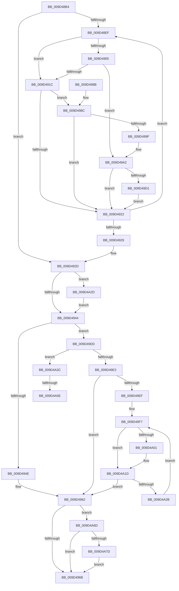

# SepRemoveDisabledGroupsAndPrivileges

- RVA: `0x009D48B4`–`0x009D4A8E` (길이 `474` bytes)
- VA: `0x00000001409D48B4`
- 실행 섹션: `PAGE`
- PDB 이름 있음: `예`; PDB Function 태그: `예`
- unwind 정보 RVA: `0x000A1A18`
- 디코드: `122`개 명령, `474/474` bytes 표시
- 미해석 바이트: `0` (있으면 어셈블리에 `.byte`로 보존)

> 이 문서는 커널 이미지의 기계어와 PDB 기호를 분석해 생성했습니다. 4번과 5번은 함수 원형과 자료형을 바이너리 사용 방식에서 추정한 C 해석이며 원본 소스 복구 결과는 아닙니다.

## 1. Dependencies

- 직접 호출 지점: **4**; 고유 호출 대상: **3**
- 직접 호출자로 확인된 함수: **1**
- RIP 상대 이미지 참조: **0**

### Outgoing calls
- `0x009D490F` → [SepSidInSidAndAttributes](SepSidInSidAndAttributes_function_009D4A94.md) (function, `0x009D4A94`)
- `0x009D4996` → [RtlIsElevatedRid](RtlIsElevatedRid_function_009D4B30.md) (function, `0x009D4B30`)
- `0x009D4A30` → [SepTokenPrivilegeCount](../../text/43/SepTokenPrivilegeCount_function_00432EC0.md) (function, `0x00432EC0`)
- `0x009D4A70` → [SepTokenPrivilegeCount](../../text/43/SepTokenPrivilegeCount_function_00432EC0.md) (function, `0x00432EC0`)

### Direct callers
- [SepFilterToken](../9C/SepFilterToken_function_009C6B80.md) at `0x009C76C3`

### Static image references
- 디코드된 RIP-relative 메모리 참조가 없습니다.

## 2. Other-region calls and transfers

- 다른 실행 섹션으로 향하는 call: **2**
  - `0x009D4A30` → [SepTokenPrivilegeCount](../../text/43/SepTokenPrivilegeCount_function_00432EC0.md) (`PAGE` → `.text`)
  - `0x009D4A70` → [SepTokenPrivilegeCount](../../text/43/SepTokenPrivilegeCount_function_00432EC0.md) (`PAGE` → `.text`)
- call이 아닌 외부 분기/꼬리 이동: **2**
  - `0x009D4A58` → [sub_00B2F9B8](../B2/Unknown_function_00B2F9B8.md) (`tail-transfer`)
  - `0x009D4A68` → [sub_00B2F9B8](../B2/Unknown_function_00B2F9B8.md) (`tail-transfer`)

## 3. Assembly (complete function range)

```asm
009D48B4  48 89 5C 24 08                  mov qword ptr [rsp + 8], rbx
009D48B9  48 89 6C 24 18                  mov qword ptr [rsp + 0x18], rbp
009D48BE  48 89 74 24 20                  mov qword ptr [rsp + 0x20], rsi
009D48C3  57                              push rdi
009D48C4  41 54                           push r12
009D48C6  41 55                           push r13
009D48C8  41 56                           push r14
009D48CA  41 57                           push r15
009D48CC  48 83 EC 20                     sub rsp, 0x20
009D48D0  33 FF                           xor edi, edi
009D48D2  45 32 FF                        xor r15b, r15b
009D48D5  40 32 ED                        xor bpl, bpl
009D48D8  89 7C 24 58                     mov dword ptr [rsp + 0x58], edi
009D48DC  33 F6                           xor esi, esi
009D48DE  4D 8B E1                        mov r12, r9
009D48E1  45 8B E8                        mov r13d, r8d
009D48E4  44 8B F2                        mov r14d, edx
009D48E7  48 8B D9                        mov rbx, rcx
009D48EA  39 71 7C                        cmp dword ptr [rcx + 0x7c], esi
009D48ED  76 3E                           jbe 0x1409d492d
009D48EF  4C 8B 8B 98 00 00 00            mov r9, qword ptr [rbx + 0x98]
009D48F6  8B FE                           mov edi, esi
009D48F8  48 C1 E7 04                     shl rdi, 4
009D48FC  42 8B 44 0F 08                  mov eax, dword ptr [rdi + r9 + 8]
009D4901  A8 30                           test al, 0x30
009D4903  75 17                           jne 0x1409d491c
009D4905  4E 8B 0C 0F                     mov r9, qword ptr [rdi + r9]
009D4909  41 8B D5                        mov edx, r13d
009D490C  49 8B CC                        mov rcx, r12
009D490F  E8 80 01 00 00                  call 0x1409d4a94
009D4914  84 C0                           test al, al
009D4916  0F 85 86 00 00 00               jne 0x1409d49a2
009D491C  41 F6 C6 04                     test r14b, 4
009D4920  75 6A                           jne 0x1409d498c
009D4922  FF C6                           inc esi
009D4924  3B 73 7C                        cmp esi, dword ptr [rbx + 0x7c]
009D4927  72 C6                           jb 0x1409d48ef
009D4929  8B 7C 24 58                     mov edi, dword ptr [rsp + 0x58]
009D492D  44 8B 93 C8 00 00 00            mov r10d, dword ptr [rbx + 0xc8]
009D4934  45 8B DA                        mov r11d, r10d
009D4937  41 81 E3 00 08 00 00            and r11d, 0x800
009D493E  0F 84 E9 00 00 00               je 0x1409d4a2d
009D4944  41 F6 C6 01                     test r14b, 1
009D4948  0F 84 8F 00 00 00               je 0x1409d49dd
009D494E  B8 00 00 80 00                  mov eax, 0x800000
009D4953  40 B5 01                        mov bpl, 1
009D4956  48 21 43 48                     and qword ptr [rbx + 0x48], rax
009D495A  48 21 43 50                     and qword ptr [rbx + 0x50], rax
009D495E  48 21 43 40                     and qword ptr [rbx + 0x40], rax
009D4962  45 85 DB                        test r11d, r11d
009D4965  0F 84 02 01 00 00               je 0x1409d4a6d
009D496B  48 8B 5C 24 50                  mov rbx, qword ptr [rsp + 0x50]
009D4970  40 8A C5                        mov al, bpl
009D4973  48 8B 6C 24 60                  mov rbp, qword ptr [rsp + 0x60]
009D4978  48 8B 74 24 68                  mov rsi, qword ptr [rsp + 0x68]
009D497D  48 83 C4 20                     add rsp, 0x20
009D4981  41 5F                           pop r15
009D4983  41 5E                           pop r14
009D4985  41 5D                           pop r13
009D4987  41 5C                           pop r12
009D4989  5F                              pop rdi
009D498A  C3                              ret
009D498B  CC                              int3
009D498C  48 8B 8B 98 00 00 00            mov rcx, qword ptr [rbx + 0x98]
009D4993  48 03 CF                        add rcx, rdi
009D4996  E8 95 01 00 00                  call 0x1409d4b30
009D499B  84 C0                           test al, al
009D499D  74 83                           je 0x1409d4922
009D499F  41 B7 01                        mov r15b, 1
009D49A2  48 8B 83 98 00 00 00            mov rax, qword ptr [rbx + 0x98]
009D49A9  40 B5 01                        mov bpl, 1
009D49AC  83 64 38 08 F0                  and dword ptr [rax + rdi + 8], 0xfffffff0
009D49B1  48 8B 83 98 00 00 00            mov rax, qword ptr [rbx + 0x98]
009D49B8  83 4C 38 08 10                  or dword ptr [rax + rdi + 8], 0x10
009D49BD  0F BA AB C8 00 00 00 0B         bts dword ptr [rbx + 0xc8], 0xb
009D49C5  3B B3 90 00 00 00               cmp esi, dword ptr [rbx + 0x90]
009D49CB  0F 85 51 FF FF FF               jne 0x1409d4922
009D49D1  83 A3 90 00 00 00 00            and dword ptr [rbx + 0x90], 0
009D49D8  E9 45 FF FF FF                  jmp 0x1409d4922
009D49DD  41 F6 C6 04                     test r14b, 4
009D49E1  75 59                           jne 0x1409d4a3c
009D49E3  8B 44 24 70                     mov eax, dword ptr [rsp + 0x70]
009D49E7  85 C0                           test eax, eax
009D49E9  0F 84 73 FF FF FF               je 0x1409d4962
009D49EF  48 8B 54 24 78                  mov rdx, qword ptr [rsp + 0x78]
009D49F4  44 8B C0                        mov r8d, eax
009D49F7  8B 0A                           mov ecx, dword ptr [rdx]
009D49F9  8D 41 FE                        lea eax, [rcx - 2]
009D49FC  83 F8 22                        cmp eax, 0x22
009D49FF  77 1C                           ja 0x1409d4a1d
009D4A01  8B C1                           mov eax, ecx
009D4A03  48 8B 4B 48                     mov rcx, qword ptr [rbx + 0x48]
009D4A07  48 0F B3 C1                     btr rcx, rax
009D4A0B  48 89 4B 48                     mov qword ptr [rbx + 0x48], rcx
009D4A0F  8B 02                           mov eax, dword ptr [rdx]
009D4A11  48 8B 4B 40                     mov rcx, qword ptr [rbx + 0x40]
009D4A15  48 0F B3 C1                     btr rcx, rax
009D4A19  48 89 4B 40                     mov qword ptr [rbx + 0x40], rcx
009D4A1D  48 83 C2 0C                     add rdx, 0xc
009D4A21  49 83 E8 01                     sub r8, 1
009D4A25  0F 84 37 FF FF FF               je 0x1409d4962
009D4A2B  EB CA                           jmp 0x1409d49f7
009D4A2D  48 8B CB                        mov rcx, rbx
009D4A30  E8 8B E4 A5 FF                  call 0x140432ec0
009D4A35  8B F8                           mov edi, eax
009D4A37  E9 08 FF FF FF                  jmp 0x1409d4944
009D4A3C  48 8B 43 48                     mov rax, qword ptr [rbx + 0x48]
009D4A40  40 B5 01                        mov bpl, 1
009D4A43  48 8B 4B 50                     mov rcx, qword ptr [rbx + 0x50]
009D4A47  49 B8 00 00 88 02 06 00 00 00   movabs r8, 0x602880000
009D4A51  48 8B 53 40                     mov rdx, qword ptr [rbx + 0x40]
009D4A55  45 84 FF                        test r15b, r15b
009D4A58  0F 85 5A AF 15 00               jne 0x140b2f9b8
009D4A5E  49 B8 7B F9 E9 DF EE FF FF FF   movabs r8, 0xffffffeedfe9f97b
009D4A68  E9 4B AF 15 00                  jmp 0x140b2f9b8
009D4A6D  48 8B CB                        mov rcx, rbx
009D4A70  E8 4B E4 A5 FF                  call 0x140432ec0
009D4A75  3B C7                           cmp eax, edi
009D4A77  0F 83 EE FE FF FF               jae 0x1409d496b
009D4A7D  41 0F BA EA 0B                  bts r10d, 0xb
009D4A82  44 89 93 C8 00 00 00            mov dword ptr [rbx + 0xc8], r10d
009D4A89  E9 DD FE FF FF                  jmp 0x1409d496b
```

## 4. C-style interpretation (structured pseudocode)

```c
__int64 __fastcall SepRemoveDisabledGroupsAndPrivileges(__int64 a1, int a2, int a3, __int64 a4, unsigned int a5, __int64 a6)
{
    __int64 result;
    __int64 v_r11;
    __int64 v_r15;
    __int64 v_rbp;
    __int64 v_rdi;
    __int64 v_rsi;
    __int64 v_rsp;
    unsigned int v_stack_p10;
    unsigned __int64 v_stack_p18;
    unsigned __int64 v_stack_p20;
    unsigned __int64 v_stack_p8;

    v_stack_p8 = v_rbx;
    v_stack_p18 = v_rbp;
    v_stack_p20 = v_rsi;
    v_rsp = (v_rsp) - (32);
    v_rdi = 0;
    v_r15 = 0;
    v_rbp = 0;
    v_stack_p10 = 0;
    v_rsi = 0;
    if ((*(unsigned int *)(a1 + 124)) <= 0) goto loc_009D492D;
loc_009D48EF:
    v_rdi = (0) << (4);
    if ((((unsigned __int8)((unsigned int)(*(unsigned int *)(v_rdi + *(unsigned __int64 *)(a1 + 152) * 1 + 8)))) & (48)) != 0) goto loc_009D491C;
    result = SepSidInSidAndAttributes(a4, (unsigned int)((unsigned int)((unsigned int)(a3))), a3, *(unsigned __int64 *)(v_rdi + *(unsigned __int64 *)(a1 + 152) * 1));
    if ((unsigned __int8)(result) != 0) goto loc_009D49A2;
loc_009D491C:
    if ((((unsigned __int8)((unsigned int)(a2))) & (4)) != 0) goto loc_009D498C;
loc_009D4922:
    v_rsi = (unsigned int)((v_rsi) + 1);
    if (((unsigned int)(v_rsi)) < (*(unsigned int *)(a1 + 124))) goto loc_009D48EF;
loc_009D492D:
    v_r11 = (unsigned int)(((unsigned int)((unsigned int)((unsigned int)(*(unsigned int *)(a1 + 200))))) & (0x800ULL));
    if (condition_is_equal) goto loc_009D4A2D;
loc_009D4944:
    if ((((unsigned __int8)((unsigned int)(a2))) & (1)) == 0) goto loc_009D49DD;
loc_009D4962:
    if ((unsigned int)(v_r11) == 0) goto loc_009D4A6D;
loc_009D496B:
    v_rsp = (v_rsp) + (32);
    return 1;
loc_009D498C:
    a1 = (*(unsigned __int64 *)(v_stack_p8 + 152)) + ((unsigned int)(v_stack_p10));
    result = RtlIsElevatedRid(a1, (unsigned int)((unsigned int)((unsigned int)(a3))), a3, *(unsigned __int64 *)(v_rdi + *(unsigned __int64 *)(a1 + 152) * 1));
    if ((unsigned __int8)(result) == 0) goto loc_009D4922;
loc_009D49A2:
    if (((unsigned int)(v_stack_p20)) != (*(unsigned int *)(v_stack_p8 + 144))) goto loc_009D4922;
    goto loc_009D4922;
loc_009D49DD:
    if ((((unsigned __int8)((unsigned int)(a2))) & (4)) != 0) goto loc_009D4A3C;
    if ((unsigned int)((unsigned int)(a5)) == 0) goto loc_009D4962;
loc_009D49F7:
    result = (unsigned int)(*(unsigned int *)(a6)) - 2;
    if (((unsigned int)((unsigned int)(*(unsigned int *)(a6)) - 2)) <= 34) {
        result = (unsigned int)((unsigned int)(*(unsigned int *)(a6)));
        a1 = *(unsigned __int64 *)(v_stack_p8 + 72);
        *(unsigned __int64 *)(v_stack_p8 + 72) = a1;
        result = *(unsigned int *)(a6);
        a1 = *(unsigned __int64 *)(v_stack_p8 + 64);
        *(unsigned __int64 *)(v_stack_p8 + 64) = a1;
    }
    a2 = (a6) + (12);
    a3 = ((unsigned int)((unsigned int)((unsigned int)(a5)))) - (1);
    if (condition_is_equal) goto loc_009D4962;
    goto loc_009D49F7;
loc_009D4A2D:
    result = SepTokenPrivilegeCount(v_stack_p8, a2, a3, *(unsigned __int64 *)(v_rdi + *(unsigned __int64 *)(a1 + 152) * 1));
    goto loc_009D4944;
loc_009D4A3C:
loc_009D4A6D:
    result = SepTokenPrivilegeCount(v_stack_p8, *(unsigned __int64 *)(v_stack_p8 + 64), a3, *(unsigned __int64 *)(v_rdi + *(unsigned __int64 *)(a1 + 152) * 1));
    if (((unsigned int)(result)) >= ((unsigned int)((unsigned int)((unsigned int)(result))))) goto loc_009D496B;
    *(unsigned int *)(v_stack_p8 + 200) = (unsigned int)((unsigned int)(*(unsigned int *)(a1 + 200)));
    goto loc_009D496B;
}
```

## 5. (Beta) C Style

```c
int64_t SepRemoveDisabledGroupsAndPrivileges(void *Arg1, int32_t Arg2, int32_t Arg3, int64_t Arg4, uint32_t Arg5, void *Arg6)
{
    uint8_t *arg1 = (uint8_t *)Arg1;
    uint8_t *arg6 = (uint8_t *)Arg6;

    int64_t result;
    int64_t local_r11;
    int64_t local_r15;
    int64_t local_rbp;
    int64_t local_rdi;
    int64_t local_rsi;
    int64_t local_rsp;
    uint32_t v_stack_p10;
    uint64_t v_stack_p18;
    uint64_t v_stack_p20;
    uint64_t v_stack_p8;

    v_stack_p8 = local_rbx;
    v_stack_p18 = local_rbp;
    v_stack_p20 = local_rsi;
    local_rsp = (local_rsp) - (32);
    local_rdi = 0;
    local_r15 = 0;
    local_rbp = 0;
    v_stack_p10 = 0;
    local_rsi = 0;
    if ((*(uint32_t *)(arg1 + 0x7C)) <= 0) goto loc_009D492D;
loc_009D48EF:
    local_rdi = (0) << (4);
    if ((((uint8_t)((uint32_t)(*(uint32_t *)(local_rdi + *(uint64_t *)(arg1 + 0x98) * 1 + 0x8)))) & (48)) != 0) goto loc_009D491C;
    result = SepSidInSidAndAttributes(Arg4, (uint32_t)((uint32_t)((uint32_t)(Arg3))), Arg3, *(uint64_t *)(local_rdi + *(uint64_t *)(arg1 + 0x98) * 1));
    if ((uint8_t)(result) != 0) goto loc_009D49A2;
loc_009D491C:
    if ((((uint8_t)((uint32_t)(Arg2))) & (4)) != 0) goto loc_009D498C;
loc_009D4922:
    local_rsi = (uint32_t)((local_rsi) + 1);
    if (((uint32_t)(local_rsi)) < (*(uint32_t *)(arg1 + 0x7C))) goto loc_009D48EF;
loc_009D492D:
    local_r11 = (uint32_t)(((uint32_t)((uint32_t)((uint32_t)(*(uint32_t *)(arg1 + 0xC8))))) & (0x800ULL));
    if (condition_is_equal) goto loc_009D4A2D;
loc_009D4944:
    if ((((uint8_t)((uint32_t)(Arg2))) & (1)) == 0) goto loc_009D49DD;
loc_009D4962:
    if ((uint32_t)(local_r11) == 0) goto loc_009D4A6D;
loc_009D496B:
    local_rsp = (local_rsp) + (32);
    return 1;
loc_009D498C:
    Arg1 = (*(uint64_t *)(v_stack_p8 + 0x98)) + ((uint32_t)(v_stack_p10));
    result = RtlIsElevatedRid(Arg1, (uint32_t)((uint32_t)((uint32_t)(Arg3))), Arg3, *(uint64_t *)(local_rdi + *(uint64_t *)(arg1 + 0x98) * 1));
    if ((uint8_t)(result) == 0) goto loc_009D4922;
loc_009D49A2:
    if (((uint32_t)(v_stack_p20)) != (*(uint32_t *)(v_stack_p8 + 0x90))) goto loc_009D4922;
    goto loc_009D4922;
loc_009D49DD:
    if ((((uint8_t)((uint32_t)(Arg2))) & (4)) != 0) goto loc_009D4A3C;
    if ((uint32_t)((uint32_t)(Arg5)) == 0) goto loc_009D4962;
loc_009D49F7:
    result = (uint32_t)(*(uint32_t *)(arg6)) - 2;
    if (((uint32_t)((uint32_t)(*(uint32_t *)(arg6)) - 2)) <= 34) {
        result = (uint32_t)((uint32_t)(*(uint32_t *)(arg6)));
        Arg1 = *(uint64_t *)(v_stack_p8 + 0x48);
        *(void **)(v_stack_p8 + 0x48) = Arg1;
        result = *(uint32_t *)(arg6);
        Arg1 = *(uint64_t *)(v_stack_p8 + 0x40);
        *(void **)(v_stack_p8 + 0x40) = Arg1;
    }
    Arg2 = (Arg6) + (12);
    Arg3 = ((uint32_t)((uint32_t)((uint32_t)(Arg5)))) - (1);
    if (condition_is_equal) goto loc_009D4962;
    goto loc_009D49F7;
loc_009D4A2D:
    result = SepTokenPrivilegeCount(v_stack_p8, Arg2, Arg3, *(uint64_t *)(local_rdi + *(uint64_t *)(arg1 + 0x98) * 1));
    goto loc_009D4944;
loc_009D4A3C:
loc_009D4A6D:
    result = SepTokenPrivilegeCount(v_stack_p8, *(uint64_t *)(v_stack_p8 + 0x40), Arg3, *(uint64_t *)(local_rdi + *(uint64_t *)(arg1 + 0x98) * 1));
    if (((uint32_t)(result)) >= ((uint32_t)((uint32_t)((uint32_t)(result))))) goto loc_009D496B;
    *(uint32_t *)(v_stack_p8 + 0xC8) = (uint32_t)((uint32_t)(*(uint32_t *)(arg1 + 0xC8)));
    goto loc_009D496B;
}
```

### 관측된 메모리 오프셋

구조체 형식이 확인되지 않은 접근은 인자 기준의 오프셋으로만 기록했습니다.

| 기준 인자 | 오프셋 표현 | 폭 (bit) | 접근 |
|---|---:|---:|---|
| `Arg1` | `+ 0x40` | `64` | `R` |
| `Arg1` | `+ 0x40` | `64` | `R/W` |
| `Arg1` | `+ 0x40` | `64` | `W` |
| `Arg1` | `+ 0x48` | `64` | `R` |
| `Arg1` | `+ 0x48` | `64` | `R/W` |
| `Arg1` | `+ 0x48` | `64` | `W` |
| `Arg1` | `+ 0x50` | `64` | `R` |
| `Arg1` | `+ 0x50` | `64` | `R/W` |
| `Arg1` | `+ 0x7C` | `32` | `R` |
| `Arg1` | `+ 0x90` | `32` | `R` |
| `Arg1` | `+ 0x90` | `32` | `R/W` |
| `Arg1` | `+ 0x98` | `64` | `R` |
| `Arg1` | `+ 0xC8` | `32` | `R` |
| `Arg1` | `+ 0xC8` | `32` | `R/W` |
| `Arg1` | `+ 0xC8` | `32` | `W` |
| `Arg6` | `+ 0x0` | `32` | `R` |

## 6. Execution-region graph

[열기: 2D/3D 그래프와 함수 탐색 컨트롤 패널](../../../control-panel.html?section=page&rva=0x009D48B4&view=graph)

- 2D 그래프는 위에서 아래로 흐르고, 3D 그래프는 빈 공간을 드래그해 회전합니다. Shift+드래그는 이동, 휠은 확대·축소, 함수 노드 선택은 대상 보고서 이동입니다.

### Static fallback


