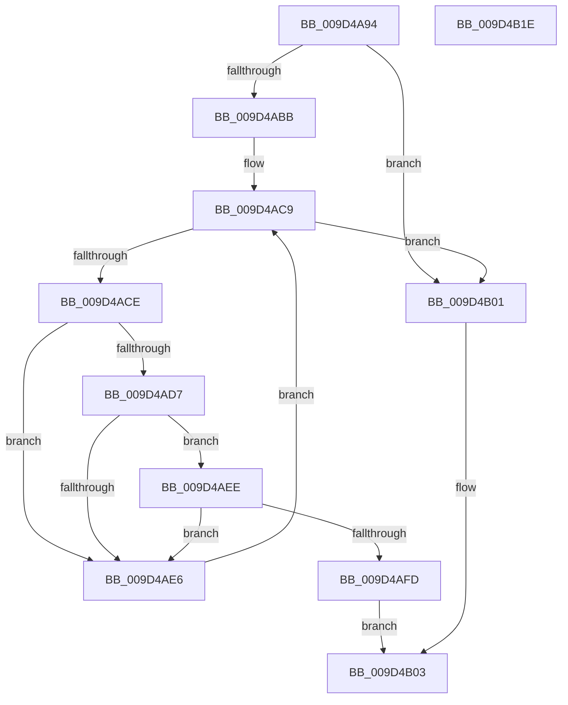

# SepSidInSidAndAttributes

- RVA: `0x009D4A94`–`0x009D4B1F` (길이 `139` bytes)
- VA: `0x00000001409D4A94`
- 실행 섹션: `PAGE`
- PDB 이름 있음: `예`; PDB Function 태그: `아니요`
- unwind 정보 RVA: `0x0005E6B4`
- 디코드: `44`개 명령, `139/139` bytes 표시
- 미해석 바이트: `0` (있으면 어셈블리에 `.byte`로 보존)

> 이 문서는 커널 이미지의 기계어와 PDB 기호를 분석해 생성했습니다. 4번과 5번은 함수 원형과 자료형을 바이너리 사용 방식에서 추정한 C 해석이며 원본 소스 복구 결과는 아닙니다.

## 1. Dependencies

- 직접 호출 지점: **1**; 고유 호출 대상: **1**
- 직접 호출자로 확인된 함수: **2**
- RIP 상대 이미지 참조: **0**

### Outgoing calls
- `0x009D4AF4` → [memcmp](../../text/6C/memcmp_function_006C6B10.md) (function, `0x006C6B10`)

### Direct callers
- [SepFilterToken](../9C/SepFilterToken_function_009C6B80.md) at `0x009C733A`
- [SepRemoveDisabledGroupsAndPrivileges](SepRemoveDisabledGroupsAndPrivileges_function_009D48B4.md) at `0x009D490F`

### Static image references
- 디코드된 RIP-relative 메모리 참조가 없습니다.

## 2. Other-region calls and transfers

- 다른 실행 섹션으로 향하는 call: **1**
  - `0x009D4AF4` → [memcmp](../../text/6C/memcmp_function_006C6B10.md) (`PAGE` → `.text`)
- 별도 외부 분기/꼬리 이동을 확인하지 못했습니다.

## 3. Assembly (complete function range)

```asm
009D4A94  48 8B C4                        mov rax, rsp
009D4A97  48 89 58 08                     mov qword ptr [rax + 8], rbx
009D4A9B  48 89 68 10                     mov qword ptr [rax + 0x10], rbp
009D4A9F  48 89 70 18                     mov qword ptr [rax + 0x18], rsi
009D4AA3  48 89 78 20                     mov qword ptr [rax + 0x20], rdi
009D4AA7  41 56                           push r14
009D4AA9  48 83 EC 20                     sub rsp, 0x20
009D4AAD  49 8B F1                        mov rsi, r9
009D4AB0  44 8B F2                        mov r14d, edx
009D4AB3  48 8B D9                        mov rbx, rcx
009D4AB6  48 85 C9                        test rcx, rcx
009D4AB9  74 46                           je 0x1409d4b01
009D4ABB  41 0F B6 41 01                  movzx eax, byte ptr [r9 + 1]
009D4AC0  33 FF                           xor edi, edi
009D4AC2  8D 2C 85 08 00 00 00            lea ebp, [rax*4 + 8]
009D4AC9  41 3B FE                        cmp edi, r14d
009D4ACC  73 33                           jae 0x1409d4b01
009D4ACE  48 8B 13                        mov rdx, qword ptr [rbx]
009D4AD1  8A 02                           mov al, byte ptr [rdx]
009D4AD3  38 06                           cmp byte ptr [rsi], al
009D4AD5  75 0F                           jne 0x1409d4ae6
009D4AD7  0F B6 42 01                     movzx eax, byte ptr [rdx + 1]
009D4ADB  8D 04 85 08 00 00 00            lea eax, [rax*4 + 8]
009D4AE2  3B E8                           cmp ebp, eax
009D4AE4  74 08                           je 0x1409d4aee
009D4AE6  48 83 C3 10                     add rbx, 0x10
009D4AEA  FF C7                           inc edi
009D4AEC  EB DB                           jmp 0x1409d4ac9
009D4AEE  44 8B C5                        mov r8d, ebp
009D4AF1  48 8B CE                        mov rcx, rsi
009D4AF4  E8 17 20 CF FF                  call 0x1406c6b10
009D4AF9  85 C0                           test eax, eax
009D4AFB  75 E9                           jne 0x1409d4ae6
009D4AFD  B0 01                           mov al, 1
009D4AFF  EB 02                           jmp 0x1409d4b03
009D4B01  32 C0                           xor al, al
009D4B03  48 8B 5C 24 30                  mov rbx, qword ptr [rsp + 0x30]
009D4B08  48 8B 6C 24 38                  mov rbp, qword ptr [rsp + 0x38]
009D4B0D  48 8B 74 24 40                  mov rsi, qword ptr [rsp + 0x40]
009D4B12  48 8B 7C 24 48                  mov rdi, qword ptr [rsp + 0x48]
009D4B17  48 83 C4 20                     add rsp, 0x20
009D4B1B  41 5E                           pop r14
009D4B1D  C3                              ret
009D4B1E  CC                              int3
```

## 4. C-style interpretation (structured pseudocode)

```c
__int64 __fastcall SepSidInSidAndAttributes(__int64 a1, int a2, __int64 a3, __int64 a4)
{
    __int64 result;
    __int64 v_rbx;
    __int64 v_rdi;
    __int64 v_rsp;
    unsigned __int64 v_stack_p10;
    unsigned __int64 v_stack_p18;
    unsigned __int64 v_stack_p20;
    unsigned __int64 v_stack_p8;

    *(unsigned __int64 *)(v_rsp + 8) = v_rbx;
    *(unsigned __int64 *)(v_rsp + 16) = v_rbp;
    *(unsigned __int64 *)(v_rsp + 24) = v_rsi;
    *(unsigned __int64 *)(v_rsp + 32) = v_rdi;
    v_rsp = (v_rsp) - (32);
    if (a1 == 0) goto loc_009D4B01;
    v_rdi = 0;
loc_009D4AC9:
    if (0 >= ((unsigned int)((unsigned int)(a2)))) goto loc_009D4B01;
    if ((*(unsigned __int8 *)(a4)) != ((unsigned __int8)(*(unsigned __int8 *)(*(unsigned __int64 *)(a1))))) goto loc_009D4AE6;
    if (((unsigned int)(*(unsigned __int8 *)(a4 + 1) * 4 + 8)) == ((unsigned int)(*(unsigned __int8 *)(*(unsigned __int64 *)(a1) + 1) * 4 + 8))) goto loc_009D4AEE;
loc_009D4AE6:
    v_rbx = (a1) + (16);
    v_rdi = (unsigned int)((v_rdi) + 1);
    goto loc_009D4AC9;
loc_009D4AEE:
    result = memcmp(a4, *(unsigned __int64 *)(a1), (unsigned int)((unsigned int)(*(unsigned __int8 *)(a4 + 1) * 4 + 8)), a4);
    if ((unsigned int)(result) != 0) goto loc_009D4AE6;
    goto loc_009D4B03;
loc_009D4B01:
    result = 0;
loc_009D4B03:
    v_rsp = (v_rsp) + (32);
    return result;
}
```

## 5. (Beta) C Style

```c
int64_t SepSidInSidAndAttributes(void *Arg1, int32_t Arg2, int64_t Arg3, void *Arg4)
{
    uint8_t *arg1 = (uint8_t *)Arg1;
    uint8_t *arg4 = (uint8_t *)Arg4;

    int64_t result;
    int64_t local_rbx;
    int64_t local_rdi;
    int64_t local_rsp;
    uint64_t v_stack_p10;
    uint64_t v_stack_p18;
    uint64_t v_stack_p20;
    uint64_t v_stack_p8;

    *(uint64_t *)(local_rsp + 0x8) = local_rbx;
    *(uint64_t *)(local_rsp + 0x10) = local_rbp;
    *(uint64_t *)(local_rsp + 0x18) = local_rsi;
    *(uint64_t *)(local_rsp + 0x20) = local_rdi;
    local_rsp = (local_rsp) - (32);
    if (Arg1 == NULL) goto loc_009D4B01;
    local_rdi = 0;
loc_009D4AC9:
    if (0 >= ((uint32_t)((uint32_t)(Arg2)))) goto loc_009D4B01;
    if ((*(uint8_t *)(arg4)) != ((uint8_t)(*(uint8_t *)(*(uint64_t *)(arg1))))) goto loc_009D4AE6;
    if (((uint32_t)(*(uint8_t *)(arg4 + 0x1) * 4 + 8)) == ((uint32_t)(*(uint8_t *)(*(uint64_t *)(arg1) + 0x1) * 4 + 8))) goto loc_009D4AEE;
loc_009D4AE6:
    local_rbx = (Arg1) + (16);
    local_rdi = (uint32_t)((local_rdi) + 1);
    goto loc_009D4AC9;
loc_009D4AEE:
    result = memcmp(Arg4, *(uint64_t *)(arg1), (uint32_t)((uint32_t)(*(uint8_t *)(arg4 + 0x1) * 4 + 8)), Arg4);
    if ((uint32_t)(result) != 0) goto loc_009D4AE6;
    goto loc_009D4B03;
loc_009D4B01:
    result = 0;
loc_009D4B03:
    local_rsp = (local_rsp) + (32);
    return result;
}
```

### 관측된 메모리 오프셋

구조체 형식이 확인되지 않은 접근은 인자 기준의 오프셋으로만 기록했습니다.

| 기준 인자 | 오프셋 표현 | 폭 (bit) | 접근 |
|---|---:|---:|---|
| `Arg1` | `+ 0x0` | `64` | `R` |
| `Arg4` | `+ 0x0` | `8` | `R` |
| `Arg4` | `+ 0x1` | `8` | `R` |

## 6. Execution-region graph

[열기: 2D/3D 그래프와 함수 탐색 컨트롤 패널](../../../control-panel.html?section=page&rva=0x009D4A94&view=graph)

- 2D 그래프는 위에서 아래로 흐르고, 3D 그래프는 빈 공간을 드래그해 회전합니다. Shift+드래그는 이동, 휠은 확대·축소, 함수 노드 선택은 대상 보고서 이동입니다.

### Static fallback


