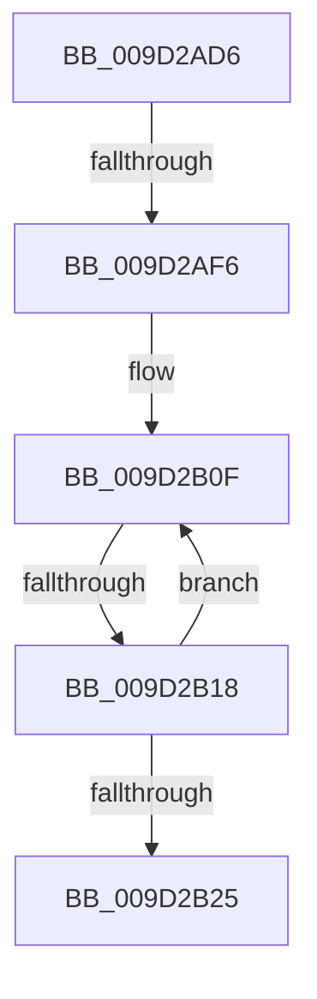

# sub_009D2AD6

- RVA: `0x009D2AD6`–`0x009D2B3A` (길이 `100` bytes)
- VA: `0x00000001409D2AD6`
- 실행 섹션: `PAGE`
- PDB 이름 있음: `아니요`; PDB Function 태그: `아니요`
- unwind 정보 RVA: `0x000A148C`
- 디코드: `22`개 명령, `100/100` bytes 표시
- 미해석 바이트: `0` (있으면 어셈블리에 `.byte`로 보존)

> 이 문서는 커널 이미지의 기계어와 PDB 기호를 분석해 생성했습니다. 4번과 5번은 함수 원형과 자료형을 바이너리 사용 방식에서 추정한 C 해석이며 원본 소스 복구 결과는 아닙니다.

## 1. Dependencies

- 직접 호출 지점: **0**; 고유 호출 대상: **0**
- 직접 호출자로 확인된 함수: **0**
- RIP 상대 이미지 참조: **1**

### Outgoing calls
- 직접 디코드된 call 명령이 없습니다.

### Direct callers
- 이 함수 시작 RVA로 연결되는 직접 call은 확인되지 않았습니다. 간접 호출은 완전히 역산할 수 없습니다.

### Static image references
- `0x009D2B05` → RVA `0x00B4DEA0` (`CmDeviceRegPropMap`; read)

## 2. Other-region calls and transfers

- 다른 실행 섹션으로 향하는 call: **0**
- call이 아닌 외부 분기/꼬리 이동: **2**
  - `0x009D2AF0` → [sub_009D2B5A + 0x8A](Unknown_function_009D2B5A.md) (`tail-transfer`)
  - `0x009D2B16` → [sub_009D2B5A](Unknown_function_009D2B5A.md) (`tail-transfer`)

## 3. Assembly (complete function range)

```asm
009D2AD6  48 89 BC 24 48 01 00 00         mov qword ptr [rsp + 0x148], rdi
009D2ADE  41 89 4D 00                     mov dword ptr [r13], ecx
009D2AE2  4C 89 A4 24 F0 00 00 00         mov qword ptr [rsp + 0xf0], r12
009D2AEA  41 89 0F                        mov dword ptr [r15], ecx
009D2AED  4D 85 F6                        test r14, r14
009D2AF0  0F 84 EE 00 00 00               je 0x1409d2be4
009D2AF6  44 8B 65 6F                     mov r12d, dword ptr [rbp + 0x6f]
009D2AFA  45 85 E4                        test r12d, r12d
009D2AFD  4C 0F 44 F1                     cmove r14, rcx
009D2B01  45 8B 51 10                     mov r10d, dword ptr [r9 + 0x10]
009D2B05  48 8D 3D 94 B3 17 00            lea rdi, [rip + 0x17b394]
009D2B0C  44 8B C1                        mov r8d, ecx
009D2B0F  48 8B 17                        mov rdx, qword ptr [rdi]
009D2B12  44 3B 52 10                     cmp r10d, dword ptr [rdx + 0x10]
009D2B16  74 42                           je 0x1409d2b5a
009D2B18  41 FF C0                        inc r8d
009D2B1B  48 83 C7 18                     add rdi, 0x18
009D2B1F  41 83 F8 21                     cmp r8d, 0x21
009D2B23  72 EA                           jb 0x1409d2b0f
009D2B25  BB 16 00 00 C0                  mov ebx, 0xc0000016
009D2B2A  48 8B BC 24 48 01 00 00         mov rdi, qword ptr [rsp + 0x148]
009D2B32  4C 8B A4 24 F0 00 00 00         mov r12, qword ptr [rsp + 0xf0]
```

## 4. C-style interpretation (structured pseudocode)

```c
void __fastcall sub_009D2AD6(__int64 a1, __int64 a2, __int64 a3, __int64 a4, __int64 a5, __int64 a6, __int64 a7, __int64 a8, __int64 a9, __int64 a10, __int64 a11, __int64 a12, __int64 a13, __int64 a14, __int64 a15, __int64 a16, __int64 a17, __int64 a18, __int64 a19, __int64 a20, __int64 a21, __int64 a22, __int64 a23, __int64 a24, __int64 a25, __int64 a26, __int64 a27, __int64 a28, __int64 a29, __int64 a30, __int64 a31, __int64 a32, __int64 a33, __int64 a34, __int64 a35, __int64 a36, __int64 a37, __int64 a38, __int64 a39, __int64 a40, __int64 a41)
{
    __int64 v_r14;
    __int64 v_rdi;
    unsigned __int64 v_stack_p148;
    unsigned __int64 v_stack_pF0;

    v_stack_p148 = v_rdi;
    *(unsigned int *)(v_r13) = (unsigned int)(a1);
    v_stack_pF0 = v_r12;
    *(unsigned int *)(v_r15) = (unsigned int)(a1);
    if ((unsigned int)((unsigned int)(*(unsigned int *)(v_rbp + 111))) == 0) { v_r14 = a1; }
loc_009D2B0F:
    a3 = (unsigned int)(((unsigned int)((unsigned int)(a1))) + 1);
    v_rdi = (v_rip + 1553300) + (24);
    if (((unsigned int)(a3)) < 33) goto loc_009D2B0F;
    return;
}
```

## 5. (Beta) C Style

```c
void sub_009D2AD6(int64_t Arg1, int64_t Arg2, int64_t Arg3, void *Arg4, uint64_t Arg5, uint64_t Arg6, uint64_t Arg7, uint64_t Arg8, uint64_t Arg9, uint64_t Arg10, uint64_t Arg11, uint64_t Arg12, uint64_t Arg13, uint64_t Arg14, uint64_t Arg15, uint64_t Arg16, uint64_t Arg17, uint64_t Arg18, uint64_t Arg19, uint64_t Arg20, uint64_t Arg21, uint64_t Arg22, uint64_t Arg23, uint64_t Arg24, uint64_t Arg25, uint64_t Arg26, uint64_t Arg27, uint64_t Arg28, uint64_t Arg29, int64_t Arg30, uint64_t Arg31, uint64_t Arg32, uint64_t Arg33, uint64_t Arg34, uint64_t Arg35, uint64_t Arg36, uint64_t Arg37, uint64_t Arg38, uint64_t Arg39, uint64_t Arg40, int64_t Arg41)
{
    uint8_t *arg4 = (uint8_t *)Arg4;

    int64_t local_r14;
    int64_t local_rdi;
    uint64_t v_stack_p148;
    uint64_t v_stack_pF0;

    v_stack_p148 = local_rdi;
    *(uint32_t *)(local_r13) = (uint32_t)(Arg1);
    v_stack_pF0 = local_r12;
    *(uint32_t *)(local_r15) = (uint32_t)(Arg1);
    if ((uint32_t)((uint32_t)(*(uint32_t *)(local_rbp + 0x6F))) == 0) { local_r14 = Arg1; }
loc_009D2B0F:
    Arg3 = (uint32_t)(((uint32_t)((uint32_t)(Arg1))) + 1);
    local_rdi = (v_rip + 1553300) + (24);
    if (((uint32_t)(Arg3)) < 33) goto loc_009D2B0F;
    return;
}
```

### 관측된 메모리 오프셋

구조체 형식이 확인되지 않은 접근은 인자 기준의 오프셋으로만 기록했습니다.

| 기준 인자 | 오프셋 표현 | 폭 (bit) | 접근 |
|---|---:|---:|---|
| `Arg4` | `+ 0x10` | `32` | `R` |

## 6. Execution-region graph

[열기: 2D/3D 그래프와 함수 탐색 컨트롤 패널](../../../control-panel.html?section=page&rva=0x009D2AD6&view=graph)

- 2D 그래프는 위에서 아래로 흐르고, 3D 그래프는 빈 공간을 드래그해 회전합니다. Shift+드래그는 이동, 휠은 확대·축소, 함수 노드 선택은 대상 보고서 이동입니다.

### Static fallback


