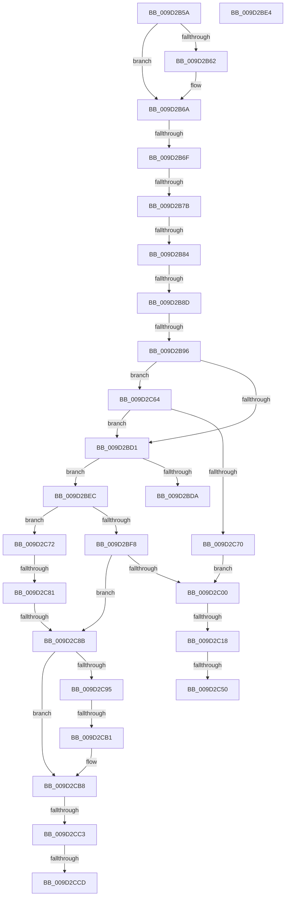

# sub_009D2B5A

- RVA: `0x009D2B5A`–`0x009D2CE0` (길이 `390` bytes)
- VA: `0x00000001409D2B5A`
- 실행 섹션: `PAGE`
- PDB 이름 있음: `아니요`; PDB Function 태그: `아니요`
- unwind 정보 RVA: `0x000A14B8`
- 디코드: `95`개 명령, `390/390` bytes 표시
- 미해석 바이트: `0` (있으면 어셈블리에 `.byte`로 보존)

> 이 문서는 커널 이미지의 기계어와 PDB 기호를 분석해 생성했습니다. 4번과 5번은 함수 원형과 자료형을 바이너리 사용 방식에서 추정한 C 해석이며 원본 소스 복구 결과는 아닙니다.

## 1. Dependencies

- 직접 호출 지점: **4**; 고유 호출 대상: **4**
- 직접 호출자로 확인된 함수: **0**
- RIP 상대 이미지 참조: **0**

### Outgoing calls
- `0x009D2BC2` → [CmGetDeviceRegProp](../8E/CmGetDeviceRegProp_function_008ED870.md) (function, `0x008ED870`)
- `0x009D2C41` → [_CmOpenDeviceRegKey](../8E/_CmOpenDeviceRegKey_function_008EE540.md) (function, `0x008EE540`)
- `0x009D2C55` → [ZwClose](../../text/6A/ZwClose_function_006AD2B0.md) (function, `0x006AD2B0`)
- `0x009D2C98` → [PnpMultiSzGetLen](PnpMultiSzGetLen_function_009D3180.md) (function, `0x009D3180`)

### Direct callers
- 이 함수 시작 RVA로 연결되는 직접 call은 확인되지 않았습니다. 간접 호출은 완전히 역산할 수 없습니다.

### Static image references
- 디코드된 RIP-relative 메모리 참조가 없습니다.

## 2. Other-region calls and transfers

- 다른 실행 섹션으로 향하는 call: **1**
  - `0x009D2C55` → [ZwClose](../../text/6A/ZwClose_function_006AD2B0.md) (`PAGE` → `.text`)
- call이 아닌 외부 분기/꼬리 이동: **16**
  - `0x009D2B6D` → [sub_009D2AD6 + 0x42](Unknown_function_009D2AD6.md) (`tail-transfer`)
  - `0x009D2B75` → [sub_009D2CEA](Unknown_function_009D2CEA.md) (`tail-transfer`)
  - `0x009D2B7E` → [sub_009D2CEA + 0x186](Unknown_function_009D2CEA.md) (`tail-transfer`)
  - `0x009D2B87` → [sub_009D2CEA](Unknown_function_009D2CEA.md) (`tail-transfer`)
  - `0x009D2B90` → [sub_009D2CEA + 0x21E](Unknown_function_009D2CEA.md) (`tail-transfer`)
  - `0x009D2BDF` → [sub_009D2AD6 + 0x54](Unknown_function_009D2AD6.md) (`tail-transfer`)
  - `0x009D2BE7` → [sub_009D2AD6 + 0x2B](Unknown_function_009D2AD6.md) (`tail-transfer`)
  - `0x009D2C12` → [sub_009D2AD6 + 0x54](Unknown_function_009D2AD6.md) (`tail-transfer`)
  - `0x009D2C4A` → [sub_009D2CEA + 0x232](Unknown_function_009D2CEA.md) (`tail-transfer`)
  - `0x009D2C5F` → [sub_009D2AD6 + 0x54](Unknown_function_009D2AD6.md) (`tail-transfer`)
  - `0x009D2C7B` → [sub_009D2CEA + 0xB3](Unknown_function_009D2CEA.md) (`tail-transfer`)
  - `0x009D2C85` → [sub_009D2CEA + 0x12B](Unknown_function_009D2CEA.md) (`tail-transfer`)
  - `0x009D2CAB` → [sub_009D2CEA + 0x203](Unknown_function_009D2CEA.md) (`tail-transfer`)
  - `0x009D2CBD` → [sub_009D2AD6 + 0x54](Unknown_function_009D2AD6.md) (`tail-transfer`)
  - `0x009D2CC7` → [sub_009D2AD6 + 0x54](Unknown_function_009D2AD6.md) (`tail-transfer`)
  - `0x009D2CDB` → [sub_009D2AD6 + 0x54](Unknown_function_009D2AD6.md) (`tail-transfer`)

## 3. Assembly (complete function range)

```asm
009D2B5A  49 8B 09                        mov rcx, qword ptr [r9]
009D2B5D  48 2B 0A                        sub rcx, qword ptr [rdx]
009D2B60  75 08                           jne 0x1409d2b6a
009D2B62  49 8B 49 08                     mov rcx, qword ptr [r9 + 8]
009D2B66  48 2B 4A 08                     sub rcx, qword ptr [rdx + 8]
009D2B6A  48 85 C9                        test rcx, rcx
009D2B6D  75 A9                           jne 0x1409d2b18
009D2B6F  8B 77 0C                        mov esi, dword ptr [rdi + 0xc]
009D2B72  83 FE 25                        cmp esi, 0x25
009D2B75  0F 84 6F 01 00 00               je 0x1409d2cea
009D2B7B  83 FE 1B                        cmp esi, 0x1b
009D2B7E  0F 84 EC 02 00 00               je 0x1409d2e70
009D2B84  83 FE 09                        cmp esi, 9
009D2B87  0F 84 5D 01 00 00               je 0x1409d2cea
009D2B8D  83 FE 19                        cmp esi, 0x19
009D2B90  0F 84 72 03 00 00               je 0x1409d2f08
009D2B96  48 8B 54 24 50                  mov rdx, qword ptr [rsp + 0x50]
009D2B9B  48 8D 44 24 44                  lea rax, [rsp + 0x44]
009D2BA0  48 8B 4C 24 48                  mov rcx, qword ptr [rsp + 0x48]
009D2BA5  44 8B CE                        mov r9d, esi
009D2BA8  44 89 5C 24 38                  mov dword ptr [rsp + 0x38], r11d
009D2BAD  4C 8B C3                        mov r8, rbx
009D2BB0  4C 89 7C 24 30                  mov qword ptr [rsp + 0x30], r15
009D2BB5  4C 89 74 24 28                  mov qword ptr [rsp + 0x28], r14
009D2BBA  48 89 44 24 20                  mov qword ptr [rsp + 0x20], rax
009D2BBF  45 89 27                        mov dword ptr [r15], r12d
009D2BC2  E8 A9 AC F1 FF                  call 0x1408ed870
009D2BC7  8B D8                           mov ebx, eax
009D2BC9  85 C0                           test eax, eax
009D2BCB  0F 85 93 00 00 00               jne 0x1409d2c64
009D2BD1  8B 47 10                        mov eax, dword ptr [rdi + 0x10]
009D2BD4  39 44 24 44                     cmp dword ptr [rsp + 0x44], eax
009D2BD8  74 12                           je 0x1409d2bec
009D2BDA  BB 0D 00 00 C0                  mov ebx, 0xc000000d
009D2BDF  E9 46 FF FF FF                  jmp 0x1409d2b2a
009D2BE4  44 8B E1                        mov r12d, ecx
009D2BE7  E9 15 FF FF FF                  jmp 0x1409d2b01
009D2BEC  8B 47 08                        mov eax, dword ptr [rdi + 8]
009D2BEF  41 89 45 00                     mov dword ptr [r13], eax
009D2BF3  83 F8 12                        cmp eax, 0x12
009D2BF6  74 7A                           je 0x1409d2c72
009D2BF8  85 DB                           test ebx, ebx
009D2BFA  0F 84 8B 00 00 00               je 0x1409d2c8b
009D2C00  48 8B 74 24 48                  mov rsi, qword ptr [rsp + 0x48]
009D2C05  33 FF                           xor edi, edi
009D2C07  4C 8B 64 24 50                  mov r12, qword ptr [rsp + 0x50]
009D2C0C  81 FB 0E 00 00 C0               cmp ebx, 0xc000000e
009D2C12  0F 85 12 FF FF FF               jne 0x1409d2b2a
009D2C18  48 89 7C 24 38                  mov qword ptr [rsp + 0x38], rdi
009D2C1D  48 8D 44 24 60                  lea rax, [rsp + 0x60]
009D2C22  48 89 44 24 30                  mov qword ptr [rsp + 0x30], rax
009D2C27  45 33 C9                        xor r9d, r9d
009D2C2A  C6 44 24 28 00                  mov byte ptr [rsp + 0x28], 0
009D2C2F  49 8B D4                        mov rdx, r12
009D2C32  48 8B CE                        mov rcx, rsi
009D2C35  C7 44 24 20 01 00 00 00         mov dword ptr [rsp + 0x20], 1
009D2C3D  45 8D 41 10                     lea r8d, [r9 + 0x10]
009D2C41  E8 FA B8 F1 FF                  call 0x1408ee540
009D2C46  8B D8                           mov ebx, eax
009D2C48  85 C0                           test eax, eax
009D2C4A  0F 85 CC 02 00 00               jne 0x1409d2f1c
009D2C50  48 8B 4C 24 60                  mov rcx, qword ptr [rsp + 0x60]
009D2C55  E8 56 A6 CD FF                  call 0x1406ad2b0
009D2C5A  BB 25 02 00 C0                  mov ebx, 0xc0000225
009D2C5F  E9 C6 FE FF FF                  jmp 0x1409d2b2a
009D2C64  81 FB 23 00 00 C0               cmp ebx, 0xc0000023
009D2C6A  0F 84 61 FF FF FF               je 0x1409d2bd1
009D2C70  EB 8E                           jmp 0x1409d2c00
009D2C72  41 8B 07                        mov eax, dword ptr [r15]
009D2C75  89 44 24 40                     mov dword ptr [rsp + 0x40], eax
009D2C79  85 DB                           test ebx, ebx
009D2C7B  0F 85 1C 01 00 00               jne 0x1409d2d9d
009D2C81  41 83 FC 02                     cmp r12d, 2
009D2C85  0F 83 8A 01 00 00               jae 0x1409d2e15
009D2C8B  41 81 7D 00 12 20 00 00         cmp dword ptr [r13], 0x2012
009D2C93  75 23                           jne 0x1409d2cb8
009D2C95  49 8B CE                        mov rcx, r14
009D2C98  E8 E3 04 00 00                  call 0x1409d3180
009D2C9D  8B C8                           mov ecx, eax
009D2C9F  44 8B C8                        mov r9d, eax
009D2CA2  48 03 C9                        add rcx, rcx
009D2CA5  41 8B 07                        mov eax, dword ptr [r15]
009D2CA8  48 3B C8                        cmp rcx, rax
009D2CAB  0F 87 3C 02 00 00               ja 0x1409d2eed
009D2CB1  43 8D 04 09                     lea eax, [r9 + r9]
009D2CB5  41 89 07                        mov dword ptr [r15], eax
009D2CB8  41 83 7D 00 12                  cmp dword ptr [r13], 0x12
009D2CBD  0F 85 67 FE FF FF               jne 0x1409d2b2a
009D2CC3  41 83 3F 00                     cmp dword ptr [r15], 0
009D2CC7  0F 85 5D FE FF FF               jne 0x1409d2b2a
009D2CCD  33 C0                           xor eax, eax
009D2CCF  BB 25 02 00 C0                  mov ebx, 0xc0000225
009D2CD4  41 89 07                        mov dword ptr [r15], eax
009D2CD7  41 89 45 00                     mov dword ptr [r13], eax
009D2CDB  E9 4A FE FF FF                  jmp 0x1409d2b2a
```

## 4. C-style interpretation (structured pseudocode)

```c
__int64 __fastcall sub_009D2B5A(__int64 a1, __int64 a2, __int64 a3, __int64 a4, __int64 a5, __int64 a6, __int64 a7, __int64 a8, __int64 a9, __int64 a10, __int64 a11, __int64 a12)
{
    __int64 result;
    __int64 v_rdi;
    unsigned __int64 v_stack_p20;
    unsigned __int64 v_stack_p28;
    unsigned __int64 v_stack_p30;
    unsigned int v_stack_p38;
    unsigned int v_stack_p40;
    unsigned __int64 v_stack_p44;

    a1 = (*(unsigned __int64 *)(a4)) - (*(unsigned __int64 *)(a2));
    if (!(condition_is_not_equal)) {
        a1 = *(unsigned __int64 *)(a4 + 8);
        a1 = (a1) - (*(unsigned __int64 *)(a2 + 8));
    }
    v_stack_p38 = (unsigned int)(v_r11);
    v_stack_p30 = v_r15;
    v_stack_p28 = v_r14;
    v_stack_p20 = v_stack_p44;
    *(unsigned int *)(v_r15) = (unsigned int)(v_r12);
    result = CmGetDeviceRegProp(a9, a10, v_rbx, (unsigned int)((unsigned int)((unsigned int)(*(unsigned int *)(v_rdi + 12)))));
    if ((unsigned int)(result) != 0) goto loc_009D2C64;
loc_009D2BD1:
    if (v_stack_p44 == ((unsigned int)((unsigned int)(*(unsigned int *)(v_rdi + 16))))) goto loc_009D2BEC;
loc_009D2BEC:
    *(unsigned int *)(v_r13) = (unsigned int)((unsigned int)(*(unsigned int *)(v_rdi + 8)));
    if (((unsigned int)((unsigned int)(*(unsigned int *)(v_rdi + 8)))) == 18) goto loc_009D2C72;
    if ((unsigned int)((unsigned int)(0xC000000DULL)) == 0) goto loc_009D2C8B;
loc_009D2C00:
    v_rdi = 0;
    v_stack_p38 = 0;
    v_stack_p30 = a12;
    a4 = 0;
    v_stack_p28 = 0;
    v_stack_p20 = 1;
    result = _CmOpenDeviceRegKey(a9, a10, a4 + 16, a4);
    result = ZwClose(a12, a10, a4 + 16, a4);
loc_009D2C64:
    if (((unsigned int)((unsigned int)(0xC0000225ULL))) == 0xC0000023ULL) goto loc_009D2BD1;
    goto loc_009D2C00;
loc_009D2C72:
    v_stack_p40 = (unsigned int)((unsigned int)(*(unsigned int *)(v_r15)));
loc_009D2C8B:
    if ((*(unsigned int *)(v_r13)) != 0x2012ULL) goto loc_009D2CB8;
    result = PnpMultiSzGetLen(v_r14, a10, a4 + 16, a4);
    a1 = ((unsigned int)((unsigned int)(result))) + ((unsigned int)((unsigned int)(result)));
    *(unsigned int *)(v_r15) = (unsigned int)((unsigned int)((unsigned int)(result)) + (unsigned int)((unsigned int)(result)) * 1);
loc_009D2CB8:
    result = 0;
    *(unsigned int *)(v_r15) = 0;
    *(unsigned int *)(v_r13) = 0;
}
```

## 5. (Beta) C Style

```c
int64_t sub_009D2B5A(int64_t Arg1, void *Arg2, int64_t Arg3, void *Arg4, uint64_t Arg5, uint64_t Arg6, uint64_t Arg7, uint64_t Arg8, int64_t Arg9, int64_t Arg10, uint64_t Arg11, int64_t Arg12)
{
    uint8_t *arg2 = (uint8_t *)Arg2;
    uint8_t *arg4 = (uint8_t *)Arg4;

    int64_t result;
    int64_t local_rdi;
    uint64_t v_stack_p20;
    uint64_t v_stack_p28;
    uint64_t v_stack_p30;
    uint32_t v_stack_p38;
    uint32_t v_stack_p40;
    uint64_t v_stack_p44;

    Arg1 = (*(uint64_t *)(arg4)) - (*(uint64_t *)(arg2));
    if (!(condition_is_not_equal)) {
        Arg1 = *(uint64_t *)(arg4 + 0x8);
        Arg1 = (Arg1) - (*(uint64_t *)(arg2 + 0x8));
    }
    v_stack_p38 = (uint32_t)(local_r11);
    v_stack_p30 = local_r15;
    v_stack_p28 = local_r14;
    v_stack_p20 = v_stack_p44;
    *(uint32_t *)(local_r15) = (uint32_t)(local_r12);
    result = CmGetDeviceRegProp(Arg9, Arg10, local_rbx, (uint32_t)((uint32_t)((uint32_t)(*(uint32_t *)(local_rdi + 0xC)))));
    if ((uint32_t)(result) != 0) goto loc_009D2C64;
loc_009D2BD1:
    if (v_stack_p44 == ((uint32_t)((uint32_t)(*(uint32_t *)(local_rdi + 0x10))))) goto loc_009D2BEC;
loc_009D2BEC:
    *(uint32_t *)(local_r13) = (uint32_t)((uint32_t)(*(uint32_t *)(local_rdi + 0x8)));
    if (((uint32_t)((uint32_t)(*(uint32_t *)(local_rdi + 0x8)))) == 18) goto loc_009D2C72;
    if ((uint32_t)((uint32_t)(0xC000000DULL)) == 0) goto loc_009D2C8B;
loc_009D2C00:
    local_rdi = 0;
    v_stack_p38 = 0;
    v_stack_p30 = Arg12;
    Arg4 = 0;
    v_stack_p28 = 0;
    v_stack_p20 = 1;
    result = _CmOpenDeviceRegKey(Arg9, Arg10, Arg4 + 16, Arg4);
    result = ZwClose(Arg12, Arg10, Arg4 + 16, Arg4);
loc_009D2C64:
    if (((uint32_t)((uint32_t)(0xC0000225ULL))) == 0xC0000023ULL) goto loc_009D2BD1;
    goto loc_009D2C00;
loc_009D2C72:
    v_stack_p40 = (uint32_t)((uint32_t)(*(uint32_t *)(local_r15)));
loc_009D2C8B:
    if ((*(uint32_t *)(local_r13)) != 0x2012ULL) goto loc_009D2CB8;
    result = PnpMultiSzGetLen(local_r14, Arg10, Arg4 + 16, Arg4);
    Arg1 = ((uint32_t)((uint32_t)(result))) + ((uint32_t)((uint32_t)(result)));
    *(uint32_t *)(local_r15) = (uint32_t)((uint32_t)((uint32_t)(result)) + (uint32_t)((uint32_t)(result)) * 1);
loc_009D2CB8:
    result = 0;
    *(uint32_t *)(local_r15) = 0;
    *(uint32_t *)(local_r13) = 0;
}
```

### 관측된 메모리 오프셋

구조체 형식이 확인되지 않은 접근은 인자 기준의 오프셋으로만 기록했습니다.

| 기준 인자 | 오프셋 표현 | 폭 (bit) | 접근 |
|---|---:|---:|---|
| `Arg2` | `+ 0x0` | `64` | `R` |
| `Arg2` | `+ 0x8` | `64` | `R` |
| `Arg4` | `+ 0x0` | `64` | `R` |
| `Arg4` | `+ 0x8` | `64` | `R` |

## 6. Execution-region graph

[열기: 2D/3D 그래프와 함수 탐색 컨트롤 패널](../../../control-panel.html?section=page&rva=0x009D2B5A&view=graph)

- 2D 그래프는 위에서 아래로 흐르고, 3D 그래프는 빈 공간을 드래그해 회전합니다. Shift+드래그는 이동, 휠은 확대·축소, 함수 노드 선택은 대상 보고서 이동입니다.

### Static fallback


