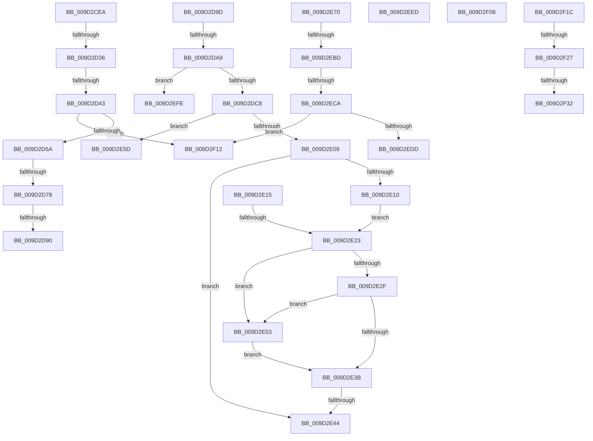

# sub_009D2CEA

- RVA: `0x009D2CEA`–`0x009D2F3C` (길이 `594` bytes)
- VA: `0x00000001409D2CEA`
- 실행 섹션: `PAGE`
- PDB 이름 있음: `아니요`; PDB Function 태그: `아니요`
- unwind 정보 RVA: `0x000A14E0`
- 디코드: `142`개 명령, `594/594` bytes 표시
- 미해석 바이트: `0` (있으면 어셈블리에 `.byte`로 보존)

> 이 문서는 커널 이미지의 기계어와 PDB 기호를 분석해 생성했습니다. 4번과 5번은 함수 원형과 자료형을 바이너리 사용 방식에서 추정한 C 해석이며 원본 소스 복구 결과는 아닙니다.

## 1. Dependencies

- 직접 호출 지점: **10**; 고유 호출 대상: **7**
- 직접 호출자로 확인된 함수: **0**
- RIP 상대 이미지 참조: **0**

### Outgoing calls
- `0x009D2D27` → [CmGetDeviceRegProp](../8E/CmGetDeviceRegProp_function_008ED870.md) (function, `0x008ED870`)
- `0x009D2D69` → [RtlInitUnicodeStringEx](../../text/46/RtlInitUnicodeStringEx_function_00463960.md) (function, `0x00463960`)
- `0x009D2D81` → [RtlGUIDFromString](../8F/RtlGUIDFromString_function_008F1EF0.md) (function, `0x008F1EF0`)
- `0x009D2DB7` → [ExAllocatePool2](../../poolcode/B8/ExAllocatePool2_function_00B820F0.md) (function, `0x00B820F0`)
- `0x009D2E00` → [CmGetDeviceRegProp](../8E/CmGetDeviceRegProp_function_008ED870.md) (function, `0x008ED870`)
- `0x009D2E26` → [PnpParseIndirectInfString](PnpParseIndirectInfString_function_009D3374.md) (function, `0x009D3374`)
- `0x009D2E32` → [PnpParseIndirectResourceString](PnpParseIndirectResourceString_function_009D3444.md) (function, `0x009D3444`)
- `0x009D2E49` → [ExFreePoolWithTag](../../poolcode/B8/ExFreePoolWithTag_function_00B82870.md) (function, `0x00B82870`)
- `0x009D2E64` → [ExFreePoolWithTag](../../poolcode/B8/ExFreePoolWithTag_function_00B82870.md) (function, `0x00B82870`)
- `0x009D2EAE` → [CmGetDeviceRegProp](../8E/CmGetDeviceRegProp_function_008ED870.md) (function, `0x008ED870`)

### Direct callers
- 이 함수 시작 RVA로 연결되는 직접 call은 확인되지 않았습니다. 간접 호출은 완전히 역산할 수 없습니다.

### Static image references
- 디코드된 RIP-relative 메모리 참조가 없습니다.

## 2. Other-region calls and transfers

- 다른 실행 섹션으로 향하는 call: **4**
  - `0x009D2D69` → [RtlInitUnicodeStringEx](../../text/46/RtlInitUnicodeStringEx_function_00463960.md) (`PAGE` → `.text`)
  - `0x009D2DB7` → [ExAllocatePool2](../../poolcode/B8/ExAllocatePool2_function_00B820F0.md) (`PAGE` → `POOLCODE`)
  - `0x009D2E49` → [ExFreePoolWithTag](../../poolcode/B8/ExFreePoolWithTag_function_00B82870.md) (`PAGE` → `POOLCODE`)
  - `0x009D2E64` → [ExFreePoolWithTag](../../poolcode/B8/ExFreePoolWithTag_function_00B82870.md) (`PAGE` → `POOLCODE`)
- call이 아닌 외부 분기/꼬리 이동: **20**
  - `0x009D2D30` → [sub_009D2B5A + 0xAB](Unknown_function_009D2B5A.md) (`tail-transfer`)
  - `0x009D2D3D` → [sub_009D2B5A + 0x80](Unknown_function_009D2B5A.md) (`tail-transfer`)
  - `0x009D2D72` → [sub_009D2B5A + 0xAD](Unknown_function_009D2B5A.md) (`tail-transfer`)
  - `0x009D2D8A` → [sub_009D2B5A + 0xAD](Unknown_function_009D2B5A.md) (`tail-transfer`)
  - `0x009D2D98` → [sub_009D2AD6 + 0x54](Unknown_function_009D2AD6.md) (`tail-transfer`)
  - `0x009D2DA3` → [sub_009D2B5A + 0xA6](Unknown_function_009D2B5A.md) (`tail-transfer`)
  - `0x009D2E1D` → [sub_009D2B5A + 0x131](Unknown_function_009D2B5A.md) (`tail-transfer`)
  - `0x009D2E3E` → [sub_009D2B5A + 0x9E](Unknown_function_009D2B5A.md) (`tail-transfer`)
  - `0x009D2E4E` → [sub_009D2B5A + 0x9E](Unknown_function_009D2B5A.md) (`tail-transfer`)
  - `0x009D2E6B` → [sub_009D2B5A + 0xB2](Unknown_function_009D2B5A.md) (`tail-transfer`)
  - `0x009D2EB7` → [sub_009D2B5A + 0xAB](Unknown_function_009D2B5A.md) (`tail-transfer`)
  - `0x009D2EC4` → [sub_009D2B5A + 0x80](Unknown_function_009D2B5A.md) (`tail-transfer`)
  - `0x009D2EE8` → [sub_009D2AD6 + 0x54](Unknown_function_009D2AD6.md) (`tail-transfer`)
  - `0x009D2EF9` → [sub_009D2AD6 + 0x54](Unknown_function_009D2AD6.md) (`tail-transfer`)
  - `0x009D2F03` → [sub_009D2AD6 + 0x54](Unknown_function_009D2AD6.md) (`tail-transfer`)
  - `0x009D2F0D` → [sub_009D2AD6 + 0x54](Unknown_function_009D2AD6.md) (`tail-transfer`)
  - `0x009D2F17` → [sub_009D2AD6 + 0x54](Unknown_function_009D2AD6.md) (`tail-transfer`)
  - `0x009D2F21` → [sub_009D2AD6 + 0x54](Unknown_function_009D2AD6.md) (`tail-transfer`)
  - `0x009D2F2C` → [sub_009D2AD6 + 0x54](Unknown_function_009D2AD6.md) (`tail-transfer`)
  - `0x009D2F37` → [sub_009D2AD6 + 0x54](Unknown_function_009D2AD6.md) (`tail-transfer`)

## 3. Assembly (complete function range)

```asm
009D2CEA  48 8B 54 24 50                  mov rdx, qword ptr [rsp + 0x50]
009D2CEF  48 8D 44 24 40                  lea rax, [rsp + 0x40]
009D2CF4  44 89 5C 24 38                  mov dword ptr [rsp + 0x38], r11d
009D2CF9  44 8B CE                        mov r9d, esi
009D2CFC  48 8B 74 24 48                  mov rsi, qword ptr [rsp + 0x48]
009D2D01  4C 8B C3                        mov r8, rbx
009D2D04  48 89 44 24 30                  mov qword ptr [rsp + 0x30], rax
009D2D09  48 8B CE                        mov rcx, rsi
009D2D0C  48 8D 45 9F                     lea rax, [rbp - 0x61]
009D2D10  C7 44 24 40 4E 00 00 00         mov dword ptr [rsp + 0x40], 0x4e
009D2D18  48 89 44 24 28                  mov qword ptr [rsp + 0x28], rax
009D2D1D  48 8D 44 24 44                  lea rax, [rsp + 0x44]
009D2D22  48 89 44 24 20                  mov qword ptr [rsp + 0x20], rax
009D2D27  E8 44 AB F1 FF                  call 0x1408ed870
009D2D2C  8B D8                           mov ebx, eax
009D2D2E  85 C0                           test eax, eax
009D2D30  0F 88 CF FE FF FF               js 0x1409d2c05
009D2D36  8B 47 10                        mov eax, dword ptr [rdi + 0x10]
009D2D39  39 44 24 44                     cmp dword ptr [rsp + 0x44], eax
009D2D3D  0F 85 97 FE FF FF               jne 0x1409d2bda
009D2D43  41 C7 07 10 00 00 00            mov dword ptr [r15], 0x10
009D2D4A  8B 47 08                        mov eax, dword ptr [rdi + 8]
009D2D4D  41 89 45 00                     mov dword ptr [r13], eax
009D2D51  45 3B 27                        cmp r12d, dword ptr [r15]
009D2D54  0F 82 B8 01 00 00               jb 0x1409d2f12
009D2D5A  33 FF                           xor edi, edi
009D2D5C  48 8D 55 9F                     lea rdx, [rbp - 0x61]
009D2D60  48 8D 4C 24 70                  lea rcx, [rsp + 0x70]
009D2D65  66 89 7D EB                     mov word ptr [rbp - 0x15], di
009D2D69  E8 F2 0B A9 FF                  call 0x140463960
009D2D6E  8B D8                           mov ebx, eax
009D2D70  85 C0                           test eax, eax
009D2D72  0F 88 8F FE FF FF               js 0x1409d2c07
009D2D78  48 8D 55 8F                     lea rdx, [rbp - 0x71]
009D2D7C  48 8D 4C 24 70                  lea rcx, [rsp + 0x70]
009D2D81  E8 6A F1 F1 FF                  call 0x1408f1ef0
009D2D86  8B D8                           mov ebx, eax
009D2D88  85 C0                           test eax, eax
009D2D8A  0F 88 77 FE FF FF               js 0x1409d2c07
009D2D90  0F 10 45 8F                     movups xmm0, xmmword ptr [rbp - 0x71]
009D2D94  41 0F 11 06                     movups xmmword ptr [r14], xmm0
009D2D98  E9 8D FD FF FF                  jmp 0x1409d2b2a
009D2D9D  81 FB 23 00 00 C0               cmp ebx, 0xc0000023
009D2DA3  0F 85 57 FE FF FF               jne 0x1409d2c00
009D2DA9  48 8B D0                        mov rdx, rax
009D2DAC  B9 00 01 00 00                  mov ecx, 0x100
009D2DB1  41 B8 50 4E 50 52               mov r8d, 0x52504e50
009D2DB7  E8 34 F3 1A 00                  call 0x140b820f0
009D2DBC  48 8B F8                        mov rdi, rax
009D2DBF  48 85 C0                        test rax, rax
009D2DC2  0F 84 36 01 00 00               je 0x1409d2efe
009D2DC8  8B 45 7F                        mov eax, dword ptr [rbp + 0x7f]
009D2DCB  44 8B CE                        mov r9d, esi
009D2DCE  4C 8B 64 24 50                  mov r12, qword ptr [rsp + 0x50]
009D2DD3  48 8B 74 24 48                  mov rsi, qword ptr [rsp + 0x48]
009D2DD8  49 8B D4                        mov rdx, r12
009D2DDB  4C 8B 44 24 68                  mov r8, qword ptr [rsp + 0x68]
009D2DE0  48 8B CE                        mov rcx, rsi
009D2DE3  89 44 24 38                     mov dword ptr [rsp + 0x38], eax
009D2DE7  48 8D 44 24 40                  lea rax, [rsp + 0x40]
009D2DEC  48 89 44 24 30                  mov qword ptr [rsp + 0x30], rax
009D2DF1  48 8D 44 24 5C                  lea rax, [rsp + 0x5c]
009D2DF6  48 89 7C 24 28                  mov qword ptr [rsp + 0x28], rdi
009D2DFB  48 89 44 24 20                  mov qword ptr [rsp + 0x20], rax
009D2E00  E8 6B AA F1 FF                  call 0x1408ed870
009D2E05  85 C0                           test eax, eax
009D2E07  78 54                           js 0x1409d2e5d
009D2E09  83 7C 24 40 02                  cmp dword ptr [rsp + 0x40], 2
009D2E0E  72 34                           jb 0x1409d2e44
009D2E10  4C 8B DF                        mov r11, rdi
009D2E13  EB 0E                           jmp 0x1409d2e23
009D2E15  33 FF                           xor edi, edi
009D2E17  4D 8B DE                        mov r11, r14
009D2E1A  4D 85 F6                        test r14, r14
009D2E1D  0F 84 68 FE FF FF               je 0x1409d2c8b
009D2E23  49 8B CB                        mov rcx, r11
009D2E26  E8 49 05 00 00                  call 0x1409d3374
009D2E2B  84 C0                           test al, al
009D2E2D  75 24                           jne 0x1409d2e53
009D2E2F  49 8B CB                        mov rcx, r11
009D2E32  E8 0D 06 00 00                  call 0x1409d3444
009D2E37  84 C0                           test al, al
009D2E39  75 18                           jne 0x1409d2e53
009D2E3B  48 85 FF                        test rdi, rdi
009D2E3E  0F 84 B4 FD FF FF               je 0x1409d2bf8
009D2E44  33 D2                           xor edx, edx
009D2E46  48 8B CF                        mov rcx, rdi
009D2E49  E8 22 FA 1A 00                  call 0x140b82870
009D2E4E  E9 A5 FD FF FF                  jmp 0x1409d2bf8
009D2E53  41 C7 45 00 19 00 00 00         mov dword ptr [r13], 0x19
009D2E5B  EB DE                           jmp 0x1409d2e3b
009D2E5D  33 D2                           xor edx, edx
009D2E5F  48 8B CF                        mov rcx, rdi
009D2E62  8B D8                           mov ebx, eax
009D2E64  E8 07 FA 1A 00                  call 0x140b82870
009D2E69  33 FF                           xor edi, edi
009D2E6B  E9 9C FD FF FF                  jmp 0x1409d2c0c
009D2E70  48 8B 54 24 50                  mov rdx, qword ptr [rsp + 0x50]
009D2E75  48 8D 44 24 40                  lea rax, [rsp + 0x40]
009D2E7A  44 89 5C 24 38                  mov dword ptr [rsp + 0x38], r11d
009D2E7F  44 8B CE                        mov r9d, esi
009D2E82  48 8B 74 24 48                  mov rsi, qword ptr [rsp + 0x48]
009D2E87  4C 8B C3                        mov r8, rbx
009D2E8A  48 89 44 24 30                  mov qword ptr [rsp + 0x30], rax
009D2E8F  48 8B CE                        mov rcx, rsi
009D2E92  48 8D 44 24 58                  lea rax, [rsp + 0x58]
009D2E97  C7 44 24 40 04 00 00 00         mov dword ptr [rsp + 0x40], 4
009D2E9F  48 89 44 24 28                  mov qword ptr [rsp + 0x28], rax
009D2EA4  48 8D 44 24 44                  lea rax, [rsp + 0x44]
009D2EA9  48 89 44 24 20                  mov qword ptr [rsp + 0x20], rax
009D2EAE  E8 BD A9 F1 FF                  call 0x1408ed870
009D2EB3  8B D8                           mov ebx, eax
009D2EB5  85 C0                           test eax, eax
009D2EB7  0F 88 48 FD FF FF               js 0x1409d2c05
009D2EBD  8B 47 10                        mov eax, dword ptr [rdi + 0x10]
009D2EC0  39 44 24 44                     cmp dword ptr [rsp + 0x44], eax
009D2EC4  0F 85 10 FD FF FF               jne 0x1409d2bda
009D2ECA  41 C7 07 01 00 00 00            mov dword ptr [r15], 1
009D2ED1  8B 47 08                        mov eax, dword ptr [rdi + 8]
009D2ED4  41 89 45 00                     mov dword ptr [r13], eax
009D2ED8  45 3B 27                        cmp r12d, dword ptr [r15]
009D2EDB  72 35                           jb 0x1409d2f12
009D2EDD  8B 44 24 58                     mov eax, dword ptr [rsp + 0x58]
009D2EE1  F7 D8                           neg eax
009D2EE3  1A C9                           sbb cl, cl
009D2EE5  41 88 0E                        mov byte ptr [r14], cl
009D2EE8  E9 3D FC FF FF                  jmp 0x1409d2b2a
009D2EED  BB E5 00 00 C0                  mov ebx, 0xc00000e5
009D2EF2  41 C7 07 00 00 00 00            mov dword ptr [r15], 0
009D2EF9  E9 2C FC FF FF                  jmp 0x1409d2b2a
009D2EFE  BB 17 00 00 C0                  mov ebx, 0xc0000017
009D2F03  E9 22 FC FF FF                  jmp 0x1409d2b2a
009D2F08  BB BB 00 00 C0                  mov ebx, 0xc00000bb
009D2F0D  E9 18 FC FF FF                  jmp 0x1409d2b2a
009D2F12  BB 23 00 00 C0                  mov ebx, 0xc0000023
009D2F17  E9 0E FC FF FF                  jmp 0x1409d2b2a
009D2F1C  3D 0E 00 00 C0                  cmp eax, 0xc000000e
009D2F21  0F 84 03 FC FF FF               je 0x1409d2b2a
009D2F27  3D C0 00 00 C0                  cmp eax, 0xc00000c0
009D2F2C  0F 84 F8 FB FF FF               je 0x1409d2b2a
009D2F32  BB 01 00 00 C0                  mov ebx, 0xc0000001
009D2F37  E9 EE FB FF FF                  jmp 0x1409d2b2a
```

## 4. C-style interpretation (structured pseudocode)

```c
__int64 __fastcall sub_009D2CEA(__int64 a1, __int64 a2, __int64 a3, __int64 a4, __int64 a5, __int64 a6, __int64 a7, __int64 a8, __int64 a9, __int64 a10, __int64 a11, __int64 a12, __int64 a13, __int64 a14)
{
    __int64 result;
    __int64 v_rdi;
    unsigned __int64 v_stack_p20;
    unsigned __int64 v_stack_p28;
    unsigned __int64 v_stack_p30;
    unsigned int v_stack_p38;
    unsigned int v_stack_p40;
    unsigned __int64 v_stack_p44;
    unsigned __int64 v_stack_p48;
    unsigned __int64 v_stack_p50;
    unsigned __int64 v_stack_p58;
    unsigned __int64 v_stack_p5C;
    unsigned __int64 v_stack_p68;

    v_stack_p38 = (unsigned int)(v_r11);
    v_stack_p30 = a8;
    v_stack_p40 = 78;
    v_stack_p28 = v_rbp - 97;
    v_stack_p20 = v_stack_p44;
    result = CmGetDeviceRegProp(a9, a10, v_rbx, (unsigned int)((unsigned int)(v_rsi)));
    *(unsigned int *)(v_r15) = 16;
    *(unsigned int *)(v_r13) = (unsigned int)((unsigned int)(*(unsigned int *)(v_rdi + 8)));
    if (((unsigned int)(v_r12)) < (*(unsigned int *)(v_r15))) goto loc_009D2F12;
    v_rdi = 0;
    *(unsigned __int16 *)(v_rbp - 21) = 0;
    result = RtlInitUnicodeStringEx(a14, v_rbp - 97, v_rbx, (unsigned int)((unsigned int)(v_rsi)));
    result = RtlGUIDFromString(a14, v_rbp - 113, v_rbx, (unsigned int)((unsigned int)(v_rsi)));
    *(unsigned __int64 *)(v_r14) = v_xmm0;
loc_009D2F12:
}
```

## 5. (Beta) C Style

```c
int64_t sub_009D2CEA(int64_t Arg1, int64_t Arg2, int64_t Arg3, int64_t Arg4, uint64_t Arg5, uint64_t Arg6, uint64_t Arg7, int64_t Arg8, int64_t Arg9, int64_t Arg10, uint64_t Arg11, uint64_t Arg12, uint64_t Arg13, int64_t Arg14)
{
    int64_t result;
    int64_t local_rdi;
    uint64_t v_stack_p20;
    uint64_t v_stack_p28;
    uint64_t v_stack_p30;
    uint32_t v_stack_p38;
    uint32_t v_stack_p40;
    uint64_t v_stack_p44;
    uint64_t v_stack_p48;
    uint64_t v_stack_p50;
    uint64_t v_stack_p58;
    uint64_t v_stack_p5C;
    uint64_t v_stack_p68;

    v_stack_p38 = (uint32_t)(local_r11);
    v_stack_p30 = Arg8;
    v_stack_p40 = 78;
    v_stack_p28 = local_rbp - 97;
    v_stack_p20 = v_stack_p44;
    result = CmGetDeviceRegProp(Arg9, Arg10, local_rbx, (uint32_t)((uint32_t)(local_rsi)));
    *(uint32_t *)(local_r15) = 16;
    *(uint32_t *)(local_r13) = (uint32_t)((uint32_t)(*(uint32_t *)(local_rdi + 0x8)));
    if (((uint32_t)(local_r12)) < (*(uint32_t *)(local_r15))) goto loc_009D2F12;
    local_rdi = 0;
    *(uint16_t *)(local_rbp - 0x15) = 0;
    result = RtlInitUnicodeStringEx(Arg14, local_rbp - 97, local_rbx, (uint32_t)((uint32_t)(local_rsi)));
    result = RtlGUIDFromString(Arg14, local_rbp - 113, local_rbx, (uint32_t)((uint32_t)(local_rsi)));
    *(uint64_t *)(local_r14) = v_xmm0;
loc_009D2F12:
}
```

## 6. Execution-region graph

[열기: 2D/3D 그래프와 함수 탐색 컨트롤 패널](../../../control-panel.html?section=page&rva=0x009D2CEA&view=graph)

- 2D 그래프는 위에서 아래로 흐르고, 3D 그래프는 빈 공간을 드래그해 회전합니다. Shift+드래그는 이동, 휠은 확대·축소, 함수 노드 선택은 대상 보고서 이동입니다.

### Static fallback


