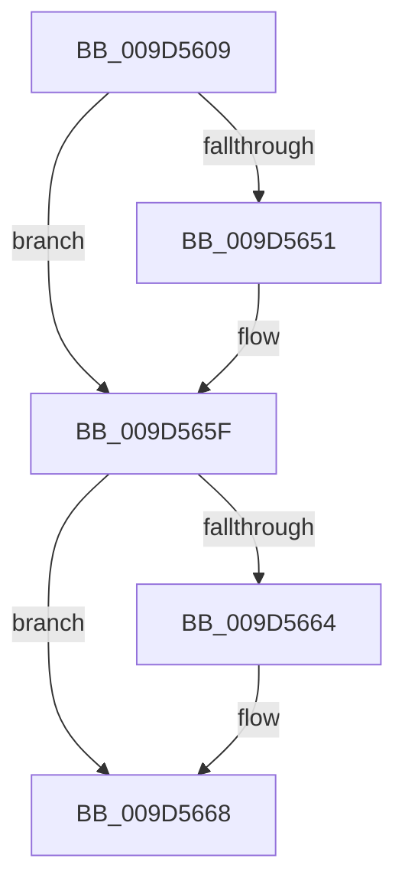

# sub_009D5609

- RVA: `0x009D5609`–`0x009D5689` (길이 `128` bytes)
- VA: `0x00000001409D5609`
- 실행 섹션: `PAGE`
- PDB 이름 있음: `아니요`; PDB Function 태그: `아니요`
- unwind 정보 RVA: `0x000A1D0C`
- 디코드: `31`개 명령, `128/128` bytes 표시
- 미해석 바이트: `0` (있으면 어셈블리에 `.byte`로 보존)

> 이 문서는 커널 이미지의 기계어와 PDB 기호를 분석해 생성했습니다. 4번과 5번은 함수 원형과 자료형을 바이너리 사용 방식에서 추정한 C 해석이며 원본 소스 복구 결과는 아닙니다.

## 1. Dependencies

- 직접 호출 지점: **2**; 고유 호출 대상: **2**
- 직접 호출자로 확인된 함수: **0**
- RIP 상대 이미지 참조: **0**

### Outgoing calls
- `0x009D5641` → [KeAbPreAcquire](../../text/21/KeAbPreAcquire_function_00210230.md) (function, `0x00210230`)
- `0x009D565A` → [ExfAcquirePushLockExclusiveEx](../../text/20/ExfAcquirePushLockExclusiveEx_function_0020FC90.md) (function, `0x0020FC90`)

### Direct callers
- 이 함수 시작 RVA로 연결되는 직접 call은 확인되지 않았습니다. 간접 호출은 완전히 역산할 수 없습니다.

### Static image references
- 디코드된 RIP-relative 메모리 참조가 없습니다.

## 2. Other-region calls and transfers

- 다른 실행 섹션으로 향하는 call: **2**
  - `0x009D5641` → [KeAbPreAcquire](../../text/21/KeAbPreAcquire_function_00210230.md) (`PAGE` → `.text`)
  - `0x009D565A` → [ExfAcquirePushLockExclusiveEx](../../text/20/ExfAcquirePushLockExclusiveEx_function_0020FC90.md) (`PAGE` → `.text`)
- call이 아닌 외부 분기/꼬리 이동: **1**
  - `0x009D5683` → [sub_009D5730](Unknown_function_009D5730.md) (`tail-transfer`)

## 3. Assembly (complete function range)

```asm
009D5609  48 89 6C 24 58                  mov qword ptr [rsp + 0x58], rbp
009D560E  33 C0                           xor eax, eax
009D5610  48 89 74 24 60                  mov qword ptr [rsp + 0x60], rsi
009D5615  45 33 C0                        xor r8d, r8d
009D5618  48 8D 72 68                     lea rsi, [rdx + 0x68]
009D561C  4C 89 74 24 28                  mov qword ptr [rsp + 0x28], r14
009D5621  4C 8B B4 24 80 00 00 00         mov r14, qword ptr [rsp + 0x80]
009D5629  33 D2                           xor edx, edx
009D562B  4C 89 7C 24 20                  mov qword ptr [rsp + 0x20], r15
009D5630  48 8B CE                        mov rcx, rsi
009D5633  4C 8B BC 24 88 00 00 00         mov r15, qword ptr [rsp + 0x88]
009D563B  41 89 06                        mov dword ptr [r14], eax
009D563E  41 89 07                        mov dword ptr [r15], eax
009D5641  E8 EA AB 83 FF                  call 0x140210230
009D5646  F0 48 0F BA 2E 00               lock bts qword ptr [rsi], 0
009D564C  48 8B E8                        mov rbp, rax
009D564F  73 0E                           jae 0x1409d565f
009D5651  4C 8B C6                        mov r8, rsi
009D5654  48 8B D0                        mov rdx, rax
009D5657  48 8B CE                        mov rcx, rsi
009D565A  E8 31 A6 83 FF                  call 0x14020fc90
009D565F  48 85 ED                        test rbp, rbp
009D5662  74 04                           je 0x1409d5668
009D5664  C6 45 0A 01                     mov byte ptr [rbp + 0xa], 1
009D5668  8B 53 64                        mov edx, dword ptr [rbx + 0x64]
009D566B  48 C7 C0 FF FF FF FF            mov rax, 0xffffffffffffffff
009D5672  44 8B 44 24 70                  mov r8d, dword ptr [rsp + 0x70]
009D5677  83 E2 01                        and edx, 1
009D567A  48 8B 6C 24 58                  mov rbp, qword ptr [rsp + 0x58]
009D567F  41 F6 C0 01                     test r8b, 1
009D5683  0F 85 A7 00 00 00               jne 0x1409d5730
```

## 4. C-style interpretation (structured pseudocode)

```c
__int64 __fastcall sub_009D5609(__int64 a1, __int64 a2, int a3, __int64 a4, __int64 a5, __int64 a6, __int64 a7, __int64 a8, __int64 a9, __int64 a10, __int64 a11, __int64 a12, __int64 a13, unsigned int a14, __int64 a15, __int64 a16, __int64 a17)
{
    __int64 result;
    unsigned __int64 v_stack_p20;
    unsigned __int64 v_stack_p28;
    unsigned __int64 v_stack_p58;
    unsigned __int64 v_stack_p60;

    v_stack_p58 = v_rbp;
    result = 0;
    v_stack_p60 = v_rsi;
    a3 = 0;
    v_stack_p28 = v_r14;
    a2 = 0;
    v_stack_p20 = v_r15;
    *(unsigned int *)(a16) = 0;
    *(unsigned int *)(a17) = 0;
    result = KeAbPreAcquire(a2 + 104, a2, a3, a4);
    if (!(condition_is_above_or_equal)) {
        a3 = a2 + 104;
        a2 = result;
        a1 = a2 + 104;
        result = ExfAcquirePushLockExclusiveEx(a1, a2, a3, a4);
    }
    if (result != 0) {
        *(unsigned __int8 *)(result + 10) = 1;
    }
    a2 = (unsigned int)(((unsigned int)(*(unsigned int *)(v_rbx + 100))) & (1));
}
```

## 5. (Beta) C Style

```c
int64_t sub_009D5609(int64_t Arg1, void *Arg2, int32_t Arg3, int64_t Arg4, uint64_t Arg5, uint64_t Arg6, uint64_t Arg7, uint64_t Arg8, uint64_t Arg9, uint64_t Arg10, int64_t Arg11, uint64_t Arg12, uint64_t Arg13, uint32_t Arg14, uint64_t Arg15, void *Arg16, void *Arg17)
{
    uint8_t *arg2 = (uint8_t *)Arg2;
    uint8_t *arg16 = (uint8_t *)Arg16;
    uint8_t *arg17 = (uint8_t *)Arg17;

    int64_t result;
    uint64_t v_stack_p20;
    uint64_t v_stack_p28;
    uint64_t v_stack_p58;
    uint64_t v_stack_p60;

    v_stack_p58 = local_rbp;
    result = 0;
    v_stack_p60 = local_rsi;
    Arg3 = 0;
    v_stack_p28 = local_r14;
    Arg2 = 0;
    v_stack_p20 = local_r15;
    *(uint32_t *)(arg16) = 0;
    *(uint32_t *)(arg17) = 0;
    result = KeAbPreAcquire(Arg2 + 104, Arg2, Arg3, Arg4);
    if (!(condition_is_above_or_equal)) {
        Arg3 = Arg2 + 104;
        Arg2 = result;
        Arg1 = Arg2 + 104;
        result = ExfAcquirePushLockExclusiveEx(Arg1, Arg2, Arg3, Arg4);
    }
    if (result != 0) {
        *(uint8_t *)(result + 0xA) = 1;
    }
    Arg2 = (uint32_t)(((uint32_t)(*(uint32_t *)(local_rbx + 0x64))) & (1));
}
```

### 관측된 메모리 오프셋

구조체 형식이 확인되지 않은 접근은 인자 기준의 오프셋으로만 기록했습니다.

| 기준 인자 | 오프셋 표현 | 폭 (bit) | 접근 |
|---|---:|---:|---|
| `Arg2` | `+ 0x0` | `64` | `R/W` |
| `Arg2` | `+ 0x68` | `64` | `R` |
| `Arg16` | `+ 0x0` | `32` | `W` |
| `Arg17` | `+ 0x0` | `32` | `W` |

## 6. Execution-region graph

[열기: 2D/3D 그래프와 함수 탐색 컨트롤 패널](../../../control-panel.html?section=page&rva=0x009D5609&view=graph)

- 2D 그래프는 위에서 아래로 흐르고, 3D 그래프는 빈 공간을 드래그해 회전합니다. Shift+드래그는 이동, 휠은 확대·축소, 함수 노드 선택은 대상 보고서 이동입니다.

### Static fallback


