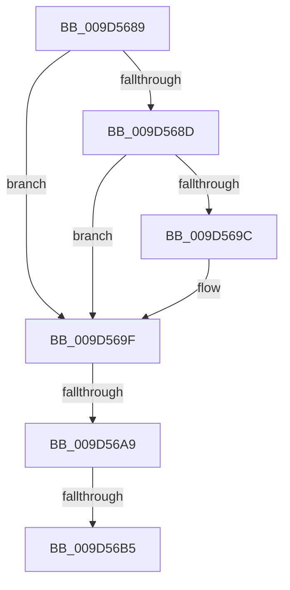

# sub_009D5689

- RVA: `0x009D5689`–`0x009D56E8` (길이 `95` bytes)
- VA: `0x00000001409D5689`
- 실행 섹션: `PAGE`
- PDB 이름 있음: `아니요`; PDB Function 태그: `아니요`
- unwind 정보 RVA: `0x000A1D2C`
- 디코드: `24`개 명령, `95/95` bytes 표시
- 미해석 바이트: `0` (있으면 어셈블리에 `.byte`로 보존)

> 이 문서는 커널 이미지의 기계어와 PDB 기호를 분석해 생성했습니다. 4번과 5번은 함수 원형과 자료형을 바이너리 사용 방식에서 추정한 C 해석이며 원본 소스 복구 결과는 아닙니다.

## 1. Dependencies

- 직접 호출 지점: **0**; 고유 호출 대상: **0**
- 직접 호출자로 확인된 함수: **0**
- RIP 상대 이미지 참조: **0**

### Outgoing calls
- 직접 디코드된 call 명령이 없습니다.

### Direct callers
- 이 함수 시작 RVA로 연결되는 직접 call은 확인되지 않았습니다. 간접 호출은 완전히 역산할 수 없습니다.

### Static image references
- 디코드된 RIP-relative 메모리 참조가 없습니다.

## 2. Other-region calls and transfers

- 다른 실행 섹션으로 향하는 call: **0**
- call이 아닌 외부 분기/꼬리 이동: **3**
  - `0x009D56A3` → [sub_009D577B](Unknown_function_009D577B.md) (`tail-transfer`)
  - `0x009D56AF` → [sub_009D577B + 0xF](Unknown_function_009D577B.md) (`tail-transfer`)
  - `0x009D56E6` → [sub_009D5754](Unknown_function_009D5754.md) (`tail-transfer`)

## 3. Assembly (complete function range)

```asm
009D5689  85 D2                           test edx, edx
009D568B  74 12                           je 0x1409d569f
009D568D  8B C8                           mov ecx, eax
009D568F  F0 0F C1 8F A0 00 00 00         lock xadd dword ptr [rdi + 0xa0], ecx
009D5697  83 F9 01                        cmp ecx, 1
009D569A  75 03                           jne 0x1409d569f
009D569C  41 89 06                        mov dword ptr [r14], eax
009D569F  83 7B 78 02                     cmp dword ptr [rbx + 0x78], 2
009D56A3  0F 84 D2 00 00 00               je 0x1409d577b
009D56A9  8B 4B 7C                        mov ecx, dword ptr [rbx + 0x7c]
009D56AC  F6 C1 01                        test cl, 1
009D56AF  0F 85 D5 00 00 00               jne 0x1409d578a
009D56B5  4C 8B 7C 24 20                  mov r15, qword ptr [rsp + 0x20]
009D56BA  41 8B C8                        mov ecx, r8d
009D56BD  23 4B 7C                        and ecx, dword ptr [rbx + 0x7c]
009D56C0  4C 8B 74 24 28                  mov r14, qword ptr [rsp + 0x28]
009D56C5  44 89 43 64                     mov dword ptr [rbx + 0x64], r8d
009D56C9  44 23 83 80 00 00 00            and r8d, dword ptr [rbx + 0x80]
009D56D0  83 7B 78 00                     cmp dword ptr [rbx + 0x78], 0
009D56D4  4C 89 6B 50                     mov qword ptr [rbx + 0x50], r13
009D56D8  4C 89 63 58                     mov qword ptr [rbx + 0x58], r12
009D56DC  89 4B 7C                        mov dword ptr [rbx + 0x7c], ecx
009D56DF  44 89 83 80 00 00 00            mov dword ptr [rbx + 0x80], r8d
009D56E6  75 6C                           jne 0x1409d5754
```

## 4. C-style interpretation (structured pseudocode)

```c
void __fastcall sub_009D5689(__int64 a1, int a2, int a3, __int64 a4, __int64 a5)
{
    unsigned __int64 v_stack_p20;

    if (a2 == 0) goto loc_009D569F;
    if (((unsigned int)((unsigned int)((unsigned int)(result)))) == 1) {
        *(unsigned int *)(v_r14) = (unsigned int)(result);
    }
    a1 = (unsigned int)(((unsigned int)(a3)) & (*(unsigned int *)(v_rbx + 124)));
    *(unsigned int *)(v_rbx + 100) = a3;
    a3 = (unsigned int)((a3) & (*(unsigned int *)(v_rbx + 128)));
    *(unsigned __int64 *)(v_rbx + 80) = v_r13;
    *(unsigned __int64 *)(v_rbx + 88) = v_r12;
    *(unsigned int *)(v_rbx + 124) = (unsigned int)(a1);
    *(unsigned int *)(v_rbx + 128) = a3;
}
```

## 5. (Beta) C Style

```c
void sub_009D5689(int64_t Arg1, int32_t Arg2, int32_t Arg3, int64_t Arg4, int64_t Arg5)
{
    uint64_t v_stack_p20;

    if (Arg2 == 0) goto loc_009D569F;
    if (((uint32_t)((uint32_t)((uint32_t)(result)))) == 1) {
        *(uint32_t *)(local_r14) = (uint32_t)(result);
    }
    Arg1 = (uint32_t)(((uint32_t)(Arg3)) & (*(uint32_t *)(local_rbx + 0x7C)));
    *(uint32_t *)(local_rbx + 0x64) = Arg3;
    Arg3 = (uint32_t)((Arg3) & (*(uint32_t *)(local_rbx + 0x80)));
    *(uint64_t *)(local_rbx + 0x50) = local_r13;
    *(uint64_t *)(local_rbx + 0x58) = local_r12;
    *(uint32_t *)(local_rbx + 0x7C) = (uint32_t)(Arg1);
    *(uint32_t *)(local_rbx + 0x80) = Arg3;
}
```

## 6. Execution-region graph

[열기: 2D/3D 그래프와 함수 탐색 컨트롤 패널](../../../control-panel.html?section=page&rva=0x009D5689&view=graph)

- 2D 그래프는 위에서 아래로 흐르고, 3D 그래프는 빈 공간을 드래그해 회전합니다. Shift+드래그는 이동, 휠은 확대·축소, 함수 노드 선택은 대상 보고서 이동입니다.

### Static fallback


