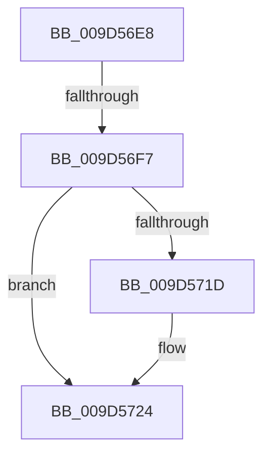

# sub_009D56E8

- RVA: `0x009D56E8`–`0x009D5730` (길이 `72` bytes)
- VA: `0x00000001409D56E8`
- 실행 섹션: `PAGE`
- PDB 이름 있음: `아니요`; PDB Function 태그: `아니요`
- unwind 정보 RVA: `0x000A1D48`
- 디코드: `18`개 명령, `72/72` bytes 표시
- 미해석 바이트: `0` (있으면 어셈블리에 `.byte`로 보존)

> 이 문서는 커널 이미지의 기계어와 PDB 기호를 분석해 생성했습니다. 4번과 5번은 함수 원형과 자료형을 바이너리 사용 방식에서 추정한 C 해석이며 원본 소스 복구 결과는 아닙니다.

## 1. Dependencies

- 직접 호출 지점: **2**; 고유 호출 대상: **2**
- 직접 호출자로 확인된 함수: **0**
- RIP 상대 이미지 참조: **0**

### Outgoing calls
- `0x009D56FA` → [KeAbPostRelease](../../text/2E/KeAbPostRelease_function_002E1600.md) (function, `0x002E1600`)
- `0x009D5703` → [ExAcquireRundownProtection](../../text/21/ExAcquireRundownProtection_function_00216620.md) (function, `0x00216620`)

### Direct callers
- 이 함수 시작 RVA로 연결되는 직접 call은 확인되지 않았습니다. 간접 호출은 완전히 역산할 수 없습니다.

### Static image references
- 디코드된 RIP-relative 메모리 참조가 없습니다.

## 2. Other-region calls and transfers

- 다른 실행 섹션으로 향하는 call: **2**
  - `0x009D56FA` → [KeAbPostRelease](../../text/2E/KeAbPostRelease_function_002E1600.md) (`PAGE` → `.text`)
  - `0x009D5703` → [ExAcquireRundownProtection](../../text/21/ExAcquireRundownProtection_function_00216620.md) (`PAGE` → `.text`)
- call이 아닌 외부 분기/꼬리 이동: **2**
  - `0x009D56F1` → [sub_009D5792 + 0x13](Unknown_function_009D5792.md) (`tail-transfer`)
  - `0x009D572B` → [ExpWnfUpdateSubscription + 0x39](ExpWnfUpdateSubscription_function_009D55C0.md) (`tail-transfer`)

## 3. Assembly (complete function range)

```asm
009D56E8  F0 48 0F C1 06                  lock xadd qword ptr [rsi], rax
009D56ED  24 06                           and al, 6
009D56EF  3C 02                           cmp al, 2
009D56F1  0F 84 AE 00 00 00               je 0x1409d57a5
009D56F7  48 8B CE                        mov rcx, rsi
009D56FA  E8 01 BF 90 FF                  call 0x1402e1600
009D56FF  48 8D 4B 08                     lea rcx, [rbx + 8]
009D5703  E8 18 0F 84 FF                  call 0x140216620
009D5708  48 8B 44 24 78                  mov rax, qword ptr [rsp + 0x78]
009D570D  48 8B 8C 24 90 00 00 00         mov rcx, qword ptr [rsp + 0x90]
009D5715  48 89 18                        mov qword ptr [rax], rbx
009D5718  48 85 C9                        test rcx, rcx
009D571B  74 07                           je 0x1409d5724
009D571D  48 8B 43 10                     mov rax, qword ptr [rbx + 0x10]
009D5721  48 89 01                        mov qword ptr [rcx], rax
009D5724  48 8B 74 24 60                  mov rsi, qword ptr [rsp + 0x60]
009D5729  33 C0                           xor eax, eax
009D572B  E9 C9 FE FF FF                  jmp 0x1409d55f9
```

## 4. C-style interpretation (structured pseudocode)

```c
__int64 __fastcall sub_009D56E8(__int64 a1, __int64 a2, __int64 a3, __int64 a4, __int64 a5, __int64 a6, __int64 a7, __int64 a8, __int64 a9, __int64 a10, __int64 a11, __int64 a12, __int64 a13, __int64 a14, __int64 a15, __int64 a16, __int64 a17, __int64 a18)
{
    __int64 result;

    result = (unsigned __int8)((result) & (6));
    result = KeAbPostRelease(v_rsi, a2, a3, a4);
    result = ExAcquireRundownProtection(v_rbx + 8, a2, a3, a4);
    *(unsigned __int64 *)(a15) = v_rbx;
    result = a15;
    if (a18 != 0) {
        result = *(unsigned __int64 *)(v_rbx + 16);
        *(unsigned __int64 *)(a18) = result;
    }
    result = 0;
}
```

## 5. (Beta) C Style

```c
int64_t sub_009D56E8(int64_t Arg1, int64_t Arg2, int64_t Arg3, int64_t Arg4, uint64_t Arg5, uint64_t Arg6, uint64_t Arg7, uint64_t Arg8, uint64_t Arg9, uint64_t Arg10, uint64_t Arg11, int64_t Arg12, uint64_t Arg13, uint64_t Arg14, void *Arg15, uint64_t Arg16, uint64_t Arg17, int64_t Arg18)
{
    uint8_t *arg15 = (uint8_t *)Arg15;

    int64_t result;

    result = (uint8_t)((result) & (6));
    result = KeAbPostRelease(local_rsi, Arg2, Arg3, Arg4);
    result = ExAcquireRundownProtection(local_rbx + 8, Arg2, Arg3, Arg4);
    *(uint64_t *)(arg15) = local_rbx;
    result = Arg15;
    if (Arg18 != 0) {
        result = *(uint64_t *)(local_rbx + 0x10);
        *(uint64_t *)(Arg18) = result;
    }
    result = 0;
}
```

### 관측된 메모리 오프셋

구조체 형식이 확인되지 않은 접근은 인자 기준의 오프셋으로만 기록했습니다.

| 기준 인자 | 오프셋 표현 | 폭 (bit) | 접근 |
|---|---:|---:|---|
| `Arg15` | `+ 0x0` | `64` | `W` |

## 6. Execution-region graph

[열기: 2D/3D 그래프와 함수 탐색 컨트롤 패널](../../../control-panel.html?section=page&rva=0x009D56E8&view=graph)

- 2D 그래프는 위에서 아래로 흐르고, 3D 그래프는 빈 공간을 드래그해 회전합니다. Shift+드래그는 이동, 휠은 확대·축소, 함수 노드 선택은 대상 보고서 이동입니다.

### Static fallback


