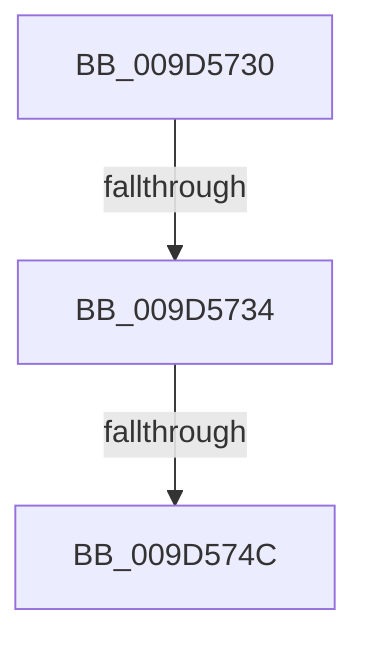

# sub_009D5730

- RVA: `0x009D5730`–`0x009D5754` (길이 `36` bytes)
- VA: `0x00000001409D5730`
- 실행 섹션: `PAGE`
- PDB 이름 있음: `아니요`; PDB Function 태그: `아니요`
- unwind 정보 RVA: `0x000A1D5C`
- 디코드: `9`개 명령, `36/36` bytes 표시
- 미해석 바이트: `0` (있으면 어셈블리에 `.byte`로 보존)

> 이 문서는 커널 이미지의 기계어와 PDB 기호를 분석해 생성했습니다. 4번과 5번은 함수 원형과 자료형을 바이너리 사용 방식에서 추정한 C 해석이며 원본 소스 복구 결과는 아닙니다.

## 1. Dependencies

- 직접 호출 지점: **0**; 고유 호출 대상: **0**
- 직접 호출자로 확인된 함수: **0**
- RIP 상대 이미지 참조: **0**

### Outgoing calls
- 직접 디코드된 call 명령이 없습니다.

### Direct callers
- 이 함수 시작 RVA로 연결되는 직접 call은 확인되지 않았습니다. 간접 호출은 완전히 역산할 수 없습니다.

### Static image references
- 디코드된 RIP-relative 메모리 참조가 없습니다.

## 2. Other-region calls and transfers

- 다른 실행 섹션으로 향하는 call: **0**
- call이 아닌 외부 분기/꼬리 이동: **3**
  - `0x009D5732` → [sub_009D5689 + 0x2C](Unknown_function_009D5689.md) (`tail-transfer`)
  - `0x009D5746` → [sub_009D5689 + 0x2C](Unknown_function_009D5689.md) (`tail-transfer`)
  - `0x009D574F` → [sub_009D5689 + 0x2C](Unknown_function_009D5689.md) (`tail-transfer`)

## 3. Assembly (complete function range)

```asm
009D5730  85 D2                           test edx, edx
009D5732  75 81                           jne 0x1409d56b5
009D5734  B9 01 00 00 00                  mov ecx, 1
009D5739  F0 0F C1 8F A0 00 00 00         lock xadd dword ptr [rdi + 0xa0], ecx
009D5741  FF C1                           inc ecx
009D5743  83 F9 01                        cmp ecx, 1
009D5746  0F 85 69 FF FF FF               jne 0x1409d56b5
009D574C  41 89 0E                        mov dword ptr [r14], ecx
009D574F  E9 61 FF FF FF                  jmp 0x1409d56b5
```

## 4. C-style interpretation (structured pseudocode)

```c
void __fastcall sub_009D5730(__int64 a1, int a2)
{
    a1 = (unsigned int)((1) + 1);
    *(unsigned int *)(v_r14) = (unsigned int)(a1);
}
```

## 5. (Beta) C Style

```c
void sub_009D5730(int64_t Arg1, int32_t Arg2)
{
    Arg1 = (uint32_t)((1) + 1);
    *(uint32_t *)(local_r14) = (uint32_t)(Arg1);
}
```

## 6. Execution-region graph

[열기: 2D/3D 그래프와 함수 탐색 컨트롤 패널](../../../control-panel.html?section=page&rva=0x009D5730&view=graph)

- 2D 그래프는 위에서 아래로 흐르고, 3D 그래프는 빈 공간을 드래그해 회전합니다. Shift+드래그는 이동, 휠은 확대·축소, 함수 노드 선택은 대상 보고서 이동입니다.

### Static fallback


