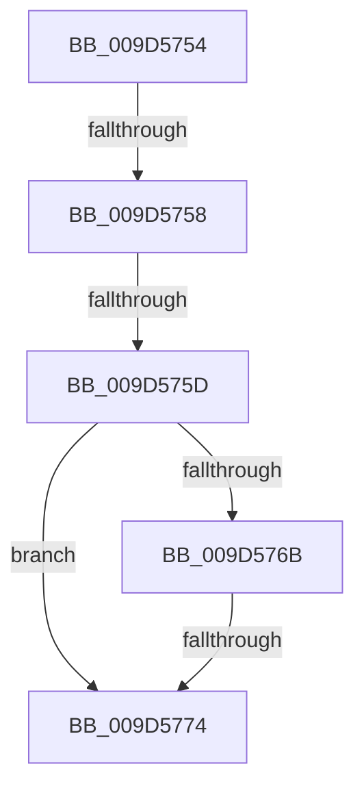

# sub_009D5754

- RVA: `0x009D5754`–`0x009D577B` (길이 `39` bytes)
- VA: `0x00000001409D5754`
- 실행 섹션: `PAGE`
- PDB 이름 있음: `아니요`; PDB Function 태그: `아니요`
- unwind 정보 RVA: `0x000A1D78`
- 디코드: `13`개 명령, `39/39` bytes 표시
- 미해석 바이트: `0` (있으면 어셈블리에 `.byte`로 보존)

> 이 문서는 커널 이미지의 기계어와 PDB 기호를 분석해 생성했습니다. 4번과 5번은 함수 원형과 자료형을 바이너리 사용 방식에서 추정한 C 해석이며 원본 소스 복구 결과는 아닙니다.

## 1. Dependencies

- 직접 호출 지점: **0**; 고유 호출 대상: **0**
- 직접 호출자로 확인된 함수: **0**
- RIP 상대 이미지 참조: **0**

### Outgoing calls
- 직접 디코드된 call 명령이 없습니다.

### Direct callers
- 이 함수 시작 RVA로 연결되는 직접 call은 확인되지 않았습니다. 간접 호출은 완전히 역산할 수 없습니다.

### Static image references
- 디코드된 RIP-relative 메모리 참조가 없습니다.

## 2. Other-region calls and transfers

- 다른 실행 섹션으로 향하는 call: **0**
- call이 아닌 외부 분기/꼬리 이동: **3**
  - `0x009D5756` → [sub_009D56E8](Unknown_function_009D56E8.md) (`tail-transfer`)
  - `0x009D575B` → [sub_009D56E8](Unknown_function_009D56E8.md) (`tail-transfer`)
  - `0x009D5772` → [sub_009D5792](Unknown_function_009D5792.md) (`tail-transfer`)

## 3. Assembly (complete function range)

```asm
009D5754  85 C9                           test ecx, ecx
009D5756  75 90                           jne 0x1409d56e8
009D5758  45 85 C0                        test r8d, r8d
009D575B  75 8B                           jne 0x1409d56e8
009D575D  4C 8B 43 68                     mov r8, qword ptr [rbx + 0x68]
009D5761  48 8D 4B 68                     lea rcx, [rbx + 0x68]
009D5765  49 39 48 08                     cmp qword ptr [r8 + 8], rcx
009D5769  75 09                           jne 0x1409d5774
009D576B  48 8B 51 08                     mov rdx, qword ptr [rcx + 8]
009D576F  48 39 0A                        cmp qword ptr [rdx], rcx
009D5772  74 1E                           je 0x1409d5792
009D5774  B9 03 00 00 00                  mov ecx, 3
009D5779  CD 29                           int 0x29
```

## 4. C-style interpretation (structured pseudocode)

```c
void __fastcall sub_009D5754(int a1, __int64 a2, int a3)
{
    if ((*(unsigned __int64 *)(*(unsigned __int64 *)(v_rbx + 104) + 8)) != (v_rbx + 104)) goto loc_009D5774;
loc_009D5774:
    return;
}
```

## 5. (Beta) C Style

```c
void sub_009D5754(int32_t Arg1, int64_t Arg2, int32_t Arg3)
{
    if ((*(uint64_t *)(*(uint64_t *)(local_rbx + 0x68) + 0x8)) != (local_rbx + 104)) goto loc_009D5774;
loc_009D5774:
    return;
}
```

## 6. Execution-region graph

[열기: 2D/3D 그래프와 함수 탐색 컨트롤 패널](../../../control-panel.html?section=page&rva=0x009D5754&view=graph)

- 2D 그래프는 위에서 아래로 흐르고, 3D 그래프는 빈 공간을 드래그해 회전합니다. Shift+드래그는 이동, 휠은 확대·축소, 함수 노드 선택은 대상 보고서 이동입니다.

### Static fallback


