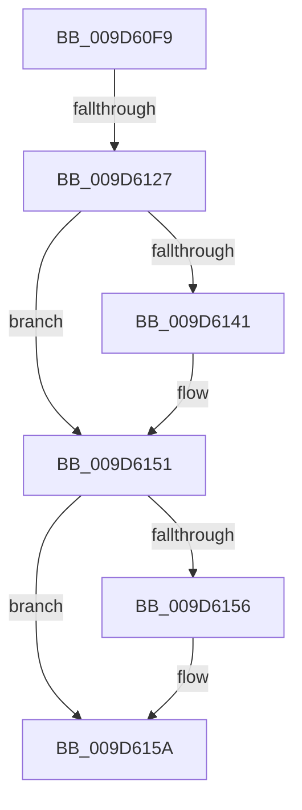

# sub_009D60F9

- RVA: `0x009D60F9`–`0x009D6177` (길이 `126` bytes)
- VA: `0x00000001409D60F9`
- 실행 섹션: `PAGE`
- PDB 이름 있음: `아니요`; PDB Function 태그: `아니요`
- unwind 정보 RVA: `0x000A23C8`
- 디코드: `33`개 명령, `126/126` bytes 표시
- 미해석 바이트: `0` (있으면 어셈블리에 `.byte`로 보존)

> 이 문서는 커널 이미지의 기계어와 PDB 기호를 분석해 생성했습니다. 4번과 5번은 함수 원형과 자료형을 바이너리 사용 방식에서 추정한 C 해석이며 원본 소스 복구 결과는 아닙니다.

## 1. Dependencies

- 직접 호출 지점: **2**; 고유 호출 대상: **2**
- 직접 호출자로 확인된 함수: **0**
- RIP 상대 이미지 참조: **0**

### Outgoing calls
- `0x009D612A` → [KeAbPreAcquire](../../text/21/KeAbPreAcquire_function_00210230.md) (function, `0x00210230`)
- `0x009D614C` → [ExfAcquirePushLockSharedEx](../../text/21/ExfAcquirePushLockSharedEx_function_0021044C.md) (function, `0x0021044C`)

### Direct callers
- 이 함수 시작 RVA로 연결되는 직접 call은 확인되지 않았습니다. 간접 호출은 완전히 역산할 수 없습니다.

### Static image references
- 디코드된 RIP-relative 메모리 참조가 없습니다.

## 2. Other-region calls and transfers

- 다른 실행 섹션으로 향하는 call: **2**
  - `0x009D612A` → [KeAbPreAcquire](../../text/21/KeAbPreAcquire_function_00210230.md) (`PAGE` → `.text`)
  - `0x009D614C` → [ExfAcquirePushLockSharedEx](../../text/21/ExfAcquirePushLockSharedEx_function_0021044C.md) (`PAGE` → `.text`)
- call이 아닌 외부 분기/꼬리 이동: **2**
  - `0x009D6121` → [sub_009D61BC](Unknown_function_009D61BC.md) (`tail-transfer`)
  - `0x009D6175` → [sub_009D6177 + 0xC](Unknown_function_009D6177.md) (`tail-transfer`)

## 3. Assembly (complete function range)

```asm
009D60F9  48 89 74 24 40                  mov qword ptr [rsp + 0x40], rsi
009D60FE  4C 8B F2                        mov r14, rdx
009D6101  48 89 7C 24 48                  mov qword ptr [rsp + 0x48], rdi
009D6106  48 8B D9                        mov rbx, rcx
009D6109  48 8D BA 28 01 00 00            lea rdi, [rdx + 0x128]
009D6110  4C 89 7C 24 50                  mov qword ptr [rsp + 0x50], r15
009D6115  33 D2                           xor edx, edx
009D6117  41 0F B6 E8                     movzx ebp, r8b
009D611B  48 8B CF                        mov rcx, rdi
009D611E  45 84 C0                        test r8b, r8b
009D6121  0F 85 95 00 00 00               jne 0x1409d61bc
009D6127  45 33 C0                        xor r8d, r8d
009D612A  E8 01 A1 83 FF                  call 0x140210230
009D612F  48 8B F0                        mov rsi, rax
009D6132  41 BF 11 00 00 00               mov r15d, 0x11
009D6138  33 C0                           xor eax, eax
009D613A  F0 4C 0F B1 3F                  lock cmpxchg qword ptr [rdi], r15
009D613F  74 10                           je 0x1409d6151
009D6141  4C 8B CF                        mov r9, rdi
009D6144  4C 8B C6                        mov r8, rsi
009D6147  33 D2                           xor edx, edx
009D6149  48 8B CF                        mov rcx, rdi
009D614C  E8 FB A2 83 FF                  call 0x14021044c
009D6151  48 85 F6                        test rsi, rsi
009D6154  74 04                           je 0x1409d615a
009D6156  C6 46 0A 01                     mov byte ptr [rsi + 0xa], 1
009D615A  48 8B 3B                        mov rdi, qword ptr [rbx]
009D615D  49 8B C7                        mov rax, r15
009D6160  4C 8B 7C 24 50                  mov r15, qword ptr [rsp + 0x50]
009D6165  33 C9                           xor ecx, ecx
009D6167  48 8B 74 24 40                  mov rsi, qword ptr [rsp + 0x40]
009D616C  F0 48 0F B1 8F 28 01 00 00      lock cmpxchg qword ptr [rdi + 0x128], rcx
009D6175  74 0C                           je 0x1409d6183
```

## 4. C-style interpretation (structured pseudocode)

```c
__int64 __fastcall sub_009D60F9(__int64 a1, __int64 a2, int a3, __int64 a4, __int64 a5, __int64 a6, __int64 a7, __int64 a8, __int64 a9, __int64 a10)
{
    __int64 result;
    unsigned __int64 v_stack_p40;
    unsigned __int64 v_stack_p48;
    unsigned __int64 v_stack_p50;

    v_stack_p40 = v_rsi;
    v_stack_p48 = v_rdi;
    v_stack_p50 = v_r15;
    a2 = 0;
    a3 = 0;
    result = KeAbPreAcquire(a2 + 296, a2, a3, a4);
    result = 0;
    if (!(condition_is_equal)) {
        a4 = a2 + 296;
        a3 = 0;
        a2 = 0;
        a1 = a2 + 296;
        result = ExfAcquirePushLockSharedEx(a1, a2, a3, a4);
    }
    if (result != 0) {
        *(unsigned __int8 *)(result + 10) = 1;
    }
    a1 = 0;
}
```

## 5. (Beta) C Style

```c
int64_t sub_009D60F9(void *Arg1, void *Arg2, int32_t Arg3, int64_t Arg4, uint64_t Arg5, uint64_t Arg6, uint64_t Arg7, int64_t Arg8, uint64_t Arg9, int64_t Arg10)
{
    uint8_t *arg1 = (uint8_t *)Arg1;
    uint8_t *arg2 = (uint8_t *)Arg2;

    int64_t result;
    uint64_t v_stack_p40;
    uint64_t v_stack_p48;
    uint64_t v_stack_p50;

    v_stack_p40 = local_rsi;
    v_stack_p48 = local_rdi;
    v_stack_p50 = local_r15;
    Arg2 = 0;
    Arg3 = 0;
    result = KeAbPreAcquire(Arg2 + 296, Arg2, Arg3, Arg4);
    result = 0;
    if (!(condition_is_equal)) {
        Arg4 = Arg2 + 296;
        Arg3 = 0;
        Arg2 = 0;
        Arg1 = Arg2 + 296;
        result = ExfAcquirePushLockSharedEx(Arg1, Arg2, Arg3, Arg4);
    }
    if (result != 0) {
        *(uint8_t *)(result + 0xA) = 1;
    }
    Arg1 = 0;
}
```

### 관측된 메모리 오프셋

구조체 형식이 확인되지 않은 접근은 인자 기준의 오프셋으로만 기록했습니다.

| 기준 인자 | 오프셋 표현 | 폭 (bit) | 접근 |
|---|---:|---:|---|
| `Arg1` | `+ 0x0` | `64` | `R` |
| `Arg2` | `+ 0x0` | `64` | `R` |
| `Arg2` | `+ 0x128` | `64` | `R` |

## 6. Execution-region graph

[열기: 2D/3D 그래프와 함수 탐색 컨트롤 패널](../../../control-panel.html?section=page&rva=0x009D60F9&view=graph)

- 2D 그래프는 위에서 아래로 흐르고, 3D 그래프는 빈 공간을 드래그해 회전합니다. Shift+드래그는 이동, 휠은 확대·축소, 함수 노드 선택은 대상 보고서 이동입니다.

### Static fallback


