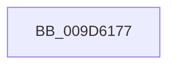

# sub_009D6177

- RVA: `0x009D6177`–`0x009D619A` (길이 `35` bytes)
- VA: `0x00000001409D6177`
- 실행 섹션: `PAGE`
- PDB 이름 있음: `아니요`; PDB Function 태그: `아니요`
- unwind 정보 RVA: `0x000A23E4`
- 디코드: `7`개 명령, `35/35` bytes 표시
- 미해석 바이트: `0` (있으면 어셈블리에 `.byte`로 보존)

> 이 문서는 커널 이미지의 기계어와 PDB 기호를 분석해 생성했습니다. 4번과 5번은 함수 원형과 자료형을 바이너리 사용 방식에서 추정한 C 해석이며 원본 소스 복구 결과는 아닙니다.

## 1. Dependencies

- 직접 호출 지점: **2**; 고유 호출 대상: **2**
- 직접 호출자로 확인된 함수: **0**
- RIP 상대 이미지 참조: **0**

### Outgoing calls
- `0x009D617E` → [ExfReleasePushLockShared](../../text/26/ExfReleasePushLockShared_function_00263440.md) (function, `0x00263440`)
- `0x009D618A` → [KeAbPostRelease](../../text/2E/KeAbPostRelease_function_002E1600.md) (function, `0x002E1600`)

### Direct callers
- 이 함수 시작 RVA로 연결되는 직접 call은 확인되지 않았습니다. 간접 호출은 완전히 역산할 수 없습니다.

### Static image references
- 디코드된 RIP-relative 메모리 참조가 없습니다.

## 2. Other-region calls and transfers

- 다른 실행 섹션으로 향하는 call: **2**
  - `0x009D617E` → [ExfReleasePushLockShared](../../text/26/ExfReleasePushLockShared_function_00263440.md) (`PAGE` → `.text`)
  - `0x009D618A` → [KeAbPostRelease](../../text/2E/KeAbPostRelease_function_002E1600.md) (`PAGE` → `.text`)
- call이 아닌 외부 분기/꼬리 이동: **1**
  - `0x009D6198` → [sub_009D619A + 0x11](Unknown_function_009D619A.md) (`tail-transfer`)

## 3. Assembly (complete function range)

```asm
009D6177  48 8D 8F 28 01 00 00            lea rcx, [rdi + 0x128]
009D617E  E8 BD D2 88 FF                  call 0x140263440
009D6183  48 8D 8F 28 01 00 00            lea rcx, [rdi + 0x128]
009D618A  E8 71 B4 90 FF                  call 0x1402e1600
009D618F  80 7B 16 00                     cmp byte ptr [rbx + 0x16], 0
009D6193  48 8B 7C 24 48                  mov rdi, qword ptr [rsp + 0x48]
009D6198  74 11                           je 0x1409d61ab
```

## 4. C-style interpretation (structured pseudocode)

```c
__int64 __fastcall sub_009D6177(__int64 a1, __int64 a2, __int64 a3, __int64 a4, __int64 a5, __int64 a6, __int64 a7, __int64 a8, __int64 a9)
{
    __int64 result;

    result = ExfReleasePushLockShared(v_rdi + 296, a2, a3, a4);
    result = KeAbPostRelease(v_rdi + 296, a2, a3, a4);
}
```

## 5. (Beta) C Style

```c
int64_t sub_009D6177(int64_t Arg1, int64_t Arg2, int64_t Arg3, int64_t Arg4, uint64_t Arg5, uint64_t Arg6, uint64_t Arg7, uint64_t Arg8, int64_t Arg9)
{
    int64_t result;

    result = ExfReleasePushLockShared(local_rdi + 296, Arg2, Arg3, Arg4);
    result = KeAbPostRelease(local_rdi + 296, Arg2, Arg3, Arg4);
}
```

## 6. Execution-region graph

[열기: 2D/3D 그래프와 함수 탐색 컨트롤 패널](../../../control-panel.html?section=page&rva=0x009D6177&view=graph)

- 2D 그래프는 위에서 아래로 흐르고, 3D 그래프는 빈 공간을 드래그해 회전합니다. Shift+드래그는 이동, 휠은 확대·축소, 함수 노드 선택은 대상 보고서 이동입니다.

### Static fallback


