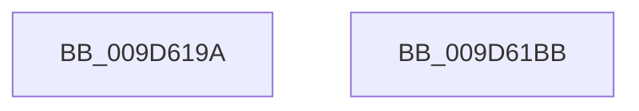

# sub_009D619A

- RVA: `0x009D619A`–`0x009D61BC` (길이 `34` bytes)
- VA: `0x00000001409D619A`
- 실행 섹션: `PAGE`
- PDB 이름 있음: `아니요`; PDB Function 태그: `아니요`
- unwind 정보 RVA: `0x000A23F8`
- 디코드: `12`개 명령, `34/34` bytes 표시
- 미해석 바이트: `0` (있으면 어셈블리에 `.byte`로 보존)

> 이 문서는 커널 이미지의 기계어와 PDB 기호를 분석해 생성했습니다. 4번과 5번은 함수 원형과 자료형을 바이너리 사용 방식에서 추정한 C 해석이며 원본 소스 복구 결과는 아닙니다.

## 1. Dependencies

- 직접 호출 지점: **1**; 고유 호출 대상: **1**
- 직접 호출자로 확인된 함수: **0**
- RIP 상대 이미지 참조: **0**

### Outgoing calls
- `0x009D61A2` → [ObDereferenceObjectDeferDeleteWithTag](../../text/26/ObDereferenceObjectDeferDeleteWithTag_function_00263EA0.md) (function, `0x00263EA0`)

### Direct callers
- 이 함수 시작 RVA로 연결되는 직접 call은 확인되지 않았습니다. 간접 호출은 완전히 역산할 수 없습니다.

### Static image references
- 디코드된 RIP-relative 메모리 참조가 없습니다.

## 2. Other-region calls and transfers

- 다른 실행 섹션으로 향하는 call: **1**
  - `0x009D61A2` → [ObDereferenceObjectDeferDeleteWithTag](../../text/26/ObDereferenceObjectDeferDeleteWithTag_function_00263EA0.md) (`PAGE` → `.text`)
- 별도 외부 분기/꼬리 이동을 확인하지 못했습니다.

## 3. Assembly (complete function range)

```asm
009D619A  48 8B 0B                        mov rcx, qword ptr [rbx]
009D619D  BA 4F 62 4C 55                  mov edx, 0x554c624f
009D61A2  E8 F9 DC 88 FF                  call 0x140263ea0
009D61A7  C6 43 16 00                     mov byte ptr [rbx + 0x16], 0
009D61AB  40 88 6B 15                     mov byte ptr [rbx + 0x15], bpl
009D61AF  4C 89 33                        mov qword ptr [rbx], r14
009D61B2  48 83 C4 20                     add rsp, 0x20
009D61B6  41 5E                           pop r14
009D61B8  5D                              pop rbp
009D61B9  5B                              pop rbx
009D61BA  C3                              ret
009D61BB  CC                              int3
```

## 4. C-style interpretation (structured pseudocode)

```c
__int64 __fastcall sub_009D619A(void)
{
    __int64 result;
    __int64 v_rsp;

    result = ObDereferenceObjectDeferDeleteWithTag(*(unsigned __int64 *)(v_rbx), (unsigned int)(0x554C624FULL), a3, a4);
    *(unsigned __int8 *)(v_rbx + 22) = 0;
    *(unsigned __int8 *)(v_rbx + 21) = (unsigned __int8)(v_rbp);
    *(unsigned __int64 *)(v_rbx) = v_r14;
    v_rsp = (v_rsp) + (32);
    return result;
}
```

## 5. (Beta) C Style

```c
void sub_009D619A(void)
{
    int64_t result;
    int64_t local_rsp;

    result = ObDereferenceObjectDeferDeleteWithTag(*(uint64_t *)(local_rbx), (uint32_t)(0x554C624FULL), a3, a4);
    *(uint8_t *)(local_rbx + 0x16) = 0;
    *(uint8_t *)(local_rbx + 0x15) = (uint8_t)(local_rbp);
    *(uint64_t *)(local_rbx) = local_r14;
    local_rsp = (local_rsp) + (32);
    return result;
}
```

## 6. Execution-region graph

[열기: 2D/3D 그래프와 함수 탐색 컨트롤 패널](../../../control-panel.html?section=page&rva=0x009D619A&view=graph)

- 2D 그래프는 위에서 아래로 흐르고, 3D 그래프는 빈 공간을 드래그해 회전합니다. Shift+드래그는 이동, 휠은 확대·축소, 함수 노드 선택은 대상 보고서 이동입니다.

### Static fallback


