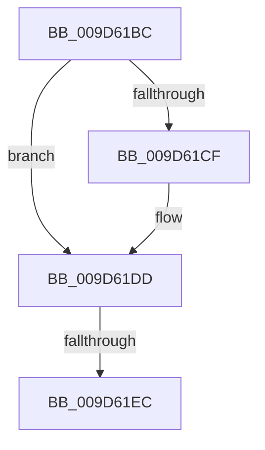

# sub_009D61BC

- RVA: `0x009D61BC`–`0x009D61F1` (길이 `53` bytes)
- VA: `0x00000001409D61BC`
- 실행 섹션: `PAGE`
- PDB 이름 있음: `아니요`; PDB Function 태그: `아니요`
- unwind 정보 RVA: `0x000A240C`
- 디코드: `13`개 명령, `53/53` bytes 표시
- 미해석 바이트: `0` (있으면 어셈블리에 `.byte`로 보존)

> 이 문서는 커널 이미지의 기계어와 PDB 기호를 분석해 생성했습니다. 4번과 5번은 함수 원형과 자료형을 바이너리 사용 방식에서 추정한 C 해석이며 원본 소스 복구 결과는 아닙니다.

## 1. Dependencies

- 직접 호출 지점: **2**; 고유 호출 대상: **2**
- 직접 호출자로 확인된 함수: **0**
- RIP 상대 이미지 참조: **0**

### Outgoing calls
- `0x009D61BF` → [KeAbPreAcquire](../../text/21/KeAbPreAcquire_function_00210230.md) (function, `0x00210230`)
- `0x009D61D8` → [ExfAcquirePushLockExclusiveEx](../../text/20/ExfAcquirePushLockExclusiveEx_function_0020FC90.md) (function, `0x0020FC90`)

### Direct callers
- 이 함수 시작 RVA로 연결되는 직접 call은 확인되지 않았습니다. 간접 호출은 완전히 역산할 수 없습니다.

### Static image references
- 디코드된 RIP-relative 메모리 참조가 없습니다.

## 2. Other-region calls and transfers

- 다른 실행 섹션으로 향하는 call: **2**
  - `0x009D61BF` → [KeAbPreAcquire](../../text/21/KeAbPreAcquire_function_00210230.md) (`PAGE` → `.text`)
  - `0x009D61D8` → [ExfAcquirePushLockExclusiveEx](../../text/20/ExfAcquirePushLockExclusiveEx_function_0020FC90.md) (`PAGE` → `.text`)
- call이 아닌 외부 분기/꼬리 이동: **2**
  - `0x009D61E6` → [sub_009D60F9 + 0x5D](Unknown_function_009D60F9.md) (`tail-transfer`)
  - `0x009D61EC` → [sub_009D60F9 + 0x61](Unknown_function_009D60F9.md) (`tail-transfer`)

## 3. Assembly (complete function range)

```asm
009D61BC  45 33 C0                        xor r8d, r8d
009D61BF  E8 6C A0 83 FF                  call 0x140210230
009D61C4  F0 48 0F BA 2F 00               lock bts qword ptr [rdi], 0
009D61CA  48 8B F0                        mov rsi, rax
009D61CD  73 0E                           jae 0x1409d61dd
009D61CF  4C 8B C7                        mov r8, rdi
009D61D2  48 8B D0                        mov rdx, rax
009D61D5  48 8B CF                        mov rcx, rdi
009D61D8  E8 B3 9A 83 FF                  call 0x14020fc90
009D61DD  41 BF 11 00 00 00               mov r15d, 0x11
009D61E3  48 85 F6                        test rsi, rsi
009D61E6  0F 85 6A FF FF FF               jne 0x1409d6156
009D61EC  E9 69 FF FF FF                  jmp 0x1409d615a
```

## 4. C-style interpretation (structured pseudocode)

```c
__int64 __fastcall sub_009D61BC(__int64 a1, __int64 a2, int a3)
{
    __int64 result;

    a3 = 0;
    result = KeAbPreAcquire(a1, a2, a3, a4);
    if (!(condition_is_above_or_equal)) {
        a3 = v_rdi;
        a2 = result;
        a1 = v_rdi;
        result = ExfAcquirePushLockExclusiveEx(a1, a2, a3, a4);
    }
}
```

## 5. (Beta) C Style

```c
int64_t sub_009D61BC(int64_t Arg1, int64_t Arg2, int32_t Arg3)
{
    int64_t result;

    Arg3 = 0;
    result = KeAbPreAcquire(Arg1, Arg2, Arg3, a4);
    if (!(condition_is_above_or_equal)) {
        Arg3 = local_rdi;
        Arg2 = result;
        Arg1 = local_rdi;
        result = ExfAcquirePushLockExclusiveEx(Arg1, Arg2, Arg3, a4);
    }
}
```

## 6. Execution-region graph

[열기: 2D/3D 그래프와 함수 탐색 컨트롤 패널](../../../control-panel.html?section=page&rva=0x009D61BC&view=graph)

- 2D 그래프는 위에서 아래로 흐르고, 3D 그래프는 빈 공간을 드래그해 회전합니다. Shift+드래그는 이동, 휠은 확대·축소, 함수 노드 선택은 대상 보고서 이동입니다.

### Static fallback


