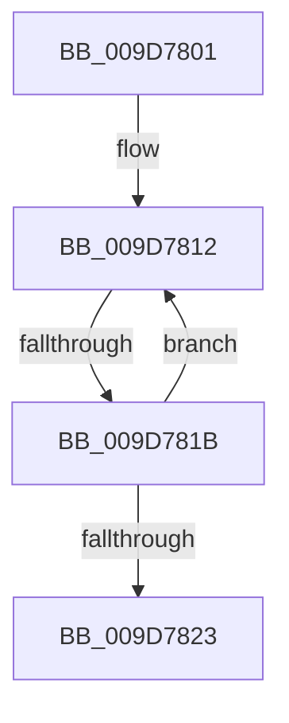

# sub_009D7801

- RVA: `0x009D7801`–`0x009D7828` (길이 `39` bytes)
- VA: `0x00000001409D7801`
- 실행 섹션: `PAGE`
- PDB 이름 있음: `아니요`; PDB Function 태그: `아니요`
- unwind 정보 RVA: `0x000A287C`
- 디코드: `10`개 명령, `39/39` bytes 표시
- 미해석 바이트: `0` (있으면 어셈블리에 `.byte`로 보존)

> 이 문서는 커널 이미지의 기계어와 PDB 기호를 분석해 생성했습니다. 4번과 5번은 함수 원형과 자료형을 바이너리 사용 방식에서 추정한 C 해석이며 원본 소스 복구 결과는 아닙니다.

## 1. Dependencies

- 직접 호출 지점: **0**; 고유 호출 대상: **0**
- 직접 호출자로 확인된 함수: **0**
- RIP 상대 이미지 참조: **0**

### Outgoing calls
- 직접 디코드된 call 명령이 없습니다.

### Direct callers
- 이 함수 시작 RVA로 연결되는 직접 call은 확인되지 않았습니다. 간접 호출은 완전히 역산할 수 없습니다.

### Static image references
- 디코드된 RIP-relative 메모리 참조가 없습니다.

## 2. Other-region calls and transfers

- 다른 실행 섹션으로 향하는 call: **0**
- call이 아닌 외부 분기/꼬리 이동: **1**
  - `0x009D7819` → [sub_009D782E](Unknown_function_009D782E.md) (`tail-transfer`)

## 3. Assembly (complete function range)

```asm
009D7801  48 89 5C 24 30                  mov qword ptr [rsp + 0x30], rbx
009D7806  48 8D 59 E0                     lea rbx, [rcx - 0x20]
009D780A  0F 0D 4B 08                     prefetchw byte ptr [rbx + 8]
009D780E  48 8B 43 08                     mov rax, qword ptr [rbx + 8]
009D7812  48 8D 48 FF                     lea rcx, [rax - 1]
009D7816  48 85 C9                        test rcx, rcx
009D7819  7E 13                           jle 0x1409d782e
009D781B  F0 48 0F B1 4B 08               lock cmpxchg qword ptr [rbx + 8], rcx
009D7821  75 EF                           jne 0x1409d7812
009D7823  48 8B 5C 24 30                  mov rbx, qword ptr [rsp + 0x30]
```

## 4. C-style interpretation (structured pseudocode)

```c
__int64 __fastcall sub_009D7801(__int64 a1, __int64 a2, __int64 a3, __int64 a4, __int64 a5, __int64 a6)
{
    unsigned __int64 v_stack_p30;

    v_stack_p30 = v_rbx;
loc_009D7812:
    if (*(unsigned __int64 *)(a1 - 32 + 8) - 1 != 0) goto loc_009D7812;
    return *(unsigned __int64 *)(a1 - 32 + 8);
}
```

## 5. (Beta) C Style

```c
int64_t sub_009D7801(void *Arg1, int64_t Arg2, int64_t Arg3, int64_t Arg4, uint64_t Arg5, int64_t Arg6)
{
    uint8_t *arg1 = (uint8_t *)Arg1;

    uint64_t v_stack_p30;

    v_stack_p30 = local_rbx;
loc_009D7812:
    if (*(uint64_t *)(arg1 - 0x20 + 0x8) - 1 != 0) goto loc_009D7812;
    return *(uint64_t *)(arg1 - 0x20 + 0x8);
}
```

### 관측된 메모리 오프셋

구조체 형식이 확인되지 않은 접근은 인자 기준의 오프셋으로만 기록했습니다.

| 기준 인자 | 오프셋 표현 | 폭 (bit) | 접근 |
|---|---:|---:|---|
| `Arg1` | `- 0x20` | `64` | `R` |
| `Arg1` | `+ 0x8` | `8` | `R` |
| `Arg1` | `+ 0x8` | `64` | `R` |

## 6. Execution-region graph

[열기: 2D/3D 그래프와 함수 탐색 컨트롤 패널](../../../control-panel.html?section=page&rva=0x009D7801&view=graph)

- 2D 그래프는 위에서 아래로 흐르고, 3D 그래프는 빈 공간을 드래그해 회전합니다. Shift+드래그는 이동, 휠은 확대·축소, 함수 노드 선택은 대상 보고서 이동입니다.

### Static fallback


