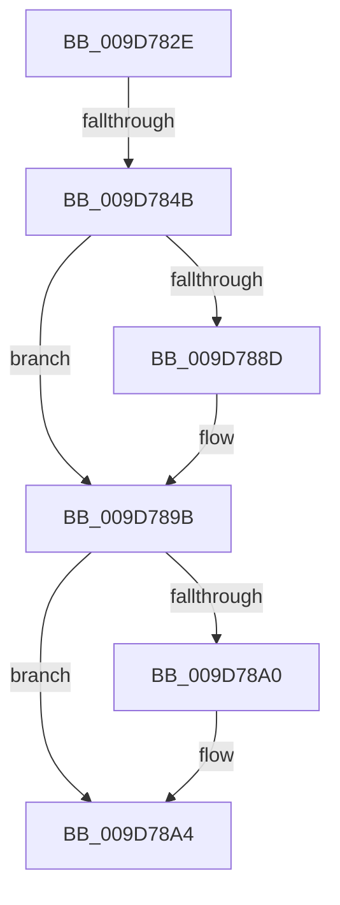

# sub_009D782E

- RVA: `0x009D782E`–`0x009D78BF` (길이 `145` bytes)
- VA: `0x00000001409D782E`
- 실행 섹션: `PAGE`
- PDB 이름 있음: `아니요`; PDB Function 태그: `아니요`
- unwind 정보 RVA: `0x000A28A4`
- 디코드: `35`개 명령, `145/145` bytes 표시
- 미해석 바이트: `0` (있으면 어셈블리에 `.byte`로 보존)

> 이 문서는 커널 이미지의 기계어와 PDB 기호를 분석해 생성했습니다. 4번과 5번은 함수 원형과 자료형을 바이너리 사용 방식에서 추정한 C 해석이며 원본 소스 복구 결과는 아닙니다.

## 1. Dependencies

- 직접 호출 지점: **2**; 고유 호출 대상: **2**
- 직접 호출자로 확인된 함수: **0**
- RIP 상대 이미지 참조: **1**

### Outgoing calls
- `0x009D787D` → [KeAbPreAcquire](../../text/21/KeAbPreAcquire_function_00210230.md) (function, `0x00210230`)
- `0x009D7896` → [ExfAcquirePushLockExclusiveEx](../../text/20/ExfAcquirePushLockExclusiveEx_function_0020FC90.md) (function, `0x0020FC90`)

### Direct callers
- 이 함수 시작 RVA로 연결되는 직접 call은 확인되지 않았습니다. 간접 호출은 완전히 역산할 수 없습니다.

### Static image references
- `0x009D785F` → RVA `0x00FD0EC0` (`CACHEALI`; read)

## 2. Other-region calls and transfers

- 다른 실행 섹션으로 향하는 call: **2**
  - `0x009D787D` → [KeAbPreAcquire](../../text/21/KeAbPreAcquire_function_00210230.md) (`PAGE` → `.text`)
  - `0x009D7896` → [ExfAcquirePushLockExclusiveEx](../../text/20/ExfAcquirePushLockExclusiveEx_function_0020FC90.md) (`PAGE` → `.text`)
- call이 아닌 외부 분기/꼬리 이동: **2**
  - `0x009D7845` → [sub_009D7965](Unknown_function_009D7965.md) (`tail-transfer`)
  - `0x009D78BD` → [sub_009D7920 + 0x7](Unknown_function_009D7920.md) (`tail-transfer`)

## 3. Assembly (complete function range)

```asm
009D782E  48 89 6C 24 38                  mov qword ptr [rsp + 0x38], rbp
009D7833  48 89 74 24 40                  mov qword ptr [rsp + 0x40], rsi
009D7838  48 89 7C 24 48                  mov qword ptr [rsp + 0x48], rdi
009D783D  4C 89 74 24 20                  mov qword ptr [rsp + 0x20], r14
009D7842  48 85 C9                        test rcx, rcx
009D7845  0F 85 1A 01 00 00               jne 0x1409d7965
009D784B  8B 43 10                        mov eax, dword ptr [rbx + 0x10]
009D784E  45 33 C0                        xor r8d, r8d
009D7851  65 4C 8B 34 25 88 01 00 00      mov r14, qword ptr gs:[0x188]
009D785A  33 D2                           xor edx, edx
009D785C  0F B6 F0                        movzx esi, al
009D785F  48 8D 05 5A 96 5F 00            lea rax, [rip + 0x5f965a]
009D7866  48 C1 E6 04                     shl rsi, 4
009D786A  48 03 F0                        add rsi, rax
009D786D  66 41 FF 8E E4 01 00 00         dec word ptr [r14 + 0x1e4]
009D7875  48 8B CE                        mov rcx, rsi
009D7878  90                              nop
009D7879  48 8D 7E 08                     lea rdi, [rsi + 8]
009D787D  E8 AE 89 83 FF                  call 0x140210230
009D7882  F0 48 0F BA 2E 00               lock bts qword ptr [rsi], 0
009D7888  48 8B E8                        mov rbp, rax
009D788B  73 0E                           jae 0x1409d789b
009D788D  4C 8B C6                        mov r8, rsi
009D7890  48 8B D0                        mov rdx, rax
009D7893  48 8B CE                        mov rcx, rsi
009D7896  E8 F5 83 83 FF                  call 0x14020fc90
009D789B  48 85 ED                        test rbp, rbp
009D789E  74 04                           je 0x1409d78a4
009D78A0  C6 45 0A 01                     mov byte ptr [rbp + 0xa], 1
009D78A4  48 C7 C0 FF FF FF FF            mov rax, 0xffffffffffffffff
009D78AB  48 8B C8                        mov rcx, rax
009D78AE  F0 48 0F C1 4B 08               lock xadd qword ptr [rbx + 8], rcx
009D78B4  48 8B 6C 24 38                  mov rbp, qword ptr [rsp + 0x38]
009D78B9  48 83 E9 01                     sub rcx, 1
009D78BD  7F 68                           jg 0x1409d7927
```

## 4. C-style interpretation (structured pseudocode)

```c
__int64 __fastcall sub_009D782E(__int64 a1, int a2, int a3, __int64 a4, __int64 a5, __int64 a6, __int64 a7)
{
    __int64 result;
    __int64 v_rsi;
    unsigned __int64 v_stack_p20;
    unsigned __int64 v_stack_p38;
    unsigned __int64 v_stack_p40;
    unsigned __int64 v_stack_p48;

    v_stack_p38 = v_rbp;
    v_stack_p40 = v_rsi;
    v_stack_p48 = v_rdi;
    v_stack_p20 = v_r14;
    a3 = 0;
    a2 = 0;
    v_rsi = ((unsigned __int8)((unsigned int)(*(unsigned int *)(v_rbx + 16)))) << (4);
    v_rsi = (v_rsi) + (v_rip + 6264410);
    result = KeAbPreAcquire(v_rsi, a2, a3, a4);
    if (!(condition_is_above_or_equal)) {
        a3 = v_rsi;
        a2 = result;
        a1 = v_rsi;
        result = ExfAcquirePushLockExclusiveEx(a1, a2, a3, a4);
    }
    if (result != 0) {
        *(unsigned __int8 *)(result + 10) = 1;
    }
    a1 = (-1) - (1);
}
```

## 5. (Beta) C Style

```c
int64_t sub_009D782E(int64_t Arg1, int32_t Arg2, int32_t Arg3, int64_t Arg4, uint64_t Arg5, uint64_t Arg6, int64_t Arg7)
{
    int64_t result;
    int64_t local_rsi;
    uint64_t v_stack_p20;
    uint64_t v_stack_p38;
    uint64_t v_stack_p40;
    uint64_t v_stack_p48;

    v_stack_p38 = local_rbp;
    v_stack_p40 = local_rsi;
    v_stack_p48 = local_rdi;
    v_stack_p20 = local_r14;
    Arg3 = 0;
    Arg2 = 0;
    local_rsi = ((uint8_t)((uint32_t)(*(uint32_t *)(local_rbx + 0x10)))) << (4);
    local_rsi = (local_rsi) + (v_rip + 6264410);
    result = KeAbPreAcquire(local_rsi, Arg2, Arg3, Arg4);
    if (!(condition_is_above_or_equal)) {
        Arg3 = local_rsi;
        Arg2 = result;
        Arg1 = local_rsi;
        result = ExfAcquirePushLockExclusiveEx(Arg1, Arg2, Arg3, Arg4);
    }
    if (result != 0) {
        *(uint8_t *)(result + 0xA) = 1;
    }
    Arg1 = (-1) - (1);
}
```

## 6. Execution-region graph

[열기: 2D/3D 그래프와 함수 탐색 컨트롤 패널](../../../control-panel.html?section=page&rva=0x009D782E&view=graph)

- 2D 그래프는 위에서 아래로 흐르고, 3D 그래프는 빈 공간을 드래그해 회전합니다. Shift+드래그는 이동, 휠은 확대·축소, 함수 노드 선택은 대상 보고서 이동입니다.

### Static fallback


