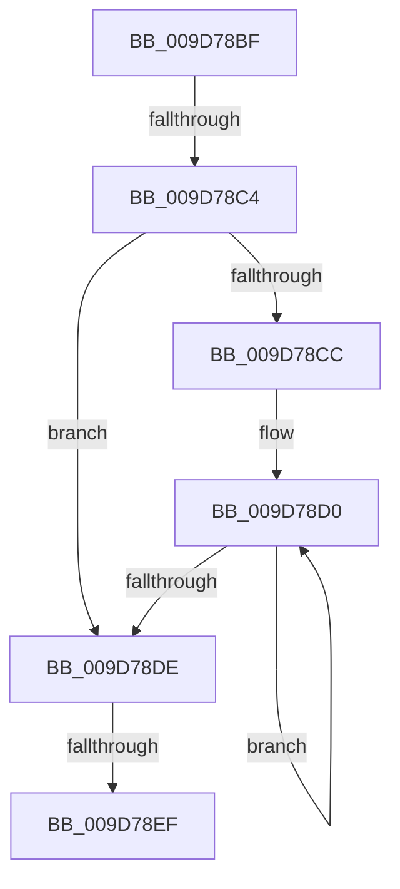

# sub_009D78BF

- RVA: `0x009D78BF`–`0x009D7920` (길이 `97` bytes)
- VA: `0x00000001409D78BF`
- 실행 섹션: `PAGE`
- PDB 이름 있음: `아니요`; PDB Function 태그: `아니요`
- unwind 정보 RVA: `0x000A28C8`
- 디코드: `28`개 명령, `97/97` bytes 표시
- 미해석 바이트: `0` (있으면 어셈블리에 `.byte`로 보존)

> 이 문서는 커널 이미지의 기계어와 PDB 기호를 분석해 생성했습니다. 4번과 5번은 함수 원형과 자료형을 바이너리 사용 방식에서 추정한 C 해석이며 원본 소스 복구 결과는 아닙니다.

## 1. Dependencies

- 직접 호출 지점: **3**; 고유 호출 대상: **3**
- 직접 호출자로 확인된 함수: **0**
- RIP 상대 이미지 참조: **0**

### Outgoing calls
- `0x009D78F2` → [KeAbPostRelease](../../text/2E/KeAbPostRelease_function_002E1600.md) (function, `0x002E1600`)
- `0x009D78FA` → [KeLeaveCriticalRegionThread](../../text/25/KeLeaveCriticalRegionThread_function_0025EFF0.md) (function, `0x0025EFF0`)
- `0x009D7907` → [ExFreePoolWithTag](../../poolcode/B8/ExFreePoolWithTag_function_00B82870.md) (function, `0x00B82870`)

### Direct callers
- 이 함수 시작 RVA로 연결되는 직접 call은 확인되지 않았습니다. 간접 호출은 완전히 역산할 수 없습니다.

### Static image references
- 디코드된 RIP-relative 메모리 참조가 없습니다.

## 2. Other-region calls and transfers

- 다른 실행 섹션으로 향하는 call: **3**
  - `0x009D78F2` → [KeAbPostRelease](../../text/2E/KeAbPostRelease_function_002E1600.md) (`PAGE` → `.text`)
  - `0x009D78FA` → [KeLeaveCriticalRegionThread](../../text/25/KeLeaveCriticalRegionThread_function_0025EFF0.md) (`PAGE` → `.text`)
  - `0x009D7907` → [ExFreePoolWithTag](../../poolcode/B8/ExFreePoolWithTag_function_00B82870.md) (`PAGE` → `POOLCODE`)
- call이 아닌 외부 분기/꼬리 이동: **3**
  - `0x009D78C2` → [sub_009D7920](Unknown_function_009D7920.md) (`tail-transfer`)
  - `0x009D78ED` → [sub_009D7920 + 0x24](Unknown_function_009D7920.md) (`tail-transfer`)
  - `0x009D791B` → [sub_009D7801 + 0x22](Unknown_function_009D7801.md) (`tail-transfer`)

## 3. Assembly (complete function range)

```asm
009D78BF  48 85 C9                        test rcx, rcx
009D78C2  75 5C                           jne 0x1409d7920
009D78C4  48 8B 17                        mov rdx, qword ptr [rdi]
009D78C7  48 3B D3                        cmp rdx, rbx
009D78CA  74 12                           je 0x1409d78de
009D78CC  0F 1F 40 00                     nop dword ptr [rax]
009D78D0  48 8B 0A                        mov rcx, qword ptr [rdx]
009D78D3  48 8B FA                        mov rdi, rdx
009D78D6  48 8B D1                        mov rdx, rcx
009D78D9  48 3B CB                        cmp rcx, rbx
009D78DC  75 F2                           jne 0x1409d78d0
009D78DE  48 8B 13                        mov rdx, qword ptr [rbx]
009D78E1  48 89 17                        mov qword ptr [rdi], rdx
009D78E4  F0 48 0F C1 06                  lock xadd qword ptr [rsi], rax
009D78E9  24 06                           and al, 6
009D78EB  3C 02                           cmp al, 2
009D78ED  74 55                           je 0x1409d7944
009D78EF  48 8B CE                        mov rcx, rsi
009D78F2  E8 09 9D 90 FF                  call 0x1402e1600
009D78F7  49 8B CE                        mov rcx, r14
009D78FA  E8 F1 76 88 FF                  call 0x14025eff0
009D78FF  BA 4F 62 53 63                  mov edx, 0x6353624f
009D7904  48 8B CB                        mov rcx, rbx
009D7907  E8 64 AF 1A 00                  call 0x140b82870
009D790C  48 8B 7C 24 48                  mov rdi, qword ptr [rsp + 0x48]
009D7911  48 8B 74 24 40                  mov rsi, qword ptr [rsp + 0x40]
009D7916  4C 8B 74 24 20                  mov r14, qword ptr [rsp + 0x20]
009D791B  E9 03 FF FF FF                  jmp 0x1409d7823
```

## 4. C-style interpretation (structured pseudocode)

```c
__int64 __fastcall sub_009D78BF(__int64 a1, __int64 a2, __int64 a3, __int64 a4, __int64 a5, __int64 a6, __int64 a7, __int64 a8, __int64 a9)
{
    __int64 result;
    unsigned __int64 v_stack_p20;

    if ((*(unsigned __int64 *)(v_rdi)) == v_rbx) goto loc_009D78DE;
loc_009D78D0:
    if ((*(unsigned __int64 *)(*(unsigned __int64 *)(v_rdi))) != v_rbx) goto loc_009D78D0;
loc_009D78DE:
    *(unsigned __int64 *)(*(unsigned __int64 *)(v_rdi)) = *(unsigned __int64 *)(v_rbx);
    result = (unsigned __int8)((result) & (6));
    result = KeAbPostRelease(v_rsi, *(unsigned __int64 *)(v_rbx), a3, a4);
    result = KeLeaveCriticalRegionThread(v_r14, *(unsigned __int64 *)(v_rbx), a3, a4);
    result = ExFreePoolWithTag(v_rbx, (unsigned int)(0x6353624FULL), a3, a4);
}
```

## 5. (Beta) C Style

```c
int64_t sub_009D78BF(int64_t Arg1, int64_t Arg2, int64_t Arg3, int64_t Arg4, uint64_t Arg5, uint64_t Arg6, uint64_t Arg7, int64_t Arg8, int64_t Arg9)
{
    int64_t result;
    uint64_t v_stack_p20;

    if ((*(uint64_t *)(local_rdi)) == local_rbx) goto loc_009D78DE;
loc_009D78D0:
    if ((*(uint64_t *)(*(uint64_t *)(local_rdi))) != local_rbx) goto loc_009D78D0;
loc_009D78DE:
    *(uint64_t *)(*(uint64_t *)(local_rdi)) = *(uint64_t *)(local_rbx);
    result = (uint8_t)((result) & (6));
    result = KeAbPostRelease(local_rsi, *(uint64_t *)(local_rbx), Arg3, Arg4);
    result = KeLeaveCriticalRegionThread(local_r14, *(uint64_t *)(local_rbx), Arg3, Arg4);
    result = ExFreePoolWithTag(local_rbx, (uint32_t)(0x6353624FULL), Arg3, Arg4);
}
```

## 6. Execution-region graph

[열기: 2D/3D 그래프와 함수 탐색 컨트롤 패널](../../../control-panel.html?section=page&rva=0x009D78BF&view=graph)

- 2D 그래프는 위에서 아래로 흐르고, 3D 그래프는 빈 공간을 드래그해 회전합니다. Shift+드래그는 이동, 휠은 확대·축소, 함수 노드 선택은 대상 보고서 이동입니다.

### Static fallback


