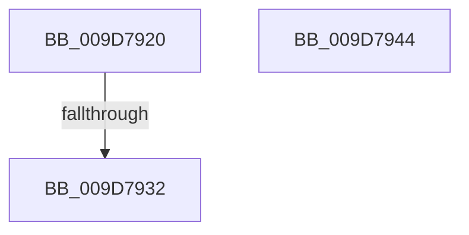

# sub_009D7920

- RVA: `0x009D7920`–`0x009D794E` (길이 `46` bytes)
- VA: `0x00000001409D7920`
- 실행 섹션: `PAGE`
- PDB 이름 있음: `아니요`; PDB Function 태그: `아니요`
- unwind 정보 RVA: `0x000A28E8`
- 디코드: `14`개 명령, `46/46` bytes 표시
- 미해석 바이트: `0` (있으면 어셈블리에 `.byte`로 보존)

> 이 문서는 커널 이미지의 기계어와 PDB 기호를 분석해 생성했습니다. 4번과 5번은 함수 원형과 자료형을 바이너리 사용 방식에서 추정한 C 해석이며 원본 소스 복구 결과는 아닙니다.

## 1. Dependencies

- 직접 호출 지점: **3**; 고유 호출 대상: **3**
- 직접 호출자로 확인된 함수: **0**
- RIP 상대 이미지 참조: **0**

### Outgoing calls
- `0x009D7935` → [KeAbPostRelease](../../text/2E/KeAbPostRelease_function_002E1600.md) (function, `0x002E1600`)
- `0x009D793D` → [KeLeaveCriticalRegionThread](../../text/25/KeLeaveCriticalRegionThread_function_0025EFF0.md) (function, `0x0025EFF0`)
- `0x009D7947` → [ExfTryToWakePushLock](../../text/26/ExfTryToWakePushLock_function_00265DD0.md) (function, `0x00265DD0`)

### Direct callers
- 이 함수 시작 RVA로 연결되는 직접 call은 확인되지 않았습니다. 간접 호출은 완전히 역산할 수 없습니다.

### Static image references
- 디코드된 RIP-relative 메모리 참조가 없습니다.

## 2. Other-region calls and transfers

- 다른 실행 섹션으로 향하는 call: **3**
  - `0x009D7935` → [KeAbPostRelease](../../text/2E/KeAbPostRelease_function_002E1600.md) (`PAGE` → `.text`)
  - `0x009D793D` → [KeLeaveCriticalRegionThread](../../text/25/KeLeaveCriticalRegionThread_function_0025EFF0.md) (`PAGE` → `.text`)
  - `0x009D7947` → [ExfTryToWakePushLock](../../text/26/ExfTryToWakePushLock_function_00265DD0.md) (`PAGE` → `.text`)
- call이 아닌 외부 분기/꼬리 이동: **3**
  - `0x009D7930` → [sub_009D795B](Unknown_function_009D795B.md) (`tail-transfer`)
  - `0x009D7942` → [sub_009D78BF + 0x4D](Unknown_function_009D78BF.md) (`tail-transfer`)
  - `0x009D794C` → [sub_009D78BF + 0x30](Unknown_function_009D78BF.md) (`tail-transfer`)

## 3. Assembly (complete function range)

```asm
009D7920  B9 0E 00 00 00                  mov ecx, 0xe
009D7925  CD 29                           int 0x29
009D7927  F0 48 0F C1 06                  lock xadd qword ptr [rsi], rax
009D792C  24 06                           and al, 6
009D792E  3C 02                           cmp al, 2
009D7930  74 29                           je 0x1409d795b
009D7932  48 8B CE                        mov rcx, rsi
009D7935  E8 C6 9C 90 FF                  call 0x1402e1600
009D793A  49 8B CE                        mov rcx, r14
009D793D  E8 AE 76 88 FF                  call 0x14025eff0
009D7942  EB C8                           jmp 0x1409d790c
009D7944  48 8B CE                        mov rcx, rsi
009D7947  E8 84 E4 88 FF                  call 0x140265dd0
009D794C  EB A1                           jmp 0x1409d78ef
```

## 4. C-style interpretation (structured pseudocode)

```c
__int64 __fastcall sub_009D7920(void)
{
    __int64 result;

    result = (unsigned __int8)((result) & (6));
    result = KeAbPostRelease(v_rsi, a2, a3, a4);
    result = KeLeaveCriticalRegionThread(v_r14, a2, a3, a4);
}
```

## 5. (Beta) C Style

```c
void sub_009D7920(void)
{
    int64_t result;

    result = (uint8_t)((result) & (6));
    result = KeAbPostRelease(local_rsi, a2, a3, a4);
    result = KeLeaveCriticalRegionThread(local_r14, a2, a3, a4);
}
```

## 6. Execution-region graph

[열기: 2D/3D 그래프와 함수 탐색 컨트롤 패널](../../../control-panel.html?section=page&rva=0x009D7920&view=graph)

- 2D 그래프는 위에서 아래로 흐르고, 3D 그래프는 빈 공간을 드래그해 회전합니다. Shift+드래그는 이동, 휠은 확대·축소, 함수 노드 선택은 대상 보고서 이동입니다.

### Static fallback


