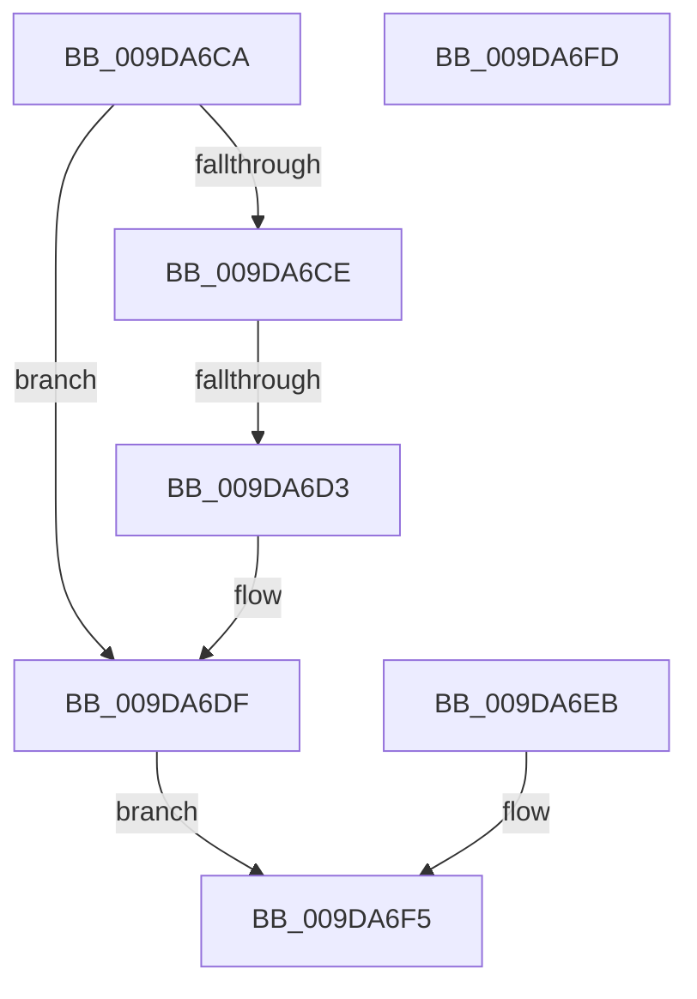

# sub_009DA6CA

- RVA: `0x009DA6CA`–`0x009DA70E` (길이 `68` bytes)
- VA: `0x00000001409DA6CA`
- 실행 섹션: `PAGE`
- PDB 이름 있음: `아니요`; PDB Function 태그: `아니요`
- unwind 정보 RVA: `0x000A327C`
- 디코드: `25`개 명령, `68/68` bytes 표시
- 미해석 바이트: `0` (있으면 어셈블리에 `.byte`로 보존)

> 이 문서는 커널 이미지의 기계어와 PDB 기호를 분석해 생성했습니다. 4번과 5번은 함수 원형과 자료형을 바이너리 사용 방식에서 추정한 C 해석이며 원본 소스 복구 결과는 아닙니다.

## 1. Dependencies

- 직접 호출 지점: **0**; 고유 호출 대상: **0**
- 직접 호출자로 확인된 함수: **0**
- RIP 상대 이미지 참조: **0**

### Outgoing calls
- 직접 디코드된 call 명령이 없습니다.

### Direct callers
- 이 함수 시작 RVA로 연결되는 직접 call은 확인되지 않았습니다. 간접 호출은 완전히 역산할 수 없습니다.

### Static image references
- 디코드된 RIP-relative 메모리 참조가 없습니다.

## 2. Other-region calls and transfers

- 다른 실행 섹션으로 향하는 call: **0**
- call이 아닌 외부 분기/꼬리 이동: **2**
  - `0x009DA6D1` → [AlpcpCaptureIdMessage + 0x31](AlpcpCaptureIdMessage_function_009DA680.md) (`tail-transfer`)
  - `0x009DA70C` → [AlpcpCaptureIdMessage + 0x37](AlpcpCaptureIdMessage_function_009DA680.md) (`tail-transfer`)

## 3. Assembly (complete function range)

```asm
009DA6CA  84 C0                           test al, al
009DA6CC  74 11                           je 0x1409da6df
009DA6CE  4D 85 C9                        test r9, r9
009DA6D1  75 DE                           jne 0x1409da6b1
009DA6D3  4D 3B D3                        cmp r10, r11
009DA6D6  90                              nop
009DA6D7  4D 0F 42 DA                     cmovb r11, r10
009DA6DB  41 0F B6 03                     movzx eax, byte ptr [r11]
009DA6DF  41 8B 42 18                     mov eax, dword ptr [r10 + 0x18]
009DA6E3  89 02                           mov dword ptr [rdx], eax
009DA6E5  41 8B 42 20                     mov eax, dword ptr [r10 + 0x20]
009DA6E9  EB 0A                           jmp 0x1409da6f5
009DA6EB  41 8B 42 10                     mov eax, dword ptr [r10 + 0x10]
009DA6EF  89 02                           mov dword ptr [rdx], eax
009DA6F1  41 8B 42 14                     mov eax, dword ptr [r10 + 0x14]
009DA6F5  41 89 00                        mov dword ptr [r8], eax
009DA6F8  48 83 C4 28                     add rsp, 0x28
009DA6FC  C3                              ret
009DA6FD  CC                              int3
009DA6FE  4D 3B D3                        cmp r10, r11
009DA701  49 8B CB                        mov rcx, r11
009DA704  90                              nop
009DA705  49 0F 42 CA                     cmovb rcx, r10
009DA709  0F B6 09                        movzx ecx, byte ptr [rcx]
009DA70C  EB A9                           jmp 0x1409da6b7
```

## 4. C-style interpretation (structured pseudocode)

```c
__int64 __fastcall sub_009DA6CA(__int64 a1, __int64 a2, __int64 a3, __int64 a4)
{
    __int64 v_r11;
    __int64 v_rsp;

    if ((unsigned __int8)(result) == 0) goto loc_009DA6DF;
    if (v_r10 < v_r11) { v_r11 = v_r10; }
loc_009DA6DF:
    *(unsigned int *)(a2) = (unsigned int)((unsigned int)(*(unsigned int *)(v_r10 + 24)));
    goto loc_009DA6F5;
loc_009DA6F5:
    *(unsigned int *)(a3) = (unsigned int)((unsigned int)(*(unsigned int *)(v_r10 + 32)));
    v_rsp = (v_rsp) + (40);
    return (unsigned int)(*(unsigned int *)(v_r10 + 32));
}
```

## 5. (Beta) C Style

```c
int64_t sub_009DA6CA(int64_t Arg1, void *Arg2, void *Arg3, int64_t Arg4)
{
    uint8_t *arg2 = (uint8_t *)Arg2;
    uint8_t *arg3 = (uint8_t *)Arg3;

    int64_t local_r11;
    int64_t local_rsp;

    if ((uint8_t)(result) == 0) goto loc_009DA6DF;
    if (local_r10 < local_r11) { local_r11 = local_r10; }
loc_009DA6DF:
    *(uint32_t *)(arg2) = (uint32_t)((uint32_t)(*(uint32_t *)(local_r10 + 0x18)));
    goto loc_009DA6F5;
loc_009DA6F5:
    *(uint32_t *)(arg3) = (uint32_t)((uint32_t)(*(uint32_t *)(local_r10 + 0x20)));
    local_rsp = (local_rsp) + (40);
    return (uint32_t)(*(uint32_t *)(local_r10 + 0x20));
}
```

### 관측된 메모리 오프셋

구조체 형식이 확인되지 않은 접근은 인자 기준의 오프셋으로만 기록했습니다.

| 기준 인자 | 오프셋 표현 | 폭 (bit) | 접근 |
|---|---:|---:|---|
| `Arg2` | `+ 0x0` | `32` | `W` |
| `Arg3` | `+ 0x0` | `32` | `W` |

## 6. Execution-region graph

[열기: 2D/3D 그래프와 함수 탐색 컨트롤 패널](../../../control-panel.html?section=page&rva=0x009DA6CA&view=graph)

- 2D 그래프는 위에서 아래로 흐르고, 3D 그래프는 빈 공간을 드래그해 회전합니다. Shift+드래그는 이동, 휠은 확대·축소, 함수 노드 선택은 대상 보고서 이동입니다.

### Static fallback


