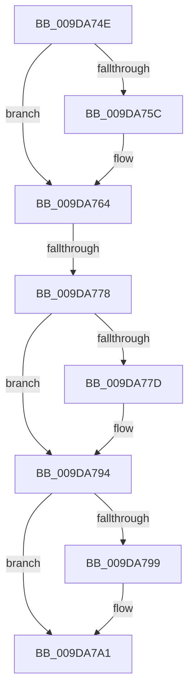

# sub_009DA74E

- RVA: `0x009DA74E`–`0x009DA7A6` (길이 `88` bytes)
- VA: `0x00000001409DA74E`
- 실행 섹션: `PAGE`
- PDB 이름 있음: `아니요`; PDB Function 태그: `아니요`
- unwind 정보 RVA: `0x000A32A4`
- 디코드: `24`개 명령, `88/88` bytes 표시
- 미해석 바이트: `0` (있으면 어셈블리에 `.byte`로 보존)

> 이 문서는 커널 이미지의 기계어와 PDB 기호를 분석해 생성했습니다. 4번과 5번은 함수 원형과 자료형을 바이너리 사용 방식에서 추정한 C 해석이며 원본 소스 복구 결과는 아닙니다.

## 1. Dependencies

- 직접 호출 지점: **3**; 고유 호출 대상: **3**
- 직접 호출자로 확인된 함수: **0**
- RIP 상대 이미지 참조: **0**

### Outgoing calls
- `0x009DA75F` → [CmLockHiveSecurityShared](../../pagecmrc/BC/CmLockHiveSecurityShared_function_00BC996C.md) (function, `0x00BC996C`)
- `0x009DA76F` → [CmpFindSecurityCellCacheIndex](../../text/42/CmpFindSecurityCellCacheIndex_function_00428060.md) (function, `0x00428060`)
- `0x009DA79C` → [CmUnlockHiveSecurity](../../pagecmrc/BC/CmUnlockHiveSecurity_function_00BC99C8.md) (function, `0x00BC99C8`)

### Direct callers
- 이 함수 시작 RVA로 연결되는 직접 call은 확인되지 않았습니다. 간접 호출은 완전히 역산할 수 없습니다.

### Static image references
- 디코드된 RIP-relative 메모리 참조가 없습니다.

## 2. Other-region calls and transfers

- 다른 실행 섹션으로 향하는 call: **3**
  - `0x009DA75F` → [CmLockHiveSecurityShared](../../pagecmrc/BC/CmLockHiveSecurityShared_function_00BC996C.md) (`PAGE` → `PAGECMRC`)
  - `0x009DA76F` → [CmpFindSecurityCellCacheIndex](../../text/42/CmpFindSecurityCellCacheIndex_function_00428060.md) (`PAGE` → `.text`)
  - `0x009DA79C` → [CmUnlockHiveSecurity](../../pagecmrc/BC/CmUnlockHiveSecurity_function_00BC99C8.md) (`PAGE` → `PAGECMRC`)
- call이 아닌 외부 분기/꼬리 이동: **1**
  - `0x009DA776` → [sub_009DA7C3](Unknown_function_009DA7C3.md) (`tail-transfer`)

## 3. Assembly (complete function range)

```asm
009DA74E  48 89 5C 24 60                  mov qword ptr [rsp + 0x60], rbx
009DA753  48 8B 59 20                     mov rbx, qword ptr [rcx + 0x20]
009DA757  45 84 C9                        test r9b, r9b
009DA75A  75 08                           jne 0x1409da764
009DA75C  48 8B CB                        mov rcx, rbx
009DA75F  E8 08 F2 1E 00                  call 0x140bc996c
009DA764  4C 8D 44 24 68                  lea r8, [rsp + 0x68]
009DA769  41 8B D6                        mov edx, r14d
009DA76C  48 8B CB                        mov rcx, rbx
009DA76F  E8 EC D8 A4 FF                  call 0x140428060
009DA774  84 C0                           test al, al
009DA776  74 4B                           je 0x1409da7c3
009DA778  4D 85 FF                        test r15, r15
009DA77B  75 17                           jne 0x1409da794
009DA77D  48 8B 8B 60 07 00 00            mov rcx, qword ptr [rbx + 0x760]
009DA784  8B 54 24 68                     mov edx, dword ptr [rsp + 0x68]
009DA788  48 03 D2                        add rdx, rdx
009DA78B  48 8B 54 D1 08                  mov rdx, qword ptr [rcx + rdx*8 + 8]
009DA790  48 89 56 58                     mov qword ptr [rsi + 0x58], rdx
009DA794  40 84 FF                        test dil, dil
009DA797  75 08                           jne 0x1409da7a1
009DA799  48 8B CB                        mov rcx, rbx
009DA79C  E8 27 F2 1E 00                  call 0x140bc99c8
009DA7A1  48 8B 5C 24 60                  mov rbx, qword ptr [rsp + 0x60]
```

## 4. C-style interpretation (structured pseudocode)

```c
__int64 __fastcall sub_009DA74E(__int64 a1, __int64 a2, __int64 a3, unsigned __int8 a4, __int64 a5, __int64 a6, __int64 a7, __int64 a8, __int64 a9, __int64 a10, __int64 a11, __int64 a12, unsigned int a13)
{
    __int64 result;
    unsigned __int64 v_stack_p60;

    v_stack_p60 = v_rbx;
    if (a4 == 0) {
        a1 = *(unsigned __int64 *)(a1 + 32);
        result = CmLockHiveSecurityShared(a1, a2, a3, a4);
    }
    result = CmpFindSecurityCellCacheIndex(*(unsigned __int64 *)(a1 + 32), (unsigned int)((unsigned int)(v_r14)), a13, a4);
    if (v_r15 == 0) {
        a1 = *(unsigned __int64 *)(*(unsigned __int64 *)(a1 + 32) + 1888);
        a2 = a13;
        a2 = (a2) + (a2);
        a2 = *(unsigned __int64 *)(a1 + a2 * 8 + 8);
        *(unsigned __int64 *)(v_rsi + 88) = a2;
    }
    if ((unsigned __int8)(v_rdi) == 0) {
        a1 = *(unsigned __int64 *)(a1 + 32);
        result = CmUnlockHiveSecurity(a1, a2, a13, a4);
    }
    return result;
}
```

## 5. (Beta) C Style

```c
int64_t sub_009DA74E(void *Arg1, int64_t Arg2, int64_t Arg3, uint8_t Arg4, uint64_t Arg5, uint64_t Arg6, uint64_t Arg7, uint64_t Arg8, uint64_t Arg9, uint64_t Arg10, uint64_t Arg11, int64_t Arg12, uint32_t Arg13)
{
    uint8_t *arg1 = (uint8_t *)Arg1;

    int64_t result;
    uint64_t v_stack_p60;

    v_stack_p60 = local_rbx;
    if (Arg4 == 0) {
        Arg1 = *(uint64_t *)(arg1 + 0x20);
        result = CmLockHiveSecurityShared(Arg1, Arg2, Arg3, Arg4);
    }
    result = CmpFindSecurityCellCacheIndex(*(uint64_t *)(arg1 + 0x20), (uint32_t)((uint32_t)(local_r14)), Arg13, Arg4);
    if (local_r15 == 0) {
        Arg1 = *(uint64_t *)(*(uint64_t *)(arg1 + 0x20) + 0x760);
        Arg2 = Arg13;
        Arg2 = (Arg2) + (Arg2);
        Arg2 = *(uint64_t *)(arg1 + Arg2 * 8 + 0x8);
        *(uint64_t *)(local_rsi + 0x58) = Arg2;
    }
    if ((uint8_t)(local_rdi) == 0) {
        Arg1 = *(uint64_t *)(arg1 + 0x20);
        result = CmUnlockHiveSecurity(Arg1, Arg2, Arg13, Arg4);
    }
    return result;
}
```

### 관측된 메모리 오프셋

구조체 형식이 확인되지 않은 접근은 인자 기준의 오프셋으로만 기록했습니다.

| 기준 인자 | 오프셋 표현 | 폭 (bit) | 접근 |
|---|---:|---:|---|
| `Arg1` | `+ 0x20` | `64` | `R` |

## 6. Execution-region graph

[열기: 2D/3D 그래프와 함수 탐색 컨트롤 패널](../../../control-panel.html?section=page&rva=0x009DA74E&view=graph)

- 2D 그래프는 위에서 아래로 흐르고, 3D 그래프는 빈 공간을 드래그해 회전합니다. Shift+드래그는 이동, 휠은 확대·축소, 함수 노드 선택은 대상 보고서 이동입니다.

### Static fallback


