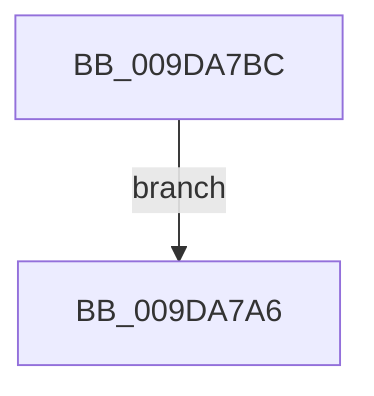

# sub_009DA7A6

- RVA: `0x009DA7A6`–`0x009DA7C3` (길이 `29` bytes)
- VA: `0x00000001409DA7A6`
- 실행 섹션: `PAGE`
- PDB 이름 있음: `아니요`; PDB Function 태그: `아니요`
- unwind 정보 RVA: `0x000A32B8`
- 디코드: `12`개 명령, `29/29` bytes 표시
- 미해석 바이트: `0` (있으면 어셈블리에 `.byte`로 보존)

> 이 문서는 커널 이미지의 기계어와 PDB 기호를 분석해 생성했습니다. 4번과 5번은 함수 원형과 자료형을 바이너리 사용 방식에서 추정한 C 해석이며 원본 소스 복구 결과는 아닙니다.

## 1. Dependencies

- 직접 호출 지점: **0**; 고유 호출 대상: **0**
- 직접 호출자로 확인된 함수: **0**
- RIP 상대 이미지 참조: **0**

### Outgoing calls
- 직접 디코드된 call 명령이 없습니다.

### Direct callers
- 이 함수 시작 RVA로 연결되는 직접 call은 확인되지 않았습니다. 간접 호출은 완전히 역산할 수 없습니다.

### Static image references
- 디코드된 RIP-relative 메모리 참조가 없습니다.

## 2. Other-region calls and transfers

- 다른 실행 섹션으로 향하는 call: **0**
- 별도 외부 분기/꼬리 이동을 확인하지 못했습니다.

## 3. Assembly (complete function range)

```asm
009DA7A6  40 0F B6 C5                     movzx eax, bpl
009DA7AA  48 8B 6C 24 70                  mov rbp, qword ptr [rsp + 0x70]
009DA7AF  48 83 C4 30                     add rsp, 0x30
009DA7B3  41 5F                           pop r15
009DA7B5  41 5E                           pop r14
009DA7B7  41 5C                           pop r12
009DA7B9  5F                              pop rdi
009DA7BA  5E                              pop rsi
009DA7BB  C3                              ret
009DA7BC  CC                              int3
009DA7BD  4C 89 61 58                     mov qword ptr [rcx + 0x58], r12
009DA7C1  EB E3                           jmp 0x1409da7a6
```

## 4. C-style interpretation (structured pseudocode)

```c
__int64 __fastcall sub_009DA7A6(__int64 a1, __int64 a2, __int64 a3, __int64 a4, __int64 a5, __int64 a6, __int64 a7, __int64 a8, __int64 a9, __int64 a10, __int64 a11, __int64 a12, __int64 a13, __int64 a14)
{
    __int64 v_rsp;

    v_rsp = (v_rsp) + (48);
    return (unsigned __int8)(v_rbp);
}
```

## 5. (Beta) C Style

```c
int64_t sub_009DA7A6(int64_t Arg1, int64_t Arg2, int64_t Arg3, int64_t Arg4, uint64_t Arg5, uint64_t Arg6, uint64_t Arg7, uint64_t Arg8, uint64_t Arg9, uint64_t Arg10, uint64_t Arg11, uint64_t Arg12, uint64_t Arg13, int64_t Arg14)
{
    int64_t local_rsp;

    local_rsp = (local_rsp) + (48);
    return (uint8_t)(local_rbp);
}
```

## 6. Execution-region graph

[열기: 2D/3D 그래프와 함수 탐색 컨트롤 패널](../../../control-panel.html?section=page&rva=0x009DA7A6&view=graph)

- 2D 그래프는 위에서 아래로 흐르고, 3D 그래프는 빈 공간을 드래그해 회전합니다. Shift+드래그는 이동, 휠은 확대·축소, 함수 노드 선택은 대상 보고서 이동입니다.

### Static fallback


