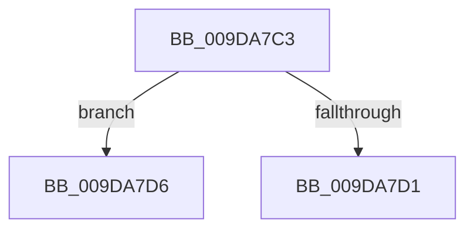

# sub_009DA7C3

- RVA: `0x009DA7C3`–`0x009DA7F0` (길이 `45` bytes)
- VA: `0x00000001409DA7C3`
- 실행 섹션: `PAGE`
- PDB 이름 있음: `아니요`; PDB Function 태그: `아니요`
- unwind 정보 RVA: `0x000A32CC`
- 디코드: `12`개 명령, `45/45` bytes 표시
- 미해석 바이트: `0` (있으면 어셈블리에 `.byte`로 보존)

> 이 문서는 커널 이미지의 기계어와 PDB 기호를 분석해 생성했습니다. 4번과 5번은 함수 원형과 자료형을 바이너리 사용 방식에서 추정한 C 해석이며 원본 소스 복구 결과는 아닙니다.

## 1. Dependencies

- 직접 호출 지점: **1**; 고유 호출 대상: **1**
- 직접 호출자로 확인된 함수: **0**
- RIP 상대 이미지 참조: **0**

### Outgoing calls
- `0x009DA7EA` → [KeBugCheckEx](../../text/4F/KeBugCheckEx_function_004FD660.md) (function, `0x004FD660`)

### Direct callers
- 이 함수 시작 RVA로 연결되는 직접 call은 확인되지 않았습니다. 간접 호출은 완전히 역산할 수 없습니다.

### Static image references
- 디코드된 RIP-relative 메모리 참조가 없습니다.

## 2. Other-region calls and transfers

- 다른 실행 섹션으로 향하는 call: **1**
  - `0x009DA7EA` → [KeBugCheckEx](../../text/4F/KeBugCheckEx_function_004FD660.md) (`PAGE` → `.text`)
- call이 아닌 외부 분기/꼬리 이동: **1**
  - `0x009DA7D4` → [sub_009DA74E + 0x46](Unknown_function_009DA74E.md) (`tail-transfer`)

## 3. Assembly (complete function range)

```asm
009DA7C3  4C 89 66 58                     mov qword ptr [rsi + 0x58], r12
009DA7C7  44 38 A4 24 80 00 00 00         cmp byte ptr [rsp + 0x80], r12b
009DA7CF  74 05                           je 0x1409da7d6
009DA7D1  40 32 ED                        xor bpl, bpl
009DA7D4  EB BE                           jmp 0x1409da794
009DA7D6  BA 04 00 00 00                  mov edx, 4
009DA7DB  4C 89 74 24 20                  mov qword ptr [rsp + 0x20], r14
009DA7E0  4C 8B CE                        mov r9, rsi
009DA7E3  8D 4A 4D                        lea ecx, [rdx + 0x4d]
009DA7E6  44 8D 42 FD                     lea r8d, [rdx - 3]
009DA7EA  E8 71 2E B2 FF                  call 0x1404fd660
009DA7EF  CC                              int3
```

## 4. C-style interpretation (structured pseudocode)

```c
__int64 __fastcall sub_009DA7C3(__int64 a1, __int64 a2, __int64 a3, __int64 a4, __int64 a5, __int64 a6, __int64 a7, __int64 a8, __int64 a9, __int64 a10, __int64 a11, __int64 a12, __int64 a13, __int64 a14, __int64 a15, unsigned __int8 a16)
{
    __int64 result;
    __int64 v_rbp;
    unsigned __int64 v_stack_p20;

    *(unsigned __int64 *)(v_rsi + 88) = v_r12;
    if (a16 == ((unsigned __int8)(v_r12))) goto loc_009DA7D6;
    v_rbp = 0;
loc_009DA7D6:
    v_stack_p20 = v_r14;
    result = KeBugCheckEx(4 + 77, 4, 4 - 3, v_rsi);
    return result;
}
```

## 5. (Beta) C Style

```c
int64_t sub_009DA7C3(int64_t Arg1, int64_t Arg2, int64_t Arg3, int64_t Arg4, uint64_t Arg5, uint64_t Arg6, uint64_t Arg7, uint64_t Arg8, uint64_t Arg9, uint64_t Arg10, uint64_t Arg11, uint64_t Arg12, uint64_t Arg13, uint64_t Arg14, uint64_t Arg15, uint8_t Arg16)
{
    int64_t result;
    int64_t local_rbp;
    uint64_t v_stack_p20;

    *(uint64_t *)(local_rsi + 0x58) = local_r12;
    if (Arg16 == ((uint8_t)(local_r12))) goto loc_009DA7D6;
    local_rbp = 0;
loc_009DA7D6:
    v_stack_p20 = local_r14;
    result = KeBugCheckEx(4 + 77, 4, 4 - 3, local_rsi);
    return result;
}
```

## 6. Execution-region graph

[열기: 2D/3D 그래프와 함수 탐색 컨트롤 패널](../../../control-panel.html?section=page&rva=0x009DA7C3&view=graph)

- 2D 그래프는 위에서 아래로 흐르고, 3D 그래프는 빈 공간을 드래그해 회전합니다. Shift+드래그는 이동, 휠은 확대·축소, 함수 노드 선택은 대상 보고서 이동입니다.

### Static fallback


