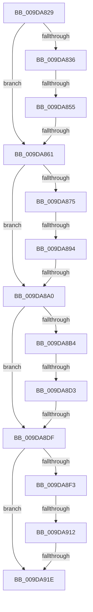

# sub_009DA829

- RVA: `0x009DA829`–`0x009DA93A` (길이 `273` bytes)
- VA: `0x00000001409DA829`
- 실행 섹션: `PAGE`
- PDB 이름 있음: `아니요`; PDB Function 태그: `아니요`
- unwind 정보 RVA: `0x000A32EC`
- 디코드: `71`개 명령, `273/273` bytes 표시
- 미해석 바이트: `0` (있으면 어셈블리에 `.byte`로 보존)

> 이 문서는 커널 이미지의 기계어와 PDB 기호를 분석해 생성했습니다. 4번과 5번은 함수 원형과 자료형을 바이너리 사용 방식에서 추정한 C 해석이며 원본 소스 복구 결과는 아닙니다.

## 1. Dependencies

- 직접 호출 지점: **2**; 고유 호출 대상: **2**
- 직접 호출자로 확인된 함수: **0**
- RIP 상대 이미지 참조: **3**

### Outgoing calls
- `0x009DA921` → [PspRemoveQuotaBlock](PspRemoveQuotaBlock_function_009DAA00.md) (function, `0x009DAA00`)
- `0x009DA92B` → [ExFreePoolWithTag](../../poolcode/B8/ExFreePoolWithTag_function_00B82870.md) (function, `0x00B82870`)

### Direct callers
- 이 함수 시작 RVA로 연결되는 직접 call은 확인되지 않았습니다. 간접 호출은 완전히 역산할 수 없습니다.

### Static image references
- `0x009DA861` → RVA `0x00FC7358` (`ALMOSTRO`; read)
- `0x009DA8A0` → RVA `0x00FC7360` (`ALMOSTRO`; read)
- `0x009DA8DF` → RVA `0x00FC7368` (`ALMOSTRO`; read)

## 2. Other-region calls and transfers

- 다른 실행 섹션으로 향하는 call: **1**
  - `0x009DA92B` → [ExFreePoolWithTag](../../poolcode/B8/ExFreePoolWithTag_function_00B82870.md) (`PAGE` → `POOLCODE`)
- call이 아닌 외부 분기/꼬리 이동: **9**
  - `0x009DA84F` → [sub_009DA93A](Unknown_function_009DA93A.md) (`tail-transfer`)
  - `0x009DA85B` → [sub_009DA93A + 0x1F](Unknown_function_009DA93A.md) (`tail-transfer`)
  - `0x009DA88E` → [sub_009DA93A + 0x2E](Unknown_function_009DA93A.md) (`tail-transfer`)
  - `0x009DA89A` → [sub_009DA93A + 0x4D](Unknown_function_009DA93A.md) (`tail-transfer`)
  - `0x009DA8CD` → [sub_009DA93A + 0x5F](Unknown_function_009DA93A.md) (`tail-transfer`)
  - `0x009DA8D9` → [sub_009DA93A + 0x7E](Unknown_function_009DA93A.md) (`tail-transfer`)
  - `0x009DA90C` → [sub_009DA93A + 0x90](Unknown_function_009DA93A.md) (`tail-transfer`)
  - `0x009DA918` → [sub_009DA93A + 0xAC](Unknown_function_009DA93A.md) (`tail-transfer`)
  - `0x009DA935` → [PspDereferenceQuotaBlock + 0x1B](PspDereferenceQuotaBlock_function_009DA800.md) (`tail-transfer`)

## 3. Assembly (complete function range)

```asm
009DA829  48 89 7C 24 30                  mov qword ptr [rsp + 0x30], rdi
009DA82E  24 03                           and al, 3
009DA830  33 FF                           xor edi, edi
009DA832  3C 01                           cmp al, 1
009DA834  75 2B                           jne 0x1409da861
009DA836  48 8B 51 50                     mov rdx, qword ptr [rcx + 0x50]
009DA83A  44 8B CF                        mov r9d, edi
009DA83D  4C 8B 41 40                     mov r8, qword ptr [rcx + 0x40]
009DA841  48 85 D2                        test rdx, rdx
009DA844  48 8B 49 48                     mov rcx, qword ptr [rcx + 0x48]
009DA848  41 0F 95 C1                     setne r9b
009DA84C  49 03 C8                        add rcx, r8
009DA84F  0F 85 E5 00 00 00               jne 0x1409da93a
009DA855  44 8B C7                        mov r8d, edi
009DA858  48 85 D2                        test rdx, rdx
009DA85B  0F 85 F8 00 00 00               jne 0x1409da959
009DA861  0F B6 05 F0 CA 5E 00            movzx eax, byte ptr [rip + 0x5ecaf0]
009DA868  48 8D 93 80 00 00 00            lea rdx, [rbx + 0x80]
009DA86F  24 03                           and al, 3
009DA871  3C 01                           cmp al, 1
009DA873  75 2B                           jne 0x1409da8a0
009DA875  4C 8B 4A 50                     mov r9, qword ptr [rdx + 0x50]
009DA879  44 8B D7                        mov r10d, edi
009DA87C  4C 8B 42 40                     mov r8, qword ptr [rdx + 0x40]
009DA880  4D 85 C9                        test r9, r9
009DA883  48 8B 4A 48                     mov rcx, qword ptr [rdx + 0x48]
009DA887  41 0F 95 C2                     setne r10b
009DA88B  49 03 C8                        add rcx, r8
009DA88E  0F 85 D4 00 00 00               jne 0x1409da968
009DA894  4C 8B C7                        mov r8, rdi
009DA897  4D 85 C9                        test r9, r9
009DA89A  0F 85 E7 00 00 00               jne 0x1409da987
009DA8A0  0F B6 05 B9 CA 5E 00            movzx eax, byte ptr [rip + 0x5ecab9]
009DA8A7  48 8D 93 00 01 00 00            lea rdx, [rbx + 0x100]
009DA8AE  24 03                           and al, 3
009DA8B0  3C 01                           cmp al, 1
009DA8B2  75 2B                           jne 0x1409da8df
009DA8B4  4C 8B 4A 50                     mov r9, qword ptr [rdx + 0x50]
009DA8B8  44 8B D7                        mov r10d, edi
009DA8BB  4C 8B 42 40                     mov r8, qword ptr [rdx + 0x40]
009DA8BF  4D 85 C9                        test r9, r9
009DA8C2  48 8B 4A 48                     mov rcx, qword ptr [rdx + 0x48]
009DA8C6  41 0F 95 C2                     setne r10b
009DA8CA  49 03 C8                        add rcx, r8
009DA8CD  0F 85 C6 00 00 00               jne 0x1409da999
009DA8D3  4C 8B C7                        mov r8, rdi
009DA8D6  4D 85 C9                        test r9, r9
009DA8D9  0F 85 D9 00 00 00               jne 0x1409da9b8
009DA8DF  0F B6 05 82 CA 5E 00            movzx eax, byte ptr [rip + 0x5eca82]
009DA8E6  48 8D 93 80 01 00 00            lea rdx, [rbx + 0x180]
009DA8ED  24 03                           and al, 3
009DA8EF  3C 01                           cmp al, 1
009DA8F1  75 2B                           jne 0x1409da91e
009DA8F3  4C 8B 4A 50                     mov r9, qword ptr [rdx + 0x50]
009DA8F7  44 8B D7                        mov r10d, edi
009DA8FA  4C 8B 42 40                     mov r8, qword ptr [rdx + 0x40]
009DA8FE  4D 85 C9                        test r9, r9
009DA901  48 8B 4A 48                     mov rcx, qword ptr [rdx + 0x48]
009DA905  41 0F 95 C2                     setne r10b
009DA909  49 03 C8                        add rcx, r8
009DA90C  0F 85 B8 00 00 00               jne 0x1409da9ca
009DA912  4C 8B C7                        mov r8, rdi
009DA915  4D 85 C9                        test r9, r9
009DA918  0F 85 C8 00 00 00               jne 0x1409da9e6
009DA91E  48 8B CB                        mov rcx, rbx
009DA921  E8 DA 00 00 00                  call 0x1409daa00
009DA926  33 D2                           xor edx, edx
009DA928  48 8B CB                        mov rcx, rbx
009DA92B  E8 40 7F 1A 00                  call 0x140b82870
009DA930  48 8B 7C 24 30                  mov rdi, qword ptr [rsp + 0x30]
009DA935  E9 E1 FE FF FF                  jmp 0x1409da81b
```

## 4. C-style interpretation (structured pseudocode)

```c
__int64 __fastcall sub_009DA829(__int64 a1, __int64 a2, __int64 a3, __int64 a4, __int64 a5, __int64 a6)
{
    __int64 result;
    __int64 v_r10;
    __int64 v_rdi;
    unsigned __int64 v_stack_p30;

    v_stack_p30 = v_rdi;
    result = (unsigned __int8)((result) & (3));
    v_rdi = 0;
    if (((unsigned __int8)(result)) != 1) goto loc_009DA861;
    a4 = (*(unsigned __int64 *)(a1 + 80) != 0) ? 1 : 0;
    a1 = (*(unsigned __int64 *)(a1 + 72)) + (*(unsigned __int64 *)(a1 + 64));
loc_009DA861:
    result = (unsigned __int8)((*(unsigned __int8 *)(v_rip + 6212336)) & (3));
    if (((unsigned __int8)(result)) != 1) goto loc_009DA8A0;
    v_r10 = (*(unsigned __int64 *)(v_rbx + 128 + 80) != 0) ? 1 : 0;
    a1 = (*(unsigned __int64 *)(v_rbx + 128 + 72)) + (*(unsigned __int64 *)(v_rbx + 128 + 64));
loc_009DA8A0:
    result = (unsigned __int8)((*(unsigned __int8 *)(v_rip + 6212281)) & (3));
    if (((unsigned __int8)(result)) != 1) goto loc_009DA8DF;
    v_r10 = (*(unsigned __int64 *)(v_rbx + 256 + 80) != 0) ? 1 : 0;
    a1 = (*(unsigned __int64 *)(v_rbx + 256 + 72)) + (*(unsigned __int64 *)(v_rbx + 256 + 64));
loc_009DA8DF:
    result = (unsigned __int8)((*(unsigned __int8 *)(v_rip + 6212226)) & (3));
    if (((unsigned __int8)(result)) != 1) goto loc_009DA91E;
    v_r10 = (*(unsigned __int64 *)(v_rbx + 384 + 80) != 0) ? 1 : 0;
    a1 = (*(unsigned __int64 *)(v_rbx + 384 + 72)) + (*(unsigned __int64 *)(v_rbx + 384 + 64));
loc_009DA91E:
    result = PspRemoveQuotaBlock(v_rbx, v_rbx + 384, 0, *(unsigned __int64 *)(v_rbx + 384 + 80));
    a2 = 0;
    result = ExFreePoolWithTag(v_rbx, a2, 0, *(unsigned __int64 *)(v_rbx + 384 + 80));
}
```

## 5. (Beta) C Style

```c
int64_t sub_009DA829(void *Arg1, int64_t Arg2, int64_t Arg3, int64_t Arg4, uint64_t Arg5, int64_t Arg6)
{
    uint8_t *arg1 = (uint8_t *)Arg1;

    int64_t result;
    int64_t local_r10;
    int64_t local_rdi;
    uint64_t v_stack_p30;

    v_stack_p30 = local_rdi;
    result = (uint8_t)((result) & (3));
    local_rdi = 0;
    if (((uint8_t)(result)) != 1) goto loc_009DA861;
    Arg4 = (*(uint64_t *)(arg1 + 0x50) != 0) ? 1 : 0;
    Arg1 = (*(uint64_t *)(arg1 + 0x48)) + (*(uint64_t *)(arg1 + 0x40));
loc_009DA861:
    result = (uint8_t)((*(uint8_t *)(v_rip + 0x5ECAF0)) & (3));
    if (((uint8_t)(result)) != 1) goto loc_009DA8A0;
    local_r10 = (*(uint64_t *)(local_rbx + 0x80 + 0x50) != 0) ? 1 : 0;
    Arg1 = (*(uint64_t *)(local_rbx + 0x80 + 0x48)) + (*(uint64_t *)(local_rbx + 0x80 + 0x40));
loc_009DA8A0:
    result = (uint8_t)((*(uint8_t *)(v_rip + 0x5ECAB9)) & (3));
    if (((uint8_t)(result)) != 1) goto loc_009DA8DF;
    local_r10 = (*(uint64_t *)(local_rbx + 0x100 + 0x50) != 0) ? 1 : 0;
    Arg1 = (*(uint64_t *)(local_rbx + 0x100 + 0x48)) + (*(uint64_t *)(local_rbx + 0x100 + 0x40));
loc_009DA8DF:
    result = (uint8_t)((*(uint8_t *)(v_rip + 0x5ECA82)) & (3));
    if (((uint8_t)(result)) != 1) goto loc_009DA91E;
    local_r10 = (*(uint64_t *)(local_rbx + 0x180 + 0x50) != 0) ? 1 : 0;
    Arg1 = (*(uint64_t *)(local_rbx + 0x180 + 0x48)) + (*(uint64_t *)(local_rbx + 0x180 + 0x40));
loc_009DA91E:
    result = PspRemoveQuotaBlock(local_rbx, local_rbx + 384, 0, *(uint64_t *)(local_rbx + 0x180 + 0x50));
    Arg2 = 0;
    result = ExFreePoolWithTag(local_rbx, Arg2, 0, *(uint64_t *)(local_rbx + 0x180 + 0x50));
}
```

### 관측된 메모리 오프셋

구조체 형식이 확인되지 않은 접근은 인자 기준의 오프셋으로만 기록했습니다.

| 기준 인자 | 오프셋 표현 | 폭 (bit) | 접근 |
|---|---:|---:|---|
| `Arg1` | `+ 0x40` | `64` | `R` |
| `Arg1` | `+ 0x48` | `64` | `R` |
| `Arg1` | `+ 0x50` | `64` | `R` |

## 6. Execution-region graph

[열기: 2D/3D 그래프와 함수 탐색 컨트롤 패널](../../../control-panel.html?section=page&rva=0x009DA829&view=graph)

- 2D 그래프는 위에서 아래로 흐르고, 3D 그래프는 빈 공간을 드래그해 회전합니다. Shift+드래그는 이동, 휠은 확대·축소, 함수 노드 선택은 대상 보고서 이동입니다.

### Static fallback


