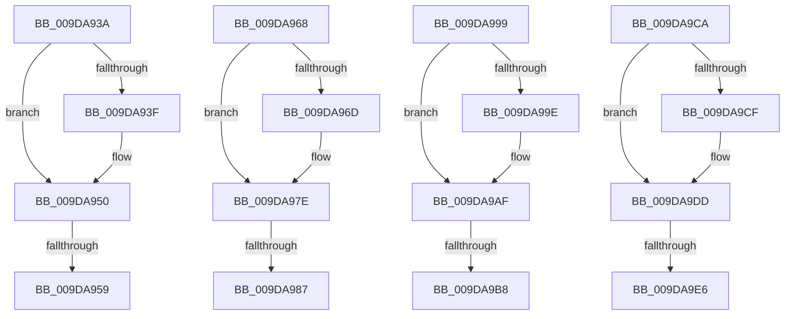

# sub_009DA93A

- RVA: `0x009DA93A`–`0x009DA9F8` (길이 `190` bytes)
- VA: `0x00000001409DA93A`
- 실행 섹션: `PAGE`
- PDB 이름 있음: `아니요`; PDB Function 태그: `아니요`
- unwind 정보 RVA: `0x000A3300`
- 디코드: `51`개 명령, `190/190` bytes 표시
- 미해석 바이트: `0` (있으면 어셈블리에 `.byte`로 보존)

> 이 문서는 커널 이미지의 기계어와 PDB 기호를 분석해 생성했습니다. 4번과 5번은 함수 원형과 자료형을 바이너리 사용 방식에서 추정한 C 해석이며 원본 소스 복구 결과는 아닙니다.

## 1. Dependencies

- 직접 호출 지점: **4**; 고유 호출 대상: **1**
- 직접 호출자로 확인된 함수: **0**
- RIP 상대 이미지 참조: **0**

### Outgoing calls
- `0x009DA95E` → [PspReturnResourceQuota](../../text/38/PspReturnResourceQuota_function_0038FFC4.md) (function, `0x0038FFC4`)
- `0x009DA98F` → [PspReturnResourceQuota](../../text/38/PspReturnResourceQuota_function_0038FFC4.md) (function, `0x0038FFC4`)
- `0x009DA9C0` → [PspReturnResourceQuota](../../text/38/PspReturnResourceQuota_function_0038FFC4.md) (function, `0x0038FFC4`)
- `0x009DA9EE` → [PspReturnResourceQuota](../../text/38/PspReturnResourceQuota_function_0038FFC4.md) (function, `0x0038FFC4`)

### Direct callers
- 이 함수 시작 RVA로 연결되는 직접 call은 확인되지 않았습니다. 간접 호출은 완전히 역산할 수 없습니다.

### Static image references
- 디코드된 RIP-relative 메모리 참조가 없습니다.

## 2. Other-region calls and transfers

- 다른 실행 섹션으로 향하는 call: **4**
  - `0x009DA95E` → [PspReturnResourceQuota](../../text/38/PspReturnResourceQuota_function_0038FFC4.md) (`PAGE` → `.text`)
  - `0x009DA98F` → [PspReturnResourceQuota](../../text/38/PspReturnResourceQuota_function_0038FFC4.md) (`PAGE` → `.text`)
  - `0x009DA9C0` → [PspReturnResourceQuota](../../text/38/PspReturnResourceQuota_function_0038FFC4.md) (`PAGE` → `.text`)
  - `0x009DA9EE` → [PspReturnResourceQuota](../../text/38/PspReturnResourceQuota_function_0038FFC4.md) (`PAGE` → `.text`)
- call이 아닌 외부 분기/꼬리 이동: **8**
  - `0x009DA953` → [sub_009DA829 + 0x2F](Unknown_function_009DA829.md) (`tail-transfer`)
  - `0x009DA963` → [sub_009DA829 + 0x38](Unknown_function_009DA829.md) (`tail-transfer`)
  - `0x009DA981` → [sub_009DA829 + 0x6E](Unknown_function_009DA829.md) (`tail-transfer`)
  - `0x009DA994` → [sub_009DA829 + 0x77](Unknown_function_009DA829.md) (`tail-transfer`)
  - `0x009DA9B2` → [sub_009DA829 + 0xAD](Unknown_function_009DA829.md) (`tail-transfer`)
  - `0x009DA9C5` → [sub_009DA829 + 0xB6](Unknown_function_009DA829.md) (`tail-transfer`)
  - `0x009DA9E0` → [sub_009DA829 + 0xEC](Unknown_function_009DA829.md) (`tail-transfer`)
  - `0x009DA9F3` → [sub_009DA829 + 0xF5](Unknown_function_009DA829.md) (`tail-transfer`)

## 3. Assembly (complete function range)

```asm
009DA93A  48 85 D2                        test rdx, rdx
009DA93D  74 11                           je 0x1409da950
009DA93F  4C 8B C7                        mov r8, rdi
009DA942  48 8B C7                        mov rax, rdi
009DA945  4C 87 43 48                     xchg qword ptr [rbx + 0x48], r8
009DA949  48 87 43 40                     xchg qword ptr [rbx + 0x40], rax
009DA94D  4C 03 C0                        add r8, rax
009DA950  4D 85 C0                        test r8, r8
009DA953  0F 84 FF FE FF FF               je 0x1409da858
009DA959  48 8B D3                        mov rdx, rbx
009DA95C  33 C9                           xor ecx, ecx
009DA95E  E8 61 56 9B FF                  call 0x14038ffc4
009DA963  E9 F9 FE FF FF                  jmp 0x1409da861
009DA968  4D 85 C9                        test r9, r9
009DA96B  74 11                           je 0x1409da97e
009DA96D  4C 8B C7                        mov r8, rdi
009DA970  48 8B C7                        mov rax, rdi
009DA973  4C 87 42 48                     xchg qword ptr [rdx + 0x48], r8
009DA977  48 87 42 40                     xchg qword ptr [rdx + 0x40], rax
009DA97B  4C 03 C0                        add r8, rax
009DA97E  4D 85 C0                        test r8, r8
009DA981  0F 84 10 FF FF FF               je 0x1409da897
009DA987  45 8B CA                        mov r9d, r10d
009DA98A  B9 01 00 00 00                  mov ecx, 1
009DA98F  E8 30 56 9B FF                  call 0x14038ffc4
009DA994  E9 07 FF FF FF                  jmp 0x1409da8a0
009DA999  4D 85 C9                        test r9, r9
009DA99C  74 11                           je 0x1409da9af
009DA99E  4C 8B C7                        mov r8, rdi
009DA9A1  48 8B C7                        mov rax, rdi
009DA9A4  4C 87 42 48                     xchg qword ptr [rdx + 0x48], r8
009DA9A8  48 87 42 40                     xchg qword ptr [rdx + 0x40], rax
009DA9AC  4C 03 C0                        add r8, rax
009DA9AF  4D 85 C0                        test r8, r8
009DA9B2  0F 84 1E FF FF FF               je 0x1409da8d6
009DA9B8  45 8B CA                        mov r9d, r10d
009DA9BB  B9 02 00 00 00                  mov ecx, 2
009DA9C0  E8 FF 55 9B FF                  call 0x14038ffc4
009DA9C5  E9 15 FF FF FF                  jmp 0x1409da8df
009DA9CA  4D 85 C9                        test r9, r9
009DA9CD  74 0E                           je 0x1409da9dd
009DA9CF  4C 8B C7                        mov r8, rdi
009DA9D2  4C 87 42 48                     xchg qword ptr [rdx + 0x48], r8
009DA9D6  48 87 7A 40                     xchg qword ptr [rdx + 0x40], rdi
009DA9DA  4C 03 C7                        add r8, rdi
009DA9DD  4D 85 C0                        test r8, r8
009DA9E0  0F 84 2F FF FF FF               je 0x1409da915
009DA9E6  45 8B CA                        mov r9d, r10d
009DA9E9  B9 03 00 00 00                  mov ecx, 3
009DA9EE  E8 D1 55 9B FF                  call 0x14038ffc4
009DA9F3  E9 26 FF FF FF                  jmp 0x1409da91e
```

## 4. C-style interpretation (structured pseudocode)

```c
__int64 __fastcall sub_009DA93A(int a1, __int64 a2, __int64 a3, __int64 a4)
{
    __int64 result;

    if (a2 != 0) {
        a3 = v_rdi;
        result = v_rdi;
        a3 = (a3) + (result);
    }
    a1 = 0;
    result = PspReturnResourceQuota(a1, v_rbx, a3, a4);
}
```

## 5. (Beta) C Style

```c
int64_t sub_009DA93A(int32_t Arg1, int64_t Arg2, int64_t Arg3, int64_t Arg4)
{
    int64_t result;

    if (Arg2 != 0) {
        Arg3 = local_rdi;
        result = local_rdi;
        Arg3 = (Arg3) + (result);
    }
    Arg1 = 0;
    result = PspReturnResourceQuota(Arg1, local_rbx, Arg3, Arg4);
}
```

## 6. Execution-region graph

[열기: 2D/3D 그래프와 함수 탐색 컨트롤 패널](../../../control-panel.html?section=page&rva=0x009DA93A&view=graph)

- 2D 그래프는 위에서 아래로 흐르고, 3D 그래프는 빈 공간을 드래그해 회전합니다. Shift+드래그는 이동, 휠은 확대·축소, 함수 노드 선택은 대상 보고서 이동입니다.

### Static fallback


