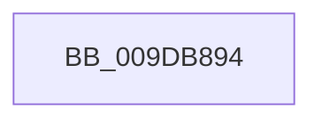

# sub_009DB894

- RVA: `0x009DB894`–`0x009DB8C9` (길이 `53` bytes)
- VA: `0x00000001409DB894`
- 실행 섹션: `PAGE`
- PDB 이름 있음: `아니요`; PDB Function 태그: `아니요`
- unwind 정보 RVA: `0x000A3598`
- 디코드: `12`개 명령, `53/53` bytes 표시
- 미해석 바이트: `0` (있으면 어셈블리에 `.byte`로 보존)

> 이 문서는 커널 이미지의 기계어와 PDB 기호를 분석해 생성했습니다. 4번과 5번은 함수 원형과 자료형을 바이너리 사용 방식에서 추정한 C 해석이며 원본 소스 복구 결과는 아닙니다.

## 1. Dependencies

- 직접 호출 지점: **2**; 고유 호출 대상: **1**
- 직접 호출자로 확인된 함수: **0**
- RIP 상대 이미지 참조: **0**

### Outgoing calls
- `0x009DB8AA` → [ObpPushStackInfo](../../text/21/ObpPushStackInfo_function_002109E4.md) (function, `0x002109E4`)
- `0x009DB8BF` → [ObpPushStackInfo](../../text/21/ObpPushStackInfo_function_002109E4.md) (function, `0x002109E4`)

### Direct callers
- 이 함수 시작 RVA로 연결되는 직접 call은 확인되지 않았습니다. 간접 호출은 완전히 역산할 수 없습니다.

### Static image references
- 디코드된 RIP-relative 메모리 참조가 없습니다.

## 2. Other-region calls and transfers

- 다른 실행 섹션으로 향하는 call: **2**
  - `0x009DB8AA` → [ObpPushStackInfo](../../text/21/ObpPushStackInfo_function_002109E4.md) (`PAGE` → `.text`)
  - `0x009DB8BF` → [ObpPushStackInfo](../../text/21/ObpPushStackInfo_function_002109E4.md) (`PAGE` → `.text`)
- 별도 외부 분기/꼬리 이동을 확인하지 못했습니다.

## 3. Assembly (complete function range)

```asm
009DB894  48 89 5C 24 30                  mov qword ptr [rsp + 0x30], rbx
009DB899  48 8D 59 D0                     lea rbx, [rcx - 0x30]
009DB89D  41 B9 44 66 6C 74               mov r9d, 0x746c6644
009DB8A3  48 8B CB                        mov rcx, rbx
009DB8A6  44 8D 42 01                     lea r8d, [rdx + 1]
009DB8AA  E8 35 51 83 FF                  call 0x1402109e4
009DB8AF  41 B8 01 00 00 00               mov r8d, 1
009DB8B5  44 8B CF                        mov r9d, edi
009DB8B8  41 0F B6 D0                     movzx edx, r8b
009DB8BC  48 8B CB                        mov rcx, rbx
009DB8BF  E8 20 51 83 FF                  call 0x1402109e4
009DB8C4  48 8B 5C 24 30                  mov rbx, qword ptr [rsp + 0x30]
```

## 4. C-style interpretation (structured pseudocode)

```c
__int64 __fastcall sub_009DB894(__int64 a1, __int64 a2, __int64 a3, __int64 a4, __int64 a5, __int64 a6)
{
    __int64 result;
    unsigned __int64 v_stack_p30;

    v_stack_p30 = v_rbx;
    result = ObpPushStackInfo(a1 - 48, a2, a2 + 1, (unsigned int)(0x746C6644ULL));
    result = ObpPushStackInfo(a1 - 48, 1, 1, (unsigned int)((unsigned int)(v_rdi)));
    return result;
}
```

## 5. (Beta) C Style

```c
int64_t sub_009DB894(void *Arg1, void *Arg2, int64_t Arg3, int64_t Arg4, uint64_t Arg5, int64_t Arg6)
{
    uint8_t *arg1 = (uint8_t *)Arg1;
    uint8_t *arg2 = (uint8_t *)Arg2;

    int64_t result;
    uint64_t v_stack_p30;

    v_stack_p30 = local_rbx;
    result = ObpPushStackInfo(Arg1 - 48, Arg2, Arg2 + 1, (uint32_t)(0x746C6644ULL));
    result = ObpPushStackInfo(Arg1 - 48, 1, 1, (uint32_t)((uint32_t)(local_rdi)));
    return result;
}
```

### 관측된 메모리 오프셋

구조체 형식이 확인되지 않은 접근은 인자 기준의 오프셋으로만 기록했습니다.

| 기준 인자 | 오프셋 표현 | 폭 (bit) | 접근 |
|---|---:|---:|---|
| `Arg1` | `- 0x30` | `64` | `R` |
| `Arg2` | `+ 0x1` | `32` | `R` |

## 6. Execution-region graph

[열기: 2D/3D 그래프와 함수 탐색 컨트롤 패널](../../../control-panel.html?section=page&rva=0x009DB894&view=graph)

- 2D 그래프는 위에서 아래로 흐르고, 3D 그래프는 빈 공간을 드래그해 회전합니다. Shift+드래그는 이동, 휠은 확대·축소, 함수 노드 선택은 대상 보고서 이동입니다.

### Static fallback


