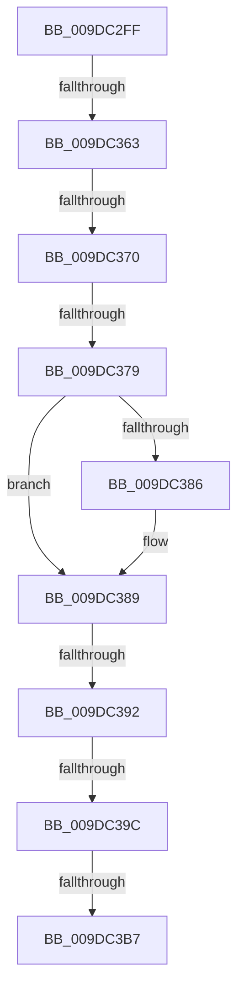

# sub_009DC2FF

- RVA: `0x009DC2FF`–`0x009DC3C2` (길이 `195` bytes)
- VA: `0x00000001409DC2FF`
- 실행 섹션: `PAGE`
- PDB 이름 있음: `아니요`; PDB Function 태그: `아니요`
- unwind 정보 RVA: `0x000A3684`
- 디코드: `50`개 명령, `195/195` bytes 표시
- 미해석 바이트: `0` (있으면 어셈블리에 `.byte`로 보존)

> 이 문서는 커널 이미지의 기계어와 PDB 기호를 분석해 생성했습니다. 4번과 5번은 함수 원형과 자료형을 바이너리 사용 방식에서 추정한 C 해석이며 원본 소스 복구 결과는 아닙니다.

## 1. Dependencies

- 직접 호출 지점: **3**; 고유 호출 대상: **3**
- 직접 호출자로 확인된 함수: **0**
- RIP 상대 이미지 참조: **0**

### Outgoing calls
- `0x009DC341` → [CmpInitializeThreadInfo](../../text/3F/CmpInitializeThreadInfo_function_003FBE70.md) (function, `0x003FBE70`)
- `0x009DC3A0` → [CmpAttachToRegistryProcess](../../pagecmrc/BC/CmpAttachToRegistryProcess_function_00BC98E0.md) (function, `0x00BC98E0`)
- `0x009DC3A5` → [CmpLockRegistry](../../pagecmrc/BC/CmpLockRegistry_function_00BC9B34.md) (function, `0x00BC9B34`)

### Direct callers
- 이 함수 시작 RVA로 연결되는 직접 call은 확인되지 않았습니다. 간접 호출은 완전히 역산할 수 없습니다.

### Static image references
- 디코드된 RIP-relative 메모리 참조가 없습니다.

## 2. Other-region calls and transfers

- 다른 실행 섹션으로 향하는 call: **3**
  - `0x009DC341` → [CmpInitializeThreadInfo](../../text/3F/CmpInitializeThreadInfo_function_003FBE70.md) (`PAGE` → `.text`)
  - `0x009DC3A0` → [CmpAttachToRegistryProcess](../../pagecmrc/BC/CmpAttachToRegistryProcess_function_00BC98E0.md) (`PAGE` → `PAGECMRC`)
  - `0x009DC3A5` → [CmpLockRegistry](../../pagecmrc/BC/CmpLockRegistry_function_00BC9B34.md) (`PAGE` → `PAGECMRC`)
- call이 아닌 외부 분기/꼬리 이동: **7**
  - `0x009DC35D` → [sub_009DC531](Unknown_function_009DC531.md) (`tail-transfer`)
  - `0x009DC36A` → [sub_009DC531](Unknown_function_009DC531.md) (`tail-transfer`)
  - `0x009DC373` → [sub_009DC531](Unknown_function_009DC531.md) (`tail-transfer`)
  - `0x009DC38C` → [sub_009DC5D4 + 0x2D](Unknown_function_009DC5D4.md) (`tail-transfer`)
  - `0x009DC396` → [sub_009DC531](Unknown_function_009DC531.md) (`tail-transfer`)
  - `0x009DC3B5` → [sub_009DC3C2](Unknown_function_009DC3C2.md) (`tail-transfer`)
  - `0x009DC3BC` → [sub_009DC5D4](Unknown_function_009DC5D4.md) (`tail-transfer`)

## 3. Assembly (complete function range)

```asm
009DC2FF  49 89 5B 08                     mov qword ptr [r11 + 8], rbx
009DC303  0F 57 C0                        xorps xmm0, xmm0
009DC306  49 89 7B E0                     mov qword ptr [r11 - 0x20], rdi
009DC30A  33 C0                           xor eax, eax
009DC30C  4D 89 63 D8                     mov qword ptr [r11 - 0x28], r12
009DC310  33 DB                           xor ebx, ebx
009DC312  4D 89 6B D0                     mov qword ptr [r11 - 0x30], r13
009DC316  4D 8B E1                        mov r12, r9
009DC319  4D 89 7B C8                     mov qword ptr [r11 - 0x38], r15
009DC31D  4D 8B D0                        mov r10, r8
009DC320  4C 8B D9                        mov r11, rcx
009DC323  48 89 45 DF                     mov qword ptr [rbp - 0x21], rax
009DC327  48 8D 4D CF                     lea rcx, [rbp - 0x31]
009DC32B  4C 8B FA                        mov r15, rdx
009DC32E  0F 11 45 CF                     movups xmmword ptr [rbp - 0x31], xmm0
009DC332  44 8B EB                        mov r13d, ebx
009DC335  0F 11 45 E7                     movups xmmword ptr [rbp - 0x19], xmm0
009DC339  0F 11 45 F7                     movups xmmword ptr [rbp - 9], xmm0
009DC33D  0F 11 45 07                     movups xmmword ptr [rbp + 7], xmm0
009DC341  E8 2A FB A1 FF                  call 0x1403fbe70
009DC346  0F 57 D2                        xorps xmm2, xmm2
009DC349  B8 FF FF FF FF                  mov eax, 0xffffffff
009DC34E  0F 11 55 AF                     movups xmmword ptr [rbp - 0x51], xmm2
009DC352  66 89 45 B1                     mov word ptr [rbp - 0x4f], ax
009DC356  0F 11 55 BF                     movups xmmword ptr [rbp - 0x41], xmm2
009DC35A  4D 85 FF                        test r15, r15
009DC35D  0F 84 CE 01 00 00               je 0x1409dc531
009DC363  41 81 3F 32 30 79 6B            cmp dword ptr [r15], 0x6b793032
009DC36A  0F 85 C1 01 00 00               jne 0x1409dc531
009DC370  4D 85 DB                        test r11, r11
009DC373  0F 84 B8 01 00 00               je 0x1409dc531
009DC379  4D 8B 7F 08                     mov r15, qword ptr [r15 + 8]
009DC37D  4C 89 7D A7                     mov qword ptr [rbp - 0x59], r15
009DC381  4D 85 D2                        test r10, r10
009DC384  74 03                           je 0x1409dc389
009DC386  4D 89 3A                        mov qword ptr [r10], r15
009DC389  4D 85 E4                        test r12, r12
009DC38C  0F 84 6F 02 00 00               je 0x1409dc601
009DC392  41 F6 C7 01                     test r15b, 1
009DC396  0F 85 95 01 00 00               jne 0x1409dc531
009DC39C  48 8D 4D E7                     lea rcx, [rbp - 0x19]
009DC3A0  E8 3B D5 1E 00                  call 0x140bc98e0
009DC3A5  E8 8A D7 1E 00                  call 0x140bc9b34
009DC3AA  41 0F BF 7F 42                  movsx edi, word ptr [r15 + 0x42]
009DC3AF  48 8B CB                        mov rcx, rbx
009DC3B2  83 FF 02                        cmp edi, 2
009DC3B5  7C 0B                           jl 0x1409dc3c2
009DC3B7  8B C7                           mov eax, edi
009DC3B9  83 E8 01                        sub eax, 1
009DC3BC  0F 85 12 02 00 00               jne 0x1409dc5d4
```

## 4. C-style interpretation (structured pseudocode)

```c
__int64 __fastcall sub_009DC2FF(__int64 a1, __int64 a2, __int64 a3, __int64 a4)
{
    __int64 result;
    __int64 v_rbx;

    *(unsigned __int64 *)(v_r11 + 8) = v_rbx;
    *(unsigned __int64 *)(v_r11 - 32) = v_rdi;
    result = 0;
    *(unsigned __int64 *)(v_r11 - 40) = v_r12;
    v_rbx = 0;
    *(unsigned __int64 *)(v_r11 - 48) = v_r13;
    *(unsigned __int64 *)(v_r11 - 56) = v_r15;
    *(unsigned __int64 *)(v_rbp - 33) = 0;
    *(unsigned __int64 *)(v_rbp - 49) = v_xmm0;
    *(unsigned __int64 *)(v_rbp - 25) = v_xmm0;
    *(unsigned __int64 *)(v_rbp - 9) = v_xmm0;
    *(unsigned __int64 *)(v_rbp + 7) = v_xmm0;
    result = CmpInitializeThreadInfo(v_rbp - 49, a2, a3, a4);
    *(unsigned __int64 *)(v_rbp - 81) = v_xmm2;
    *(unsigned __int16 *)(v_rbp - 79) = (unsigned __int16)((unsigned int)(0xFFFFFFFFULL));
    *(unsigned __int64 *)(v_rbp - 65) = v_xmm2;
    *(unsigned __int64 *)(v_rbp - 89) = *(unsigned __int64 *)(a2 + 8);
    if (a3 != 0) {
        *(unsigned __int64 *)(a3) = *(unsigned __int64 *)(a2 + 8);
    }
    result = CmpAttachToRegistryProcess(v_rbp - 25, a2, a3, a4);
    result = CmpLockRegistry(v_rbp - 25, a2, a3, a4);
    result = (unsigned int)(((unsigned int)((unsigned int)((__int16)(*(unsigned __int16 *)(*(unsigned __int64 *)(a2 + 8) + 66))))) - (1));
}
```

## 5. (Beta) C Style

```c
int64_t sub_009DC2FF(int64_t Arg1, int64_t Arg2, int64_t Arg3, int64_t Arg4)
{
    int64_t result;
    int64_t local_rbx;

    *(uint64_t *)(local_r11 + 0x8) = local_rbx;
    *(uint64_t *)(local_r11 - 0x20) = local_rdi;
    result = 0;
    *(uint64_t *)(local_r11 - 0x28) = local_r12;
    local_rbx = 0;
    *(uint64_t *)(local_r11 - 0x30) = local_r13;
    *(uint64_t *)(local_r11 - 0x38) = local_r15;
    *(uint64_t *)(local_rbp - 0x21) = 0;
    *(uint64_t *)(local_rbp - 0x31) = v_xmm0;
    *(uint64_t *)(local_rbp - 0x19) = v_xmm0;
    *(uint64_t *)(local_rbp - 0x9) = v_xmm0;
    *(uint64_t *)(local_rbp + 0x7) = v_xmm0;
    result = CmpInitializeThreadInfo(local_rbp - 49, Arg2, Arg3, Arg4);
    *(uint64_t *)(local_rbp - 0x51) = v_xmm2;
    *(uint16_t *)(local_rbp - 0x4F) = (uint16_t)((uint32_t)(0xFFFFFFFFULL));
    *(uint64_t *)(local_rbp - 0x41) = v_xmm2;
    *(uint64_t *)(local_rbp - 0x59) = *(uint64_t *)(Arg2 + 0x8);
    if (Arg3 != 0) {
        *(uint64_t *)(Arg3) = *(uint64_t *)(Arg2 + 0x8);
    }
    result = CmpAttachToRegistryProcess(local_rbp - 25, Arg2, Arg3, Arg4);
    result = CmpLockRegistry(local_rbp - 25, Arg2, Arg3, Arg4);
    result = (uint32_t)(((uint32_t)((uint32_t)((int16_t)(*(uint16_t *)(*(uint64_t *)(Arg2 + 0x8) + 0x42))))) - (1));
}
```

## 6. Execution-region graph

[열기: 2D/3D 그래프와 함수 탐색 컨트롤 패널](../../../control-panel.html?section=page&rva=0x009DC2FF&view=graph)

- 2D 그래프는 위에서 아래로 흐르고, 3D 그래프는 빈 공간을 드래그해 회전합니다. Shift+드래그는 이동, 휠은 확대·축소, 함수 노드 선택은 대상 보고서 이동입니다.

### Static fallback


