# sub_009DC3C2

- RVA: `0x009DC3C2`–`0x009DC4C9` (길이 `263` bytes)
- VA: `0x00000001409DC3C2`
- 실행 섹션: `PAGE`
- PDB 이름 있음: `아니요`; PDB Function 태그: `아니요`
- unwind 정보 RVA: `0x000A36A8`
- 디코드: `65`개 명령, `263/263` bytes 표시
- 미해석 바이트: `0` (있으면 어셈블리에 `.byte`로 보존)

> 이 문서는 커널 이미지의 기계어와 PDB 기호를 분석해 생성했습니다. 4번과 5번은 함수 원형과 자료형을 바이너리 사용 방식에서 추정한 C 해석이며 원본 소스 복구 결과는 아닙니다.

## 1. Dependencies

- 직접 호출 지점: **2**; 고유 호출 대상: **2**
- 직접 호출자로 확인된 함수: **0**
- RIP 상대 이미지 참조: **0**

### Outgoing calls
- `0x009DC420` → [CmpLockKcbShared](../../pagecmrc/BC/CmpLockKcbShared_function_00BC9A1C.md) (function, `0x00BC9A1C`)
- `0x009DC4B0` → [CmpUnlockKcb](../../pagecmrc/BC/CmpUnlockKcb_function_00BC92C0.md) (function, `0x00BC92C0`)

### Direct callers
- 이 함수 시작 RVA로 연결되는 직접 call은 확인되지 않았습니다. 간접 호출은 완전히 역산할 수 없습니다.

### Static image references
- 디코드된 RIP-relative 메모리 참조가 없습니다.

## 2. Other-region calls and transfers

- 다른 실행 섹션으로 향하는 call: **2**
  - `0x009DC420` → [CmpLockKcbShared](../../pagecmrc/BC/CmpLockKcbShared_function_00BC9A1C.md) (`PAGE` → `PAGECMRC`)
  - `0x009DC4B0` → [CmpUnlockKcb](../../pagecmrc/BC/CmpUnlockKcb_function_00BC92C0.md) (`PAGE` → `PAGECMRC`)
- call이 아닌 외부 분기/꼬리 이동: **7**
  - `0x009DC3DE` → [sub_009DC539 + 0x66](Unknown_function_009DC539.md) (`tail-transfer`)
  - `0x009DC414` → [sub_009DC539 + 0x52](Unknown_function_009DC539.md) (`tail-transfer`)
  - `0x009DC439` → [sub_009DC539 + 0x5B](Unknown_function_009DC539.md) (`tail-transfer`)
  - `0x009DC455` → [sub_009DC539](Unknown_function_009DC539.md) (`tail-transfer`)
  - `0x009DC467` → [sub_009DC609](Unknown_function_009DC609.md) (`tail-transfer`)
  - `0x009DC473` → [sub_009DC609 + 0x1A](Unknown_function_009DC609.md) (`tail-transfer`)
  - `0x009DC4A4` → [sub_009DC539 + 0x49](Unknown_function_009DC539.md) (`tail-transfer`)

## 3. Assembly (complete function range)

```asm
009DC3C2  48 89 B4 24 C0 00 00 00         mov qword ptr [rsp + 0xc0], rsi
009DC3CA  49 0F BF 77 42                  movsx rsi, word ptr [r15 + 0x42]
009DC3CF  66 89 7D AF                     mov word ptr [rbp - 0x51], di
009DC3D3  48 89 4D C7                     mov qword ptr [rbp - 0x39], rcx
009DC3D7  66 89 75 B1                     mov word ptr [rbp - 0x4f], si
009DC3DB  66 85 F6                        test si, si
009DC3DE  0F 85 BB 01 00 00               jne 0x1409dc59f
009DC3E4  4C 89 7C F5 B7                  mov qword ptr [rbp + rsi*8 - 0x49], r15
009DC3E9  0F B7 75 B1                     movzx esi, word ptr [rbp - 0x4f]
009DC3ED  0F B7 FB                        movzx edi, bx
009DC3F0  66 3B DE                        cmp bx, si
009DC3F3  7F 40                           jg 0x1409dc435
009DC3F5  4C 8B 7D C7                     mov r15, qword ptr [rbp - 0x39]
009DC3F9  48 8D 4D B7                     lea rcx, [rbp - 0x49]
009DC3FD  4C 2B F9                        sub r15, rcx
009DC400  4C 8D 75 B7                     lea r14, [rbp - 0x49]
009DC404  49 83 C7 F0                     add r15, -0x10
009DC408  0F 1F 84 00 00 00 00 00         nop dword ptr [rax + rax]
009DC410  66 83 FF 02                     cmp di, 2
009DC414  0F 8D 71 01 00 00               jge 0x1409dc58b
009DC41A  49 8B CE                        mov rcx, r14
009DC41D  48 8B 09                        mov rcx, qword ptr [rcx]
009DC420  E8 F7 D5 1E 00                  call 0x140bc9a1c
009DC425  66 FF C7                        inc di
009DC428  49 83 C6 08                     add r14, 8
009DC42C  66 3B FE                        cmp di, si
009DC42F  7E DF                           jle 0x1409dc410
009DC431  4C 8B 7D A7                     mov r15, qword ptr [rbp - 0x59]
009DC435  49 39 5F 50                     cmp qword ptr [r15 + 0x50], rbx
009DC439  0F 84 55 01 00 00               je 0x1409dc594
009DC43F  49 8B 87 28 01 00 00            mov rax, qword ptr [r15 + 0x128]
009DC446  48 89 5D A7                     mov qword ptr [rbp - 0x59], rbx
009DC44A  A8 01                           test al, 1
009DC44C  74 04                           je 0x1409dc452
009DC44E  48 83 E0 FE                     and rax, 0xfffffffffffffffe
009DC452  48 85 C0                        test rax, rax
009DC455  0F 84 DE 00 00 00               je 0x1409dc539
009DC45B  4C 8B E8                        mov r13, rax
009DC45E  8B FB                           mov edi, ebx
009DC460  48 8B 4D A7                     mov rcx, qword ptr [rbp - 0x59]
009DC464  48 85 C9                        test rcx, rcx
009DC467  0F 85 9C 01 00 00               jne 0x1409dc609
009DC46D  0F B7 75 B1                     movzx esi, word ptr [rbp - 0x4f]
009DC471  85 FF                           test edi, edi
009DC473  0F 88 AA 01 00 00               js 0x1409dc623
009DC479  4D 89 2C 24                     mov qword ptr [r12], r13
009DC47D  44 8B F3                        mov r14d, ebx
009DC480  66 3B DE                        cmp bx, si
009DC483  7F 3C                           jg 0x1409dc4c1
009DC485  4C 8B 7D C7                     mov r15, qword ptr [rbp - 0x39]
009DC489  48 8D 4D B7                     lea rcx, [rbp - 0x49]
009DC48D  4C 2B F9                        sub r15, rcx
009DC490  48 8D 7D B7                     lea rdi, [rbp - 0x49]
009DC494  49 83 C7 F0                     add r15, -0x10
009DC498  0F 1F 84 00 00 00 00 00         nop dword ptr [rax + rax]
009DC4A0  66 83 FB 02                     cmp bx, 2
009DC4A4  0F 8D D8 00 00 00               jge 0x1409dc582
009DC4AA  48 8B CF                        mov rcx, rdi
009DC4AD  48 8B 09                        mov rcx, qword ptr [rcx]
009DC4B0  E8 0B CE 1E 00                  call 0x140bc92c0
009DC4B5  66 FF C3                        inc bx
009DC4B8  48 83 C7 08                     add rdi, 8
009DC4BC  66 3B DE                        cmp bx, si
009DC4BF  7E DF                           jle 0x1409dc4a0
009DC4C1  48 8B B4 24 C0 00 00 00         mov rsi, qword ptr [rsp + 0xc0]
```

## 4. C-style interpretation (structured pseudocode)

```c
__int64 __fastcall sub_009DC3C2(__int64 a1, __int64 a2, __int64 a3, __int64 a4, __int64 a5, __int64 a6, __int64 a7, __int64 a8, __int64 a9, __int64 a10, __int64 a11, __int64 a12, __int64 a13, __int64 a14, __int64 a15, __int64 a16, __int64 a17, __int64 a18, __int64 a19, __int64 a20, __int64 a21, __int64 a22, __int64 a23, __int64 a24)
{
    __int64 result;
    __int64 v_r14;
    __int64 v_r15;
    __int64 v_rbx;
    __int64 v_rdi;
    unsigned __int64 v_stack_pC0;

    v_stack_pC0 = v_rsi;
    *(unsigned __int16 *)(v_rbp - 81) = (unsigned __int16)(v_rdi);
    *(unsigned __int64 *)(v_rbp - 57) = a1;
    *(unsigned __int16 *)(v_rbp - 79) = (unsigned __int16)((__int16)(*(unsigned __int16 *)(v_r15 + 66)));
    *(unsigned __int64 *)(v_rbp + (__int16)(*(unsigned __int16 *)(v_r15 + 66)) * 8 - 73) = v_r15;
    if (((unsigned __int16)(v_rbx)) > ((unsigned __int16)(*(unsigned __int16 *)(v_rbp - 79)))) goto loc_009DC435;
    v_r15 = (*(unsigned __int64 *)(v_rbp - 57)) - (v_rbp - 73);
    v_r15 = (v_r15) + (-16);
loc_009DC410:
    result = CmpLockKcbShared(*(unsigned __int64 *)(v_rbp - 73), a2, a3, a4);
    v_rdi = (unsigned __int16)(((unsigned __int16)(v_rbx)) + 1);
    v_r14 = (v_rbp - 73) + (8);
    if (((unsigned __int16)(v_rdi)) <= ((unsigned __int16)(*(unsigned __int16 *)(v_rbp - 79)))) goto loc_009DC410;
loc_009DC435:
    *(unsigned __int64 *)(v_rbp - 89) = v_rbx;
    result = *(unsigned __int64 *)(*(unsigned __int64 *)(v_rbp - 89) + 296);
    if ((((unsigned __int8)(*(unsigned __int64 *)(*(unsigned __int64 *)(v_rbp - 89) + 296))) & (1)) != 0) {
        result = (*(unsigned __int64 *)(*(unsigned __int64 *)(v_rbp - 89) + 296)) & (-2);
    }
    *(unsigned __int64 *)(v_r12) = result;
    if (((unsigned __int16)(v_rbx)) > ((unsigned __int16)(*(unsigned __int16 *)(v_rbp - 79)))) goto loc_009DC4C1;
    v_r15 = (*(unsigned __int64 *)(v_rbp - 57)) - (v_rbp - 73);
    v_r15 = (v_r15) + (-16);
loc_009DC4A0:
    result = CmpUnlockKcb(*(unsigned __int64 *)(v_rbp - 73), a2, a3, a4);
    v_rbx = (unsigned __int16)((v_rbx) + 1);
    v_rdi = (v_rbp - 73) + (8);
    if (((unsigned __int16)(v_rbx)) <= ((unsigned __int16)(*(unsigned __int16 *)(v_rbp - 79)))) goto loc_009DC4A0;
loc_009DC4C1:
    return result;
}
```

## 5. (Beta) C Style

```c
int64_t sub_009DC3C2(int64_t Arg1, int64_t Arg2, int64_t Arg3, int64_t Arg4, uint64_t Arg5, uint64_t Arg6, uint64_t Arg7, uint64_t Arg8, uint64_t Arg9, uint64_t Arg10, uint64_t Arg11, uint64_t Arg12, uint64_t Arg13, uint64_t Arg14, uint64_t Arg15, uint64_t Arg16, uint64_t Arg17, uint64_t Arg18, uint64_t Arg19, uint64_t Arg20, uint64_t Arg21, uint64_t Arg22, uint64_t Arg23, int64_t Arg24)
{
    int64_t result;
    int64_t local_r14;
    int64_t local_r15;
    int64_t local_rbx;
    int64_t local_rdi;
    uint64_t v_stack_pC0;

    v_stack_pC0 = local_rsi;
    *(uint16_t *)(local_rbp - 0x51) = (uint16_t)(local_rdi);
    *(uint64_t *)(local_rbp - 0x39) = Arg1;
    *(uint16_t *)(local_rbp - 0x4F) = (uint16_t)((int16_t)(*(uint16_t *)(local_r15 + 0x42)));
    *(uint64_t *)(local_rbp + (int16_t)(*(uint16_t *)(local_r15 + 0x42)) * 8 - 0x49) = local_r15;
    if (((uint16_t)(local_rbx)) > ((uint16_t)(*(uint16_t *)(local_rbp - 0x4F)))) goto loc_009DC435;
    local_r15 = (*(uint64_t *)(local_rbp - 0x39)) - (local_rbp - 73);
    local_r15 = (local_r15) + (-16);
loc_009DC410:
    result = CmpLockKcbShared(*(uint64_t *)(local_rbp - 0x49), Arg2, Arg3, Arg4);
    local_rdi = (uint16_t)(((uint16_t)(local_rbx)) + 1);
    local_r14 = (local_rbp - 73) + (8);
    if (((uint16_t)(local_rdi)) <= ((uint16_t)(*(uint16_t *)(local_rbp - 0x4F)))) goto loc_009DC410;
loc_009DC435:
    *(uint64_t *)(local_rbp - 0x59) = local_rbx;
    result = *(uint64_t *)(*(uint64_t *)(local_rbp - 0x59) + 0x128);
    if ((((uint8_t)(*(uint64_t *)(*(uint64_t *)(local_rbp - 0x59) + 0x128))) & (1)) != 0) {
        result = (*(uint64_t *)(*(uint64_t *)(local_rbp - 0x59) + 0x128)) & (-2);
    }
    *(uint64_t *)(local_r12) = result;
    if (((uint16_t)(local_rbx)) > ((uint16_t)(*(uint16_t *)(local_rbp - 0x4F)))) goto loc_009DC4C1;
    local_r15 = (*(uint64_t *)(local_rbp - 0x39)) - (local_rbp - 73);
    local_r15 = (local_r15) + (-16);
loc_009DC4A0:
    result = CmpUnlockKcb(*(uint64_t *)(local_rbp - 0x49), Arg2, Arg3, Arg4);
    local_rbx = (uint16_t)((local_rbx) + 1);
    local_rdi = (local_rbp - 73) + (8);
    if (((uint16_t)(local_rbx)) <= ((uint16_t)(*(uint16_t *)(local_rbp - 0x4F)))) goto loc_009DC4A0;
loc_009DC4C1:
    return result;
}
```

## 6. Execution-region graph

[열기: 2D/3D 그래프와 함수 탐색 컨트롤 패널](../../../control-panel.html?section=page&rva=0x009DC3C2&view=graph)

- 2D 그래프는 위에서 아래로 흐르고, 3D 그래프는 빈 공간을 드래그해 회전합니다. Shift+드래그는 이동, 휠은 확대·축소, 함수 노드 선택은 대상 보고서 이동입니다.

### Static fallback

```mermaid
flowchart TD
  bb_009DC3C2[BB_009DC3C2]
  bb_009DC3E4[BB_009DC3E4]
  bb_009DC3F5[BB_009DC3F5]
  bb_009DC410[BB_009DC410]
  bb_009DC41A[BB_009DC41A]
  bb_009DC431[BB_009DC431]
  bb_009DC435[BB_009DC435]
  bb_009DC43F[BB_009DC43F]
  bb_009DC44E[BB_009DC44E]
  bb_009DC452[BB_009DC452]
  bb_009DC45B[BB_009DC45B]
  bb_009DC46D[BB_009DC46D]
  bb_009DC479[BB_009DC479]
  bb_009DC485[BB_009DC485]
  bb_009DC4A0[BB_009DC4A0]
  bb_009DC4AA[BB_009DC4AA]
  bb_009DC4C1[BB_009DC4C1]
  bb_009DC3C2 -->|fallthrough| bb_009DC3E4
  bb_009DC3E4 -->|branch| bb_009DC435
  bb_009DC3E4 -->|fallthrough| bb_009DC3F5
  bb_009DC3F5 -->|flow| bb_009DC410
  bb_009DC410 -->|fallthrough| bb_009DC41A
  bb_009DC41A -->|branch| bb_009DC410
  bb_009DC41A -->|fallthrough| bb_009DC431
  bb_009DC431 -->|flow| bb_009DC435
  bb_009DC435 -->|fallthrough| bb_009DC43F
  bb_009DC43F -->|branch| bb_009DC452
  bb_009DC43F -->|fallthrough| bb_009DC44E
  bb_009DC44E -->|flow| bb_009DC452
  bb_009DC452 -->|fallthrough| bb_009DC45B
  bb_009DC45B -->|fallthrough| bb_009DC46D
  bb_009DC46D -->|fallthrough| bb_009DC479
  bb_009DC479 -->|branch| bb_009DC4C1
  bb_009DC479 -->|fallthrough| bb_009DC485
  bb_009DC485 -->|flow| bb_009DC4A0
  bb_009DC4A0 -->|fallthrough| bb_009DC4AA
  bb_009DC4AA -->|branch| bb_009DC4A0
  bb_009DC4AA -->|fallthrough| bb_009DC4C1
```


