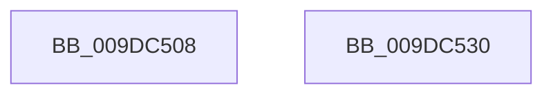

# sub_009DC508

- RVA: `0x009DC508`–`0x009DC531` (길이 `41` bytes)
- VA: `0x00000001409DC508`
- 실행 섹션: `PAGE`
- PDB 이름 있음: `아니요`; PDB Function 태그: `아니요`
- unwind 정보 RVA: `0x000A36CC`
- 디코드: `12`개 명령, `41/41` bytes 표시
- 미해석 바이트: `0` (있으면 어셈블리에 `.byte`로 보존)

> 이 문서는 커널 이미지의 기계어와 PDB 기호를 분석해 생성했습니다. 4번과 5번은 함수 원형과 자료형을 바이너리 사용 방식에서 추정한 C 해석이며 원본 소스 복구 결과는 아닙니다.

## 1. Dependencies

- 직접 호출 지점: **3**; 고유 호출 대상: **3**
- 직접 호출자로 확인된 함수: **0**
- RIP 상대 이미지 참조: **0**

### Outgoing calls
- `0x009DC508` → [CmSiFreeMemory](../../text/47/CmSiFreeMemory_function_00475D80.md) (function, `0x00475D80`)
- `0x009DC511` → [CmCleanupThreadInfo](../../text/41/CmCleanupThreadInfo_function_0041FD50.md) (function, `0x0041FD50`)
- `0x009DC520` → [_security_check_cookie](../../text/6A/_security_check_cookie_function_006AC640.md) (function, `0x006AC640`)

### Direct callers
- 이 함수 시작 RVA로 연결되는 직접 call은 확인되지 않았습니다. 간접 호출은 완전히 역산할 수 없습니다.

### Static image references
- 디코드된 RIP-relative 메모리 참조가 없습니다.

## 2. Other-region calls and transfers

- 다른 실행 섹션으로 향하는 call: **3**
  - `0x009DC508` → [CmSiFreeMemory](../../text/47/CmSiFreeMemory_function_00475D80.md) (`PAGE` → `.text`)
  - `0x009DC511` → [CmCleanupThreadInfo](../../text/41/CmCleanupThreadInfo_function_0041FD50.md) (`PAGE` → `.text`)
  - `0x009DC520` → [_security_check_cookie](../../text/6A/_security_check_cookie_function_006AC640.md) (`PAGE` → `.text`)
- 별도 외부 분기/꼬리 이동을 확인하지 못했습니다.

## 3. Assembly (complete function range)

```asm
009DC508  E8 73 98 A9 FF                  call 0x140475d80
009DC50D  48 8D 4D CF                     lea rcx, [rbp - 0x31]
009DC511  E8 3A 38 A4 FF                  call 0x14041fd50
009DC516  41 8B C6                        mov eax, r14d
009DC519  48 8B 4D 17                     mov rcx, qword ptr [rbp + 0x17]
009DC51D  48 33 CC                        xor rcx, rsp
009DC520  E8 1B 01 CD FF                  call 0x1406ac640
009DC525  48 81 C4 C8 00 00 00            add rsp, 0xc8
009DC52C  41 5E                           pop r14
009DC52E  5D                              pop rbp
009DC52F  C3                              ret
009DC530  CC                              int3
```

## 4. C-style interpretation (structured pseudocode)

```c
__int64 __fastcall sub_009DC508(void)
{
    __int64 result;
    __int64 v_rsp;

    result = CmSiFreeMemory(a1, a2, a3, a4);
    result = CmCleanupThreadInfo(v_rbp - 49, a2, a3, a4);
    a1 = (*(unsigned __int64 *)(v_rbp + 23)) ^ (v_rsp);
    result = _security_check_cookie(a1, a2, a3, a4);
    v_rsp = (v_rsp) + (200);
    return result;
}
```

## 5. (Beta) C Style

```c
void sub_009DC508(void)
{
    int64_t result;
    int64_t local_rsp;

    result = CmSiFreeMemory(a1, a2, a3, a4);
    result = CmCleanupThreadInfo(local_rbp - 49, a2, a3, a4);
    a1 = (*(uint64_t *)(local_rbp + 0x17)) ^ (local_rsp);
    result = _security_check_cookie(a1, a2, a3, a4);
    local_rsp = (local_rsp) + (200);
    return result;
}
```

## 6. Execution-region graph

[열기: 2D/3D 그래프와 함수 탐색 컨트롤 패널](../../../control-panel.html?section=page&rva=0x009DC508&view=graph)

- 2D 그래프는 위에서 아래로 흐르고, 3D 그래프는 빈 공간을 드래그해 회전합니다. Shift+드래그는 이동, 휠은 확대·축소, 함수 노드 선택은 대상 보고서 이동입니다.

### Static fallback


