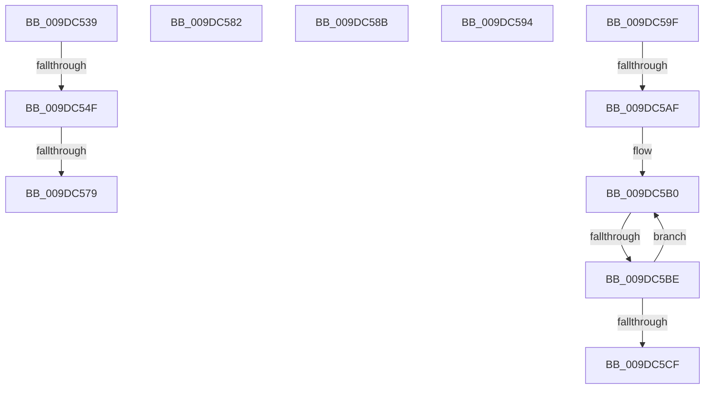

# sub_009DC539

- RVA: `0x009DC539`–`0x009DC5D4` (길이 `155` bytes)
- VA: `0x00000001409DC539`
- 실행 섹션: `PAGE`
- PDB 이름 있음: `아니요`; PDB Function 태그: `아니요`
- unwind 정보 RVA: `0x000A3704`
- 디코드: `37`개 명령, `155/155` bytes 표시
- 미해석 바이트: `0` (있으면 어셈블리에 `.byte`로 보존)

> 이 문서는 커널 이미지의 기계어와 PDB 기호를 분석해 생성했습니다. 4번과 5번은 함수 원형과 자료형을 바이너리 사용 방식에서 추정한 C 해석이며 원본 소스 복구 결과는 아닙니다.

## 1. Dependencies

- 직접 호출 지점: **1**; 고유 호출 대상: **1**
- 직접 호출자로 확인된 함수: **0**
- RIP 상대 이미지 참조: **0**

### Outgoing calls
- `0x009DC540` → [CmpConstructNameWithStatus](../85/CmpConstructNameWithStatus_function_008562A0.md) (function, `0x008562A0`)

### Direct callers
- 이 함수 시작 RVA로 연결되는 직접 call은 확인되지 않았습니다. 간접 호출은 완전히 역산할 수 없습니다.

### Static image references
- 디코드된 RIP-relative 메모리 참조가 없습니다.

## 2. Other-region calls and transfers

- 다른 실행 섹션으로 향하는 call: **0**
- call이 아닌 외부 분기/꼬리 이동: **9**
  - `0x009DC549` → [sub_009DC3C2 + 0x9E](Unknown_function_009DC3C2.md) (`tail-transfer`)
  - `0x009DC573` → [sub_009DC3C2 + 0x99](Unknown_function_009DC3C2.md) (`tail-transfer`)
  - `0x009DC57D` → [sub_009DC3C2 + 0x99](Unknown_function_009DC3C2.md) (`tail-transfer`)
  - `0x009DC586` → [sub_009DC3C2 + 0xEB](Unknown_function_009DC3C2.md) (`tail-transfer`)
  - `0x009DC58F` → [sub_009DC3C2 + 0x5B](Unknown_function_009DC3C2.md) (`tail-transfer`)
  - `0x009DC59A` → [sub_009DC3C2 + 0xBE](Unknown_function_009DC3C2.md) (`tail-transfer`)
  - `0x009DC5A9` → [sub_009DC3C2 + 0x2B](Unknown_function_009DC3C2.md) (`tail-transfer`)
  - `0x009DC5BC` → [sub_009DC609 + 0xF](Unknown_function_009DC609.md) (`tail-transfer`)
  - `0x009DC5CF` → [sub_009DC3C2 + 0x27](Unknown_function_009DC3C2.md) (`tail-transfer`)

## 3. Assembly (complete function range)

```asm
009DC539  48 8D 55 A7                     lea rdx, [rbp - 0x59]
009DC53D  49 8B CF                        mov rcx, r15
009DC540  E8 5B 9D E7 FF                  call 0x1408562a0
009DC545  8B F8                           mov edi, eax
009DC547  85 C0                           test eax, eax
009DC549  0F 88 11 FF FF FF               js 0x1409dc460
009DC54F  48 8B 4D A7                     mov rcx, qword ptr [rbp - 0x59]
009DC553  33 C0                           xor eax, eax
009DC555  F0 49 0F B1 8F 28 01 00 00      lock cmpxchg qword ptr [r15 + 0x128], rcx
009DC55E  48 8B 4D A7                     mov rcx, qword ptr [rbp - 0x59]
009DC562  49 8B 87 28 01 00 00            mov rax, qword ptr [r15 + 0x128]
009DC569  48 0F 44 CB                     cmove rcx, rbx
009DC56D  48 89 4D A7                     mov qword ptr [rbp - 0x59], rcx
009DC571  A8 01                           test al, 1
009DC573  0F 84 E2 FE FF FF               je 0x1409dc45b
009DC579  48 83 E0 FE                     and rax, 0xfffffffffffffffe
009DC57D  E9 D9 FE FF FF                  jmp 0x1409dc45b
009DC582  4A 8D 0C 3F                     lea rcx, [rdi + r15]
009DC586  E9 22 FF FF FF                  jmp 0x1409dc4ad
009DC58B  4B 8D 0C 37                     lea rcx, [r15 + r14]
009DC58F  E9 89 FE FF FF                  jmp 0x1409dc41d
009DC594  41 BE 9A 00 00 C0               mov r14d, 0xc000009a
009DC59A  E9 E1 FE FF FF                  jmp 0x1409dc480
009DC59F  49 8B 8F C0 00 00 00            mov rcx, qword ptr [r15 + 0xc0]
009DC5A6  48 85 C9                        test rcx, rcx
009DC5A9  0F 84 3E FE FF FF               je 0x1409dc3ed
009DC5AF  90                              nop
009DC5B0  48 8B 51 10                     mov rdx, qword ptr [rcx + 0x10]
009DC5B4  4C 0F BF C6                     movsx r8, si
009DC5B8  66 83 FE 02                     cmp si, 2
009DC5BC  7D 5A                           jge 0x1409dc618
009DC5BE  4A 89 54 C5 B7                  mov qword ptr [rbp + r8*8 - 0x49], rdx
009DC5C3  48 8B 49 18                     mov rcx, qword ptr [rcx + 0x18]
009DC5C7  66 FF CE                        dec si
009DC5CA  48 85 C9                        test rcx, rcx
009DC5CD  75 E1                           jne 0x1409dc5b0
009DC5CF  E9 15 FE FF FF                  jmp 0x1409dc3e9
```

## 4. C-style interpretation (structured pseudocode)

```c
__int64 __fastcall sub_009DC539(void)
{
    __int64 result;

    result = CmpConstructNameWithStatus(v_r15, v_rbp - 89, a3, a4);
    result = 0;
    a1 = *(unsigned __int64 *)(v_rbp - 89);
    if (condition_is_equal) { a1 = v_rbx; }
    *(unsigned __int64 *)(v_rbp - 89) = a1;
    result = (*(unsigned __int64 *)(v_r15 + 296)) & (-2);
}
```

## 5. (Beta) C Style

```c
void sub_009DC539(void)
{
    int64_t result;

    result = CmpConstructNameWithStatus(local_r15, local_rbp - 89, a3, a4);
    result = 0;
    a1 = *(uint64_t *)(local_rbp - 0x59);
    if (condition_is_equal) { a1 = local_rbx; }
    *(uint64_t *)(local_rbp - 0x59) = a1;
    result = (*(uint64_t *)(local_r15 + 0x128)) & (-2);
}
```

## 6. Execution-region graph

[열기: 2D/3D 그래프와 함수 탐색 컨트롤 패널](../../../control-panel.html?section=page&rva=0x009DC539&view=graph)

- 2D 그래프는 위에서 아래로 흐르고, 3D 그래프는 빈 공간을 드래그해 회전합니다. Shift+드래그는 이동, 휠은 확대·축소, 함수 노드 선택은 대상 보고서 이동입니다.

### Static fallback


