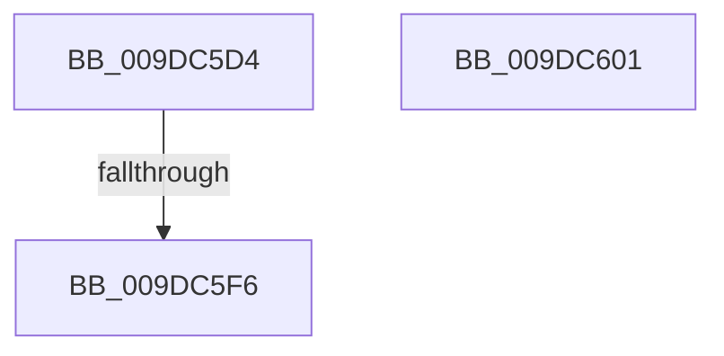

# sub_009DC5D4

- RVA: `0x009DC5D4`–`0x009DC609` (길이 `53` bytes)
- VA: `0x00000001409DC5D4`
- 실행 섹션: `PAGE`
- PDB 이름 있음: `아니요`; PDB Function 태그: `아니요`
- unwind 정보 RVA: `0x000A372C`
- 디코드: `12`개 명령, `53/53` bytes 표시
- 미해석 바이트: `0` (있으면 어셈블리에 `.byte`로 보존)

> 이 문서는 커널 이미지의 기계어와 PDB 기호를 분석해 생성했습니다. 4번과 5번은 함수 원형과 자료형을 바이너리 사용 방식에서 추정한 C 해석이며 원본 소스 복구 결과는 아닙니다.

## 1. Dependencies

- 직접 호출 지점: **1**; 고유 호출 대상: **1**
- 직접 호출자로 확인된 함수: **0**
- RIP 상대 이미지 참조: **0**

### Outgoing calls
- `0x009DC5E5` → [CmpAllocatePool](../../text/3C/CmpAllocatePool_function_003CD504.md) (function, `0x003CD504`)

### Direct callers
- 이 함수 시작 RVA로 연결되는 직접 call은 확인되지 않았습니다. 간접 호출은 완전히 역산할 수 없습니다.

### Static image references
- 디코드된 RIP-relative 메모리 참조가 없습니다.

## 2. Other-region calls and transfers

- 다른 실행 섹션으로 향하는 call: **1**
  - `0x009DC5E5` → [CmpAllocatePool](../../text/3C/CmpAllocatePool_function_003CD504.md) (`PAGE` → `.text`)
- call이 아닌 외부 분기/꼬리 이동: **3**
  - `0x009DC5F0` → [sub_009DC3C2](Unknown_function_009DC3C2.md) (`tail-transfer`)
  - `0x009DC5FC` → [sub_009DC4C9](Unknown_function_009DC4C9.md) (`tail-transfer`)
  - `0x009DC604` → [sub_009DC4C9 + 0xE](Unknown_function_009DC4C9.md) (`tail-transfer`)

## 3. Assembly (complete function range)

```asm
009DC5D4  8B D0                           mov edx, eax
009DC5D6  B9 00 01 00 00                  mov ecx, 0x100
009DC5DB  48 C1 E2 03                     shl rdx, 3
009DC5DF  41 B8 43 4D 36 35               mov r8d, 0x35364d43
009DC5E5  E8 1A 0F 9F FF                  call 0x1403cd504
009DC5EA  48 8B C8                        mov rcx, rax
009DC5ED  48 85 C0                        test rax, rax
009DC5F0  0F 85 CC FD FF FF               jne 0x1409dc3c2
009DC5F6  41 BE 9A 00 00 C0               mov r14d, 0xc000009a
009DC5FC  E9 C8 FE FF FF                  jmp 0x1409dc4c9
009DC601  44 8B F3                        mov r14d, ebx
009DC604  E9 CE FE FF FF                  jmp 0x1409dc4d7
```

## 4. C-style interpretation (structured pseudocode)

```c
__int64 __fastcall sub_009DC5D4(void)
{
    __int64 result;

    a2 = ((unsigned int)((unsigned int)(result))) << (3);
    result = CmpAllocatePool(256, a2, (unsigned int)(0x35364D43ULL), a4);
}
```

## 5. (Beta) C Style

```c
void sub_009DC5D4(void)
{
    int64_t result;

    a2 = ((uint32_t)((uint32_t)(result))) << (3);
    result = CmpAllocatePool(256, a2, (uint32_t)(0x35364D43ULL), a4);
}
```

## 6. Execution-region graph

[열기: 2D/3D 그래프와 함수 탐색 컨트롤 패널](../../../control-panel.html?section=page&rva=0x009DC5D4&view=graph)

- 2D 그래프는 위에서 아래로 흐르고, 3D 그래프는 빈 공간을 드래그해 회전합니다. Shift+드래그는 이동, 휠은 확대·축소, 함수 노드 선택은 대상 보고서 이동입니다.

### Static fallback


